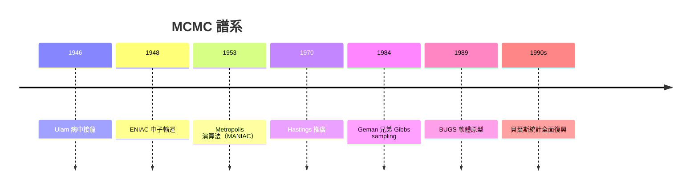

# 08.2 馬爾可夫鏈蒙地卡羅（MCMC, 1953）

## Ulam 病榻上的紙牌

1946 年冬天，波蘭裔數學家 Stanisław Ulam 因病毒性腦炎住院，躺在洛杉磯的病床上玩接龍。他好奇：一副 52 張牌，接龍成功究竟能否算出機率？組合計數不可能窮舉，但他靈光一閃——不如玩一百局，數數成功幾次。這個「用大量隨機試驗估計期望值」的念頭，在康復後被帶回 Los Alamos 國家實驗室，與 John von Neumann 討論後，成為處理中子輸運問題的方法。Nicholas Metropolis 建議以摩納哥的賭城蒙地卡羅（Monaco 的 Monte Carlo）命名，既呼應 Uranium 的賭性，也帶著戰後原子科學家的黑色幽默。

## ENIAC 與氫彈：第一次蒙地卡羅

1948 年起，這支團隊在 ENIAC 上完成了第一批蒙地卡羅計算，模擬中子在裂變材料中的行為，直接服務於氫彈計畫。這是國家軍事需求驅動計算數學的典型場景：電腦、中子物理與統計抽樣在同一間機房相遇。

## 1953 年：Metropolis 演算法

真正的方法論突破出現在 1953 年。Metropolis、Rosenbluth 夫婦、Teller 與 Teller 夫人發表〈Equation of State Calculations by Fast Computing Machines〉，在 MANIAC 電腦上模擬流體狀態方程。他們的演算法構造一條馬爾可夫鏈：隨機提議新狀態，若能量更低就接受，若更高則按 $e^{-\Delta E/kT}$ 的機率接受。關鍵洞見是——鏈的平穩分布可以任意指定，這使「按照目標分布 $\pi(x)$ 取樣」成為一種通用計算技術。文中署名的七人，恰好橫跨數學、物理與後來的政治（Edward Teller 是「氫彈之父」）。

1970 年，加拿大統計學家 W. K. Hastings 將其推廣為一般化的 Metropolis-Hastings 演算法，允許不對稱的提議分布，並首次把蒙地卡羅帶進統計推論的語境。1984 年，Geman 兄弟（Donald 與 Stuart）提出 Gibbs sampling，在影像處理的 MAP 估計中逐一條件取樣；後經 Gelfand 與 Smith 1990 年的論文推廣，Gibbs sampling 成為統計學界的標準引擎。

## 貝葉斯學派的復興

二十世紀前半，統計學被頻率學派主導，Fisher、Neyman 對貝葉斯方法多所貶抑，原因之一很實際：後驗分布 $p(\theta\mid x)\propto p(x\mid\theta)p(\theta)$ 通常積不出來。MCMC 改變了遊戲規則——不必解析積分，只要能逐點算出未正規化的後驗，就能取樣。1989 年起，英國的 BUGS 軟體（Bayesian inference Using Gibbs Sampling）讓非數學背景的應用者也能跑貝葉斯模型，流行病學、生態學、社會科學紛紛轉向。這場「貝葉斯復興」既是思想鬥爭（先驗機率是否主觀）的勝利，更是計算基礎建設的勝利。

## 從氫彈到醫院

今天的 MCMC 無所不在：HMC（Hamiltonian Monte Carlo）與其 No-U-Turn 變體支撐了 Stan 與 PyMC；系統發生學用 MCMC 重建演化樹；流行病學用它估計疫苗效力；甚至大語言模型的訓練資料分析也借用其思想。從 Ulam 病床上的一副紙牌，到全球科學家的推論引擎，蒙地卡羅見證了一件事：最深刻的科學工具，往往來自最不經意的遊戲。

## 小結

MCMC 的歷史以軍事需求為起點（氫彈），以統計學革命為終點（貝葉斯復興）。它證明了馬爾可夫鏈的極限理論——1906 年 Markov 本人的工作——能在電腦時代長出全新的果實。
