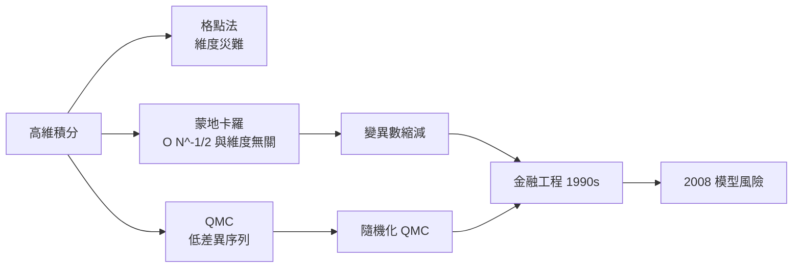

# 08.3 高維積分與維度災難的突破

## Bellman 的命名軼事

1950 年代，Richard Bellman 在 RAND 公司為美國空軍研究多階段決策問題，發展出動態規劃。他在自傳《Eye of the Hurricane》（1984）中回憶「維度災難」（curse of dimensionality）一詞的由來：當年空軍資助研究，而空軍的興趣「僅在於飛行」，Bellman 便挑了個聽起來華麗又足以讓資助者摸不著頭腦的名字，掩護理論研究的本質。這個半開玩笑的命名，精準描述了一個殘酷事實：格點法的計算量隨維度指數成長——在 $d$ 維每軸取 $m$ 個點，就要 $m^d$ 次函數求值，$d=100$ 時宇宙的原子數都不夠用。

## 蒙地卡羅誤差：與維度無關的奇蹟

對照組是蒙地卡羅。設 $I = \int f(x)\,dx$，用 $N$ 個隨機樣本估計，誤差量級為

$$\text{誤差} \sim \frac{\sigma}{\sqrt{N}},$$

值得注意的是：其中沒有 $d$。積分維度再高，誤差的收斂速率不變，只是常數 $\sigma$ 會變。以 $O(N^{-1/2})$ 換 $O(N^{-k/d})$，這是高維積分唯一的出路。1953 年 Metropolis 演算法之後，數學家開始系統性研究：誤差率雖與維度無關，卻慢得讓人難耐——能不能用「更整齊」的點，做得比隨機更好？

## 準蒙地卡羅與蘇聯學派

答案是準蒙地卡羅（QMC）：不放棄確定性，改用低差異序列（low-discrepancy sequences），讓樣本點均勻得像把奶油抹平，而非隨機濺灑。Koksma-Hlawka 不等式給出保證：誤差受函數的變異量乘上序列差異度 $D_N$ 控制，而 Sobol 序列（蘇聯數學家 Ilya Sobol 於 1967 年提出）、Niederreiter 序列可使 $D_N \sim (\log N)^d / N$，遠優於隨機的 $N^{-1/2}$。代價是那個 $(\log N)^d$——在高維仍需隨機化（如 randomized QMC）來兼顧理論與穩健性。

## 華爾街的黃金年代

1990 年代，衍生性金融商品爆炸成長，選擇權定價本質上是高維積分：路徑相依選項的每一個時間步都是一個維度。QMC 因此從學術期刊躍上交易大廳，成為定價 CDO、可轉債與利率商品的標準工具，拉丁超立方取樣（McKay 等人 1979 年提出）也被大量用於風險情境模擬。數學博士湧入華爾街，量化分析師（quant）成為高薪代名詞——Long-Term Capital Management 是這個時代最戲劇性的註腳：兩位諾貝爾經濟學獎得主（Merton 與 Scholes）坐鎮的基金，1998 年在俄羅斯違約的黑天鵝中崩潰，逼得聯準會出面召集十四家銀行紓困。

## 2008 年與模型風險

十年後的金融危機把教訓寫得更重。CDO 定價模型（如高斯 copula）在常態市場中校準優雅，危機來臨時相關性結構整體崩解——模型的輸入是歷史資料，而未來不一定重演歷史。高斯 copula 的發明人 David Li 從此從學界與業界的寵兒變成爭議人物，媒體以「摧毀華爾街的公式」稱之（雖然因果被誇大）。金融監管因此全面引入模型風險管理：模型要有獨立驗證、壓力測試與假設揭露，Basel III 對內部模型的資本要求大幅收緊。

## 變異數縮減的工具箱

實務上，蒙地卡羅的效率爭奪戰在常數 $\sigma$ 上：

- 對偶變數：取 $f(x)$ 與 $f(-x)$ 平均，抵消一階偏差。
- 控制變數：用已知期望值的相近函數校正。
- 分層取樣與拉丁超立方：強迫樣本覆蓋每個區間，不讓運氣留下空隙。
- 重要性抽樣：把機率質量搬到「重要」的區域，極端事件模擬（如破產機率）的命脈。

## 小結

維度災難逼出了蒙地卡羅，蒙地卡羅的收斂率逼出了 QMC 與變異數縮減，而它們在華爾街的勝利與 2008 年的挫敗，提醒每個計算數學家：收斂定理只對模型負責，不對現實負責。
