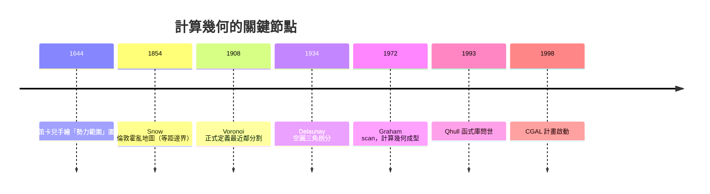

# 凸包、Delaunay 三角剖分與 Voronoi 圖

## 從笛卡兒的宇宙直覺說起

1644 年，笛卡兒在《哲學原理》中試圖解釋太陽系行星的排列。他畫了一張圖，把太陽周圍的空間劃分成許多區域，每顆行星占據一塊「勢力範圍」，區域之間以直線相隔。這張手繪的示意圖，就是 Voronoi 圖最早的視覺雛形——比這個數學物件的正式定義早了兩百多年。笛卡兒當然沒有證明任何定理，但他的宇宙論直覺捕捉到一個深刻的幾何事實：一堆「點」散布在空間中時，最自然的空間分割方式就是按照「離誰最近」來劃界。

真正把這個概念數學化的是俄國數學家 Georgy Voronoi。1908 年，他在烏克蘭出生、留學華沙的背景下發表了關於二次型的研究，其中系統地定義了平面上點集的最近鄰區域劃分。這種結構後來被命名為 Voronoi 圖（在蘇聯文獻中也稱 Dirichlet 鑲嵌，因為 Dirichlet 1850 年已在二次型研究中用過類似構造）。Voronoi 的工作純粹是數論與凸幾何的產物，他本人絕想不到，這個構造日後會成為從氣象學到行動通訊的通用工具。

## 雪與霍亂：一張地圖的歷史真相

談「最近鄰」與空間分析，不能不提流行病學史上最著名的案例：1854 年倫敦蘇活區的霍亂爆發。醫生 John Snow 在地圖上標出死者位置，發現病例集中在寬街（Broad Street）的水泵附近，於是說服當局拆掉水泵把手，疫情隨之消退。這段故事長期被講成「空間流行病學與地理分析的勝利」。

但歷史真相更有趣也更複雜。後世學者（包括Edward Tufte 的著名分析）指出：Snow 的地圖本身並未直接「證明」水泵是感染源——死亡人數與水泵的距離關係並不是他推理的核心。Snow 的關鍵論據其實是：以寬街水泵為中心畫一條「等距邊界」，邊界內的居民到寬街泵取水比到其他泵更近——這正是一個手繪的 Voronoi 圖！他發現死者幾乎都落在這個區域內，或生前確實飲用過該泵的水；而且附近釀酒廠的工人喝啤酒不喝水，所以沒人染病。也就是說，Snow 的真正貢獻不是統計相關，而是用「供水服務範圍的幾何劃分」把病因鎖定到一個具體的水源。這是 Voronoi 思想在公共衛生史上的一次英雄式應用——儘管當時沒人這樣稱呼它。這個案例也提醒我們：歷史敘事常被簡化，但還原細節後，數學工具的角色反而更精彩。

## Delaunay 三角剖分

Voronoi 圖有個對偶：把相鄰 Voronoi 區域的「種子點」連起來，得到一個三角剖分。1934 年，Voronoi 的學生 Boris Delaunay（也是著名的國際象棋大師）發表論文，系統研究了這種三角剖分。它的關鍵性質是「空圓準則」：任何三角形的外接圓內部不含其他點。這使得 Delaunay 三角剖分能最大化三角形的最小角，避免又長又扁的「劣質三角形」——這正是後來有限元素網格生成夢寐以求的品質。

Delaunay 的論文當時只是純數學文獻。要到 1970 年代電腦圖形與工程模擬興起，這套理論才被「重新發現」為實用演算法的基礎。

## 演算法時代：Graham scan 與 quickhull

Delaunay 三角剖分與 Voronoi 圖的構造都繞不開凸包（convex hull）問題。1972 年，Ronald Graham 在貝爾實驗室發表了 Graham scan 演算法，用「極角排序 + 堆疊掃描」把平面凸包計算降到 $O(n \log n)$，成為計算幾何作為一門學科誕生的標誌性論文之一。這件事的時代背景是：冷戰期間美國軍方與航太產業大量投入計算資源，洛克希德等公司早在 1960 年代就為風洞實驗發展過凸包的實作，Graham 的貢獻是把問題理論化並證明最優複雜度。

1990 年代出現的 quickhull 演算法借鑑了快速排序的分治思想，平均表現極佳，成為實務上的標準選擇。Qhull 函式庫（1993 年起）隨後被 MATLAB、R、NumPy 等科學計算環境內建——今天你在 Python 裡呼叫 `scipy.spatial.Voronoi`，底層就是 quickhull。

## CGAL 與歐盟的制度性投資

1996 年前後，歐洲的幾何計算社群意識到一件事：演算法論文寫得再多，如果沒有高品質、可維護的程式庫，理論就進不了工業。於是在歐盟資助框架（GALIA 及後續多期 EU 專案）支持下，CGAL（Computational Geometry Algorithms Library）計畫於 1998 年正式啟動，由 ETH Zürich、INRIA、MPI 資訊學研究所等機構合作維護，以 C++ 模板撰寫，提供精確算術保證（利用 exact predicates 避免浮點誤差導致的拓撲崩壞）。

這是一個值得注意的制度故事：歐盟把「計算幾何軟體基礎建設」當成戰略投資，因為幾何演算法在 CAD、GIS、晶片設計上無處不在，而美國當時的重點偏理論。CGAL 採開源授權（後改為 GPL/LGPL 混合、並允許商業授權），既保護學術開放又養活了商業服務。今天 CGAL 是 3D 重建、網格生成、地形分析的幕後支柱。

## 應用的百花齊放

Voronoi 圖與 Delaunay 剖分如今滲透到許多產業：

- 遊戲與電腦圖學：程序化地形生成、植被與城市分布常用 Voronoi 鑲嵌營造自然感；碰撞檢測與路徑規劃利用 Delaunay 圖的局部性。
- 3D 列印：切片前需要把 CAD 模型轉成封閉三角網格並修補破洞，Delaunay 式的網格重建（如 Poisson 重建）是標準流程；列印支撐結構與內部輕量化點陣設計也常用 Voronoi 單元。
- 通訊與物流：基地台覆蓋規劃本質上就是 Voronoi 劃分。
- 天文與材料科學：宇宙大尺度結構、晶粒分析都用它描述「每個點的領地」。

從笛卡兒的想像到 Snow 的粉筆線，再到 GPU 上每秒百萬次的三角剖分，這段歷史展示了一種典型的數學命運：一個源於宇宙論與純數論的抽象結構，經過流行病學家的實地洞察、俄國數學家的嚴格定義、貝爾實驗室的演算法工程、以及歐盟的軟體基礎建設，最終成為數位世界的基礎設施。抽象幾何從不「無用」，它只是還沒等到它的產業。
