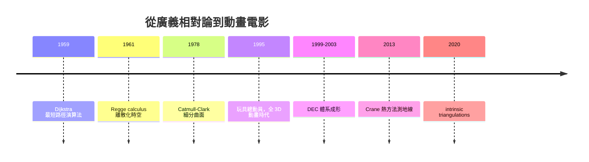

# 離散微分幾何與網格處理

## 微積分遇上三角形

連續世界的微積分已有三百年歷史，但電腦只能處理離散資料。當我們把曲面表示成三角網格——幾十萬個頂點與三角形——「導數」「梯度」「拉普拉斯算子」這些概念該如何定義？離散微分幾何（Discrete Differential Geometry, DDG）正是回答這個問題的學科：它不只把連續公式「亂凑離散化」，而是要求離散結構精確保持連續理論的關鍵性質（對稱性、守恆律、拓撲不變量）。

DDG 的思想源頭之一可以追溯到 1961 年：物理學家 Tullio Regge 為了把廣義相對論離散化，提出用單純複形（三角形四面體拼成的空間）來表示彎曲時空，曲率集中在稜邊上，以「虧損角」度量。Regge calculus 證明了一件事：幾何的核心資訊可以在完全離散的物件上存活。這個來自量子重力研究的想法，六十年後成為處理電腦圖形網格的思想基石。

## 外微積分的離散化：DEC

連續微分幾何的現代語言是外微分形式：微分、積分、Stokes 定理都寫在同一個框架裡。1990 年代末到 2000 年代初，數學家與計算機科學家（如 Mathieu Desbrun、Anil Hirani、Melvin Leok、Jerrold Marsden）發展了離散外微積分（Discrete Exterior Calculus, DEC）：把 $k$-形式放在 $k$ 維單純形上，外微分對應組合拓撲中的邊界算子 $\partial$，而 $\partial^2 = 0$ 這個恆等式在離散世界精確成立。這使得離散化的 Maxwell 方程組自動保持電荷守恆、離散化的流體模擬自動保持渦度結構——性質是「設計進去的」，不是「近似出來的」。

DEC 體現了 DDG 的哲學：先問「連續理論中哪些結構是不可妥協的」，再找離散物件上精確滿足這些結構的替身。

## Keenan Crane 與 CMU 學派

卡內基美隆大學的 Keenan Crane 是當代 DDG 最具影響力的人物之一。他本科學的是電腦科學與數學，博士論文（Caltech，2013）研究數位幾何處理中的共形幾何，此後把古典微分幾何（共形映射、葉狀結構、平均曲率流）轉譯成可計算的離散演算法。他的代表作包括：把曲面參數化統一成一個線性方程組的框架、用「反切距離」思想做的內在測地線演算法、以及 2020 年前後與合作者提出的「intrinsic triangulations」——不把網格視為埋在 3D 空間的浮點座標，而視為純粹內在的組合幾何物件，大幅提升了數值穩健性。

Crane 也以教學聞名：他在 CMU 的「Discrete Differential Geometry」課程講義與《Discrete Differential Geometry: An Applied Introduction》教材，把這門過去艱深的主題變成大學生可上手的課，搭配開源函式庫 geometry-central 與 libigl 生態系，讓研究代碼可重現。這是「教科書 + 開源碼」新模式對學科擴散的巨大加速。

## 網格處理的三大日常：平滑、參數化、最短路徑

網格平滑化（denoising）要區分「雜訊」與「特徵」。經典方法用離散拉普拉斯算子迭代平均——而離散 Laplace-Beltrami 算子的權重選擇（uniform、cotangent weights）正是 DDG 的基本課題。平滑過度會抹掉銳邊，於是有各種保持特徵的變體，其理論依據都來自譜幾何：拉普拉斯特徵函數決定震盪模式，低頻是整體形狀、高頻是細節。

參數化是把 3D 曲面攤平成 2D 平面，用於紋理貼圖與材質繪製。除非曲面可展（高斯曲率為零），攤平必有失真；DDG 的貢獻是精確刻畫可達成的折衷——共形映射保角、等距映射保長、兩者不可兼得（除非可展）。遊戲產業每天產生數百萬張貼圖，全靠這些演算法背後的理論保證。

最短路徑則是組合與幾何的交會。1959 年 Edsger Dijkstra 發表的圖上最短路徑演算法，是每個資工學生的必修；但在網格曲面上，真正的測地線不是沿著邊走——Mitchell-Mount-Papadimitriou 1987 的「exact geodesics」演算法把波前展開在三角形內部，之後 Crane 與合作者的「熱方法」（heat method, 2013）用一個拋物型 PDE 的離散解就得到全曲面測地距離，簡潔到可以寫成幾行程式碼，且對網格品質極為穩健。Dijkstra 的圖論觀點與熱方法的微分方程觀點，正好是離散與連續兩種世界觀的互補。

## 動畫電影工業：皮克斯的美學經濟

DDG 最重要的應用場景是動畫電影。1995 年《玩具總動員》證明全 3D 動畫長片可行，背後是皮克斯的 RenderMan 渲染器——這項技術多次獲得美國電影藝術與科學學院的科學與工程獎，2023 年 RenderMan 團隊更獲頒科技成就獎，並有四位皮克斯工程師因此入選計算機歷史。而讓有機形體（皮膚、葉子、恐龍）看起來平滑的秘密武器是細分曲面。

Edwin Catmull（後來的皮克斯與迪士尼動畫工作室總裁）與 Jim Clark（後來的 SGI 與 Netscape 創辦人）在 1978 年提出 Catmull-Clark 細分曲面的理論研究論文，但在當年電腦太慢，實用化要等到 1990 年代末。皮克斯的 Tony DeRose 團隊把細分曲面工程化並推廣到電影業，1998 年的《蟲蟲危機》與 Geri's Game 短片正式採用，從此細分曲面成為好萊塢角色建模的業界標準。有趣的是，細分曲面的數學分析（極限曲面、奇異點處的連續性）需要譜理論與次諧波分析，反過來餵養了 DDG：網格上的離散算子性質決定極限曲面品質，這是「應用拉動理論」的典範。

經濟面來看，動畫產業的競爭已從「能不能做出 3D」變成「能不能又快又美」：迪士尼收購皮克斯（2006）後，Catmull 出任迪士尼動畫總裁，把皮克斯的技術文化注入百年動畫帝國；每一部片的渲染成本以千萬美元計，一個更穩定的網格演算法或更快的參數化，就直接換算成製作週期與預算。學術會議 SIGGRAPH 因此成為學界與業界高度混融的特殊場域——數學家在台上講外微分，台下坐著動畫師。

## 結語：離散與連續的和解

離散微分幾何教會我們：連續與離散不是「精確與近似的關係」，而是兩個可以精確互譯的世界。Regge 為了重力場掰彎三角形，Catmull 為了電影把曲面越切越細，Crane 為了教學把理論寫成講義——數學、物理與娛樂產業在同一個三角網格上相遇。當你看到動畫角色皮膚的細微皺褶時，那其實是外微分形式在畫面上的樣子。
