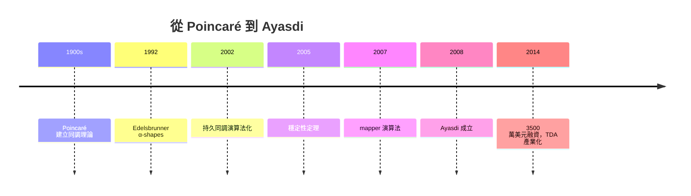

# 持久同調：用計算拓撲尋找數據中的洞

## 同調代數：六十年的沉睡資產

代數拓撲誕生於二十世紀初：Poincaré 為了研究天體力學發明了同調群，此後 Betti 數、上同調、譜序列成為純數學的核心語言。同調的基本想法極簡：計數「連通分量、環洞、空腔」這些維度不同的「洞」，並賦予代數不變量。但在整個二十世紀，這些工具主要用於數學內部——流形分類、代數幾何、表示論。從實用角度看，它們被視為最抽象、最無用的數學之一。

轉折發生在 1990 年代。Herbert Edelsbrunner（維也納出身、伊利諾大學任職後轉往杜克大學）在計算幾何領域已經以 α-shapes 聞名——1990 年代初他與同事提出的 α-shapes 用一個參數 $\alpha$ 控制滾球半徑，從點雲中「長出」形狀，是點雲重建的經典方法。Edelsbrunner 意識到：與其挑選某個固定的 $\alpha$，不如追蹤拓撲特徵（Betti 數）如何隨 $\alpha$ 變化——特徵「誕生」與「死亡」的區間，就是它的「持久度」。噪聲造成的洞壽命短，真實結構的洞壽命長。2000 年前後，Edelsbrunner、Letscher 與 Zomorodian 的論文（2002）以及 Carlsson、Zomorodian 的穩定性理論（2005 與 Cohen-Steiner、Harer 合作）把這個想法形式化為持久同調（persistent homology），並證明了穩定性定理：輸入數據的小擾動只會造成持久圖的小變動。這是讓拓撲方法能在有雜訊的真實數據上生存的數學保證——沒有穩定性，一切都只是美麗的玩具。

## Gunnar Carlsson 與 Stanford 學派

史丹佛大學的 Gunnar Carlsson 是把持久同調推向數據科學的關鍵人物。他出身正統代數拓撲（普林斯頓博士、拓撲學名家），2000 年前後開始與統計學家、計算機科學家合作，提出「拓撲數據分析」（Topological Data Analysis, TDA）的願景：數據的「形狀」攜帶傳統統計量（均值、變異數）遺漏的訊息——例如數據中有沒有環狀結構，往往對應著過程中的循環機制。

Carlsson 團隊另一重要發明是 mapper 演算法（2007，與 Singh、Maia 與生物學家合作）：用濾波函數把數據投影到低維，再用覆蓋與聚類構造一個圖狀的「形狀摘要」。mapper 最著名的實戰是在乳腺癌基因數據上的分析（2008 年前後與 Tanya Granowetz 等腫瘤學者合作），從基因表現數據的拓撲圖中發現乳腺癌可分成不同亞型，其中一亞型與高存活率相關——這項結果發表後成為 TDA 在生物醫學的招牌案例。

## Ayasdi：拓撲學家的創業故事

2008 年金融危機重創全球經濟，創投業進入寒冬，但正是這一年，Carlsson 與博士後 Harlan Sexton、Gurjeet Singh 在史丹佛附近創立了 Ayasdi（柴羅基語「尋找」之意），嘗試把 TDA 商業化。起初連創投都不確定「拓撲」能賣錢，但公司很快在銀行、醫療、政府領域找到客戶：用 mapper 圖幫銀行偵測洗錢的異常結構、幫醫院分析病患族群、幫情報機構分析資料。2014 年公司獲得 3500 萬美元 C 輪融資（Khosla Ventures、Kleiner Perkins 等頂級創投參與），2017 年累計融資超過一億美元，客戶包括花旗、Merck 等巨頭。

這段故事的制度性意義在於：一門被視為「最純」的數學（同調代數），在誕生約六十年後，透過穩定性定理、高效演算法（矩陣化約、cascading 演算法）與mapper 的視覺化威力，變成了 SaaS 產品與商業決策工具。美國政府也扮演推手：DARPA 與 NSF 的資助（如 Carlsson 長期獲 NSF 計畫支持、DARPA SIMPLEX 計畫投入可解釋 AI 與拓撲方法）讓基礎研究得以跨過「死亡之谷」。Ayasdi 後來在 2020 年代被併購整合，公司起落本身不影響一個事實：TDA 已經成為數據科學工具箱的一部分。

## 形狀分析與感測器網路

持久同調的應用版圖不斷擴張：

- 形狀分析：3D 模型檢索、分子結構比對（蛋白質口袋的持久景觀）。
- 感測器網路：2000 年代 de Silva 與 Carlsson 還在史丹佛時期的著名實驗顯示，僅憑感測器間的「近距/遠距」關係，拓撲方法可以重建環境的整體形狀——機器人覆蓋路徑與物聯網覆蓋空洞偵測（感測器網路中是否有未被監控的「洞」）成為經典問題。
- 深度學習：2017 年以降，拓撲損失（topological loss）被加入神經網路訓練，用於血管分割等需要保持連通結構的醫學影像任務。
- 動力系統與時間序列：滑窗嵌入（Takens 嵌入）+ 持久同調偵測週期性與混沌。

## 純數學的價值重估

持久同調的興起改變了數學界對「基礎研究」的論述。二十世紀中葉，同調代數被歸為最抽象的分支，Grothendieck 式的抽象化與應用沾不上邊；但 Carlsson、Edelsbrunner、Zomorodian 等人證明，抽象的代數結構一旦配上「濾過」這個自然想法與穩定性保證，就能對抗真實數據的雜訊。這也影響了學術制度的走向：美國多所大學設立了應用拓撲研究中心（如史丹佛的專案、杜克與俄亥俄州立的 TDA 群體），期刊《Journal of Applied and Computational Topology》於 2017 年創刊，NSF 設立專門的應用數學與數據科學計畫。

## 結語

持久同調的故事是「數學被重新發現」的另一個版本：不是公式變了，而是世界出現了新的問題（海量、高維、有雜訊的點雲）與新的工具（便宜算力、視覺化、開源軟體如 GUDHI、Ripser、scikit-tda）。當數據科學家在儀表板上看到一張 mapper 圖時，他看到的是 Poincaré 一百多年前發明、被冷落半世紀、再被創投點石成金的思想。純數學從不過時，它只是等待一個問題。
