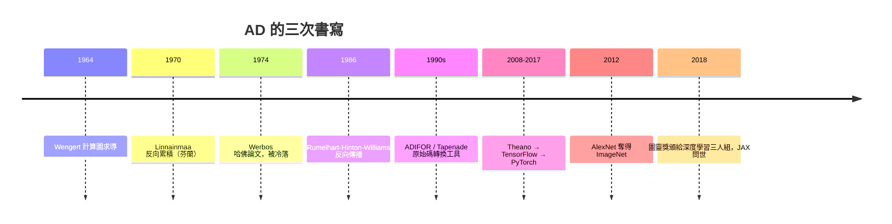

# 自動微分：前向模式與反向傳播的數學原理

## 一個被寫了三次的偉大想法

深度學習革命的引擎不是神經網路本身，而是一個更老的數學技術：自動微分（Automatic Differentiation, AD）。它解決的問題看似平凡——給定一個由基本運算組成的函數，如何精確計算它對每個參數的偏導數？有限差分有數值誤差，符號微分會遭遇表達式爆炸，而 AD 兩者皆免：它把微積分鏈鎖法則系統化地施加在計算圖上，得到與輸入精度相同的導數。

這個想法最早由紐約大學的 Robert Wengert 在 1964 年系統提出：把函數求值過程分解成基本運算序列（計算圖），每一步同時攜帶函數值與導數值。Wengert 的背景是核反應器與流體力學模擬——1960 年代美國原子能委員會（AEC）投入大量資金於數值模擬，對靈敏度分析（參數擾動對輸出的影響）有真實需求，這是冷戰科研經費孕育數學工具的另一例。

## 前向模式與對偶數

前向模式（forward mode）的思想可以用對偶數（dual numbers）優雅表達：定義 $a + b\varepsilon$，其中 $\varepsilon^2 = 0$。這與複數結構平行，運算規則自動實現鏈鎖法則：

$$(a + b\varepsilon)(c + d\varepsilon) = ac + (ad + bc)\varepsilon.$$

令 $\varepsilon$ 編碼擾動 $dx$，一次前向掃描就同時得到 $f(x)$ 與 $f'(x)$。前向模式的成本與「獨立變數個數」成正比：算 $f: \mathbb{R}^n \to \mathbb{R}^m$ 的全部偏導，需要 $n$ 次掃描。當 $n$ 小於 $m$（如模擬一個物理系統的幾個參數），前向模式極快。

## 反向模式：Linnainmaa、Werbos 與被冷落的論文

但當 $n$ 巨大（如神經網路的百萬參數）而輸出是單一損失值時，我們需要反向模式：一次反向掃描得到所有偏導數，成本與 $n$ 無關。

1970 年，芬蘭赫爾辛基大學的碩士生 Seppo Linnainmaa 在其碩士論文中發表了反向累積微分的方法——包括數值實作與浮點捨入誤差分析。這是「反向傳播作為 AD 演算法」的第一次完整描述。當時芬蘭是蘇聯邊境的中立小國，計算資源稀缺，這項工作在國際上幾乎無人聞問。

更戲劇性的是 Paul Werbos 的遭遇。1974 年他在哈佛的博士論文發展了動態系統靈敏度分析的統一框架，其中明確包含反向模式微分，並指出它可用於訓練神經網路。但當時正值神經網路的第一次寒冬：1969 年 Minsky 與 Papert 的《Perceptrons》一書論證單層感知機無法解決 XOR 問題，AI 界轉向符號主義，美國資助機構（DARPA 在 1970 年代初削減 AI 經費後又部分回補）對「神經元」路線興趣缺缺。Werbos 的洞見被埋沒——不是因為數學錯了，而是因為時代沒有需求。

1986 年，Rumelhart、Hinton 與 Williams 在《Nature》發表反向傳播論文，並以著名的 XOR 實驗證明多層網路可被訓練，一舉翻轉了 Minsky 的悲觀結論。值得注意的是，1986 年論文的理論基礎正是 1970 年代已有的 AD 原理——深度學習社群常常「重新發現」數學，這個模式日後反覆上演。

## AD 工具的演化譜系

1980 年代起，AD 從論文變成軟體。Fortran 時代的先驅包括 ADIFOR（Argonne 與 Rice 大學合作，1990 年代初，美國能源部與國家科學基金會資助）與法國 INRIA 發展的 Tapenade（至今仍用於大氣與海洋科學模擬）。這些工具做的是「原始碼轉換」：讀入 Fortran 程式，吐出計算導數的 Fortran 程式。它們讓氣象、航空、油藏模擬等數十萬行的大規模程式得以做梯度計算——這正是今天科學機器學習的先聲。

進入 2010 年代，AD 被深度學習框架重生：

- Theano（蒙特婁大學，Bengio 團隊，2008 前後）首次把符號計算圖與 GPU 結合。
- TensorFlow（Google，2015 開源）把 AD 做進分散式生產系統。
- PyTorch（Facebook，2016-17）的「define-by-run」動態圖讓 AD 如同直覺的 Python 程式，迅速成為學界主流。
- JAX（Google，2018）以函數式風格提供 `grad`、`vjp`、`jit` 的組合，把 AD、線性代數與編譯器技術（XLA）融為一體，橫跨機器學習與科學計算。

這條演化線的經濟背景是雲端運算與 GPU 產業的崛起：Nvidia 的 CUDA 早年為電玩遊戲而生（Emissary 之路：GPU 的平行結構原本是為了畫多邊形），2012 年之後被 AI 吸收為算力引擎，形成「遊戲產業補貼 AI 算力」的奇特格局。

## 深度學習革命：數學的制度性再發現

2012 年 AlexNet 在 ImageNet 競賽大勝，靠的正是反向傳播 + GPU + 大數據的組合。此後十年，AI 產業化（AlphaGo、GPT 系列）把 AD 變成世界上被執行次數最多的數學演算法之一。2018 年，Hinton、LeCun、Bengio 因深度學習獲圖靈獎——而反向傳播的數學源頭（Linnainmaa 1970、Werbos 1974）在這波浪潮中才被學界正式「考古」出來並致以遲來的敬意。Linnainmaa 直到 2000 年代才因深度學習的文獻追溯而廣為人知；Werbos 後來在美國國家科學基金會工作多年，一直倡導神經網路與控制理論的交叉。

## 結語

自動微分的歷史教訓有三層：其一，數學的正確性不能保證被接受，需求與文化（1969 年的 AI 寒冬）才是擴散的閘門；其二，工具化（從 Fortran 轉換器到 JAX）是理論影響世界的必要中介；其三，一個 1970 年芬蘭碩士論文裡的想法，能在五十年後支撐起兆元級產業——這是基礎研究價值最極端的註腳。反向傳播從來不是神經網路的專利，它只是鏈鎖法則被耐心寫成了程式。
