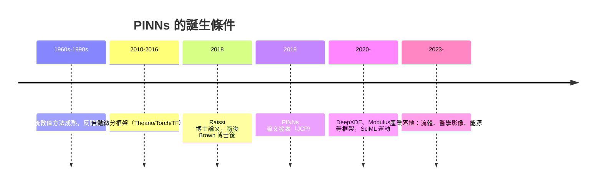

# 物理資訊神經網路（PINNs）：當神經網路讀了力學課本

## 從數值方法到「學出來的解」

傳統數值方法解偏微分方程（PDE）——有限差分、有限元素、譜方法——已有七十年歷史，是工程模擬的骨幹。但它們有共同的痛點：需要網格生成（複雜幾何上昂貴又脆弱）、高維問題遭遇維度詛咒、以及最根本的：反問題（從觀測反推參數或邊界條件）往往難以套用正向求解器的框架。

2019 年，布朗大學的 Maziar Raissi、Paris Perdikaris 與 George Em Karniadakis 在《Journal of Computational Physics》發表了〈Physics-informed neural networks: A deep learning framework for solving forward and inverse problems involving nonlinear partial differential equations〉，正式命名並系統化了 PINNs。這篇論文如今是科學機器學習領域被引用最多的文獻之一。

## 核心想法：把物理寫進損失函數

PINNs 的數學結構異常簡潔。用一個神經網路 $u_\theta(x, t)$ 表示 PDE 的解，損失函數由三部分組成：

$$\mathcal{L} = \mathcal{L}_{\text{data}} + \lambda_1 \mathcal{L}_{\text{physics}} + \lambda_2 \mathcal{L}_{\text{boundary}}$$

其中物理損失項就是 PDE 殘差本身。以 Burgers 方程或 Navier-Stokes 為例：

$$\mathcal{L}_{\text{physics}} = \frac{1}{N}\sum_i \left| \frac{\partial u_\theta}{\partial t}(x_i, t_i) + u_\theta \frac{\partial u_\theta}{\partial x}(x_i, t_i) - \nu \frac{\partial^2 u_\theta}{\partial x^2}(x_i, t_i) \right|^2$$

關鍵在於：這些導數不是數值近似，而是用自動微分精確計算的——PINNs 之所以在 2019 年爆發，正是因為 TensorFlow 與 PyTorch 已把自動微分變成人人可用的基礎設施。沒有 2010 年代的 AD 工具革命，就不會有 PINNs。這是數學基礎建設（10.1 節）與應用爆發之間因果鏈的完美示範。

## 反問題：PINNs 真正的殺手鐧

正向求解上，PINNs 常被高階傳統方法打敗（後文會談爭論）。但反問題是另一回事：若我們只有稀疏的流場觀測數據，想同時推斷未知方程形式與未知參數（如黏度 $\nu$），傳統流程需要反覆求解與校準，而 PINNs 只需把 $\nu$ 也當成可訓練變數、在損失函數中同時優化。原論文展示了從 Navier-Stokes 的稀疏速度數據中同時重建整個流場並辨識連續力學方程的例子；後續工作更延伸到「從數據發現方程」——用符號回歸從 PINNs 學到的行為中提取顯式 PDE，回應了物理學家 P.W. Anderson「多者異也」以來對湧現律的追問。

## 資助與機構：Brown 的應用數學傳統

這項工作的誕生並非偶然。Karniadakis 自 1990 年代起就在布朗大學應用數學系深耕隨機模擬與譜方法，長期獲得美國能源部（DOE）與海軍研究署（ONR）的穩定資助——DOE 的 ASCR 部門與 ONR 對「可壓縮流、潛艦流場、能源系統模擬」的需求，正是驅動 PINNs 早期應用的場景。Raissi 的博士論文（馬里蘭大學，2018，指導教授是 Karniadakis 的長期合作者 Ahmed Sameh 一系的應用數學傳統，與 Karniadakis 團隊關係密切）已預演了這個方向；2019 論文發表時 Raissi 正在 Brown 做博士後。美國海軍對「用稀疏感測器數據推斷流場」的興趣（潛艦尾流、螺旋槳噪聲）是 ONR 資助的典型動機——軍事需求再一次扮演數學的催化劑。2020 年代初，Karniadakis 團隊更將 PINNs 擴展到分數階 PDE 與隨機系統，並與 Doe 合作推動 SciML 軟體生態（如 DeepXDE 等開源框架由博士生 Lu Lu 等人開發）。

## 爭論：PINNs 挑戰得了七十年積澱嗎？

PINNs 引發了科學計算社群的真實辯論。批評者指出：訓練神經網路求 PDE 解缺乏收斂保證、沒有誤差上界、訓練常不收斂或收斂到錯誤解（「spectral bias」導致高頻特徵難學）；在單一幾何、單次求解的任務上，有限元素法又快又準。2020 年代初一系列比較研究顯示，對許多基準問題，傳統方法的效率遠勝 PINNs。

支持者的回應聚焦於 PINNs 真正的利基：無網格、天然融合異質數據、反問題與參數辨識、以及「不可微幾何」場景。這場爭論的建設性成果是讓社群更精確地劃分疆界：PINNs 不是有限元素的替代品，而是數據與物理的融合器。

## SciML 運動與產業落地

PINNs 點燃了科學機器學習（SciML）運動：MIT 的 Chris Rackauckas 發展的 SciML 生態（Julia）、Google 的地震學 PINN、Nvidia 的 Modulus（後更名 PhysicsNeMo）框架，加上 2023 年美國能源部與國家實驗室的規模化投入，讓「AI for Science」成為顯學。這波運動背後有兩大經濟引擎：其一，晶片巨頭需要 AI 超算的新市場；其二，傳統模擬產業（航太、汽車、能源）面對電動車電池設計、氣候模型等新問題，開始評估機器學習加速器。

實際產業應用已具雛形：流體力學上，PINNs 被用於潛艦與風機的流場重建、醫學影像中的血流參數辨識（如從超音波數據推斷血壓梯度的 1D 血流 PINN）；醫學影像上，磁共振血流成像的參數反演、CT 重建中的物理約束學習都有臨床級探索。2024 年前後，PINNs 相關論文年產數千篇，形成專門的研討會（如 NeurIPS 的 ML4PS workshop）與期刊專欄。

## 結語

PINNs 的本質是一次「損失函數的人文化」：把三百年力學積澱（守恆律、本構關係）寫進神經網路的優化目標。它的成敗尚在未定之天，但它已經改變了科學計算的論述方式——數據與方程不再是兩個學科，而是同一個優化問題的兩個項。至於這場融合最終產出的是工程革命還是過度炒作，歷史將由收斂性證明與工業驗收共同作答。
