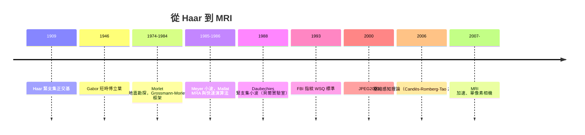

# 小波變換與壓縮感知：從地震勘探到 MRI 加速

## Haar 1909：一個被嘲笑的簡單想法

1909 年，匈牙利數學家 Alfréd Haar 在 Göttingen 大學（Hilbert 指導下）的博士論文中提出了最早的緊支集正交函數系：階梯函數對 $\psi(t)$，取值 $1$ 與 $-1$。Haar 小波簡單到近乎粗糙——不連續、頻率局部性差——但它揭示了一個重要事實：存在支撐緊、又能完備表達 $L^2$ 的正交基。此後七十年，Haar 基被視為理論玩具：Fourier 分析（1807 年起的傳統）的優雅讓「方塊函數」顯得寒酸。數學界對非光滑基的偏見，使小波思想的第一次萌芽被壓抑了大半世紀。

## Morlet 與法國石油勘探：地球物理的逆襲

1970 年代，法國地球物理學家 Jean Morlet 在 Elf Aquitaine（後併入 Total）的石油勘探部門工作，分析地震反射信號：探測船發出聲波，接收地層反射，據此判斷油氣構造。Morlet 發現，傅立葉變換把信號拆成純頻率後，失去了「什麼頻率出現在什麼時間」的資訊——而地層的深度對應時間，這正是勘探最需要的。傳統的短時傅立葉變換（Gabor 1946）窗寬固定，對高頻與低頻都不理想。

Morlet 直覺地構造了一種「伸縮平移」的波包：把一個母小波按尺度 $a$ 縮放、按位置 $b$ 平移，得到一族 $\psi_{a,b}(t) = a^{-1/2}\psi((t-b)/a)$，用內積係數表達信號——這就是連續小波變換。Morlet 與理論物理學家 Alex Grossmann（馬賽）合作，1984 年發表了嚴格的數學框架，證明小波族構成完備框架（frame），信號可穩定重構。

這段歷史有典型的工業經濟學背景：1973 年石油危機後油價暴漲，法國國家資本體系（Elf 當時是國有企業）重金投入勘探技術，地球物理部門養得起自己的數學家。小波分析的誕生地不是純數學院系，而是石油公司的計算中心——繼雷達、晶片之後，又一項軍工能源需求孕育的數學革命。

## Meyer 與 Daubechies：數學的接管與精緻化

1985 年，耶魯大學（後至巴黎）的 Yves Meyer 聽說了 Morlet 的工作，驚訝地發現這個「工程師的變換」數學上竟無人研究。他隨即證明了一個奠基結果：可以構造光滑、衰減快的正交小波基（Meyer 小波）。1986 年前後，Mallat（當時在賓州大學，與 Meyer 合作）提出多解析度分析（MRA）框架，把小波構造統一成濾波器組的迭代，並證明了快速小波變換演算法——與 FFT 地位相當的 $O(n)$ 演算法。

關鍵的最後一塊拼圖由比利時數學家 Ingrid Daubechies 完成當時任職於美國貝爾實驗室。1988 年她發表了緊支集正交小波的系統構造（Daubechies 小波）：不對稱的、任意階光滑的、支撐長度 $2p-1$ 的小波族。這使小波第一次同時具備「緊支集 + 正交 + 光滑」三重美德，直接可做成 FIR 濾波器，硬體友好。貝爾實驗室——電晶體與資訊理論的故鄉——在 AT&T 尚未被拆分（1984 年拆分後 AT&T 仍維持龐大研究體系）的轉型期，仍願意讓一位純數學家研究「抽象函數基」，這是美國工業基礎研究黃金時代的尾聲。Daubechies 1992 年的專著《Ten Lectures on Wavelets》成為經典，她本人後來成為美國數學會（AMS）首位女性主席（2011）。

## 應用落地：指紋與 JPEG2000

小波最著名的工程勝利有兩項。其一是美國 FBI 的指紋壓縮：FBI 每年處理數千萬張指紋卡，紙本數位化後檔案巨大，1993 年前後 FBI 與 Los Alamos 國家實驗室等合作開發了基於小波（CBIW/wavelet scalar quantization）的 WSQ 標準，成為指紋資料庫的法定格式——FBI 的巨量資料需求與政府採購，直接養大了小波產業。其二是 JPEG2000 標準（2000 年定稿，採 Daubechies 類的 CDF 5/3 與 9/7 小波），支援更高壓縮率與漸進式傳輸；雖然 JPEG2000 市場上未取代傳統 JPEG（專利與複雜度的因素），但在醫學影像（DICOM）、數位電影與衛星遙感中廣泛使用。這也提醒我們：技術標準的成敗不只看數學，還看專利政治與生態鎖定。

理論端，Donoho 與 Johnstone 在 1990 年代建立了小波閾值去噪的統計理論；Donoho 與 Stark 更早（1989）證明了不確定性原理：稀疏信號在時頻兩域無法同時高度集中——這個不等式後來成為壓縮感知的數學前奏。

## 壓縮感知：Candès、Romberg、Tao 與 Donoho

2004-2006 年間，一個反直覺的理論震撼了信號處理界：壓縮感知（compressed sensing）。傳統取樣遵循 Nyquist-Shannon 定理——要重建帶寬 $B$ 的信號，取樣率須超過 $2B$。但 Candès、Romberg 與陶哲軒（UCLA）在 2006 年的論文證明：若信號在某基底下稀疏（非零係數很少），只需 $m \gtrsim k\log(N/k)$ 次隨機測量（遠低於 Nyquist），就可用 $\ell^1$ 最小化

$$\min_x \|x\|_1 \quad \text{s.t.}\quad Ax = y$$

精確重建原信號。同年 Donoho 獨立發表了等價的理論框架。核心數學是約束等距性質（RIP）：隨機矩陣（如高斯、部分傅立葉）以壓倒性機率滿足 RIP，而 RIP 連同 $\ell^1$ 的幾何（多面體頂點稀疏性）保證凸優化求解器找到真實稀疏解。

這個成果的學術背景值得玩味。陶哲軒 2006 年正是菲爾茲獎得主（31 歲獲獎，表彰其在 Green-Tao 素數定理等工作上的成就），他與 Candès 合作研究壓縮感知起初源於 Candès 對 CT 醫學成像中「鬼影」的觀察。頂尖純數學家（陶是調和分析出身，師從 Stein 的普林斯頓學派）深度參與應用信號處理，在當時的數學文化中並不尋常——二十世紀中葉 Bourbaki 式的抽象化傳統讓純數學界一度輕視應用，而陶哲軒以其影響力示範了「調和分析與資訊理論合流」的價值，帶動了數學界對應用研究態度的轉變。壓縮感知論文隨後引爆統計（高維稀疏回歸、LASSO 是其近親）、優化與機器學習的連鎖研究，成為 2010 年代「數學數據科學」的旗艦。

## 應用的兩個明星：MRI 與單像素相機

壓縮感知最成功的應用是磁振造影加速。MRI 本身在 $k$-空間取樣，掃描時間與取樣線數成正比——每多一分鐘都是病人的痛苦與儀器的成本。史丹佛的 Lustig、Donoho 與 Pauly 2007 年的論文顯示，隨機欠取樣 $k$-空間配合稀疏重建，可將掃描時間大幅縮短；此後 GE、Siemens 等廠商把壓縮感知整合進商用序列，2000 年代末起逐步通過監管審批用於臨床。這是「理論誕生十年內進入醫院」的罕見速度，背後是醫療產業對提高儀器周轉率的強大經濟動機。

另一個戲劇性的示範是 Rice 大學 Baraniuk、Kelly 等人 2006-2008 年的單像素相機：不用百萬感光元，而用一片可編程的數位微鏡陣列（DMD，原本是德州儀器為投影機開發的）對光場做隨機測量，僅用一個光電感測器接收，再以 $\ell^1$ 重建影像。它證明了「測量方式本身可以重新設計」——壓縮不是事後做，而是取樣時就融入數學。

## 結語

小波與壓縮感知共享一條歷史弧線：都始於「對既定取樣／表示方式的叛逆」，都由工業需求（石油、指紋、醫療）與純數學（調和分析、凸優化）共同鍛造。Haar 的方塊函數等了七十年才被重用，Morlet 的地震波在油價危機中長成理論，Daubechies 在貝爾實驗室的安靜走廊裡造出完美的濾波器，陶哲軒則證明了菲爾茲獎得主也能為醫院的 MRI 縮時。數學史一再重複的劇本是：抽象的財富總在，只是等待提款的問題出現。
