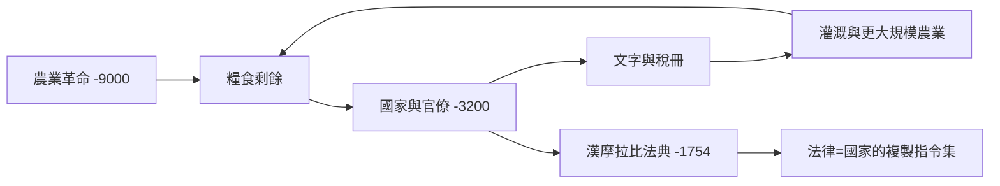

# 世界簡史歷史因果分析

## 案件摘要

本卷從 `[-9000-農業革命.md]` 一路追到 `2023-生成式AI與資訊社會.md`，是全部卷宗中最長的時間線。偵查總結論：人類大歷史由三條主軸交織——**能量**（農業、化石燃料、電力）、**組織**（從城邦官僚到民族國家與跨國體系）、**資訊**（文字、印刷、電報、網路）。三者的每一次同時躍升，就產生一次「世界體系」的重組。

$$\text{文明規模} \leq \min(\text{能量捕獲},\ \text{組織能力},\ \text{資訊處理})$$

這是木桶公式：文明的天花板由最短的一塊板決定。`-3200-文字與最早國家.md` 補上資訊之板才有了國家；`1769-瓦特蒸汽機與工業革命.md` 補上能量之板才有了現代成長；`1991-全球資訊網.md` 再次補上資訊之板——而 `2023-生成式AI與資訊社會.md` 正在測試組織之板是否跟上。

## 主要驅動力

| 驅動力 | 起點案件 | 深化案件 | 一句話機制 |
|--------|----------|----------|------------|
| 能量 | `[-9000-農業革命.md]` | `1769-瓦特蒸汽機與工業革命.md` | 每人可用能量的躍升=每人可擁有的複雜度 |
| 資訊 | `[-3200-文字與最早國家.md]` | `1450-古騰堡印刷革命.md`、`1991-全球資訊網.md` | 記錄與複製成本決定組織半徑 |
| 組織 | `[-0221-秦的統一與官僚帝國.md]`、`0605-科舉與中國官僚帝國.md` | `1871-德意志統一與民族主義時代.md` | 官僚制、科舉、民族主義是三種「人員選拔作業系統」 |
| 商業 | `1602-荷蘭東印度公司與金融革命.md` | `1869-蘇伊士與全球化.md`、`2001-中國入世與世界工廠.md` | 貿易網密度決定專業化深度 |
| 疫病 | `0541-查士丁尼大瘟疫.md`、`1347-黑死病.md` | `2020-新冠疫情與全球測壓.md` | 連接通道即病原通道，人口衝擊重塑制度 |

## 因果鏈與回饋環

### 環一：農業→剩餘→國家→文字→更大農業

`[-1754-漢摩拉比法典.md]` 顯示：國家一旦出現，就需要把規則寫成可複製的形式——法律是最早的「軟體」。`0605-科舉與中國官僚帝國.md` 則是此環的極致：用考試把帝國的人才介面標準化，維持千年。

### 環二：歐亞連接的開與合

| 事件 | 連接 | 後果 |
|------|------|------|
| `[-0141-漢武帝與絲路.md]` | 絲路開通 | 東西低頻寬交流 |
| `1206-蒙古世界體系.md` | 驛站接通歐亞 | 貿易＋技術＋**黑死病** |
| `1405-鄭和下西洋與中國的轉向.md` | 中國主動關閉 | 海權讓渡給歐洲 |
| `1492-哥倫布大交換.md` | 大西洋接通 | 生態與財富的大規模重分配 |
| `1869-蘇伊士與全球化.md` | 全球通道工程化 | 帝國物流成型 |
| `2001-中國入世與世界工廠.md` | 製造網絡一體化 | 本輪全球化的極盛 |

規律：**每次接通都同時輸送財富與風險**（蒙古和平送來馬可波羅也送來 1347-黑死病），每次封閉都把主導權讓給仍願連接的一方——鄭和的轉向就是歐洲崛起的最大讓分行為。

### 環三：戰爭—科技—國家的正回饋

`-0508-雅典民主與海權.md`（海軍→平民政治權重）→ `1096-十字軍東征.md` → `1453-君士坦丁堡陷落.md`（火藥终结城牆時代）→ `1914-第一次世界大戰.md`（工業總體戰）→ `1945-核武與絕對武器.md`（戰爭成本無限化）→ `1945-戰後秩序.md`（以制度替代戰爭）。戰爭壓力催生科技與中央集權，但當總體戰變成自毀，國家被迫發明 `1944-布列頓森林與美元秩序.md` 與聯合國來「制度化和平」。

## 關鍵轉折點

- **軸心時代（`[-0800-軸心時代.md]`）**：各大文明幾乎同時產生超越性思想——是鐵器、城市與戰亂的共同環境壓力所致，不是巧合。
- **1793 的分流時刻（`1793-馬戛爾尼使團與大分流.md`）**：兩個帝國在同一張談判桌上錯過彼此——技術與制度的差距從此定調此後兩百年。
- **1688（`1688-光榮革命.md`）與 1687（`1687-牛頓與科學革命頂點.md`）的雙重鎖定**：可信的政府承諾＋可信的自然法則，資本與科學同時獲得制度保障。
- **1989（`1989-冷戰結束.md`）**：不是歷史的終結，而是讓 `2001-中國入世與世界工廠.md`、`1999-歐元誕生與貨幣讓渡.md`、`2020-新冠疫情與全球測壓.md` 得以在單一體系內上演的前置條件。

## 反事實推演

- **若中國未在鄭和後轉向**：十五世紀的海權競爭由中華帝國與歐洲並跑——`1492-哥倫布大交換.md` 可能由寶船艦隊先寫，大分流的方向整個改寫。但結構性因素（官僚制對商業的敵意）提示：即使出海，制度未必跟得上船。
- **若蒙古未統一草原**：沒有蒙古和平→技術西傳延後、黑死病可能仍經由貿易抵達但通路不同——歐洲的崛起劇本（火藥＋印刷＋瘟疫後的勞動稀缺）全部需要重算。
- **若青黴素未在 1928 出現（`1928-青黴素與人口革命.md`）**：感染仍是死因之首→人口革命延後、福利國家的財務結構不同、抗生素時代的醫療經濟學不存在。
- **若 2020 疫情發生在 1980**：沒有數位基礎設施，封鎖意味經濟直接停擺——`2020-新冠疫情與全球測壓.md` 之所以能「測壓」，正因為 `1991-全球資訊網.md` 已建成二十九年。

## 偵探教訓

1. **找最短的板，不找最大的帆**：文明受制於木桶公式中最弱的環——判斷一個時代的走向，先量能量、組織、資訊三塊板各有多長。
2. **連接與封閉都要付代價**：開放輸送瘟疫，封閉讓渡霸權——`1405-鄭和下西洋與中國的轉向.md` 與 `2020-新冠疫情與全球測壓.md` 是同一教訓的兩面。
3. **偶發之下有結構**：黑死病是偶發（病原跳躍），但封建制度的瓦解是結構（勞動比價早已緊繃）——偵探的工作是把偶發的引信與結構的炸藥分開標記。
4. **制度落後於技術是常態**：從 `[-1754-漢摩拉比法典.md]` 到 `2023-生成式AI與資訊社會.md`，法律永遠在追趕——真正要問的不是「為什麼監管這麼慢」，而是「這次誰來扮演那姍姍來遲的立法者」。
