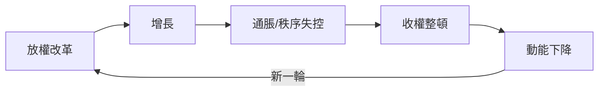

# 中國現代史歷史因果分析

## 案件摘要

本卷案件橫跨 1840 至 2025 年，近兩百年。表面上是「王朝崩潰—革命建國—改革開放」三幕劇，偵探的結論卻是：**貫穿全案的是一條「外部壓力 → 制度應變 → 動員加強 → 再遇外部壓力」的螺旋**。每當外患內憂逼到牆角，體制的反應不是縮小動員，而是加大動員；動員的成果與代價，又成為下一輪危機的燃料。因果鏈公式：

$$\text{外患} \Rightarrow \text{制度應變（洋務→維新→革命）} \Rightarrow \text{動員加深（土改→公社→文革）} \Rightarrow \text{效率損失} \Rightarrow \text{再危機} \Rightarrow \text{改革放權} \Rightarrow \text{新外部壓力}$$

## 主要驅動力

| 驅動力 | 作用機制 | 證據案件 |
|---|---|---|
| 外部軍事壓力 | 敗戰 → 學習 → 制度移植 | `1840-鴉片戰爭.md`、`1894-甲午戰爭與公車上書.md`、`1937-盧溝橋與全面抗戰.md` |
| 財政與糧食 | 徵收體系決定政權能力 | `1953-統購統銷與糧票.md`、`1994-分稅制與央行體制.md` |
| 意識形態動員 | 群眾運動替代常規官僚 | `1958-大躍進與三年困難.md`、`1966-文化大革命與十年動亂.md` |
| 地緣與大國格局 | 選邊決定發展路線 | `1950-抗美援朝與一邊倒.md`、`1971-恢復聯合國席位與中美解凍.md`、`2001-加入WTO與世界工廠.md` |
| 人口與技術紅利 | 勞動力 + 技術引進 = 增長 | `1980-獨生子女政策.md`、`2010-Android本地化與小米.md` |

## 因果鏈與回饋環

### 回饋環一：挨打—學習—再挨打（正環）

`1840-鴉片戰爭.md` 之敗 → `1861-洋務運動與同光中興.md` 買艦辦廠 → 但制度未變 → `1894-甲午戰爭與公車上書.md` 北洋水師全滅 → 證明「器物層」不夠 → `1898-戊戌變法與百日維新.md` 試制度層 → 失敗 → `1900-義和團與八國聯軍.md` 反向動員 → 更慘 → `1905-清末新政與預備立憲.md` 被迫立憲——**每一次敗仗都把改革推深一層，但改革的速度永遠追不上危機的速度**。

### 回饋環二：動員的報酬遞減（先正後負）

革命與建設都靠動員：`1926-北伐戰爭與四一二清黨.md` 靠農工動員取勝，`1945-國共內戰與建國.md` 靠土改換兵源糧草。建國後同一手法延伸——`1958-人民公社與政社合一.md` 把動員組織化到村，卻在 `1958-大躍進與三年困難.md` 撞上物理極限；`1959-廬山會議.md` 壓下糾錯聲音，使 `1966-文化大革命與十年動亂.md` 成為動員邏輯的終點。**動員能贏戰爭，不能贏經濟。**

### 回饋環三：放權—增長—通脹—收權（週期環）

`1978-改革開放與真理標準.md` 放權 → `1988-價格闖關與搶購風.md` 通脹失控 → `1989-六四與改革受挫.md` 收權 → `1992-南巡講話與市場經濟.md` 再放 → `1994-分稅制與央行體制.md` 建立宏觀框架 → `2015-股災與熔斷機制.md`、`2021-共同富裕與平台整頓.md` 同型劇本重演。**「一放就亂、一收就死」是本卷最穩定的定律。**

### 回饋環四：開放—依賴—摩擦（外部環）

`1980-經濟特區與深圳速度.md` 接軌 → `2001-加入WTO與世界工廠.md` 躍升 → `2018-中美貿易戰.md`、`2019-5G發牌與華為.md` 遭遇封鎖 → `2025-DeepSeek與AI競賽.md` 自立路線。**嵌入世界體系是增長之因，也埋下摩擦之果。**

## 關鍵轉折點

- **1911 年**：`1911-辛亥革命與民國肇建.md`——保路運動這種偶發火花，點燃了皇權崩塌的結構性乾柴；`1912-清帝退位與共和試驗.md` 證明形式共和換不來實質整合，才有 `1915-袁世凱稱帝與護國戰爭.md` 的回頭試探。
- **1936 年**：`1936-西安事變.md`——純粹的偶發事件（一場兵諫），卻把「攘外必先安內」的劇本永久改寫。
- **1978 年**：`1976-毛逝世與懷仁堂政變.md` 的權力更替 + `1978-改革開放與真理標準.md` 的思想轉向——結構條件早已成熟，缺的只是拍板的人。
- **1992 年**：`1992-南巡講話與市場經濟.md`——個人意志在制度慣性前面，最後一次成功扭轉方向。

## 反事實推演

- **若無甲午之敗**：洋務體制可再苟延，但立憲與革命仍會遲到地到來——代差會以別場敗仗呈現。結構必然，時間偶然。
- **若無西安事變**：國府仍要面對日軍全面進攻，但剿共未竟可能改變 `1945-國共內戰與建國.md` 的實力對比——**單一偶發事件改寫兩黨命運的最佳樣本**。
- **若無 1953 統購統銷**：工業化原始積累將更慢，但農村代價也小；`1953-統購統銷與糧食官僚.md` 顯示糧票體制一直運轉到 1990s，是制度鎖定的經典案例。
- **若無 2001 入世**：出口引擎缺一環，但 `2003-淘寶與電商崛起.md` 與 `2010-Android本地化與小米.md` 的內需科技線或許更早接棒。

## 偵探教訓

1. **別把「失敗」只記在個人帳上**——從 `1861-洋務運動與同光中興.md` 到 `1989-六四與改革受挫.md`，失敗多來自「用舊工具解新問題」。
2. **追蹤白銀、糧食、稅收這三條暗線**——`1840-鴉片戰爭.md` 的白銀、`1958-大躍進與三年困難.md` 的糧食、`1994-分稅制與央行體制.md` 的財政，比任何宣言更能預測下一步。
3. **偶發事件只決定「誰來做」，結構決定「做什麼」**——西安事變換了劇本演員，但中日全面衝突的結構早已寫定。
4. **改革是回饋環，不是直線**——「放—亂—收—死—再放」的週期，是讀懂 `2018-中美貿易戰.md` 之後一切政策的鑰匙。
