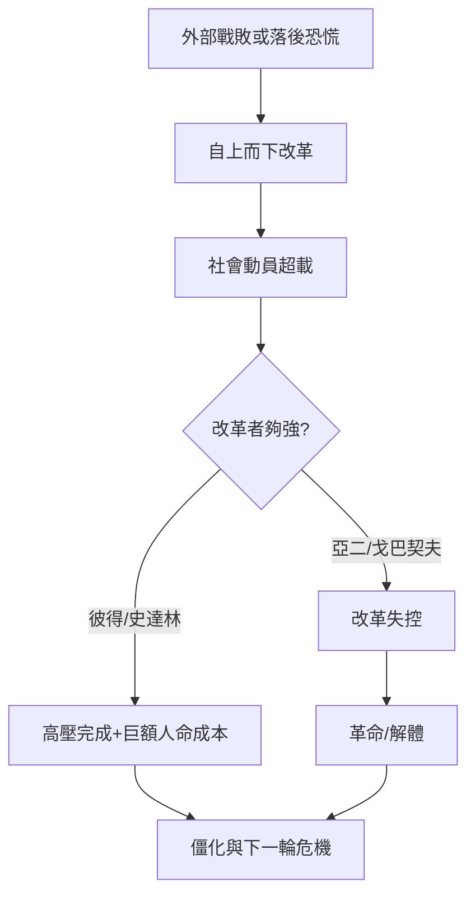

# 俄羅斯史歷史因果分析

## 案件摘要

俄羅斯史是一樁「地理指控」的大案：一個沒有天然邊界的平原國家，千年來在同一組因果軌道上反覆運行。偵查從留里克受雇而來（[0862-留里克與羅斯起源.md](0862-留里克與羅斯起源.md)）到蘇聯解體（[1991-蘇聯解體.md](1991-蘇聯解體.md)），核心發現：**安全需求 → 擴張 → 專制動員 → 農奴制與停滯 → 落後危機 → 自上而下的改革 → 改革失控 → 專制回歸**。這條環走了至少四輪（伊凡四世、彼得、亞歷山大二世、史達林）：

$$\text{無屏障平原} \to \text{安全焦慮} \to \text{領土緩衝擴張} \to \text{強制動員體制} \to \text{社會僵化} \to \text{外部失敗或落後} \to \text{精英主導改革} \to \text{失控與反撲} \to \text{更強的專制}$$

蒙古枷鎖（[1240-蒙古枷鎖.md](1240-蒙古枷鎖.md)）不是起點，卻是模板：把「以專制換生存」寫進了政治 DNA。此後每次改革的失敗，都在為下一次更狠的專制預約。

## 主要驅動力

| 驅動力 | 代表案件 | 因果作用 |
|---|---|---|
| 地理無屏障 | [1480-烏格拉對峙.md](1480-烏格拉對峙.md)、[1812-衛國戰爭.md](1812-衛國戰爭.md) | 被入侵的記憶 → 緩衝帶執迷 |
| 土地與農民 | [1649-會議法典與農奴制.md](1649-會議法典與農奴制.md)、[1861-農奴解放.md](1861-農奴解放.md)、[1906-斯托雷平土地改革.md](1906-斯托雷平土地改革.md) | 國家財政靠農民 → 農民被綁又被賣 |
| 自上而下改革 | [1682-彼得大帝.md](1682-彼得大帝.md)、[1861-農奴解放.md](1861-農奴解放.md)、[1985-改革與開放.md](1985-改革與開放.md) | 落後恐慌 → 強制西化 → 體系震盪 |
| 意識形態動員 | [1917-十月革命.md](1917-十月革命.md)、[1928-五年計劃與集體化.md](1928-五年計劃與集體化.md) | 用教條替代組織成本 |
| 資源租金 | [1964-布里茲涅夫停滯與石油地租.md](1964-布里茲涅夫停滯與石油地租.md)、[2004-穩定基金與主權財富.md](2004-穩定基金與主權財富.md) | 石油美元替代改革誘因 |

## 因果鏈與回饋環

### 環一：農奴制的鎖死—解放—再鎖死

1497 年起農民出走權逐步限縮，1649 會議法典正式鎖人（[1649-會議法典與農奴制.md](1649-會議法典與農奴制.md)）——因為國家窮，只能把稅基（農民）抵押給服役貴族。克里米亞慘敗（[1853-克里米亞戰爭與改革窗口.md](1853-克里米亞戰爭與改革窗口.md)）暴露農奴軍隊的破產，1861 解放（[1861-農奴解放.md](1861-農奴解放.md)）卻讓農民背贖金、割地少——**解放了人，沒解放土地問題**。此後三個出口：革命（[1905-革命.md](1905-革命.md)）、斯托雷平的富農路線（[1906-斯托雷平土地改革.md](1906-斯托雷平土地改革.md)，被遇刺截斷，[1881-亞歷山大二世遇刺與反改革.md](1881-亞歷山大二世遇刺與反改革.md)示範了改革者的下場）、集體化（[1928-五年計劃與集體化.md](1928-五年計劃與集體化.md)）——蘇聯用國家機器把農民再次「綁回土地」。**同一問題，帝國用法律鎖，蘇聯用集體農場鎖**。

### 環二：戰爭壓力 → 現代化 → 制度崩裂

彼得改造（[1682-彼得大帝.md](1682-彼得大帝.md)）與官秩表（[1722-官秩表與官僚制.md](1722-官秩表與官僚制.md)）靠沙皇意志碾過社會；戈巴契夫（[1985-改革與開放.md](1985-改革與開放.md)）同樣自上而下，卻撞上車諾比（[1986-車諾比核災.md](1986-車諾比核災.md)）與阿富汗（[1979-阿富汗戰爭與帝國過擴張.md](1979-阿富汗戰爭與帝國過擴張.md)）的雙重透支。**改革在俄羅斯從來不是漸進選項，是危機的續命手段**。

### 環三：石油地租與改革的死亡

1960 年代油價暴漲餵養布里茲涅夫停滯（[1964-布里茲涅夫停滯與石油地租.md](1964-布里茲涅夫停滯與石油地租.md)）：不用改革也能付帳 → 錯過電腦革命（[1958-蘇聯電腦與控制論.md](1958-蘇聯電腦與控制論.md)）與消費轉型。1986 油價崩盤，地租斷流，帝國帳本見底——**蘇聯不是被民主打倒的，是被石油市場打倒的**。後蘇聯時期重演：葉爾欽的休克療法（[1992-休克療法與憑證私有化.md](1992-休克療法與憑證私有化.md)）製造寡頭（[1993-俄羅斯黑手黨與私有化.md](1993-俄羅斯黑手黨與私有化.md)），蒲亭用油價收購忠誠、重建權力垂直（[1999-蒲亭與權力垂直.md](1999-蒲亭與權力垂直.md)）——地租政治捲土重來。

### 環四：革命—內戰—清洗的自我強化

二月革命留下的真空被「唯一交卷者」接收（[1917-二月革命.md](1917-二月革命.md)、[1917-十月革命.md](1917-十月革命.md)）→ 內戰的殘酷（[1918-內戰與戰時共產主義.md](1918-內戰與戰時共產主義.md)）塑造了「敵人無所不在」的心態 → 大清洗（[1936-大清洗.md](1936-大清洗.md)）把內戰邏輯制度化 → 黨政體制再無糾錯機制，直到史達林之死（[1953-史達林之死與貝利亞終局.md](1953-史達林之死與貝利亞終局.md)）才靠繼承鬥爭鬆綁。**暴力一旦成為組織常規，就會自我複製**。

## 關鍵轉折點

- **1240 年，拔都**：蒙古統治四百年養成「以專制換生存」的預設（[1240-蒙古枷鎖.md](1240-蒙古枷鎖.md)）。
- **1547 年，伊凡四世稱沙皇**：把拜占庭遺產與恐怖手段合一（[1547-伊凡四世.md](1547-伊凡四世.md)），特轄制是後世清洗的原型。
- **1917 年，列寧的密封列車**：德國的風投改寫二十世紀（[1917-十月革命.md](1917-十月革命.md)）。
- **1956 年，赫魯雪夫秘密報告**：揭穿個人崇拜卻不動體制，留下「可控 thaw」的模板（[1956-秘密報告.md](1956-秘密報告.md)）。
- **1991 年 12 月，三共和國首腦**：別洛韋日協議終結蘇聯——帝國死於三個人的簽字，而非廣場。

## 反事實推演

- **若斯托雷平未遇刺**：富農階層可能坐大，1917 年農民或成保守力量而非革命燃料——土地問題的「資本主義解法」未必成功，但布爾什維克的口號會失去一半彈藥。
- **若 1960 年代無石油**：蘇聯被迫提前改革（如匈牙利式或中國式），或提前崩潰——布里茲涅夫的二十年停滯靠的是油管，不是制度優越。
- **若戈巴契夫只經濟改革、不開放政治**：體制或許多撐十年，但經濟改革在無資訊自由下難以推進（價格、產權皆需政治資訊）——也可能滑向中國式先經後政，但蘇聯的民族聯邦結構使其無法複製北京路線。
- **若亞歷山大二世未被炸死**：俄羅斯或許在 1880 年代走向半憲政，避免 1905 與 1917 的疊加——但 1881 的炸彈證明：改革者的寬容在俄羅斯會被雙方（守舊派與激進派）同時懲罰。

## 偵探教訓

1. **地理是最古老的嫌犯**：無屏障平原解釋了專制、擴張、農奴制的連鎖，但地理只是「誘因結構」，不是宿命——同樣平原的烏克蘭與波蘭走了不同路，是制度選擇拉開了差距。
2. **俄羅斯改革的節奏是「停滯— shock —再停滯」**：從不漸進，因為專制體制無法授權漸進；改革者只有彼得式的碾壓與戈巴契夫式的失控兩種結局。
3. **地租是體制的止痛藥**：農奴制是人力地租，石油是資源地租——止痛藥越有效，病灶越深。偵探看俄羅斯，先查它的「止痛藥庫存」。
4. **最後的教訓**：本卷最大的因果謎題不是「為何革命」，而是「為何每次革命之後體制又長回原形」——答案在結構（地理、地租、官僚）而不在人物。換掉伊凡、彼得、史達林、蒲亭的名字，案卷的骨架不變。
