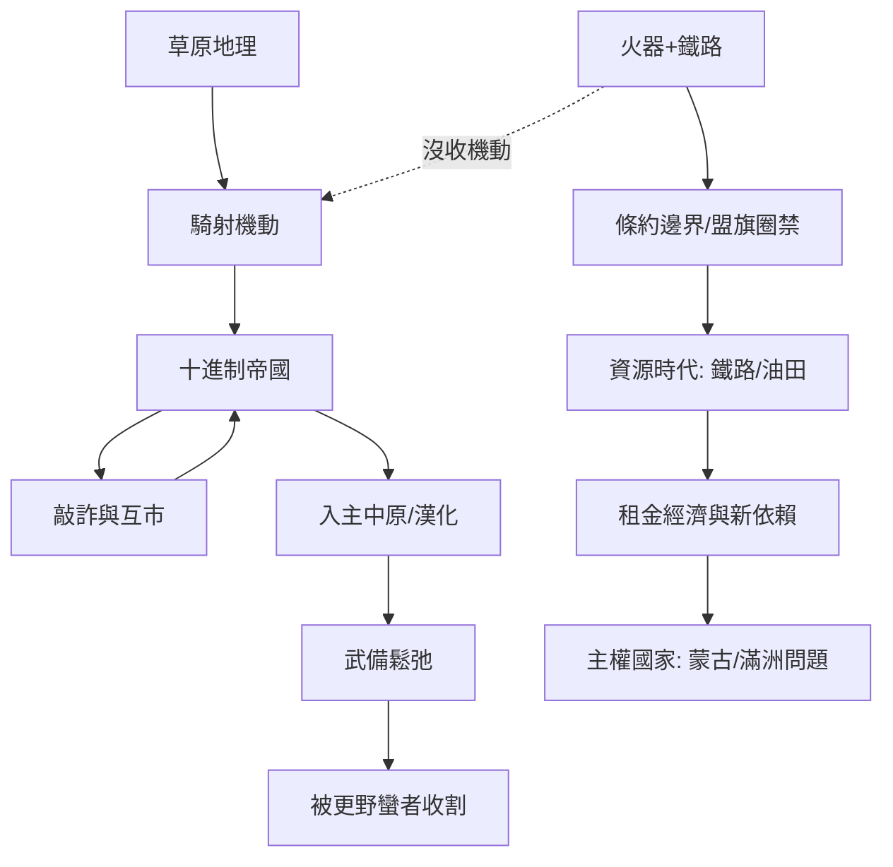

# 北亞史歷史因果分析

## 案件摘要

北亞三千年是一樁「發明—複製—終結」的連環專利案：冒頓用鳴鏑與十進制組織（`-0209-匈奴帝國.md`）註冊了「草原帝國」這項專利，此後突厥（`0552-突厥汗國與草原新主.md`）、回鶻（`0744-回鶻汗國與摩尼之國.md`）、契丹（`0907-契丹遼朝與燕雲.md`）、蒙古（`1206-蒙古帝國與世界體系.md`）全是抄作業的學生；考官則輪流由中原與俄羅斯擔任。考題只有一道：**游牧的機動 vs 定居的資源**。機動性的答題窗口維持了兩千年，直到火繩槍與鐵路（`1581-俄羅斯征服西伯利亞.md`、`1904-西伯利亞大鐵路全通.md`）把「速度」從馬背上沒收，草原帝國的專利正式作廢，考場換成鐵路、油田與邊界條約。

$$因果鏈：草場地理 \Rightarrow 馬政與騎射 \Rightarrow 十進制動員 \Rightarrow 草原帝國 \Rightarrow 對中原/俄羅斯敲詐與貿易 \Rightarrow 火器+鐵路終結機動優勢 \Rightarrow 盟旗/八旗圈禁 \Rightarrow 礦業鐵路時代 \Rightarrow 主權國家與新依賴$$

## 主要驅動力

| 驅動力 | 作用機制 | 證據案件 |
|--------|----------|----------|
| **地理與氣候** | 草原—森林—凍土劃定帝國上限；白災（大雪）是汗國殺手 | `0840-黠戛斯滅回鶻與草原真空.md`、`0946-長白山大噴發.md` |
| **組織發明** | 十進制、八旗、盟旗＝把血緣騎兵改造成領薪官僚 | `-0209-匈奴帝國.md`、`1635-八旗與佐領俸餉制.md`、`1638-理藩院與盟旗俸祿.md` |
| **貿易槓桿** | 歲幣、絹馬、茶道——敲詐與互市是同一回事的兩種開價 | `-0209-匈奴帝國.md`、`0907-契丹遼朝與燕雲.md`、`1727-恰克圖條約與萬里茶道.md` |
| **技術代差** | 複合弓→火繩槍→坦克→鐵路，機動優勢被逐代沒收 | `1581-俄羅斯征服西伯利亞.md`、`1739-和通泊之敗.md`、`1939-諾門罕戰役與八月風暴.md` |
| **繼承詛咒** | 帝國壽命往往短於開國者之後第三代 | `0048-匈奴分裂與西遷疑案.md`、`1368-北元與蒙古中興.md` |
| **外部老師** | 中原與俄羅斯輪流出題、發教科書、批改考卷 | `0386-北魏孝文帝改革.md`、`1325-莫斯科崛起與金帳收稅人.md`、`1896-中東鐵路與沙俄滲透.md` |

## 因果鏈與回饋環

### 環一：統一—敲詐—更統一（草原正回饋）

草原統一 → 對中原開價能力↑ → 歲幣/互市收入↑ → 可汗能收買更多千戶 → 更統一。`-0209-匈奴帝國.md` 與 `1206-蒙古帝國與世界體系.md` 都在此環登頂。但反噬隨附：**收入的可預期性降低了戰爭動力，奢侈化削弱了騎兵紀律**——匈奴與回鶻都死在「收租收得太舒服」之後。

### 環二：漢化—自殺迴路（北亞特有負回饋）

入主中原 → 需要官僚與稅 → 接受定居制度 → 騎兵訓練與部落紐帶鬆弛 → 迴避漢化者（留在外線）反而保有武力 → 常常由「更野蠻的同族」收割先行者。北魏孝文帝改革（`0386-北魏孝文帝改革.md`）的六鎮反彈、遼朝的金（`1115-女真金朝與靖康.md`）、金朝的蒙古，都是同一條迴路的三連拍。**毗伽碑文的詛咒是本案最早的自白書**。

### 環三：技術沒收機動性的終結環

火繩槍與城牆炮（`1552-喀山陷落與東進開關.md`）→ 騎射優勢貶值 → 俄羅斯以要塞鏈+河流推進西伯利亞（`1581-俄羅斯征服西伯利亞.md`、`1643-哥薩克東進黑龍江.md`）→ 條約把草原寫進經緯線（`1689-尼布楚條約與中俄邊界.md`、`1727-恰克圖條約與萬里茶道.md`）→ 盟旗與俸祿把牧民釘死在旗界（`1638-理藩院與盟旗俸祿.md`、`1691-多倫會盟與喀爾喀歸附.md`）→ **游牧帝國的生態位被行政與鐵路雙重填埋**。

### 環四：資源—依賴新迴路（二十世紀版）

鐵路與油田取代馬群成為北亞的「馬政」：`1896-中東鐵路與沙俄滲透.md`、`1904-西伯利亞大鐵路全通.md`、`1965-秋明油田與西西伯利亞石油.md`、`1981-秋明租金與停滯憲制.md`——蘇聯把租金制度化，租金崩了體制就崩（`1993-證券私有化與西伯利亞油企.md`）；蒙古則以「第三鄰國」複製古代的兩屬外交（`1990-蒙古民主革命與第三鄰國.md`、`2014-西伯利亞力量與能源同盟.md`）。**考題沒變，只是馬換成了輸油管**。

## 關鍵轉折點

1. **冒頓鳴鏑（-0209，`-0209-匈奴帝國.md`）**：一個用響箭殺父的人，順手發明了草原帝國的全部制度——十進制編組、單于集權、以圍獵練兵。此後兩千年的學生名單上，沒有人退學。
2. **北魏孝文帝遷都（0386，`0386-北魏孝文帝改革.md`）**：史上最大手筆的漢化實驗，證明「統治中原」與「保持草原武力」在制度上不可兼得——六鎮之亂（`0304-五胡十六國與北魏前夜.md` 的餘波）是這條公式第一次亮出代價。
3. **成吉思汗整編（1206，`1206-蒙古帝國與世界體系.md`）**：把抄了兩千年的作業重新精裝：千戶制＋怯薛＋法典，一次通過所有舊考題，並把考場擴到全球——**這是草原專利的最高峰，也是它無人可繼承的證明**（`1271-忽必烈與大元朝.md`、`1368-北元與蒙古中興.md` 皆是退潮）。
4. **恰克圖與盟旗（1727–1691，`1727-恰克圖條約與萬里茶道.md`、`1691-多倫會盟與喀爾喀歸附.md`）**：兩份文件合起來等於一張「圈禁許可證」——用貿易關卡與旗界俸祿，把最後的游牧自由換成定點補給。
5. **和通泊之後的火器分水嶺（1739，`1739-和通泊之敗.md`；1755，`1755-準噶爾之亡與新疆建置.md`）**：清軍自己的慘敗反而證明火器時代戰爭成本已非騎射可負擔——準噶爾之亡不是勇氣問題，是**草原帝國最後一個物種的滅絕登記**。
6. **諾門罕（1939，`1939-諾門罕戰役與八月風暴.md`）**：坦克代替騎兵在同一片草原上重考同一次科目——日本以此認賠，蘇聯以此確認對北亞的監護權；此後的 `1945-雅爾塔密約與外蒙公投.md` 只是行政程序。

## 反事實推演

- **若冒頓未曾統一草原**：分散部落仍會被逐個擊破或被中原冊封收編，漢初的和親財政不會成立；但「草原帝國」的發明可能只是延後——**生態位在那裡，總有人去填**，突厥或鮮卑仍會註冊同一專利。
- **若孝文帝不漢化**：北魏可能維持邊疆王朝更久，或如柔然（`0402-柔然汗國與可汗稱號.md`）般長期游離；六鎮、隋唐關隴集團的形成路徑全變——**漢化案不是失敗，而是用一次失敗養出了下一個黃金時代**。
- **若火器晚出現三百年**：草原機動優勢延長，俄羅斯東進與清朝邊疆整合都要重考；十七世紀的「世界被歐亞兩端夾擊」格局不成立，恰克圖與尼布楚兩份條約的概念本身不會出現。
- **若秋明油田不曾發現**（`1965-秋明油田與西西伯利亞石油.md`）：蘇聯在 1980 年代就將面對財政斷電，`1981-秋明租金與停滯憲制.md` 的緩衝消失，冷戰經濟結局可能提前且更混亂——**租金是體制的麻醉劑，也是倒數計時器**。

## 偵探教訓

1. **先查「誰在當老師」**：北亞每一次制度躍遷背後都有一個定居帝國的教科書——查清教材來源（中原官僚制、俄羅斯條約體系、蘇聯計劃經濟），因果鏈就出來一半。
2. **機動性是會過期的資產**：從複合弓到鐵路，北亞史就是一部「速度專利」的貶值史。任何以單一優勢立國的政體，都要問：這項優勢的保質期多久？
3. **成功是最大的繼承危機**：冒頓、成吉思汗之後的每一次分裂（`0048-匈奴分裂與西遷疑案.md`、`1368-北元與蒙古中興.md`）都不是偶然，而是「個人魅力型動員」無法寫進憲法的結構必然。
4. **條約與俸祿比戰爭更致命**：`1689-尼布楚條約與中俄邊界.md`、`1638-理藩院與盟旗俸祿.md` 沒殺一個游牧民，卻完成了所有戰爭沒完成的事——**把空間變成格子，機動性就死了**。
