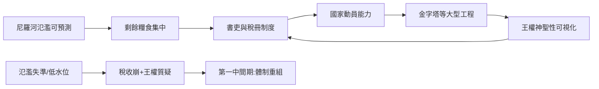

# 古埃及史歷史因果分析

## 案件摘要

古埃及是史上最長壽的國家形態：從 `3100-那爾邁統一埃及.md` 到 `[-0030-亞克興與埃及豔后之死.md]`，三千年間王朝更迭、異族兩度統治，而「埃及」作為一個政治與文明單位始終重組成功。偵查結論：這不是天命，而是一套罕見的**多重冗餘系統**——尼羅河的氾濫農業、沙漠的天然屏障、神王意識形態、官僚文書制度，四者互為保險。

$$\text{埃及的長壽} = \text{（尼羅河：能量基座）} \times \text{（沙漠：防禦冗餘）} \times \text{（神王：合法性演算法）} \times \text{（書吏：資訊制度）}$$

乘法結構意味著：任何一項歸零，系統整體崩潰——`2180-古王國崩潰.md`（氾濫失準＋體制僵化）、`1353-阿肯那頓宗教改革.md`（合法性演算法被單點改寫）、`1177-海上民族與青銅崩潰.md`（外部系統連鎖崩塌）三次系統壓力測試，各自暴露一塊板的極限。

## 主要驅動力

| 驅動力 | 代表案件 | 作用機制 |
|--------|----------|----------|
| 尼羅河氾濫 | `3100-那爾邁統一埃及.md`、`-0518-大流士運河.md` | 可預測的農業節律→可預測的稅收→中央集權 |
| 軍事技術引進 | `1650-希克索斯與戰車革命.md` | 外來技術（戰車、青銅武器）反覆重塑軍事組織 |
| 神王合法性 | `2560-吉薩大金字塔.md`、`2350-金字塔銘文.md` | 宗教建築與銘文是王權的「自我複製檔案」 |
| 外交與緩衝國 | `1457-米吉多戰役.md`、`1274-卡迭石戰役與首份和約.md` | 征服不為領土而為通道與資源 |
| 資源地理 | `1850-努比亞要塞鏈.md`、`0747-努比亞法老.md` | 努比亞黃金＝埃及的央行；但南方終有一天反向統治 |
| 帝國波及 | `1177-海上民族與青銅崩潰.md`、`-0332-亞歷山大與亞歷山大城.md` | 埃及的命運越來越由地中海體系決定 |

## 因果鏈與回饋環

### 環一：氾濫—官僚—王權的正回饋

`2670-左塞階梯金字塔.md` → `2560-吉薩大金字塔.md` 顯示：工程能力是官僚制度的年度壓力測試。`2180-古王國崩潰.md` 則是測試失敗的樣本——乾旱＋地方貴族坐大＝第一中間期。`2055-曼圖霍特普再統一.md` 證明系統可重啟，但重啟後權力分配已變（中王國的地方分權色彩）。

### 環二：外患—吸收—反擊的軍事技術迴圈

| 事件 | 外來技術 | 埃及的回應 |
|------|----------|------------|
| `1650-希克索斯與戰車革命.md` | 馬＋戰車＋複合弓 | 吸收技術後驅逐入侵者（`1550-雅赫摩斯與新王國.md`） |
| `1457-米吉多戰役.md` | 要塞與緩衝國體系 | 建立帝國常備軍 |
| `1274-卡迭石戰役與首份和約.md` | 大規模會戰 | 以條約制度化均勢 |
| `1177-海上民族與青銅崩潰.md` | 輕裝步兵海 | 岸防殲滅＋招安為傭兵 |
| `0747-努比亞法老.md` | 埃及化本身的反噬 | 南方 absorb 埃及文化後反向統治 |

規律：**埃及被入侵兩次，兩次都先學會敵人的技術再反擊**——這是防禦冗餘系統的教科書表現。但第二十五王朝（努比亞法老）證明：被埃及化最深的外圍，會成為下一個「埃及」的執行者。

### 環三：從神王到帝國行省的合法性遞減

`1353-阿肯那頓宗教改革.md`（單點故障示範：法老押注新神，體制反彈，圖坦卡門復辟 `1323-圖坦卡門與復辟.md`）→ `-0280-亞歷山大圖書館與燈塔.md`（托勒密：希臘王室＋埃及神廟的混合政體）→ `-0196-羅塞塔石碑.md`（三種文字＝三種合法性並行）→ `-0030-亞克興與埃及豔后之死.md`（克麗奧佩脫拉把埃及前途押注於羅馬內戰）。三千年間，王權合法性從「神本身的化身」一路稀釋為「外來王朝的宣傳文案」——羅塞塔石碑正是這個稀釋過程的物證。

## 關鍵轉折點

- **約前 1650 希克索斯入主**：埃及歷史上第一次體制外力量佔領北部——逼出一個「再也不信任邊界」的新王國帝國主義（`1550-雅赫摩斯與新王國.md`、`1850-努比亞要塞鏈.md`）。
- **約前 1353 阿肯那頓改宗（`1353-阿肯那頓宗教改革.md`）**：一人改寫全國宗教作業系統——證明神王制的巨大權力同時是巨大的單點故障。
- **約前 1177（`1177-海上民族與青銅崩潰.md`）**：拉美西斯三世的慘勝保存了埃及，但神廟地產膨脹、傭兵化、物價飛漲——倖存只是把崩潰推遲，第三中間期隨之而來。
- **約前 332 亞歷山大入城（`-0332-亞歷山大與亞歷山大城.md`）**：埃及被納入希臘化世界——從此它的命運由地中海強權的戰略計算決定，尼羅河仍豐饒，主權已外置。
- **前 31 亞克興（`-0030-亞克興與埃及豔后之死.md`）**：最後的法老把王國當作羅馬內戰的籌碼，賭輸即亡國——三千年的獨立史以一場海戰結算。

## 反事實推演

- **若尼羅河氾濫不可預測**：集中徵稅與大型工程失去節律基礎→`2560-吉薩大金字塔.md` 不可能、神王意識形態（王＝維持瑪阿特秩序者）失去物質支撐——埃及可能只是北非版的美索不達米亞城邦群。
- **若希克索斯未帶來戰車**：埃及維持內向型王國、無緩衝國體系→米吉多與卡迭石的帝國篇章消失、努比亞要塞鏈無必要——青銅時代晚期的東地中海均勢由他人主演。
- **若阿肯那頓的改革成功**：一神式阿頓崇拜延續→後世神廟經濟不會膨脹到 `1177` 之後佔全國土地近三分之一的程度——新王國晚期與第三中間期的政教結構整個改寫（也或許更早爆發另一場宗教內戰）。
- **若克麗奧佩脫拉押注安東尼獲勝**：埃及成為羅馬世界霸主的盟友而非行省→`-0196-羅塞塔石碑.md` 所代表的雙語行政持續、托勒密王朝續命——但結構性判斷（埃及的糧食對羅馬太重要，不可能不被吞併）提示：亡國只是延後。

## 偵探教訓

1. **長壽系統靠冗餘，不靠單點強大**：地理、意識形態、官僚、技術四重保險，才撐得起三千年——任何單項（金字塔、戰車、法老個人魅力）都撐不了一百年。
2. **最大的風險藏在最強的機制裡**：神王制的集中權力使 `1353-阿肯那頓宗教改革.md` 成為可能——系統的優點往往是單點故障的藏身處。
3. **勝利也可能只是緩刑**：`1177-海上民族與青銅崩潰.md` 之後埃及仍在地圖上，但人口、財政、信仰的損耗已不可逆——分析倖存案例，要問「付出了什麼代價」而非只問「為何倖存」。
4. **文化的吸收者終將反向書寫**：努比亞學會埃及的一切後成為法老（`0747-努比亞法老.md`）——帝國中心向外輸出制度時，也在訓練自己的替代者。
5. **檔案與石碑是最誠實的證人**：從 `2350-金字塔銘文.md` 的墓室宣言到 `-0196-羅塞塔石碑.md` 的三語公告，埃及留給後世的是一套可交叉比對的文書系統——對偵探而言，比任何銘文的宣傳內容更重要的，是「他們留下了這麼多可以對質的文件」這件事本身。
