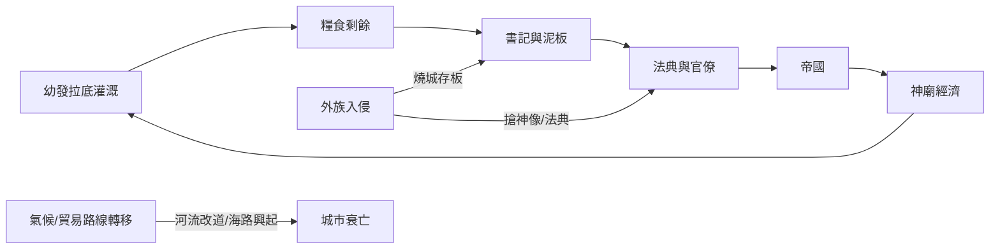

# 古巴比倫史歷史因果分析

## 案件摘要

古巴比倫三千年的因果網絡，是一場「水—泥板—神—帝國」四方共謀的連環案。幼發拉底河的灌溉農業養出糧食剩餘，剩餘養出書記與官僚，官僚養出帝國，帝國養出神廟經濟；而每一次外族入侵（赫梯、埃蘭、亞述、波斯）搶走的都不是城池，而是「神像＋法典＋檔案」這套統治技術包。最終本案的弔詭是：**軍事上巴比倫從來是輸家，制度上卻讓所有征服者變成學生**——連毀城的西拿基立，其圖書館繼承人亞述巴尼拔都得回頭抄巴比倫的泥板。

$$因果鏈：灌溉剩餘 \Rightarrow 書記階級 \Rightarrow 法典與檔案 \Rightarrow 官僚帝國 \Rightarrow 征服者抄襲 \Rightarrow 泥板保存 \Rightarrow 現代考古復案$$

## 主要驅動力

| 驅動力 | 作用機制 | 證據案件 |
|--------|----------|----------|
| **水文地理** | 運河即糧倉，糧倉即稅基；水斷則城空 | `-3200-烏魯克與楔形文字.md`、`-0689-西拿基立毀滅.md` |
| **書記技術** | 楔形文字從記賬工具升級為統治技術 | `-3200-烏魯克與楔形文字.md`、`0075-最後楔形文字.md` |
| **法典制度** | 成文法把「王的裁決」變成可複製的統治說明書 | `-2100-烏爾納姆法典.md`、`-1792-漢摩拉比統一.md` |
| **神像政治** | 馬爾杜克像的去留＝合法性的搬遷 | `-1595-赫梯洗劫巴比倫.md`、`-0539-居魯士入巴比倫.md` |
| **外生衝擊** | 青銅崩潰、外族洗劫反而固化傳統 | `-2004-烏爾陷落.md`、`-1158-埃蘭洗劫.md` |

## 因果鏈與回饋環

### 環一：灌溉—書記正回饋（建設環）

灌溉產量↑ → 人口↑ → 賬目複雜化 → 書記階級擴編 → 官僚徵稅更有效率 → 更多運河投資。`-2112-烏爾第三王朝.md` 的舒爾吉帝國是此環的巔峰：度量衡統一、學校成網、徭役表精確到人——**官僚系統自我複製，直到税比產出還重**。

### 環二：征服—吸收負回饋（保存環）

蠻族入侵 → 燒城（如 `-1761-馬里陷落.md`）→ 泥板被火烤硬反而保存 → 征服者需要舊書記管理新領土 → 楔形文字被征服者的行政體系繼承 → 巴比倫文化反而擴散。**火是本案最大的檔案管理員**：馬里檔案館、亞述巴尼拔圖書館（`-0650-亞述巴尼拔圖書館.md`）都靠毀滅才活到考古學家手裡。

### 環三：神像—合法性迴路

神像在哪，稅收與朝聖就在哪。`-1595-赫梯洗劫巴比倫.md` 搶走馬爾杜克像，`-1158-埃蘭洗劫.md` 連法典石柱一起搬——掠奪者要的不是金子，是「統治這座城的密碼」。反向操作同樣成立：居魯士（`-0539-居魯士入巴比倫.md`）把神像送回、讓猶太人歸回（`-0587-巴比倫之囚.md` 的反面），用零成本買下整座城的祭司網絡。

## 關鍵轉折點

1. **薩爾貢立阿卡德（-2334，`-2334-薩爾貢與阿卡德.md`）**：第一次證明「城邦可以變帝國」，女兒恩赫杜安娜當大祭司——把宗教也變成行省公務員。此後所有兩河強權都在抄這份作業。
2. **漢摩拉比統一（-1792，`-1792-漢摩拉比統一.md`）**：二十年扮豬、十年收網、七年消化、一部法典——「等待型統一」的樣板，證明統治靠法典不靠兵力。
3. **西拿基立毀城（-0689，`-0689-西拿基立毀滅.md`）**：第一次有人把「水」武器化，倒灌運河淹巴比倫——因果鏈的源頭被拿來當兇器，此後亞述再也治不住這座城（`-0652-兄弟叛亂.md`、`-0626-那波帕拉薩爾.md` 皆是餘波）。
4. **居魯士開城（-0539，`-0539-居魯士入巴比倫.md`）**：拿波尼度（`-0556-拿波尼度.md`）的月神改革把祭司推給波斯——**亡國的兇手往往是自己剛得罪的官僚**。
5. **塞琉西亞抽水（-0305，`-0305-塞琉西亞.md`）**：新都截走河道與人口，巴比倫不是被攻陷的，是被「搬家」搬死的；最後楔形文字（`0075-最後楔形文字.md`）只是天文日記的存檔訃告。

## 反事實推演

- **若無楔形文字**：沒有泥板賬目，就沒有跨城徵稅；兩河停留在酋邦規模，漢摩拉比法典無從書寫，《聖經》的書寫傳統（巴比倫之囚的產物）也要改道——人類第一批「帝國」可能誕生在別處。
- **若馬爾杜克像從未被搶**：神像政治的因果環斷裂，征服者的動機可能純軍事化；但祭司集團少了「迎回神像」的談判籌碼，居魯士的無血開城未必發生，波斯接手成本大幅上升。
- **若亞述巴尼拔圖書館被徹底燒成陶土**：《吉爾伽美什史詩》（`-1200-吉爾伽美什史詩.md`）消失，洪水敘事不進入希伯來傳統，西方文明的自我敘述將缺少最古老的一章——**毀滅選擇性放過泥板，是本案最大的偶然**。
- **若幼發拉底不改道**：巴比倫的衰落將主要歸於政治而非生態；塞琉西亞的「搬家成功學」失去地理藉口，楔形文字的黃昏可能晚到數百年。

## 偵探教訓

1. **別把建築物當成主體**：本案的「兇器」與「遺產」都是軟體——文字、法典、神像儀軌。城燒了十幾次，技術包每次都被下一個老大撿走。
2. **毀滅與保存是一體兩面**：火燒馬里、埋葬尼尼微、搬家塞琉西亞——每一次災難都在替泥板做防腐。查案時要問：**這份證據為什麼「恰好」留了下來？**
3. **合法性是可以搬運的**：神像、石柱、祭司網絡都是可移動資產；誰掌握了「把合法性裝箱運走」的技術，誰就用最小的軍費統治最大的城。
4. **制度壽命長於政權壽命**：從烏爾納姆到最後泥板跨越近兩千年，王朝平均壽命不過百年——**查古巴比倫史，別追國王，追那塊寫字的方法**。
