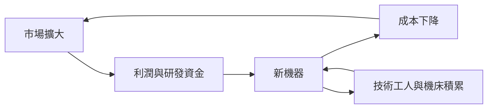

# 工業革命史歷史因果分析

## 案件摘要

本卷縱貫 1474–2018 年，核心案件只有一樁：**為什麼持續經濟成長誕生在十八世紀的英國，而不是當時更富裕的荷蘭或更科學的法國**。抽絲剝繭，兇手不是單一發明，而是一套「制度 × 能源 × 精密製造 × 市場規模」的咬合結構：專利制度保護構想（`1624-壟斷法與專利制度.md`），高工資與廉煤誘導省人省煤的發明方向，威爾金森的鏜床讓圖紙變成功率，英格蘭銀行與國債（`1694-英格蘭銀行與國債.md`）讓戰爭與運河都能融資，鐵路再把市場半徑擴大到全國。此後兩百年，是這套結構向全球擴散、並不斷自我升級的連環案。

$$\text{專利保護構想} + \text{高工資低煤價（誘因）} + \text{精密製造（落地）} + \text{資本市場（放大）} \to \text{通用動力} \to \text{工廠制} \to \text{鐵路市場整合} \to \text{鋼鐵、電力、流水線} \to \text{資訊技術}$$

## 主要驅動力

| 驅動力 | 代表證據 | 作用 |
|---|---|---|
| 制度：產權與專利 | 安妮法令（`1710-安妮法令.md`）、美國專利法（`1790-美國專利法.md`）、巴黎公約（`1883-巴黎公約.md`） | 讓發明人敢公開構想、讓投資人敢押注 |
| 能源與材料 | 達比焦炭煉鐵（`1709-達比焦炭煉鐵.md`）、攪拌法（`1784-攪拌法煉鐵.md`）、貝塞麥（`1856-貝塞麥煉鋼法.md`） | 突破生物能源天花板 |
| 誘因結構 | 艾倫命題：英國高工資＋廉煤 | 決定「省人」的機器有人買 |
| 金融制度 | 紙幣（`1661-歐洲第一張紙幣.md`）、倫敦證交所（`1801-倫敦證交所.md`）、有限責任（`1855-有限責任法.md`） | 把儲蓄轉成固定資產 |
| 組織創新 | 股份制（`1602-東印度公司與股份制.md`）、泰勒科學管理（`1911-泰勒科學管理.md`）、流水線（`1913-福特流水線.md`）、豐田方式（`1980-豐田生產方式.md`） | 技術之外，生產組織才是複利引擎 |
| 勞動與社會反應 | 盧德運動（`1811-盧德運動與技術性失業.md`）、工廠法（`1833-工廠法與勞工.md`）、礦山法案（`1842-礦山法案.md`） | 分配衝突逼出社會制度補丁 |

## 因果鏈與回饋環

### 環一：創新的自我強化（正回饋）

珍妮紡紗機（`1764-珍妮紡紗機.md`）造成紗荒，紗荒催生動力織布機（`1785-卡特萊特動力織布機.md`）；瓦特蒸汽機（`1769-瓦特蒸汽機.md`）需要精密汽缸，精密汽缸催生機床與可互換零件（`1810-機床與可互換零件.md`），機床又降低下一代的機器成本。**每一項發明都是下一項發明的原料**——這是工業革命與以往技術突發最大的差別：它會滾雪球。

### 環二：運輸成本 → 市場半徑 → 規模經濟（正回饋）

| 節點 | 案件 | 市場半徑 |
|---|---|---|
| 運河 | `1761-運河狂熱.md` | 區域 |
| 鐵路 | `1825-鐵路時代開啟.md`、`1830-利物浦曼徹斯特鐵路.md` | 全國 |
| 蘇伊士 | `1869-蘇伊士運河.md` | 洲際 |
| 貨櫃 | `1956-貨櫃革命.md` | 全球 |

運輸成本每降一級，最小有效規模就升一級，倒逼更大的設備與更深的分工——福特流水線正是全國市場養出來的怪物。

### 環三：金融深化 → 長期固定資產投資（正回饋，偶爾爆雷）

鐵路需要十年才回本，沒有有限責任與證券市場就沒人敢投。但同一制度也製造鐵路狂熱與泡沫（`1845-鐵路狂熱與泡沫.md`）、南海泡沫（`1720-南海泡沫.md`）、網路泡沫（`2000-網路泡沫.md`）。**偵推：泡沫是金融制度為長期基建預付的學費**——鐵路泡沫留下的鐵軌是真的，網路泡沫留下的光纖也是真的。

### 環四：技術失業 → 分配衝突 → 社會制度補丁（負回饋，滯後）

盧德分子砸的不是機器，是沒有社會安全網的時代。工廠法、俾斯麥社會保險（`1883-俾斯麥社會保險.md`）、格拉斯—斯蒂格爾（`1933-格拉斯-斯蒂格爾法案.md`）、SOX（`2002-SOX與審計獨立.md`）都是同一邏輯：**每次技術大躍進，補丁都晚到一個世代**。

## 關鍵轉折點

| 時刻 | 誰 | 改變了什麼 |
|---|---|---|
| 1624 | 英國國會 | 壟斷法定型專利交易，構想成為財產 |
| 1769 | 瓦特＋博爾頓＋威爾金森 | 圖紙變功率：熱力學、鏜床、商業模式三位一體 |
| 1776 | 亞當·斯密 | 分工與市場規模成為經濟學母題（`1776-國富論與市場制度.md`） |
| 1811 | 盧德分子 | 技術性失業首次成為政治議題 |
| 1825 | 史托克頓—達靈頓 | 蒸汽動力與固定路線結合，時空被重定價（`1804-蒸汽機車的誕生.md`） |
| 1913 | 福特 | 流動的流水線取代固定的工場，規模化的極限演示 |
| 1947 | 貝爾實驗室 | 電晶體（`1947-電晶體.md`）與積體電路（`1958-積體電路.md`）：能源革命轉進資訊革命 |
| 1971 | Intel | 微處理器（`1971-微處理器.md`）把工業邏輯搬進矽 |

## 反事實推演

- **若英國沒有廉價煤**：紐科門與瓦特機失去經濟動機，工業革命可能推遲百年或移往煤產地。艾倫命題成立——**誘因結構比天才重要**。
- **若 1624 年專利制度未誕生**：發明轉入行會保密與師徒制，擴散放慢；但也要注意瓦特用專利阻擋改良者二十年——制度是雙刃。
- **若沒有鐵路**：美國仍是區域經濟的聯邦，芝加哥期貨市場（`1848-芝加哥期貨市場.md`）無從統一價格，標準時區不會出現，規模經濟上限低一個量級。
- **若荷蘭而非英國贏得十八世紀**：荷蘭資本雄厚但工資已高、煤貴且無內陸煤田，其理性選擇是當「金融與貿易的荷蘭」而非「工廠的荷蘭」——**工業革命落在英國，部分是荷蘭理性的意外饋贈**（荷蘭資本反而投資了英國國債與運河）。

## 偵探教訓

1. **找咬合，不找兇手**。瓦特公式提醒我們：構想（專利）× 製造（鏜床）× 資本（博爾頓）缺一即敗。單因素解釋工業革命，等同只驗一枚指紋就結案。
2. **誘因決定發明的方向**。同樣的聰明頭腦，在廉煤社會想出省煤機器，在高工資社會想出省人機器。追問「當時什麼最貴」，比追問「誰最聰明」更有效。
3. **泡沫與基建共生**。1720、1845、2000 年的帳面災難，事後都留下真實資產。辦案時先問：崩盤之後，地上留下了什麼。
4. **補丁總是晚到**。盧德之後有工廠法，大蕭條之後有 SEC，海嘯之後有 SOX。偵探的任務不是阻止技術，而是預判下一個需要補丁的接縫。
5. **複利的來源是組織而非機器**。從股份制到流水線到豐田方式，真正不可逆的資產是「把知識寫進流程」的能力——機器會折舊，組織知識不會。
