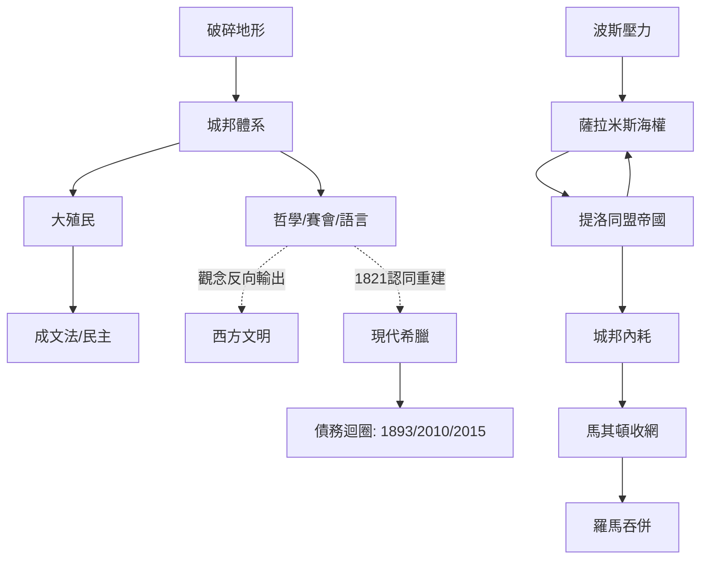

# 希臘史歷史因果分析

## 案件摘要

希臘史的因果網絡是一樁「地理判刑、制度減刑、哲學上訴」的三審案。巴爾幹的破碎地形判了統一死刑，逼出數百個小城邦；城邦間的過剩人口與貧瘠土壤逼出大殖民；殖民帶來的商業與接觸逼出成文法與個人主義；波斯帝國的壓力反而逼出泛希臘認同與雅典海上帝國；而海上帝國的暴利又反噬民主本身。最終希臘輸掉了所有獨立戰爭（喀羅尼亞、羅馬、鄂圖曼），卻靠「觀念出口」贏下了整個西方——**被征服者的制度與思想，三次反過來征服征服者**。

$$因果鏈：破碎地形 \Rightarrow 城邦林立 \Rightarrow 殖民與貿易 \Rightarrow 成文法與民主 \Rightarrow 抗波同盟 \Rightarrow 海上帝國 \Rightarrow 內耗 \Rightarrow 被馬其頓/羅馬吞併 \Rightarrow 思想反向輸出$$

## 主要驅動力

| 驅動力 | 作用機制 | 證據案件 |
|--------|----------|----------|
| **地形破碎** | 山海切割→小國寡民→直接民主可行 | `-1200-邁錫尼崩潰與黑暗時代.md`、`-0750-大殖民時代.md` |
| **人口壓力** | 貧瘠土地逼出殖民與海上謀生 | `-0750-大殖民時代.md` |
| **軍事技術** | 重裝方陣→中產公民兵→政治發言權；三列槳艦→無產槳手→民主激進化 | `-0490-馬拉松戰役.md`、`-0480-薩拉米斯海戰.md` |
| **外部壓力** | 波斯兩次入侵製造共同敵人與同盟財政 | `-0490-馬拉松戰役.md`、`-0478-提洛同盟.md` |
| **觀念再生產** | 學園、賽會、語言成為超越政權的容器 | `-0776-奧林匹亞賽會與泛希臘認同.md`、`-0387-柏拉圖學園.md` |
| **地緣傀儡學** | 列強的地理位置使希臘永遠是「別人棋盤上的格子」 | `1770-奧爾洛夫起義.md`、`1832-倫敦條約與奧托王朝.md`、`2010-三駕馬車與緊縮.md` |

## 因果鏈與回饋環

### 環一：殖民—制度正回饋

黑暗時代人口回升（`-1200-邁錫尼崩潰與黑暗時代.md`）→ 土地不夠 → 殖民團出航（`-0750-大殖民時代.md`）→ 殖民城需要重新分配土地與權力 → 「憑血緣」讓位給「憑章程」→ 母邦貴族特權被質疑 → 德拉古、梭倫相繼立法（`-0621-德拉古立法.md`、`-0594-梭倫改革.md`）。**殖民是制度的擠壓器**：一張空白的海外處女地，等於一次制度重開機。

### 環二：海權—民主互滋環

薩拉米斯的勝利靠槳手（`-0480-薩拉米斯海戰.md`）→ 劃槳的是無產階級 → 他們用命換了發言權 → 民主激進化 → 提洛同盟金庫進帕德嫩（`-0478-提洛同盟.md`）→ 帝國津貼養起陪審團津貼 → 民主運轉越依賴帝國收入 → 帝國越是暴政，民主越是「富養」。**蘇格拉底之死（`-0399-蘇格拉底之死.md`）正是此環的副作用**：五百人陪審團是帝國津貼養出的群眾機器。

### 環三：內耗—外力負回饋

城邦競爭 → 伯羅奔尼撒內耗 → 馬其頓方陣收網（`-0338-喀羅尼亞戰役.md`）→ 亞歷山大把希臘問題輸出到亞洲（`-0334-亞歷山大東征.md`）→ 繼業者戰爭再內耗（`-0323-繼業者戰爭.md`）→ 羅馬以「應邀調停」逐口吞併（`-0146-羅馬併希臘.md`）。**每一輪內耗都替下一個征服者做前置作業**——希臘從不缺敵人，缺的是不當敵人的能力。

## 關鍵轉折點

1. **邁錫尼崩潰（-1200，`-1200-邁錫尼崩潰與黑暗時代.md`）**：宮殿體系歸零，等於把希臘的制度磁碟重新格式化——此後的一切（字母、城邦、民主）都是「無政府狀態的發明」。
2. **薩拉米斯（-0480，`-0480-薩拉米斯海戰.md`）**：陸上全輸、海上翻盤，一次戰役把希臘的權力中心從斯巴達的長矛搬到雅典的槳舵——**選對了戰場，就是選對了憲法**。
3. **喀羅尼亞（-0388 前夜，`-0338-喀羅尼亞戰役.md`）**：腓力二世證明「職業化軍事機器」碾壓「業餘公民兵」——城邦的死刑判決書，但希臘文化卻藉馬其頓的刀傳遍亞洲。
4. **1821 獨立戰爭（`1821-希臘獨立戰爭.md`）**：民族主義＋列強海軍的合成品，奧托王朝（`1832-倫敦條約與奧托王朝.md`）是列強快遞來的國王——**現代希臘一出生就背著兩筆債：主權是借的，錢也是借的**（`1893-希臘第一次破產.md`）。
5. **2010 三駕馬車（`2010-三駕馬車與緊縮.md`、`2015-公投與第三次紓困.md`）**：獨立戰爭的貸款、1893 的破產、2001 進歐元區（`2001-加入歐元區.md`）的廉價信貸，是同一條債務因果鏈的四代目——**主權借貸的循環，兩百年沒斷過**。

## 反事實推演

- **若希臘地形平坦統一**：沒有城邦林立，就沒有制度實驗的多重宇宙；民主可能以某種君主開明版出現，但蘇格拉底、梭倫、陶片放逐這些「小國專屬技術」不會被發明。西方政治學的第一手教材將消失。
- **若波斯贏得薩拉米斯**：雅典海上帝國不會存在，提洛同盟貢金不會變成帕德嫩與陪審團津貼；但波斯行省制的寬容統治可能讓希臘城邦更早進入大一統市場——**民主可能是壓力的產物，而非自由的必然**。
- **若馬其頓不曾崛起**：城邦內耗將由誰收網？可能更早是羅馬，也可能西面凱爾特人。亞歷山大東征（`-0334-亞歷山大東征.md`）與希臘化時代（`-0212-阿基米德與敘拉古.md` 的悲劇背景）消失，科學中心的遷徙路線完全改寫。
- **若 1821 無列強介入**：奧爾洛夫起義（`1770-奧爾洛夫起義.md`）已示範過「借刀失敗」的結局；單靠游擊隊，建國可能延後數十年，但或許不會一開國就抵押財政——債務基因（`1893-希臘第一次破產.md`→`2010-三駕馬車與緊縮.md`）可能被省略。

## 偵探教訓

1. **輸家檔案比贏家檔案更厚**：希臘幾乎輸掉每一場獨立戰爭，但每個勝利者都得學希臘語、讀希臘書。查案時要區分「戰場因果」與「觀念因果」——後者的時滯以世紀計。
2. **壓力是制度的接生婆**：民主不是智慧的果實，是槳手、殖民者、破產農民在絕境裡談出來的。找因果時，先找誰被逼到了牆角。
3. **同盟會變帝國，津貼會變選票**：`-0478-提洛同盟.md` 的金庫搬家是全案最經典的「制度漂移」——名義不變，實質全換。任何「自願聯盟」都要查它金庫在哪。
4. **現代債務危機要往建國那天查**：2010 年的三駕馬車（`2010-三駕馬車與緊縮.md`）與 1832 年的倫敦條約（`1832-倫敦條約與奧托王朝.md`）之間，隔著的是同一根線——**這個國家的主權與財政，從出生起就是貸款買的**。
