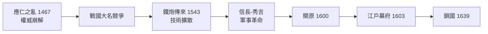

# 日本史歷史因果分析

## 案件摘要

日本史是一樁「**群島的選擇性吸入**」案件：這個資源匱乏的島國，每當外部體系出現強勢文明，就在「全面學習」與「鎖國消化」之間擺盪，並在吸收後反噬老師或撞上更大的老師。從遣唐使到黑船，從明治移植西方到戰後移植美式制度，從經濟奇蹟到失落三十年，同一套擺盪機制反覆運轉。因果鏈公式：

$$\text{外部文明壓力} \Rightarrow \text{危機感動員} \Rightarrow \text{選擇性吸收制度與技術} \Rightarrow \text{國內整合（強化權威）} \Rightarrow \text{向外擴張或輸出} \Rightarrow \text{過度擴張受挫} \Rightarrow \text{再鎖國/再吸收}$$

## 主要驅動力

| 驅動力 | 機制 | 證據案件 |
|---|---|---|
| 大陸文明引力 | 中華制度圈的光與影 | `0538-佛教東傳與飛鳥時代.md`、`0645-大化革新.md`、`0894-廢止遣唐使與國風文化.md` |
| 武士的社會契約 | 恩賞與土地 → 武家政治 | `0940-承平天慶之亂與武士崛起.md`、`1185-平家滅亡與鎌倉幕府.md` |
| 戰國競爭壓力 | 軍事競爭淘汰封建，催生統一技術 | `1467-應仁之亂與戰國時代.md`、`1543-鐵炮傳來.md`、`1600-關原之戰.md` |
| 稻米與財政 | 檢地—石高制—米價的經濟底層 | `1598-太閣檢地.md`、`1918-米騷動.md`、`1930-昭和恐慌與金解禁.md` |
| 海洋地緣 | 孤島焦慮 ↔ 資源進口命脈 | `1853-黑船來航.md`、`1941-太平洋戰爭.md`、`1973-石油危機.md` |

## 因果鏈與回饋環

### 回饋環一：吸收 → 消化 → 國風化（千年第一環）

$$\text{遣唐使} \Rightarrow \text{大化革新（}645\text{）} \Rightarrow \text{律令國家（}710\text{ 平城京）} \Rightarrow \text{攝關政治架空皇權} \Rightarrow \text{894 廢止遣唐使} \Rightarrow \text{國風文化本土化}$$

`0645-大化革新.md` 全盤移植唐制，但 `0858-攝關政治與藤原氏.md` 顯示律令制水土不服——官僚系統被貴族家門私有的同時，土地制度崩解為莊園，間接餵養了 `0940-承平天慶之亂與武士崛起.md` 的武士階層。**制度移植的裂縫，正是下一個時代的地基。**

### 回饋環二：戰國淘汰賽 → 統一 → 鎖國（軍事競爭環）

戰國兩百多年內戰是殘酷的淘汰賽，也讓日本成為世界最大的鐵炮市場之一（`1543-鐵炮傳來.md`）；`1600-關原之戰.md` 定局後，`1603-江戶幕府.md` 立即以 `1639-鎖國體制.md` 拔除外部干預——**競爭時敞開吸收，統一後立即封閉**，是島國的固定劇本。

### 回饋環三：維新 — 軍國 — 戰敗 — 民主（狂飆環）

`1853-黑船來航.md` 的外壓 → `1868-明治維新.md` 與 `1871-岩倉使節團.md` 系統性取經 → `1873-地租改正.md` 建立現代財政 → `1877-西南戰爭與士族終結.md` 掃除舊武士 → `1889-大日本帝國憲法.md` 確立天皇制國家 → `1894-甲午戰爭.md`、`1904-日俄戰爭.md` 連勝 → `1902-日英同盟.md` 加入列強俱樂部 → 但軍部戰功自大，`1931-滿洲事變與軍國主義.md` 下剋上 → `1936-二二六事件.md` 徹底失控 → `1941-太平洋戰爭.md` 過度擴張 → `1945-日本投降與占領改革.md` 崩潰與再移植。

**維新的成功為軍國的失控預付了成本**：憲法體制讓統帥權獨立於內閣，連勝的紅利讓文官無法節制軍部——因果環一路咬合。

### 回饋環四：戰後和平紅利 — 泡沫 — 失落（成長環）

占領改革（解散財閥、`1947-勞動三法.md`、地改）+ `1951-舊金山和約與日美安保.md` 的低國防成本 → `1955-戰後經濟奇蹟.md` 高成長 → `1964-東海道新幹線通車.md` 的技術自信 → `1980-豐田生產方式.md` 輸出管理革命 → `1985-廣場協議與泡沫.md` 日圓升值催生資產泡沫 → `1991-泡沫崩潰與失落的三十年.md` → `2011-三一一大地震.md` 與人口老化再壓力。**戰後體制將「危機感」制度化為公司社會，但泡沫後同一體制失去除舊布新的能力。**

## 關鍵轉折點

- **663 年白村江**：`0663-白村江之戰.md`——日本在朝鮮半島的帝國野心首次受挫，自此近千年不再直接挑戰大陸，轉向內部消化。
- **1274/1281 年**：`1274-蒙古襲來.md`——「神風」救國的神話化，深刻塑造了日本對自身命運的認知；幕府卻因恩賞無法支付而衰亡，連接 `1333-鎌倉幕府崩潰與建武新政.md`。
- **1582 年本能寺**：`1582-本能寺之變.md`——純粹偶發的家臣叛亂，卻讓秀吉（`1590-豐臣秀吉的統一.md`）而非信長完成統一，政策由軍事擴張轉向檢地與太閣體制。
- **1936 年二二六**：文官政府最後一次壓制軍部的機會，失敗即宣告通向 `1937-中日戰爭.md` 的不歸路。
- **1973 年石油危機**：`1973-石油危機.md` 逼出省能源與高附加價值轉型，反成八〇年代日本威脅論的伏筆。

## 反事實推演

- **若無白村江之敗**：日本可能更早、更執著地經營半島，國力恐耗於大陸，律令國家的內部整合將遲緩。
- **若本能寺未變**：信長的天下或許更早統一，但其嚴酷手段與對朝廷的態度可能催生更劇烈的反撲；秀吉的檢地—石高體制未必以同形出現，`1603-江戶幕府.md` 的兩百五十年和平也非必然。
- **若維新憲法採內閣統制軍隊**：統帥權獨立是軍國失控的制度入口；拔除它，`1931-滿洲事變與軍國主義.md` 的下剋上未必成功。
- **若無廣場協議**：泡沫可能延後但未必避免——超低利率與投機心理是內因，協議只是引爆器。

## 偵探教訓

1. **看危機反應，就能預測下一時代**——從 `0645-大化革新.md` 到 `1868-明治維新.md`，日本的制度躍遷永遠發生在外部震撼之後的十年內。
2. **留意「下剋上」的結構入口**——滿洲事變（關東軍獨走）與本能寺之變（家臣背叛）都是「授權失衡」的產物，不是孤立的意外。
3. **米、地、錢是幕府與帝國的共通命門**——`1598-太閣檢地.md`、`1873-地租改正.md`、`1930-昭和恐慌與金解禁.md`，三條財政線貫穿古今。
4. **成功的體制最難自我改革**——鎖國因統一而來，失落因奇蹟而成；`1991-泡沫崩潰與失落的三十年.md` 教的是：紅利期鎖死的制度，會在退潮期變成枷鎖。
