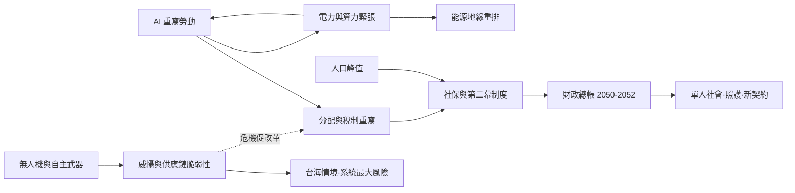

# 未來史歷史因果分析

## 案件摘要

未來史不是結案報告，是**立案偵查**：證據是當下的驅動力（人口、債務、能源、AI、氣候），情節是情境推演。本書未來史卷的案件（2030—2052）共享同一組引擎：**AI 與自動化重寫勞動、人口轉折重寫需求、氣候與能源重寫成本、債務與稅制重寫國家能力**。四股力量的交會點不是單一未來，而是分岔樹——本案偵辦的目標：標出哪些是結構必然（幾乎一定發生）、哪些是路徑依賴（取決於選擇）、哪些是純情境（取決於偶發）。

$$\text{未來} = \text{結構驅動力（確定）} \times \text{制度選擇（分岔）} \times \text{偶發衝擊（情境）}$$

三項相乘的意義：驅動力決定問題清單，制度選擇決定答案品質，偶發衝擊決定出題順序——**偵探的工作不是預測答案，是預先列出考題**。

## 主要驅動力

| 驅動力 | 對應案件 | 性質 |
|--------|----------|------|
| AI 取代初階白領 | a1-AI取代初階白領、[2033-AI責任與算法審計.md](2033-AI責任與算法審計.md) | 結構必然：技術已到，只是速度問題 |
| 人口峰值與下行 | [2048-人口峰值.md](2048-人口峰值.md)、a2-少子化的引擎 | 結構必然：生育率已定，只差時間表 |
| 債務與稅制 | a4-美國債務懸崖、[2050-財政清算與稅制重寫.md](2050-財政清算與稅制重寫.md) | 路徑依賴：危機時點可管理可拖延 |
| 能源與算力 | a9-核融合商業化、[2037-電力配給與算力條約.md](2037-電力配給與算力條約.md) | 路徑依賴：融合時點不定，電力緊張已定 |
| 氣候與資源 | a8-氣候衝擊與修復、[2041-氣候遷徙條約.md](2041-氣候遷徙條約.md)、[2039-水配給與糧食配給.md](2039-水配給與糧食配給.md) | 結構必然＋制度分岔 |
| 戰爭形態 | a5-台海封鎖、a6-戰爭形態的重寫、[2035-無人機蜂群與戰爭民主化.md](2035-無人機蜂群與戰爭民主化.md) | 純情境：取決於威懾與誤判 |

## 因果鏈與回饋環

### 鏈一：AI—勞動—分配迴路

AI 取代初階白領（a1）壓縮中產職業階梯 → 財富向資本與演算法持有者集中 → 平台反托拉斯（[2031-平台反托拉斯拆分.md](2031-平台反托拉斯拆分.md)）與全球數位稅（[2032-全球數位稅.md](2032-全球數位稅.md)）是稅制追趕技術的兩次嘗試 → 社保算法化（[2034-社保算法化.md](2034-社保算法化.md)）與照護機器人（[2040-照護機器人與單人社會.md](2040-照護機器人與單人社會.md)）是社會安全網的兩種重寫。回饋環：**分配越不均，對演算法的政治反彈越強，審計與拆分的立法越快**（[2033-AI責任與算法審計.md](2033-AI責任與算法審計.md)）。百年人生與第二幕制度（[2044-百年人生與第二幕制度.md](2044-百年人生與第二幕制度.md)、[2045-全齡教育與第二幕職涯.md](2045-全齡教育與第二幕職涯.md)）是勞動迴路的長期解：職涯從梯子改為跳板。

### 鏈二：人口—財政—世代契約迴路

少子化的引擎（a2）運轉已超過三十年，人口峰值（[2048-人口峰值.md](2048-人口峰值.md)）是它的第一個全球性里程碑 → 勞動人口萎縮，現收現付制年金吃緊，國民年金型的承諾必須重算（韓國史卷 1988 案的前車）→ 財政清算與稅制重寫（[2050-財政清算與稅制重寫.md](2050-財政清算與稅制重寫.md)）與人口下行時代的總帳（[2052-人口下行時代的總帳.md](2052-人口下行時代的總帳.md)）是兩次結算 → 遷徙成為變數：氣候遷徙條約（[2041-氣候遷徙條約.md](2041-氣候遷徙條約.md)）決定誰能借到別國的人口紅利。回饋環：**老齡社會投票能力越強，改革越難——人口結構本身阻擋人口結構的修正**。

### 鏈三：能源—算力—地緣迴路

AI 的物理底層是電力：資料中心需求爆炸 → 電力配給與算力條約（[2037-電力配給與算力條約.md](2037-電力配給與算力條約.md)）把電網變成戰略資產 → 核融合商業化（a9）若如期，能源租金崩解（石化地緣政治退場）；若延宕，電力即新的石油 → 深偽選舉（[2036-深偽選舉與真實性基礎設施.md](2036-深偽選舉與真實性基礎設施.md)）與後量子密碼遷移（a10）是同一場「算力即權力」的資訊層戰爭。回饋環：**算力集中餵養監控與深偽，監控與深偽又抬高清潔能源與密碼學的需求**——安全與自由在此迴路中同時報價。

### 鏈四：戰爭—技術—秩序迴路

無人機蜂群（[2035-無人機蜂群與戰爭民主化.md](2035-無人機蜂群與戰爭民主化.md)）把精確打擊民主化 → 傳統平台（航母、坦克）保值率下降 → 自主武器條約（[2038-自主武器條約.md](2038-自主武器條約.md)）試圖畫線，但軍備競賽邏輯強於條約邏輯 → 台海封鎖（a5）是最危險的情境節點：半導體分工（東亞史卷 1987 案）的解體將同時觸發鏈一與鏈三。回饋環：**威懾越可信，戰爭越不可能；威懾賴以為生的晶片供應鏈越集中，威懾本身越脆弱**——這是未來史最尖的因果環。

## 關鍵轉折點（情境節點）

| 節點 | 分岔 | 觀察指標 |
|------|------|----------|
| 2030 央行數位貨幣 | 貨幣主權是否重寫 | 主要經濟體 CBDC 落地率 |
| 2032 全球數位稅 | 租稅競逐是否止步 | OECD 機制的執行力 |
| 2035 蜂群戰爭 | 戰爭門檻升高或降低 | 區域衝突的無人機占比 |
| 2037 算力條約 | 電力是否成為配給品 | 資料中心用電占比 |
| 2038 自主武器條約 | 規範能否跑贏部署 | 「人在迴路」的條約文本 |
| 2041 氣候遷徙條約 | 遷徙是權利還是危機 | 條約簽署國與配額 |
| 2048 人口峰值 | 增長範式的終結 | 全球生育率與勞動參與率 |

## 反事實推演

- **若核融合提前十年商業化**：電力配給與算力條約不會發生，石化地緣政治提前退場，俄國與中東的談判籌碼崩解——但算力束縛解除後，AI 取代白領的速度反而加快，鏈一的分配問題更尖銳。能源救了地緣，未必救得了分配。
- **若台海未發生封鎖**：半導體分工延續，雁行晚景平順——但供應鏈集中的脆弱性只是延後計息；和平不是解除了風險，是把風險換成更高的未到期負債。
- **若全球數位稅失敗**：平台免於拆分與課稅，2031 案的市場結構固化——財政缺口全部落到勞動稅與消費稅，鏈二的世代契約危機提前爆發。稅制是四條鏈的共同匯流點。
- **若生育率意外回升**：人口峰值的總帳延後，年金壓力減輕——但育兒成本與照護需求的當期支出增加，財政前緊後鬆；人口政策沒有免費的解，只有時間軸的選擇。

## 偵探教訓

1. **驅動力是考題，制度是答案**：AI、人口、氣候、債務的考題已經印好，2052 的總帳只是收卷——預測的重點不是分數，是考試範圍。
2. **每條鏈都有一個匯流點**：稅制（鏈一鏈二）、電力（鏈三）、晶片（鏈四）——在匯流點做制度設計，一項改革可同時拆彈兩三條鏈。
3. **回饋環決定速度**：單向因果是直線，回饋環是指數——監控、債務、威懾脆弱性都在環上，偵探要盯的是環，不是點。
4. **情境題最危險，也最可控**：台海與自主武器是純情境——結構推著走的是必然，誤判與僥倖決定的是偶然；對偶然最好的對沖，是把必然的制度提前建好。
