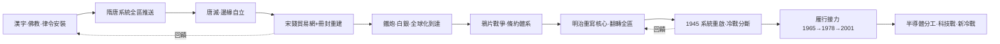

# 東亞史歷史因果分析

## 案件摘要

東亞兩千年的因果主軸只有一條：**一個以文字、官僚、朝貢為骨架的文明系統，如何被建立、被輸出、被模仿、被衝擊、被翻轉**。中國是系統的原始碼發布者；日本、朝鮮、越南是最早的 fork 開發者；西洋條約體系是 1840 年代的外部攻擊；明治維新是區內第一個成功重寫核心的案例；1945 與 1978 是兩次全系統重啟。本案偵辦的重點不是羅列事件，而是追問：系統的每一次版本升級，驅動力是外部衝擊還是內部演化？

$$\text{東亞秩序} = \text{文明核心（漢字+官僚+朝貢）} \times \text{邊緣的學習與翻轉} \times \text{外部衝擊的時機}$$

三項之中，文明核心在 1839 前是常量，之後成為被爭奪的變量——**誰能定義「現代」，誰就接手了東亞秩序的原始碼**。

## 主要驅動力

| 驅動力 | 載體 | 因果角色 |
|--------|------|----------|
| 文字與經典 | 漢字、佛教、儒家官僚 | 系統原始碼，跨國共享 |
| 財政技術 | 兩稅法、一條鞭、白銀 | 國家能力的物質基礎 |
| 貿易網絡 | 宋錢、朝貢貿易、條約口岸 | 秩序的經濟底層 |
| 軍事代差 | 鐵炮、蒸汽船、核武 | 秩序更替的暴力仲裁 |
| 美元與市場 | 美援、出口導向、入世 | 冷戰後增長引擎 |

## 因果鏈與回饋環

### 鏈一：奠基與輸出——文明系統的安裝（前 2500—900）

稻作傳播（[-2500-稻作傳播與彌生革命.md](-2500-稻作傳播與彌生革命.md)）把人口與技術推過對馬海峽；佛教傳入（[372-佛教傳入東亞.md](372-佛教傳入東亞.md)）與漢四郡確立了漢字—佛教—律令的安裝包。大化改新（[645-大化改新與律令國家.md](645-大化改新與律令國家.md)）是日本對隋唐系統的整機抄裝；白江口之戰（[663-白江口之戰與新羅統一.md](663-白江口之戰與新羅統一.md)）打完，新羅統一、日本轉入學習模式——**軍事上輸的那一方，文化上輸得心服口服**。鑑真東渡（[754-鑑真東渡與書籍之路.md](754-鑑真東渡與書籍之路.md)）證明書籍比軍隊走得更遠。科舉（[0594-科舉與東亞官僚制.md](0594-科舉與東亞官僚制.md)）與兩稅法（[0780-兩稅法與財政國家.md](0780-兩稅法與財政國家.md)）把制度版本推送全區。

### 鏈二：自立與分化——核心鬆動，邊緣分叉（900—1500）

唐滅（[0907-唐滅與東亞自立化.md](0907-唐滅與東亞自立化.md)）是系統第一次裂解：白藤江（[938-越南白藤江與獨立.md](938-越南白藤江與獨立.md)）越南出走、高麗建國（[918-高麗與後三國統一.md](918-高麗與後三國統一.md)）、日本自行其是。宋錢（[1150s-宋錢與東亞貿易網.md](1150s-宋錢與東亞貿易網.md)）用貨幣而非軍隊維繫區域網絡——**經濟聯繫比政治冊封更耐用**。元寇（[1274-元寇與蒙古衝擊.md](1274-元寇與蒙古衝擊.md)）是草原邏輯對海洋邏輯的失敗挑戰；明朝重建冊封（[1368-明朝與冊封體系重建.md](1368-明朝與冊封體系重建.md)）、鄭和（[1405-鄭和下西洋與海洋帝國.md](1405-鄭和下西洋與海洋帝國.md)）展示系統的海洋峰值——然後自我閹割。訓民正音（[1446-訓民正音與文字政治.md](1446-訓民正音與文字政治.md)）是邊緣對核心文字壟斷的局部重寫。

### 鏈三：翻轉——代差與條約（1500—1945）

鐵炮傳入（[1543-鐵炮傳入與軍事革命.md](1543-鐵炮傳入與軍事革命.md)）與白銀帝國（[1581-一條鞭法與白銀帝國.md](1581-一條鞭法與白銀帝國.md)）預告了全球化的到達；寧波爭貢（[1523-寧波爭貢與海禁崩解.md](1523-寧波爭貢與海禁崩解.md)）顯示冊封體系已經管不住貿易現實。鴉片戰爭（[1839-鴉片戰爭與朝貢體系崩解.md](1839-鴉片戰爭與朝貢體系崩解.md)）啟動條約體系的全區推送：黑船（[1853-黑船來航與開國.md](1853-黑船來航與開國.md)）—江華島（[1876-江華島條約與開化派.md](1876-江華島條約與開化派.md)）—順化，一路連鎖。明治維新（[1868-明治維新.md](1868-明治維新.md)）是唯一成功重寫核心者，甲午（[1895-甲午戰爭與東亞秩序翻轉.md](1895-甲午戰爭與東亞秩序翻轉.md)）確立翻轉，日俄戰爭（[1905-日俄戰爭與亞洲震撼.md](1905-日俄戰爭與亞洲震撼.md)）把日本推上列強席，日韓合併（[1910-日韓合併與殖民統治.md](1910-日韓合併與殖民統治.md)）完成秩序的暴力固化。馬戛爾尼（[1793-馬戛爾尼與朝貢拒絕.md](1793-馬戛爾尼與朝貢拒絕.md)）的拒絕，是核心系統拒絕打補丁的關鍵時刻——**拒絕升級的代價，五十年後一次結清**。

### 鏈四：重啟與雁行——冷戰與發展型國家（1945—）

原爆與投降（[1945-原爆與投降與戰後秩序.md](1945-原爆與投降與戰後秩序.md)）、舊金山和約（[1951-舊金山和約與冷戰體制.md](1951-舊金山和約與冷戰體制.md)）、韓戰（[1950-韓戰與冷戰東亞.md](1950-韓戰與冷戰東亞.md)）確立冷戰分斷；農地改革（[1946-農地改革.md](1946-農地改革.md)）意外為全區做了社會起點的拉平。經濟奇蹟（[1965-東亞經濟奇蹟.md](1965-東亞經濟奇蹟.md)）—改革開放（[1978-改革開放與雁行重組.md](1978-改革開放與雁行重組.md)）—廣場協議（[1985-廣場協議與雁行的改道.md](1985-廣場協議與雁行的改道.md)）—中國入世（[2001-中國入世與東亞生產網絡.md](2001-中國入世與東亞生產網絡.md)）構成雁行四段接力；金融風暴（[1997-亞洲金融風暴.md](1997-亞洲金融風暴.md)）與 GDP 超越（[2010-中國GDP超越日本.md](2010-中國GDP超越日本.md)）改寫座次；半導體分工（[1987-東亞半導體分工.md](1987-東亞半導體分工.md)）與 5G 科技戰（[2019-5G與科技戰.md](2019-5G與科技戰.md)）把競爭從關稅推到晶片——新冷戰格局（[2020s-新冷戰格局.md](2020s-新冷戰格局.md)）是 1951 體制的技術版重演。

## 關鍵轉折點

| 時刻 | 誰 | 走向的改變 |
|------|-----|-----------|
| 663 白江口 | 唐軍 | 日本放棄對抗，轉入全面學習 |
| 907 唐亡 | 朱溫 | 冊封體系首次裂解，三國各自成型 |
| 1793 馬戛爾尼 | 乾隆 | 核心拒絕升級，代差開始複利 |
| 1868 明治維新 | 明治領導層 | 東亞現代化的解釋權易手 |
| 1951 舊金山 | 美國 | 美元與市場取代朝貢與白銀 |
| 1978 十一屆三中全會 | 鄧小平 | 十億人規模的生產要素進入市場 |
| 1987 半導體分工 | 日台韓企業與政府 | 區域競爭單位從國家變成晶片製程 |

## 反事實推演

- **若白江口日方獲勝**：日本保住朝鮮半島前進基地，律令國家可能不會如此徹底唐化——之後的壬辰倭亂或許提前八百年，東亞將是雙核心對抗而非單核心輻射。
- **若乾隆 1793 接受通商**：條約體系失去戰爭理由，鴉片戰爭可能不爆發於 1840——但代差仍在，只是碰撞延後、規模更小；拒絕升級的問題本質不在時間表。
- **若明治維新失敗**：幕藩體制延續，甲午不會由日本發動，半島與台灣的殖民史改寫——但俄國南下與西洋瓜分將直接接手，條約體系照樣推送，只是執行者換人。
- **若 1978 未轉向經濟建設**：雁行停在四小龍，全球供應鏈缺少中國環節，1985 後的日本泡沫與 2010 的 GDP 超越都將不存在——新冷戰的經濟對手可能仍是日本，而非中國。

## 偵探教訓

1. **系統的強度與僵度成正比**：朝貢體系越完備，越難局部打補丁——馬戛爾尼的拒絕不是偶然，是系統的自我保護。
2. **邊緣往往先重寫核心**：訓民正音、蘭學、明治維新——距核心越遠，重寫的政治阻力越小。
3. **經濟紐帶比政治架構耐用**：宋錢網與半導體分工鏈都活過了冊封、條約、冷戰——貿易是秩序的底層，條約只是表層。
4. **衝擊-回應 vs 內部動能是假對立**：費正清與柯文各執一半——真實的因果是「外部時機 × 內部準備度」的乘積，兩者缺一，歷史就停在原地。
