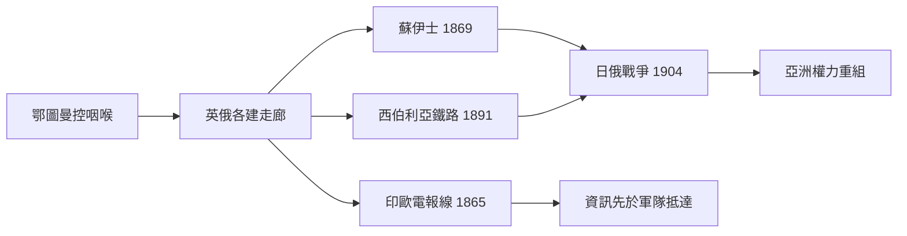

# 歐亞交界史歷史因果分析

## 案件摘要

本卷偵辦的是地球上最古老的一樁「連環案」：歐亞大陸的走廊政治。從波斯御道（[-0500-波斯御道.md](歐亞交界史/-0500-波斯御道.md)）到海底光纜（[2000-海底光纜與歐亞資訊走廊.md](2000-海底光纜與歐亞資訊走廊.md)），兩千五百年間，同一條地理走廊換了十幾任管理員——波斯、希臘化諸王、突厥、阿拉伯、可薩、蒙古、帖木兒、鄂圖曼、羅曼諾夫、大英、蘇聯、如今的中國。核心因果鏈：

$$\text{走廊地理} \to \text{過路收費的暴利} \to \text{帝國爭奪收費站} \to \text{戰爭與封鎖} \to \text{貿易改道} \to \text{舊走廊衰敗} \to \text{新走廊開闢} \to \text{新收費站崛起}$$

撒馬爾罕與伊斯坦布爾的興衰、蘇伊士與西伯利亞的開鑿、一帶一路的重鋪（[2013-一帶一路.md](2013-一帶一路.md)），全是同一條公式的迭代。**走廊不屬於任何帝國，帝國只是走廊的臨時租戶**。

## 主要驅動力

| 驅動力 | 代表案件 | 因果作用 |
|---|---|---|
| 商路租金 | [0300-粟特商隊網絡.md](0300-粟特商隊網絡.md)、[1453-君士坦丁堡陷落與陸權轉移.md](1453-君士坦丁堡陷落與陸權轉移.md) | 誰控咽喉誰收稅；稅率太高則貿易改道 |
| 軍事技術 | [0751-怛羅斯戰役.md](0751-怛羅斯戰役.md)、[1221-撒馬爾罕陷落與蒙古滅花剌子模.md](1221-撒馬爾罕陷落與蒙古滅花剌子模.md) | 戰場勝負決定走廊管理權易主 |
| 宗教網絡 | [0629-玄奘西行.md](0629-玄奘西行.md)、[0712-阿拉伯征服河中.md](0712-阿拉伯征服河中.md)、[1454-鄂圖曼米利特制.md](1454-鄂圖曼米利特制.md) | 信仰是最廉價的跨境物流系統 |
| 工業基建 | [1869-蘇伊士運河.md](1869-蘇伊士運河.md)、[1891-西伯利亞鐵路.md](1891-西伯利亞鐵路.md) | 蒸汽技術讓帝國「自建走廊」繞開租戶 |
| 邊界遺產 | [1924-中亞民族劃界與五國邊界之源.md](1924-中亞民族劃界與五國邊界之源.md)、[1923-希土人口交換.md](1923-希土人口交換.md) | 現代邊界是帝國帳本的餘額 |

## 因果鏈與回饋環

### 環一：粟特模式——網絡比帝國長壽

粟特人無國家而有網絡（[0300-粟特商隊網絡.md](0300-粟特商隊網絡.md)）：商站、雙語文書、信仰流動（佛教—摩尼教—景教）。突厥汗國（[0552-突厥汗國.md](0552-突厥汗國.md)）與唐帝國都只是它的「保險公司」。怛羅斯之戰（[0751-怛羅斯戰役.md](0751-怛羅斯戰役.md)）軍事上無關痛癢，商業上卻確認了伊斯蘭取代唐對河中的管理權——**帝國輸的是政治，網絡換的是管理員**。可薩汗國則示範了「中介國」的生存術與極限（[0965-可薩汗國的陷落.md](0965-可薩汗國的陷落.md)）：靠抽稅與信仰中立維生，一旦兩側帝國皆能直航，中介即多餘。

### 環二：蒙古整合——史上唯一的「全線一卡通」

成吉思汗統一草原（[1206-成吉思汗統一蒙古.md](1206-成吉思汗統一蒙古.md)）後，花剌子模處決商隊（[1221-撒馬爾罕陷落與蒙古滅花剌子模.md](1221-撒馬爾罕陷落與蒙古滅花剌子模.md)）觸發史上最大規模的走廊接管：金帳（[1240-基輔陷落與金帳汗國.md](1240-基輔陷落與金帳汗國.md)）、伊兒（[1258-巴格達陷落與伊兒汗國.md](1258-巴格達陷落與伊兒汗國.md)）分治，驛站全線貫通——東西方首次享受單一關稅區。但帖木兒帝國（[1370-帖木兒帝國.md](1370-帖木兒帝國.md)）的破壞性重建與帝國分裂，使陸路重新碎片化；1453 之後陸路收費站易主鄂圖曼、風險溢價上升，歐洲遂以海路「退出走廊」——**大航海不是冒險家的浪漫，是對壟斷收費站的套利**。

### 環三：工業帝國的走廊自建

蒸汽與電報讓帝國不再需要租用走廊，可以自己鋪設：運河、鐵路、電纜。代價是大博弈的白熱化——英阿戰爭（[1839-第一次英阿戰爭.md](1839-第一次英阿戰爭.md)）、俄土戰爭（[1877-俄土戰爭與柏林會議.md](1877-俄土戰爭與柏林會議.md)）、日俄戰爭（[1904-日俄戰爭.md](1904-日俄戰爭.md)）皆是兩條自建走廊的對撞測試。蘇伊士運河更把「走廊」本身變成主權標的，直到 1956 年帝國在走廊上被美國擊退（見英國史卷）。

### 環四：蘇聯閉環與走廊重開

蘇聯把歐亞心臟地帶變成封閉內院：邊界鐵幕化，走廊功能歸零。1991 中亞五國獨立（[1991-中亞五國獨立.md](1991-中亞五國獨立.md)）重開走廊，但邊界是史達林 1924 劃的五條線（[1924-中亞民族劃界與五國邊界之源.md](1924-中亞民族劃界與五國邊界之源.md)）——**重開的走廊上綁著舊帝國的引線**。阿富汗兩度證明走廊的心臟不可殖民（[1839-第一次英阿戰爭.md](1839-第一次英阿戰爭.md)、[1979-蘇聯入侵阿富汗.md](1979-蘇聯入侵阿富汗.md)），而光纜與一帶一路（[2000-海底光纜與歐亞資訊走廊.md](2000-海底光纜與歐亞資訊走廊.md)、[2013-一帶一路.md](2013-一帶一路.md)）宣示租戶換人：這次的管理員用資本而非騎兵支付過路費。

## 關鍵轉折點

- **-0329 年，亞歷山大**：東征把希臘語與希臘化城市鋪滿走廊（[-0329-亞歷山大東征與希臘化走廊.md](-0329-亞歷山大東征與希臘化走廊.md)），第一批「走廊通用語」上路。
- **1071 年，曼齊刻特**：拜占庭軍事貴族團滅（[1071-曼齊刻特戰役.md](1071-曼齊刻特戰役.md)），安納托利亞突厥化——今日土庫曼與土耳其的血緣在此接線。
- **1260 年，阿音札魯特**：馬木魯克擋住蒙古（[1260-阿音札魯特戰役.md](1260-阿音札魯特戰役.md)），埃及—敘利亞成為走廊南口的守門人，也保住了伊斯蘭世界的後勤縱深。
- **1453 年，穆罕默德二世**：收費站搬家，把歐洲趕下海（[1453-君士坦丁堡陷落與陸權轉移.md](1453-君士坦丁堡陷落與陸權轉移.md)）。
- **1921 年，外蒙古獨立**：蘇俄以「緩衝國」名義留下第一枚現代緩衝零件（[1921-外蒙古獨立.md](1921-外蒙古獨立.md)），走廊政治進入民族國家包裝時代。

## 反事實推演

- **若怛羅斯唐軍獲勝**：河中的伊斯蘭化或將延後，但粟特網絡終將在地緣壓力下改換宗主——戰役只是加速器，走廊的文化換軌取決於貿易引力而非一場會戰。
- **若花剌子模禮遇蒙古商隊**：成吉思汗或先圖金國，蒙古帝國仍將西擴（草原邏輯使然），但時序延後可能錯過花剌子模內鬥窗口——戰爭規模縮小，走廊整合延後。
- **若鄂圖曼維持低關稅**：陸路貿易或許續命百年，大航海推遲——但航海技術已成熟，西葡的遠期期權遲早行權；1453 只是把到期日提前。
- **若蘇聯未劃分五共和國**：中亞今日或為一個突厥—穆斯林自治體，獨立浪潮或成整體而非五國——但任何切割都會留下邊界飛地與水資源糾紛，只是形狀不同。

## 偵探教訓

1. **走廊的邏輯高於帝國的邏輯**：帝國興亡是表，走廊通斷是裡；偵辦歐亞史，先畫走廊地圖，再放帝國疆域動畫。
2. **收費率決定走廊命運**：壟斷者收稅太狠（鄂圖曼、蘇聯、任何過度管制），客戶就自己修路——每一次「貿易改道」都是對壟斷的市場懲罰。
3. **中介國的黃金法則**：可薩與粟特證明，走廊最穩的管理者是「兩側都離不開它」的網絡型中介；一旦技術讓兩側直連，中介的末日就到了。
4. **最後的教訓**：本卷所有戰役——怛羅斯、賽約河、阿音札魯特、查爾迪蘭——都是「管理權移交儀式」；真正的死者從來不是軍隊，而是舊走廊上的商棧、抄經房與雙語文書。偵探看歷史，要看誰在簽下一張新的過路費費率表。
