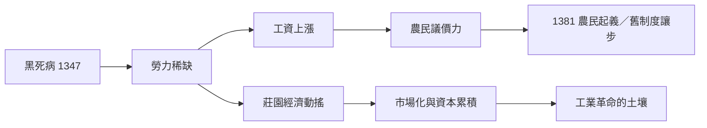

# 歐洲史歷史因果分析

## 案件摘要

本卷偵辦的不是單一命案，而是一具橫跨兩千五百年的「屍體」：歐洲本身。它死過很多次——羅馬共和之死（[-0044-凱撒與羅馬共和的終結.md](歐洲史/-0044-凱撒與羅馬共和的終結.md)）、西羅馬之死（[0476-西羅馬帝國的崩潰.md](0476-西羅馬帝國的崩潰.md)）、拜占庭之死（[1453-君士坦丁堡陷落.md](1453-君士坦丁堡陷落.md)）——卻又每次以新形態重生。解剖結論：歐洲不是被哪一個兇手殺死或救活的，而是被一組持續運轉的因果機器反覆拆解重組：**地理碎片化 → 權力多元 → 競爭 → 制度與技術創新 → 更強的競爭**。這台機器的完整因果鏈：

$$\text{地理碎片化} \to \text{權力多元} \to \text{戰爭競爭} \to \{\text{財政軍事創新},\ \text{思想市場競爭},\ \text{制度實驗}\} \to \text{優勢累積} \to \text{更激烈的競爭}$$

沒有人設計過這台機器，它是地理與教俗分裂意外裝配出來的——這是本案第一個偵探結論：**結構必然藏身在偶發事件裡**。

## 主要驅動力

| 驅動力 | 代表案件 | 作用方式 |
|---|---|---|
| 教俗二元 | [1077-卡諾莎之行與敘任權之爭.md](1077-卡諾莎之行與敘任權之爭.md) | 皇帝跪雪三日：沒有誰能壟斷合法性 → 多元體制 |
| 技術衝擊 | [1347-黑死病進入歐洲.md](1347-黑死病進入歐洲.md)、[1455-古騰堡印刷術與思想市場.md](1455-古騰堡印刷術與思想市場.md) | 人口與資訊兩次外生衝擊，重寫勞力與思想價格 |
| 戰爭財政 | [1337-百年戰爭.md](1337-百年戰爭.md)、[1870-普法戰爭與總參謀部.md](1870-普法戰爭與總參謀部.md) | 戰爭逼出稅制、國債、總參謀部——國家是戰爭的孩子 |
| 思想市場 | [1517-宗教改革.md](1517-宗教改革.md)、[1789-法國大革命.md](1789-法國大革命.md) | 印刷術＋小冊子：合法性論述成為戰場 |
| 均勻均勢 | [1648-西發里亞條約.md](1648-西發里亞條約.md)、[1815-維也納會議.md](1815-維也納會議.md) | 每次霸權衝刺都被聯盟拉回 |

## 因果鏈與回饋環

### 環一：碎片化—競爭—創新（正回饋）

羅馬崩潰後無人重建大一統：查理曼（[0800-查理曼與加洛林帝國.md](0800-查理曼與加洛林帝國.md)）與奧托（[0962-神聖羅馬帝國與奧托一世.md](0962-神聖羅馬帝國與奧托一世.md)）兩度嘗試，皆因教會不買單、繼承分割而失敗。碎片化反而成為優勢：失意者可以流動（資本、工匠、思想在列國間用腳投票），統治者被迫競爭——這正是拜占庭傭兵外包案（[1081-拜占庭傭兵帝國與外包陷阱.md](1081-拜占庭傭兵帝國與外包陷阱.md)）的反面：集權帝國外包了創新，碎片歐洲自己研發。

### 環二：黑死病—勞力價格—制度（外生衝擊的內生化）

瘟疫不是因果鏈的「起點」，而是**加速度**：沒有黑死病，勞力議價的轉變也會發生，但會慢一百年。

### 環三：印刷術—宗教改革—戰爭—主權國家

古騰堡把思想複製成本降為零（[1455-古騰堡印刷術與思想市場.md](1455-古騰堡印刷術與思想市場.md)）→ 路德的小冊子三週傳遍德意志（[1517-宗教改革.md](1517-宗教改革.md)）→ 宗教戰爭三十年 → 精疲力竭的各方簽下西發里亞（[1648-西發里亞條約.md](1648-西發里亞條約.md)），發明「主權」這個止血繃帶。思想技術 → 宗教裂解 → 戰爭 → 國際制度，四步一條龍，無一步可省。

### 環四：大戰—帳單—整合（負回饋的誕生）

三十年戰爭的教訓在兩百年後被重演：兩次大戰（[1914-第一次世界大戰.md](1914-第一次世界大戰.md)、[1945-德國投降與歐洲的分裂.md](1945-德國投降與歐洲的分裂.md)）把歐洲霸權打光，帳單催生了反向操作——煤鋼共同體（[1951-煤鋼共同體與舒曼計劃.md](1951-煤鋼共同體與舒曼計劃.md)）與羅馬條約（[1957-羅馬條約與歐洲整合.md](1957-羅馬條約與歐洲整合.md)）。**歐洲第一次用制度而非戰場消化競爭**——回饋環由正轉負。

## 關鍵轉折點

- **-0044 年，布魯圖斯們**：刺殺凱撒想救共和，反而鎖死帝制——意圖與結果分岔的經典（[-0044-凱撒與羅馬共和的終結.md](歐洲史/-0044-凱撒與羅馬共和的終結.md)）。
- **1077 年，亨利四世**：卡諾莎一跪，確定歐洲沒有人能同時握有劍與十字架——多元格局的出生證。
- **1453 年，穆罕默德二世**：君城陷落把收費站搬走，倒逼大西洋軸心。
- **1919 年，克列孟梭與威爾遜**：凡爾賽（[1919-凡爾賽條約.md](1919-凡爾賽條約.md)）既太嚴無法和解、又太寬無法壓制——二十年後的帳單當場開立。
- **1989 年，東柏林的海關小職員**：一句「立即生效」，柏林圍牆倒塌（[1989-柏林圍牆倒塌.md](1989-柏林圍牆倒塌.md)），冷戰標點系統（[1961-柏林圍牆與冷戰標點.md](1961-柏林圍牆與冷戰標點.md)）一次報廢。

## 反事實推演

- **若取消教俗二元**：歐洲成為另一個拜占庭或中華帝國——大一統、停滯、無銀行無大學無公司。歐洲奇蹟的第一因是「沒有人說了算」。
- **若古騰堡早生百年或晚生百年**：宗教改革未必成功——路德之前的異端（胡斯）都被撲滅；裂教需要思想複製成本低於鎮壓成本的時間窗口。
- **若凡爾賽條款友善**：威瑪或許存活，但結構性問題（德國體量、法國恐懼、經濟依存）仍在——修正主義未必消失，只是換代言人。
- **若煤鋼共同體失敗**：法德第四次戰爭未必開打（核武器已改變誘因），但歐洲將淪為美蘇的純粹棋盤，無今日之歐盟。

## 偵探教訓

1. **偶發與結構的分層**：黑死病、烏爾班炮、海關職員的口誤是偶發；碎片化—競爭—創新是結構。偵探要問的不是「誰殺的」，而是「為什麼這把刀當時在手邊」。
2. **回饋環會變向**：同一台競爭機器，前兩千年輸出戰爭，戰後七十年輸出整合——判斷趨勢要判斷環的方向，不是環的存在。
3. **意外事件的加速度屬性**：瘟疫、印刷術不改變方向，只改變速度；把「必然發生」與「何時發生」分開偵辦。
4. **歐洲最大的發明不是任何技術，是「多元下的競爭秩序」**——從西發里亞到羅馬條約，歐洲史就是一部「如何管理自己的碎片化」的長篇案卷。
