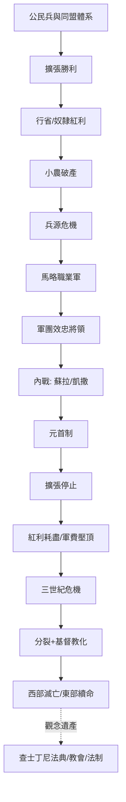

# 羅馬史歷史因果分析

## 案件摘要

羅馬史是人類史上最完整的政體實驗室，其因果網絡的主軸是一樁「擴張成功反而殺死共和」的連環案。羅馬的軍事制度（公民兵＋同盟體系）讓它贏下布匿戰爭；勝利帶來行省、奴隸與戰利品；戰利品摧毀了小農經濟；小農破產掏空了公民兵的兵源；兵源危機逼出馬略的職業軍隊；職業軍隊效忠將領而非國家；於是蘇拉、凱撒、奧古斯都輪流登場——**共和國不是被敵人打死的，是被自己的勝利紅利毒死的**。而帝國接手後又複製同一劇本：擴張停止→紅利消失→軍隊成為純成本→三世紀危機→分裂與基督教化→西半部破產，東半部以另一種身份再活一千年。

$$因果鏈：公民兵擴張 \Rightarrow 行省與奴隸紅利 \Rightarrow 小農破產 \Rightarrow 兵源危機 \Rightarrow 職業軍隊 \Rightarrow 將領私有化 \Rightarrow 內戰與元首制 \Rightarrow 紅利耗盡 \Rightarrow 三世紀危機 \Rightarrow 分裂與基督教化 \Rightarrow 西部崩潰$$

## 主要驅動力

| 驅動力 | 作用機制 | 證據案件 |
|--------|----------|----------|
| **軍事—社會制度** | 公民兵＝小農＋公民權，擴張的燃料與骨架 | `-0494-平民撤退與護民官.md`、`-0107-馬略軍制改革.md` |
| **紅利經濟** | 行省貢賦、奴隸莊園、戰利品重分配 | `-0146-迦太基滅亡.md`、`-0073-斯巴達克斯起義.md` |
| **土地問題** | 長期征戰→小農田地拋荒→被莊園吞併 | `-0133-格拉古兄弟改革.md` |
| **合法性技術** | 每次憲政危機都被新發明化解：護民官、獨裁官、元首、主教加冕 | `-0509-羅馬共和國建立.md`、`-0027-奧古斯都與元首制.md` |
| **軍隊政治化** | 軍團從國家工具變成擁立者 | `-0082-蘇拉獨裁.md`、`0069-四帝之年.md`、`0235-三世紀危機.md` |
| **宗教整合** | 基督教從被迫害者變成帝國骨架 | `0313-米蘭敕令.md`、`0325-尼西亞信經.md`、`0380-狄奧多西敕令.md` |

## 因果鏈與回饋環

### 環一：勝利—貧富分化環（共和的死因）

每贏一場戰爭 → 戰利品與行省流入元老階層 → 奴隸莊園擠垮小農（`-0133-格拉古兄弟改革.md` 的病因）→ 小農失去土地也失去兵籍 → 元老院拒絕土改 → 格拉古兄弟以體制內手段突圍失敗 → 政治暴力首例。**此環是全案核心**：羅馬的憲政能吸收階級摩擦（`-0494-平民撤退與護民官.md`），卻吸收不了「勝利紅利分配不公」這個新變數。

### 環二：軍隊私有化環（帝國的基因）

馬略開放無產者入伍（`-0107-馬略軍制改革.md`）→ 士兵的退役田依賴將領施捨 → 軍團效忠對象從元老院改為統帥 → 蘇拉示範「帶兵進城」可行（`-0082-蘇拉獨裁.md`）→ 凱撒複製並升級（`-0058-高盧戰爭.md` 的軍功資本＋`-0049-渡過盧比孔河.md` 的博弈豪賭）→ 奧古斯都用元首制把「將軍擁立」制度化（`-0027-奧古斯都與元首制.md`）。**內戰的贏家把內戰寫進了憲法**。

### 環三：邊界—軍費負回饋（帝國的死因）

擴張到極限（`0451-沙隆會戰.md` 前的邊界）→ 無新行省可搶 → 軍隊純靠稅養 → 稅基萎縮＋貨幣貶值 → `0235-三世紀危機.md` → 靠分區治理與基督教動員續命（`0395-帝國分裂.md`、`0380-狄奧多西敕令.md`）→ 邊防外包給蠻族 → `0410-西哥特洗劫羅馬.md` → `0476-西羅馬帝國滅亡.md`。**邊界越長，帝國越窮；帝國越窮，邊防越外包；越外包，越亡**。

## 關鍵轉折點

1. **十二銅表法（-0451，`-0451-十二銅表法.md`）**：把權力鬥爭從街頭搬進條文——羅馬早期的每一場階級衝突都「制度化了」，這是它能活過前四百年的原因，也是後來者誤以為憲政能解決一切的幻覺來源。
2. **坎尼會戰（-0218，`-0218-漢尼拔與坎尼會戰.md`）**：漢尼拔打出史上完美殲滅戰，羅馬卻拒絕談判、以同盟體系硬扛消耗——**此戰確立了「羅馬不認輸」的國家性格**，也暴露了勝利依賴的是制度深度而非天才。
3. **迦太基滅亡（-0146，`-0146-迦太基滅亡.md`）**：預防性戰爭滅掉最後一個對手，同時解除了「外部威脅」這個維繫內部團結的膠水——**共和國最需要敵人的時候，是剛剛打敗所有敵人的時候**。
4. **盧比孔河（-0049，`-0049-渡過盧比孔河.md`）**：凱撒的賭局不是軍事冒險而是法律事件——過河即宣判共和無效；此後「軍隊站在誰那邊」成為羅馬政治的唯一真問題（`0069-四帝之年.md`、`0235-三世紀危機.md` 反覆驗證）。
5. **米蘭敕令（0313，`0313-米蘭敕令.md`）與尼西亞信經（0325，`0325-尼西亞信經.md`）**：君士坦丁把瀕臨破產的統治機器換了一套作業系統——用教會的跨行省網絡替代失靈的市政階層；`0330-遷都君士坦丁堡.md` 則是硬體同步搬家。東部因此續命千年（`0537-聖索菲亞大教堂.md`、`0529-查士丁尼法典.md`），西部沒有等來自己的君士坦丁。

## 反事實推演

- **若格拉古土改成功**：小農兵源恢復，馬略改革可能不需要或大幅延後，軍隊私有化鏈條斷裂——共和國可能演變成某種「義大利聯邦公民國」；但元老院的既得利益使此路徑機率極低，這正是結構必然所在。
- **若漢尼拔在坎尼後直搗羅馬城**：同盟體系可能提前瓦解，地中海的主導權易手迦太基——那麼「羅馬式的法律與軍團」就只是台伯河畔的地方遺產，西方的帝國範本要等別人來寫。
- **若無基督教**：三世紀危機後的帝國缺少跨階層動員工具，可能更早裂解為多個軍事政權；但反過來說，東羅馬少了教會骨架，也未必能再活一千年（`0636-雅穆克會戰.md` 之後的存亡史將完全改寫）。
- **若 1204 年第四次十字軍不曾洗劫**（`1204-第四次十字軍洗劫君士坦丁堡.md`）：拜占庭仍面對土耳其人的壓力，`1453-君士坦丁堡陷落.md` 或許只會延後——**慢性病（邊防成本）不因一次外傷而消失**。

## 偵探教訓

1. **死因往往藏在最風光的時刻**：共和國的死亡診斷書要往布匿戰爭的勝利裡找（`-0146-迦太基滅亡.md`），不是往凱撒的刀口裡找。**凶案發生日與死亡日可以相隔一百年**。
2. **制度是為上一場戰爭設計的**：護民官、獨裁官、元首制，每個補丁都修好了舊裂縫、製造了新裂縫。查羅馬案要追的不是哪個制度「失敗」，而是哪個成功制度的外部條件消失了。
3. **誰養軍隊，誰就擁有憲法**：從馬略到三世紀的軍營皇帝（`0235-三世紀危機.md`），軍餉來源的每一次轉移都是一次政體更迭。財政檔案比法律檔案更接近真相。
4. **延續可以換裝**：西羅馬亡了，但法典（`0529-查士丁尼法典.md`）、教會與希臘火（`0718-君士坦丁堡圍城與希臘火.md`）讓「羅馬」以新容器存活。查「帝國滅亡」案時，先問：**滅亡的是政權，還是那套技術包？**
