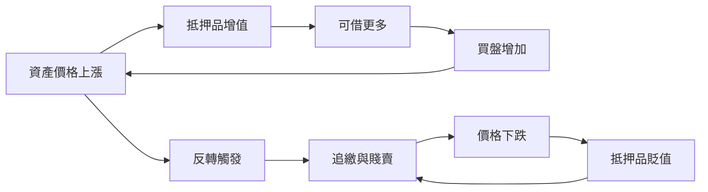

# 金融經濟史歷史因果分析

## 案件摘要

本卷自美索不達米亞的利息（`前3000-美索不達米亞利息.md`）追到 SVB 倒閉（`2023-SVB倒閉.md`），近五千年。核心謎題：**金融為什麼總是先催生繁榮、再製造崩潰、然後逼出制度**。破案結論：金融的本質是「把未來折現到今天」，這個動作天然製造槓桿；槓桿放大一切波動；而每一次崩潰，都是社會為上一輪未對沖的風險補寫制度。從威尼斯公債（`1157-威尼斯公債.md`）到聯準會（`1913-聯準會成立.md`）、從鬱金香狂熱（`1637-鬱金香狂熱.md`）到存款保險、從 2008（`2008-全球金融海嘯.md`）到 Dodd-Frank，同一齣劇本演了五千年。

$$\text{信任的制度化} \to \text{信用擴張} \to \text{槓桿上升} \to \text{資產價格正回饋} \to \text{反轉與債務通縮} \to \text{危機} \to \text{新制度補丁} \to \text{下一輪信用擴張}$$

## 主要驅動力

| 驅動力 | 代表證據 | 作用 |
|---|---|---|
| 時間偏好與利息 | `前3000-美索不達米亞利息.md` | 金融的最小單位：跨期定價 |
| 記帳技術 | 複式簿記（`1494-複式簿記.md`）、匯票 | 讓遠距、異幣、多主體的信任可計算 |
| 主權信用 | 英格蘭銀行（`1694-英格蘭銀行.md`）、國債市場、金本位（`1821-金本位.md`） | 國家的借債能力決定戰爭與霸權 |
| 央行與最後貸款人 | 白芝浩原則（`1873-巴吉特最後貸款人.md`）、聯準會（`1913-聯準會成立.md`） | 恐慌的解藥，也是道德風險的源頭 |
| 資訊與定價理論 | 複式簿記 → 馬可維茲（`1952-馬可維茲投資組合.md`）→ CAPM（`1964-CAPM.md`）→ 布萊克—休斯（`1973-布萊克休斯選擇權.md`） | 每次定價理論進步都催生新市場與新風險 |
| 貨幣秩序 | 金本位 → 尼克森震撼（`1971-尼克森震撼.md`）→ 浮動匯率與石油美元（`1974-石油美元循環.md`） | 錨的更換改寫所有資產的波動率 |

## 因果鏈與回饋環

### 環一：槓桿的正回饋與反轉（所有崩潰的通用引擎）

上行的環與下行的環是同一個環。鬱金香（1637）、南海（`1720-南海泡沫.md`）、鐵路股（`1845-鐵路股泡沫.md`）、1929（`1929-大崩盤.md`）、日本泡沫（`1990-日本泡沫崩潰.md`）、LTCM（`1998-LTCM崩潰.md`）、網路泡沫（`2000-網路泡沫與科技股.md`）、2008——費雪的債務通縮公式每次都成立：**名目債務不變、物價下跌、實質債務上升、更多賤賣**。偵推的鐵律：**找槓桿，槓桿在哪，崩潰就在哪**。

### 環二：危機 → 制度 → 新冒險空間（螺旋上升）

| 危機 | 制度補丁 |
|---|---|
| 巴迪銀行倒閉（`1340-巴迪銀行倒閉.md`） | 君主違約風險入價，國際銀行網收縮 |
| 1792 恐慌 | 梧桐協議（`1792-梧桐協議.md`）→ 紐約證交所的自律雛形 |
| 歐弗倫格尼危機（`1866-歐弗倫格尼危機.md`） | 白芝浩寫下最後貸款人操作手冊 |
| 1907 尼克博克恐慌（`1907-尼克博克恐慌.md`） | 催生聯準會 |
| 1929 大崩盤 | Glass-Steagall（`1933-格拉斯斯蒂格爾法.md`）、SEC、存款保險 |
| 2001 安隆（`2001-安隆會計舞弊.md`） | 審計獨立與資訊揭露改革 |
| 2008 海嘯 | 壓力測試、系統重要性機構監管 |
| SVB（`2023-SVB倒閉.md`） | 利率風險與監管豁免的教訓 |

**補丁總是針對上一場戰爭**：每個制度修好一種舊風險，同時讓市場去找尚未被監管的新風險——影子銀行、高頻交易（`2010-閃崩與高頻交易.md`）、加密（`2009-比特幣創世.md`）。這是金融史最深的一個回饋環：**監管是創新的路線圖**。

### 環三：主權信用 → 戰爭能力 → 霸權（政治迴路）

英格蘭銀行讓英國以 3% 利率打長期戰爭，法國以兩倍利率借不到同樣的錢——**拿坡崙戰爭的勝負一半在債券市場**。金本位時代（`1821-金本位.md`）把各國財政拴在同一錨上，代價是 1923 年德國超通膨（`1923-德國超通膨.md`）與 1931 年英國被迫脫錨（`1931-英國脫離金本位.md`）。布雷頓森林（`1944-布雷頓森林.md`）試圖兼得錨與彈性，1971 年瓦解後，石油美元循環接手供給全球流動性。**每一次貨幣錨的更換，都是一次霸權的交班**。

### 環四：全球化金融的傳染環（同步化）

歐洲美元市場（`1960-歐洲美元市場.md`）讓資金無國界，1997 亞洲金融風暴（`1997-亞洲金融風暴.md`）、1998 LTCM、2012 歐債危機（`2012-歐債危機.md`）顯示：**資本自由流動把各國的週期同步化，單一國家的審慎不再等於安全**。

## 關鍵轉折點

| 時刻 | 誰 | 改變了什麼 |
|---|---|---|
| 約前 600 | 呂底亞人 | 鑄幣（`前600-呂底亞鑄幣.md`）：價值獲得國家背書的物理載體 |
| 1694 | 英格蘭銀行 | 國債＋央行架構：主權信用成為可交易資產 |
| 1720 | 南海公司 | 泡沫成為政治醜聞與公司法改革的起點 |
| 1873 | 白芝浩 | 最後貸款人的規則化：恐慌可以被管理 |
| 1936 | 凱因斯 | 政府需求管理登上舞台（`1936-凱因斯一般理論.md`） |
| 1971 | 尼克森 | 黃金之錨拔除，全球進入信用本位 |
| 1979 | 沃克 | 以衰退換物價，央行的獨立性神話成形（`1979-沃克衝擊.md`） |
| 2008 | 雷曼 | 央行工具箱全面擴張：QE、零利率、非常規政策 |

## 反事實推演

- **若沒有英格蘭銀行與國債市場**：英國無法以低息打贏十八世紀的連番戰爭，工業革命的軍需與殖民事業失去財政後盾；荷蘭的資本或許仍會投資英國，但霸權交接可能延後半世紀。
- **若 1931 年各國早一年脫離金本位**：多數研究顯示，越早脫錨的國家復甦越快。早一年，大蕭條可能縮短三分之一，極權主義失去最關鍵的土壤。**本世紀最有價值的反事實**。
- **若 1971 年美元繼續掛鉤黃金**：美國黃金儲備將在特里芬難題下耗盡，體系仍會崩潰，只是以更混亂的方式。錨的瓦解是結構必然，時點才是選擇。
- **若 2008 年放任雷曼式的連鎖倒閉**：參照 1930–33 年九千家銀行倒閉的劇本，全球可能重演第二個大蕭條。柏南克研究了一輩子大蕭條，這是知識累積直接改寫結局的罕見案例——**環二的補丁真的被用了**。

## 偵探教訓

1. **金融危機只有一個，換著戲服登場**。抵押品從鬱金香換成鐵路股、換成房貸、換成矽谷存款，劇本不變。偵探的第一問永遠是：這一輪的槓桿放在誰的帳上。
2. **信任的技術決定金融的規模**。從楔形文字借據到複式簿記到布萊克—休斯公式，每一次「讓信任可計算」的發明，都把信用邊界外推一級。
3. **央行是補丁，不是疫苗**。最後貸款人止住恐慌，卻製造「大而不能倒」的新風險。每次救助都在為下一場危機定價。
4. **錨會換，誘惑不變**。金本位、布雷頓森林、通脹目標制——每個錨都在約束與彈性間取捨。離開錨的瞬間（1971）常被視為原罪，其實是特里芬難題的必然結算日。
5. **宏觀與微觀的接縫最危險**。安隆的帳是微觀舞弊，2008 的房貸是微觀合約，但崩潰是宏觀的。SVB 證明：個體审慎的加總不等於系統安全。辦案時，先看接縫，再看主力。
