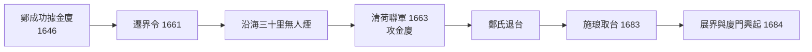

# 金門廈門史歷史因果分析

## 案件摘要

金門與廈門，一對隔海相望不到十公里的島嶼，卻在六百年間走出一條「**同源分流—對峙封鎖—再接軌**」的雙螺旋。共同的地基是閩南海商傳統與人口壓力；分岔點在 1646 年鄭成功據金廈抗清；對峙的頂點是 1958 八二三炮戰；和解的標記是 2001 小三通。本案的主謀不是任何一位將領，而是「**海洋貿易線與帝國陸權線的拉鋸**」——誰控制海權，誰就控制金廈；誰把金廈當邊防，誰就讓它們窮困。因果鏈公式：

$$\text{閩人海性} \Rightarrow \text{海商集團崛起} \Rightarrow \text{陸權政權圍剿} \Rightarrow \text{遷界與封鎖} \Rightarrow \text{邊防化/戰地化} \Rightarrow \text{兩岸和解} \Rightarrow \text{海路重啟}$$

## 主要驅動力

| 驅動力 | 機制 | 證據案件 |
|---|---|---|
| 海洋貿易線 | 月港—料羅灣—郊行—僑匯的財富脈絡 | `1522-月港走私王國.md`、`1628-鄭芝龍與海上帝國.md`、`1784-廈台對渡與郊行貿易.md` |
| 帝國陸權邏輯 | 海禁—遷界—炮擊的封鎖脈絡 | `1562-嘉靖倭寇與海禁.md`、`1661-遷界令.md`、`1956-金門戰地政務.md` |
| 移民網絡 | 落番、僑批、僑資回饋 | `1870-落番下南洋.md`、`1904-僑匯與僑批.md`、`1921-廈門大學與陳嘉庚.md` |
| 兩岸對峙 | 內戰延續的地理遺產 | `1949-古寧頭戰役.md`、`1958-八二三炮戰.md`、`1960-單打雙不打.md` |
| 和解與接軌 | 軍事線降溫換經濟線升溫 | `1979-停止炮擊與三通.md`、`1990-金門協議.md`、`2001-小三通.md` |

## 因果鏈與回饋環

### 回饋環一：海禁 → 走私 → 海商帝國（悖論環）

$$\text{海禁（}1562\text{）} \Rightarrow \text{走私利潤飆升} \Rightarrow \text{月港—浯嶼集團武裝化} \Rightarrow \text{鄭芝龍收編（}1628\text{）} \Rightarrow \text{料羅灣海戰（}1633\text{）擊退荷蘭} \Rightarrow \text{海商成為東亞實質海權}$$

朝廷想靠 `1562-嘉靖倭寇與海禁.md` 掐死海上貿易，結果反而把利潤讓給武裝走私集團；`1628-鄭芝龍與海上帝國.md` 證明被招安的走私王，比任何水師都更有效——`1633-料羅灣海戰.md` 由「海盜」守衛帝國海疆，是本案最辛辣的諷刺。

### 回饋環二：遷界 — 封鎖 — 邊疆化（封鎖環）

`1646-鄭成功與金廈基地.md` 把兩島變成抗清堡壘，清廷以 `1661-遷界令.md` 焦土回應；`1663-清荷聯軍攻金廈.md` 是兩大帝國（陸權清＋海權荷）罕見聯手絞殺一個海商政權。鄭氏退台後，`1684-展界與廈門興起.md` 讓廈門改行官方貿易路線而繁榮，金門則因腹地小、人口壓力大，走上 `1870-落番下南洋.md` 的移民之路——**同一場封鎖，兩種後果**。

### 回饋環三：僑匯 — 文教 — 現代性（回流環）

下南洋的苦力與商販寄回僑批 → `1904-僑匯與僑批.md` 顯示匯款網絡之規模 → 陳嘉庚以橡膠財富辦 `1921-廈門大學與陳嘉庚.md` → 金門僑資也蓋起番仔樓與學校 → 抗戰時 `1939-南僑機工.md` 僑胞回國服務——**僑民網絡是金廈在帝國邊陲仍能現代化的關鍵輸血管**。

### 回饋環四：對峙 — 軍事化 — 依賴 — 解凍（冷戰環）

`1949-古寧頭戰役.md` 使金門從反攻跳板變成守勢堡壘 → `1954-九三炮戰.md`、`1958-八二三炮戰.md`、`1960-單打雙不打.md` 把戰爭制度化為日常 → `1956-金門戰地政務.md` 凍結地方自治數十年 → 美方與北京默契下的 `1979-停止炮擊與三通.md` 單方面解凍 → `1990-金門協議.md` 建立首個半官方管道 → `1992-戰地政務終止.md`、`2001-小三通.md` 逐步歸還民生。**炮彈打出來的不是勝負，而是默契**——八二三後北京「打而不登、登而不打」，反而把金門留成兩岸之間的活結。

## 關鍵轉折點

- **1633 年**：料羅灣海戰——鄭氏海商集團確立東亞海權，金廈短暫成為海洋中國的首都。
- **1683 年**：`1683-澎湖海戰與金廈棄留.md`——施琅勝利使金廈失去軍事價值，朝廷一度考慮棄守；留與不留的辯論決定了其後兩百年的定位。
- **1938 年**：`1938-日軍佔領金廈.md`——海外僑匯與本土的聯繫被切斷，戰後復員（`1945-光復與金廈復員.md`）未及完成又陷入內戰。
- **1949 年**：古寧頭——金門由閩南邊島變成冷戰前線；`1952-金門酒廠.md` 則是戰地經濟的意外副產品。
- **1979 年**：停止炮擊——全案由軍事敘事轉向經濟敘事的分水嶺。

## 反事實推演

- **若無遷界令**：鄭氏據金廈的海洋政權可能存續更久，東亞的海權格局不會輕易讓位給清朝陸權——但也可能提前發生更慘烈的總攻。
- **若 1949 年古寧頭失守**：金門易手，台海防線改寫，`1958-八二三炮戰.md` 的戰場將在澎湖或台灣本島；美國協防的計算完全不同。
- **若無僑匯網絡**：金廈在十九、二十世紀之交將是純粹貧困邊疆，廈門大學與南洋回饋的現代化線全部消失。
- **若八二三後北京全力攻登**：戰爭升級可能拖入美國，兩岸和解的伏筆（活結）不復存在——克制本身是一種戰略資產。

## 偵探教訓

1. **封鎖製造黑市，黑市製造霸主**——從月港走私到小三通旁的漁船交易，禁令從來是利潤的催化劑。
2. **追僑匯，就追到了邊陲的現代化**——`1904-僑匯與僑批.md` 的匯款單比任何官方文書都更能解釋金廈的學校、樓房與鐵路。
3. **軍事對峙可以制度化為默契**——單打雙不打是「以炮彈通信」的奇特和平技術，值得寫進衝突研究教科書。
4. **地理决定角色，角色决定命運**——同一對島嶼，在鄭氏手中是海洋帝國中樞，在冷戰中是前線哨所，在 ECFA 時代（`2010-ECFA早收與廈金經貿.md`、`2018-金門供水工程.md`）是接軌橋頭堡；改變的從來不是島，而是島被賦予的角色。
