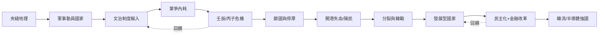

# 韓國史歷史因果分析

## 案件摘要

半島兩千年的案卷攤開來看，不是王朝更替的流水帳，而是一張因果網：**地理（夾縫）決定命運，命運決定制度，制度決定誰能打誰不能打，打輸了又回頭改造制度**。韓國史的驅動力從來不是單一变量——是「大陸帝國的壓力 × 海洋勢力的入侵 × 內部黨爭的內耗 × 存亡關頭的自我重造」四力絞合。本案的偵辦目標：把這張網拆開，指出誰推動誰、哪些是結構必然、哪些是偶然的火花。

$$\text{半島命運} = \text{夾縫地理（常量）} \times \text{外部壓力（變量）} \times \text{內部凝聚（自變量）}$$

三項相乘：地理是死數，外部壓力無法選擇，唯一能操作的變量是內部凝聚——韓國史所有的勝仗敗仗，最後都在這一項上結算。

## 主要驅動力

| 驅動力 | 載體 | 因果角色 |
|--------|------|----------|
| 夾縫地理 | 遼河—鴨綠江—對馬海峽 | 結構常量：所有入侵的路線圖 |
| 大陸帝國 | 漢、隋唐、蒙古、明、清 | 秩序供給者兼最大威脅 |
| 文字與制度輸入 | 漢字、佛教、科舉、性理學 | 文明的雙面：養分也是鎖鏈 |
| 民間動員網絡 | 部曲、書院、鄉約、教會 | 國家崩潰時的備用系統 |
| 發展型國家 | 軍事威權＋財閥 | 後發追趕的高速引擎（兼炸彈）|

## 因果鏈與回饋環

### 鏈一：古代——軍事壓力鑄造國家形態

高句麗能立國七百年（[-0037-高句麗建國.md](-0037-高句麗建國.md) 所述的遼東體制），靠的是對抗漢四郡（[-108-漢四郡與漢字文化圈.md](-108-漢四郡與漢字文化圈.md)）的持續戰時動員；廣開土大王（[0391-廣開土大王.md](0391-廣開土大王.md)）的南征北討，正是這套動員體制的峰值輸出。薩水之戰（[0612-薩水之戰.md](0612-薩水之戰.md)）擋下隋百萬大軍——地形武器化＋意志，讓半島免於被併入大陸體系。因果方向：**外部壓力越大，半島政權的軍事—動員性格越強**。

### 鏈二：中世——制度輸入的雙面迴路

高麗接收科舉（[0958-光宗科舉.md](0958-光宗科舉.md)）換來文治國家，也種下文臣壓武臣的結構病——武臣政變（[1170-武臣政變.md](1170-武臣政變.md)）是這條迴路的爆炸點。蒙古入侵（[1231-蒙古入侵與大藏經.md](1231-蒙古入侵與大藏經.md)）反而催生八萬大藏經——**宗教印刷術成為民族韌性的備份系統**，直指活字（[1377-直指活字.md](1377-直指活字.md)）承接這條技術線。朝鮮建國（[1392-朝鮮建國.md](1392-朝鮮建國.md)）後性理學國家化，訓民正音（[1443-訓民正音.md](1443-訓民正音.md)）企圖拆掉漢字階級壟斷，卻被兩班壓制四百年——**制度輸入與本土創新一直在拉鋸**。

### 鏈三：近世危機——黨爭的複利帳單

壬辰衛國戰爭（[1592-壬辰衛國戰爭.md](1592-壬辰衛國戰爭.md)）的潰敗不是軍事問題，是黨爭人事系統的總帳單；李舜臣（[1592-龜船與李舜臣.md](1592-龜船與李舜臣.md)）的制海權與義兵動員救回半局。丙子胡亂（[1636-丙子胡亂.md](1636-丙子胡亂.md)）換了宗主，華夷秩序在半島內化——北學派（參見東亞史卷）試圖補課，正祖改革（[1776-正祖改革與奎章閣.md](1776-正祖改革與奎章閣.md)）來得太遲。這條鏈的教訓：**內耗的利息按複利計算，危機到來時一次性結清**。

### 鏈四：現代——殖民地遺產與發展迴路的雙螺旋

開港（[1876-江華島條約.md](1876-江華島條約.md)）、乙巳條約（[1905-乙巳條約.md](1905-乙巳條約.md)）、韓日合併（[1910-韓日合併.md](1910-韓日合併.md)）是外部力量壓倒內部重整的連續失血；三一運動（[1919-三一運動.md](1919-三一運動.md)）證明社會動員網絡未死。光復與分裂（[1945-光復與分裂.md](1945-光復與分裂.md)）後，韓戰（[1950-韓戰.md](1950-韓戰.md)）的廢墟上，漢江奇蹟（[1961-漢江奇蹟.md](1961-漢江奇蹟.md)）以出口紀律重建國家，三星半導體豪賭（[1983-三星半導體豪賭.md](1983-三星半導體豪賭.md)）完成技術登頂，民主化（[1987-六月民主抗爭.md](1987-六月民主抗爭.md)）與 IMF 危機（[1997-IMF危機.md](1997-IMF危機.md)）是同一台引擎的兩筆結算。

## 關鍵轉折點

| 時刻 | 誰 | 走向的改變 |
|------|-----|-----------|
| 612 薩水 | 高句麗守軍 | 半島保持獨立政體，未被大陸吞併 |
| 1170 武臣政變 | 鄭仲夫等 | 文治國家軍事化，百年武人時代 |
| 1443 訓民正音 | 世宗 | 文化認同的種子埋下（四百年後發芽）|
| 1592 閑山島 | 李舜臣 | 制海權保住國家命脈 |
| 1919 三一 | 全民 | 獨立運動從宮廷轉入社會 |
| 1961 出口立國 | 朴正熙 | 從援助依賴轉為出口紀律 |
| 1987 六月 | 全民抗爭 | 發展壓倒民主的方程式反轉 |

## 反事實推演

- **若無薩水之戰的勝利**：半島併入大陸帝國，無三國文化競爭，佛教藝術、活字、韓文很可能不會以獨立國家的形式出現——東北亞成為單一漢字帝國的內海。
- **若李舜臣不掌握制海權**：日軍糧道暢通，義兵被逐區消滅，明軍失去緩衝——半島日本化的時間提前三百年，明治之後的殖民只會更徹底。
- **若朴正熙選進口替代**：美援斷炊後無外匯來源，財閥無紀律約束，韓國走向菲律賓化的家族資本主義——1988 年奧運不會在漢城，而是債務違約談判桌上。
- **若 1997 選擇馬來西亞式管制**：財閥免於去槓桿，短期止痛，但高負債體質延續——2008 金融海嘯時半島將是重災區而非免疫者。

## 偵探教訓

1. **地理是常量，制度是變量**：夾縫位置無法選擇，但回應方式可以——同一個夾縫，高句麗打出七百年，朝鮮王朝打出三百年鎖國。
2. **內耗按複利計息**：黨爭的帳單總在危機到來時一次結清——壬辰的潰敗是二十年黨爭的到期日。
3. **社會是國家的備份系統**：義兵、三一、六月——國家崩潰時，動員節點（書院、教會、校園）決定能否重啟。
4. **引擎與炸彈同體**：財閥、威權、紀律——讓韓國跑最快的機器，也正是 1997 年爆炸、1987 年被迫換氣的部分。拆除炸彈的方法不是拆引擎，是換司機與加煞車。
