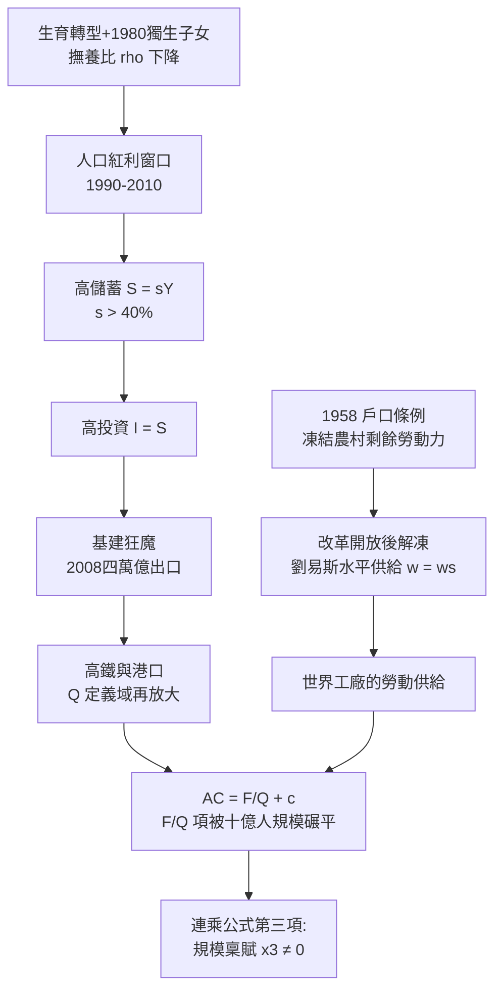

# 第五章　規模稟賦：人口紅利、高儲蓄與基礎建設

> 前兩章解決了「允許做」（制度鬆綁）與「來得及做」（雁行時機）。本章探案的最後一件證物是一部自動扶梯：每天清晨，數以千萬計的年輕人從內陸湧向沿海工廠。制度打開了門，時機排好了班次，而讓這一切以十億人規模運轉的，是稟賦本身——人口的年齡結構、儲蓄的習慣、與把這兩者焊接成生產力的基礎設施。

## 一、人口紅利的數學：撫養比下降是一台隱形的印鈔機

人口紅利常被誤解為「人多好辦事」。嚴格定義下，紅利來自**年齡結構**而非人口總量：當勞動年齡人口（生產者）相對於被撫養人口（消費者）的比例上升，整個社會的產出中可以轉化為積蓄的比例隨之上升。

設勞動人口 $L$，被撫養人口 $D$，撫養比 $\rho = D/L$。人均可支配產出為：

$$y_{disp} = \frac{Y}{L + D} = \frac{y_L}{1 + \rho}$$

其中 $y_L$ 為勞動者人均產出。$\rho$ 從 0.7 降到 0.4，人均可支配產出無須任何生產率提升即增加約 18%。1980年前後，中國的生育率在獨生子女政策（見 [1980-獨生子女政策](../../世界史/中國現代史/1980-獨生子女政策.md)）與既有生育轉型的疊加下快速下降，兒童撫養負擔減輕，而此前嬰兒潮世代正好進入勞動市場——「生產者多、被養者少」的黃金結構形成，紅利窗口大約覆蓋1990—2010年。

1994年開羅人口會議把人口問題從「控制數量」轉向「結構與權利」（見 [1994-開羅人口會議](../../世界史/世界發展史/1994-開羅人口會議.md)），此時中國恰好站在紅利窗口的中央——政策敘事與人口現實，難得地指向同一方向。

## 二、高儲蓄的算式：$S = sY$ 與增長的自迴路

紅利的第一個去處是儲蓄。國民儲蓄恆等式：

$$S = sY, \qquad I = S \;\Rightarrow\; \frac{K_{t+1}}{Y} \uparrow$$

中國的儲蓄率 $s$ 長期在 40% 以上——接近一般經濟體的兩倍。原因可以拆成三筆帳：

1. **生命週期帳**：紅利期人口的中位年齡低、處於儲蓄高峰段；
2. **預防性帳**：社會保障薄弱，家庭以儲蓄自保（教育、醫療、養老三大件）；
3. **企業與政府帳**：國有部門利潤留存與財政盈餘直接計入國民儲蓄。

在閉合經濟中 $I=S$，高儲蓄直接變成高投資。這是一條自我加速的迴路：

$$Y \uparrow \;\xrightarrow{s\, \text{固定}}\; S \uparrow \;\Rightarrow\; K \uparrow \;\Rightarrow\; Y \uparrow$$

日本與韓國在追趕期同樣經歷過高儲蓄階段；中國的差異只在規模——同樣的 $s$，乘上十億級的 $Y$，投資的絕對額是人類歷史上第一次見到的量級。

## 三、劉易斯轉折點：農村剩餘勞動力的無限供給

發展經濟學的劉易斯模型描述了後發國家的標準劇本：傳統農業部門存在大量邊際產出近零的剩餘勞動力，現代部門只要出價略高於農業生存工資 $w_s$，即可按固定價格招募任意數量勞動——**勞動供給曲線在一段區間內是水平的**：

$$w = w_s, \quad \forall L \leq L_{surplus}$$

1958年《戶口登記條例》建立的城鄉二元結構，在計劃時代把農民鎖死在土地上（見 [1958-戶口條例與城鄉二元](../../世界史/社會結構史/1958-戶口條例與城鄉二元.md)）；改革開放後，這道閘門逐步放開——先允許「離土不離鄉」，再允許進城務工。被凍結二十年的剩餘勞動力一次性解凍，形成人類史上最大規模的和平人口遷移。

水平供給曲線的經濟含義：工業部門的利潤份額極大化，資本積累速度極大化。中國製造品價格長期壓不上去，正因為供給端的 $L$ 幾乎取之不盡。轉折點（劉易斯拐點）在2000年代中期之後逐漸顯現——農民工工資開始持續上漲，水平段走平，這也預告了雁行的下一梯次。

## 四、基建狂魔的因果：$AC(Q) = F/Q + c$ 的十億人版本

高儲蓄＋無限勞動，還需要一樣東西才能變成增長：把人、貨、電、訊息連接起來的基礎設施。這裡直接借用姊妹書《美國為何崛起》第三章的同款公式（見 [03-大陸規模](../美國為何崛起/03-大陸規模：西進、鐵路與統一市場.md)）：

$$AC(Q) = \frac{F}{Q} + c$$

高鐵、港口、電網、光纖都是 $F$ 極大、$c$ 極小的產業——平均成本幾乎完全由 $Q$ 決定。美國在19世紀用大陸市場把 $Q$ 做大；中國在20世紀末擁有的，是**同一個 $F/Q$ 曲線上十億人的 $Q$**。一條高鐵線的固定成本與美國、日本差異有限，但潛在乘客量是數億——$F/Q$ 項被規模直接碾平。

這解釋了「基建狂魔」為何偏偏出現在中國，而且出現在2008年之後：

1. **需要**：勞動力從內陸向沿海的大規模流動，對運輸與通信提出海量需求；
2. **錢**：2008年全球金融危機後的四萬億刺激（見 [2008-北京奧運汶川與四萬億](../../世界史/中國現代史/2008-北京奧運汶川與四萬億.md)），恰好以基建為主要出口——儲蓄池裡的水找到管道；
3. **能力**：劉易斯水平段尚未走完，工程勞動力充沛；政府動員土地與徵遷的行政能力舉世無雙。

三者缺一，基建狂魔都不成立。這正是連乘邏輯的又一次體現。

## 五、高鐵與港口：把 $Q$ 從圖紙變成現金流

2008年後中國高鐵里程躍居世界第一，港口吞吐量包攬全球前十大集裝箱港的七席。基礎設施對增長的貢獻，本質是把市場半徑 $Q$ 的定義域再次放大：高速公路連通省域市場，高鐵把「一小時經濟圈」的定義改寫，港口把製造能力接入全球貿易網（見 [1956-集裝箱革命](../../世界史/商業貿易史/1956-集裝箱革命.md)）。

設運輸成本降低使有效市場半徑從 $R$ 擴到 $R'$，則可及市場規模：

$$Q \propto \pi (R')^2 - \pi R^2$$

$R$ 每擴大一倍，$Q$ 擴大約三倍。美國用一個世紀完成的 $R$ 擴張，中國用兩個十年壓縮完成——後發優勢的實質是：別國踩過的 $F/Q$ 曲線已經被驗證，中國只需按自己的 $Q$ 量級重新抄寫參數。

## 六、稟賦的三重奏：撫養比、儲蓄率與基建的閉合迴路

把本章變量連成閉合迴路：撫養比 $\rho\downarrow$ 提高儲蓄率 $s$，$S=sY$ 供給投資，投資建設基建，基建放大市場 $Q$ 並降低勞動力遷移成本，反過來加深劉易斯水平段的紅利。三個變量互相鎖定、互為因果——這就是為什麼規模稟賦作為連乘公式的一項**不可替代**：沒有足夠的 $Q$，同樣的儲蓄率只會造成產能過剩而非規模經濟；沒有紅利期的 $s$，再大的 $Q$ 也修不出高鐵網。

反事實檢驗：印度擁有相近的人口總量與更年輕的年齡結構，但其儲蓄率長期低了十餘個百分點，基建存量差距更大——三重奏只奏響了人口一重。蘇聯有規模有基建，卻沒有第三章的鬆綁與第四章的時機。規模稟賦是必要條件，但只有與其他項相乘才產出奇蹟。

## 小結

本章的探案結論：規模稟賦不是「人口多」三個字，而是三個可計算變量的三重奏——撫養比下降提供紅利窗口，$S=sY$ 的高儲蓄把紅利轉成投資，劉易斯式的無限勞動供給壓平成本曲線；而 $AC(Q)=F/Q+c$ 的十億人版本，讓基建從燒錢的公共品變成規模經濟的收割機。1958年戶口條例的凍結與改革後的釋放，構成這台機器最重要的「先鎖後放」設計。至此連乘公式的前三項（鬆綁、時機、稟賦）已各就各位；下一章的探案將追查第四項——國家再發明：一個只會修路的國家成不了超級出口國，還需要一台會補貼學習、會建平台、也會自我改革的國家機器。
