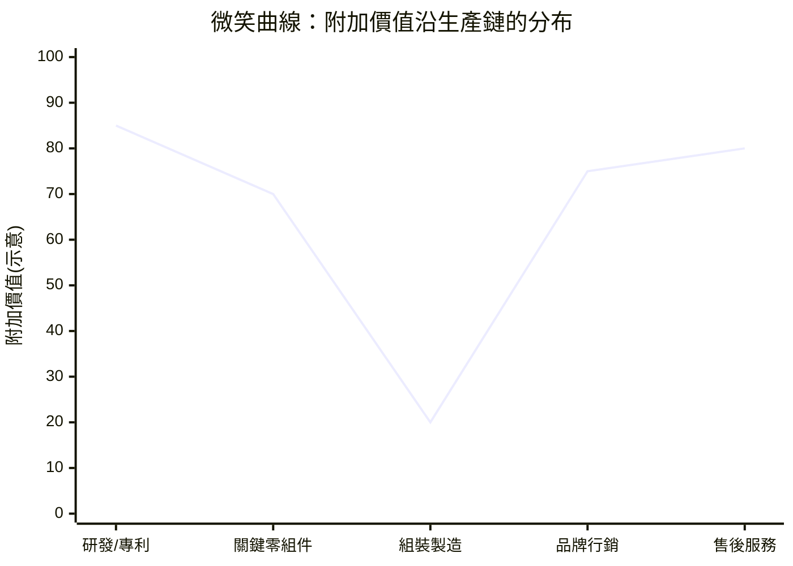
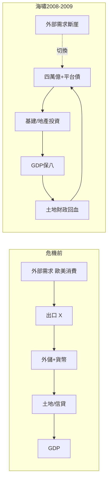
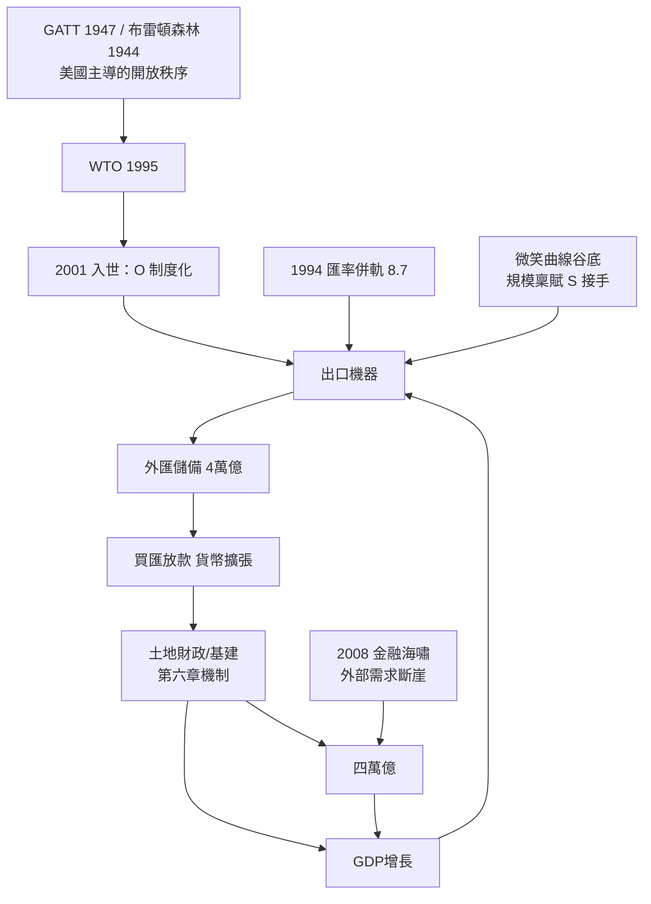

# 第七章　接入世界：入世、世界工廠與四萬億

## 一、懸案：十三億人如何擠進一扇已經有人排隊的門？

連乘公式的最後一項，是**接入開放秩序**。前四章的成果——制度鬆綁 $B$、雁行時機 $T$、規模稟賦 $S$、國家再發明 $R$——都是「國內變數」；但中國崛起的臨門一腳，是把這十三億人規模的生產體系，接上一個由美國主導、以GATT/WTO為骨架的開放貿易秩序。1995年WTO成立時，中國已為「復關」（恢復關貿總協定席位）談判了九年；到2001年正式入世，談了十五年。詳見[1995-WTO成立](../../世界史/商業貿易史/1995-WTO成立.md)。

本章要偵破的疑案有三層：

1. 為什麼**時機**恰好——1990年代雁行梯隊正好騰出勞力密集環節；
2. 為什麼**位置**恰當——中國不是去爭微笑曲線的頂端，而是先站穩底部；
3. 為什麼**衝擊**可控——2008年金融海嘯，外部需求一夜蒸發，中國用四萬億自救，這條迴路竟沒有斷。

## 二、1995 WTO：開放秩序的總閘門

1995年1月1日，世界貿易組織取代運作了近半世紀的GATT（見[1947-GATT](../../世界史/商業貿易史/1947-GATT.md)），把多邊貿易規則從「貨物」擴展到服務與智慧財產權，並設立爭端解決機制。對中國而言，這不是一個貿易俱樂部，而是**美國戰後秩序設計的總閘門**——跨書對照《美國為何崛起》第六章[06-兩次大戰：從債務國到秩序設計者](../美國為何崛起/06-兩次大戰：從債務國到秩序設計者.md)：美國在1944年布雷頓森林會議（[1944-布列頓森林](../../世界史/世界發展史/1944-布列頓森林.md)）與1947年GATT上搭建的，是一套「開放市場＋美元結算＋規則化爭端」的體系；日本、德國、四小龍的崛起，全是**接入**這套體系的後果。

探案的關鍵在此反轉：中國的崛起故事，常被敘述為「挑戰美國秩序」；但在第五項變數的意義上，2001年中國做的恰恰是**深度加入**美國主導的開放秩序——接受更嚴格的規則約束（關稅減讓、服務開放、智慧財產權、特別保障條款），換取永久正常貿易關係（PNTR）與最惠國待遇的確定性。連乘式寫作：

$$Y = B \times T \times S \times R \times O, \quad O: 0 \to 1$$

1980年代的中國，$O$ 是半開的門（來料加工、經濟特區試點）；1990年代最惠國待遇年年受美國國會審查，$O$ 帶有不確定性折價；入世之後，$O$ 才第一次成為**制度化、可預期的常數**。外資因此敢下長期賭注。

## 三、2001入世：談了十五年的入場券

2001年12月11日，中國正式成為WTO第143個成員。相關檔案：[2001-中國入世](../../世界史/商業貿易史/2001-中國入世.md)、[2001-中國入世與世界工廠](../../世界史/世界簡史/2001-中國入世與世界工廠.md)、[2001-中國入世與東亞生產網絡](../../世界史/東亞史/2001-中國入世與東亞生產網絡.md)。

入世的承諾清單極其具體：平均關稅從15.3%降至約9.8%、工業品配額逐步取消、開放分銷與零售、允許外資銀行與保險進入、修訂超過兩千項法規。探案式的理解是：**入世把第六章「國家再發明」的成果鎖進了國際條約**。國內改革可能反覆（1989–1991殷鑑不遠），但條約義務不可逆——入世本質上是用外部約束（外部錨）來固化內部改革（內部承諾）。這是「再發明的國家」才做得出的動作：一個純計畫國家既無力兌現，也不會自願束縛。

## 四、世界工廠：微笑曲線底部的戰略價值

宏碁施振榮1992年提出的微笑曲線，把生產鏈畫成一張兩端上翹的拋物線：左端是研發與關鍵零組件（高毛利），右端是品牌、行銷、服務（高毛利），中間的組裝製造沉在谷底（低毛利）。中國入世後的分工位置，正是谷底。

多數論者把谷底讀成「悲慘增長」；探案則要反轉一次。谷底有三個被低估的性質：

1. **規模不可替代**：組裝是最吃規模與效率的環節。中國的 $S$（規模稟賦）——近乎無限供給的年輕勞動力、統一大陸市場、完整產業門類——在谷底環節的報酬率最高。同樣一億件手機的組裝訂單，只有中國接得下也學得快。
2. **學習曲線入口**：製造是技術學習的入口，不是終點。加工貿易進口晶片出口整機，看似只賺工繳費，但供應鏈、工程師、品管體系在二十年間完成了從谷底向兩端的爬升——這是雁行理論的標準劇本（詳見第二章）。
3. **網絡效應鎖定**：富士康不是一家工廠，是一個生態。珠三角、長三角的產業叢集讓邊際投資者的報酬遞增，供應商一小時車程可達——這種密度任何後進國短期無法複製。

故谷底不是被動的剝削位置，而是**以規模換時間的戰略蹲踞**：先用 $S$ 獨占谷底，再沿曲線兩端爬升。東亞生產網絡為此重組：日本、韓國、台灣提供中間財與設備，中國組裝，最終市場在歐美——三角貿易結構定型，詳見[2001-中國入世與東亞生產網絡](../../世界史/東亞史/2001-中國入世與東亞生產網絡.md)。

## 五、出口導向迴路：匯率併軌與外匯儲備

接入的金融基礎設施，早在1994年就鋪好。**匯率併軌**：1994年前官方匯率與外匯調劑市場匯率雙軌並行（約5.8兌1美元對8.7），1994年1月併軌至8.7並實行有管理的浮動，官方匯率一次性貶值33%。配合出口退稅，出口部門的成本信號徹底理順。此後人民幣在8.27上下錨定近十一年——一個**可預期的匯率**，正是代工合約報價的前提。

由此形成本書最關鍵的一條閉路——**出口導向迴路**：

$$X \uparrow \;\Rightarrow\; F \uparrow \;\Rightarrow\; \Delta Res \uparrow \;\Rightarrow\; M_B \uparrow \;\Rightarrow\; P_{land} \uparrow \;\Rightarrow\; I_g \uparrow \;\Rightarrow\; Y \uparrow \;\Rightarrow\; X \uparrow$$

出口 $X$ 換取外匯 $F$、積累儲備 $Res$；央行為維持匯率而買匯放出基礎貨幣 $M_B$；流動性進入土地與信貸市場，支撐第六章的土地財政與基建投資 $I_g$；增長又擴大出口能力。2001–2013年，外匯儲備從約2,100億美元暴增至近4萬億美元，全球第一。這條迴路把「接入開放秩序」（$O$）與「國家再發明」（$R$）焊死在一起：**外部需求與內部土地金融，是同一個雙螺旋的兩股**。

代價同樣要記入案卷：匯率低估構成隱性補貼，儲備資產大量配置於美國國債——中國買美債壓低利率，反過來助燃了美國的信用擴張。兩國迴路互為因果，這正是2008年危機的地質結構。

## 六、2008：海嘯與四萬億——迴路的壓力測試

2008年9月雷曼倒閉，全球金融海嘯爆發（詳見[2008-全球金融危機](../../世界史/世界發展史/2008-全球金融危機.md)、[2008-全球金融海嘯](../../世界史/金融經濟史/2008-全球金融海嘯.md)，技術面另參[2008-金融海嘯與CDO](../../科技史/金融計算/2008-金融海嘯與CDO.md)）。對中國這台出口機器而言，這是五臟六腑的衝擊：2009年初出口同比一度暴跌逾兩成，兩千萬農民工失業返鄉。

中国的應對是**四萬億投資計劃**（2008年底宣布，2009–2010年實施），詳見[2008-北京奧運汶川與四萬億](../../世界史/中國現代史/2008-北京奧運汶川與四萬億.md)。其結構值得拆解：中央財政只出約1.18萬億，其餘由地方融資平台以土地抵押向銀行舉債配套——也就是說，四萬億的真實引擎，正是第六章預埋的**土地財政＋錦標賽**機制。海嘯沒有壓垮迴路，反而讓迴路從「出口驅動」切換到「基建驅動」：

探案評價必須兩面並書。**成功面**：2009年中國貢獻了全球增長的過半，經濟V型反轉，並在雁行鏈上把日本擠成世界第二大經濟體（2010年）；四萬億證明「再發明的國家」具備危機動員能力——這是蘇聯式僵化國家做不到、也與美國的TARP與QE量化寬鬆（詳見[2008-全球金融危機](../../世界史/世界發展史/2008-全球金融危機.md)）形成對照的第三種救援模式：美國救金融中介，中國直接啟動實物投資。

**代價面**：地方融資平台債務膨脹、鋼鐵水泥產能過剩、房地產進一步金融化、投資佔GDP比重攀升至近五成——出口導向迴路的部分功能被投資依賴所取代，增長模式的結構失衡自此固化。連乘式中，$O$ 在2008年後從「確定性常數」逐漸轉為「下行風險變數」：當全球化的設計者與最大的受益者開始互相視為對手，第五項的長期走向成為本書尾聲的問題。

## 七、總圖：接入的完整迴路

連乘檢驗：入世之前，$B、T、S、R$ 四項俱備，但 $O$ 帶著不確定性折價，積分有限；入世把 $O$ 推向1，五項相乘，才有2001–2013那一段人類經濟史上最大的單國增長。

## 小結

本章偵破的最後命題：中國崛起的第五塊拼圖，不是對抗秩序而是**接入秩序**。1995年WTO是美國戰後設計的總閘門；2001年入世用十五年的談判把國內改革鎖進國際條約；微笑曲線谷底是以規模換時間的戰略蹲踞；1994年匯率併軌預埋了出口導向的金融迴路；2008年海嘯則是對整條迴路的壓力測試——四萬億靠的仍是土地財政與地方錦標賽的內建引擎。五項連乘至此完整：

$$\text{中國崛起} = \underbrace{\text{制度鬆綁}}_{B} \times \underbrace{\text{雁行時機}}_{T} \times \underbrace{\text{規模稟賦}}_{S} \times \underbrace{\text{國家再發明}}_{R} \times \underbrace{\text{接入開放秩序}}_{O}$$

連乘的鐵律再次顯靈：1989–1991若無南巡，$R=0$；若無入世，$O\approx0$——任一項歸零，其他四項再強也積不出崛起。而正因為連乘，最後一項 $O$ 的任何衰減，都將以乘數方式動搖全局。這是崛起故事的結尾，也是下一個問題的開端。
