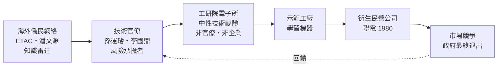
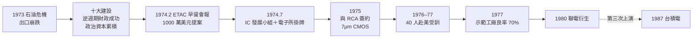

# 02.1 早餐會報：潘文淵與國家賭局

## 一、案情

1974 年 2 月，紐澤西州一家小餐館。幾位旅美華人工程師圍著早餐桌，桌上攤開的不是報紙，而是一份提案：**建議台灣政府投入 1000 萬美元，引進積體電路（IC）技術**。

七個月後的 1974 年 7 月，行政院正式核定「設置積體電路工業發展小組」，經濟部所屬工業技術研究院成立電子工業研究發展中心（電子所）。一頓早餐，變成一筆國家級賭注；一張餐桌，變成台灣半導體產業的出生證明。

偵探首先要問的問題是：**一個外匯存底有限、剛被石油危機打趴的開發中國家，憑什麼敢押一個自己完全不懂的產業？**

## 二、前因：石油危機逼出來的焦慮

要理解這頓早餐，必須先回到 1973 年 10 月。第四次中東戰爭爆發，OPEC 禁運，油價在數月內暴漲約四倍。對台灣而言，這是一場完美的風暴：

- 石油百分之百進口，能源成本直接灌入所有出口品；
- 出口占 GDP 比重已達四成上下，全球需求一凍結，訂單跟著蒸發；
- 1974 年經濟成長率摔到約 -1.9%——這是台灣戰後少見的負成長。

行政院長蔣經國的回應是「十大建設」：以逆週期財政填補民間需求缺口。其財政邏輯用最簡的凱因斯模型就能寫下：

$$
\Delta Y = \frac{1}{1 - c(1-t) - m}\,\Delta G
$$

其中 $c$ 是邊際消費傾向、$t$ 是稅率、$m$ 是進口漏損。十大建設大量使用本地勞工、本地水泥與鋼鐵，$m$ 小，乘數估計達 1.5–2：1974 年 -1.9% 的 GDP，1976 年被拉回 +13% 的強勁復甦。這場成功的逆週期操作留下了兩筆遺產：一是物理基礎（中山高速公路把新竹與台北、桃園機場串成一線，正是日後園區選址的條件），二是政治資本——「政府主導可以做成大事」的信念，成為下一場賭局的許可證。

但技術官僚們心裡清楚一件事——**基建救得了一時，救不了十年後**。紡織、塑膠、電視機組裝這些勞力密集產業，遲早會因工資上漲而流失。他們需要的不是一條高速公路，而是「下一個紡織業」：一個技術門檻夠高、附加價值夠高、別人短期內搶不走的產業。

此時，兩位關鍵人物登場：

- **孫運璿**，經濟部長，電機工程師出身，曾戰後重建台灣電力系統，是「工程師治國」的典型；
- **李國鼎**，財政部長，物理學家出身，長期思考「台灣下一步賣什麼」。

第三位登場的不是官員，而是**潘文淵**——貝爾實驗室的華裔研究員。他在 1973 年向交通部電信總局提出發展電子工業的建言，隨後串聯旅美華人專家組成「**電子技術顧問委員會（ETAC, Electronic Technical Advisory Council）**」——一個無給職、無官方編制、純憑熱血的智庫。早餐會報，就是 ETAC 的工作現場。

## 三、線索與推理：1000 萬美元怎麼算這筆帳

### 線索一：候選技術的篩選

ETAC 把當時的選項攤在桌上逐一排除：| 技術選項 | 資本需求 | 技術門檻 | 市場前景 | 判定 |
|---------|---------|---------|---------|------|
| 電腦整機 | 高 | 極高 | 尚未起飛 | ✗ 本地無市場 |
| 家電／消費電子 | 低 | 低 | 成熟 | 已被占據 |
| 核能／重工 | 極高 | 極高 | 政治敏感 | ✗ 風險不可控 |
| **積體電路** | 約 1000 萬美元 | 高但可學 | 爆發性成長 | ✓ 唯一解 |

IC 的迷人與可怕是同一件事：它是「工業的米」，所有電子產品都要用；但當時全世界沒有任何一個開發中國家成功自製過 IC。

還有一條隱而不顯的線索：**台灣其實已經摸過電子的邊**。1964 年通用儀器（GI）來台設封裝廠、1966 年高雄加工出口區掛牌、1969 年電視機開始外銷——到 1974 年，台灣已有十餘年的電子組裝與封裝勞動力儲備。IC 計畫不是從零起跳，而是從「會組裝」往上游「會製造」爬一格。爬一格比跳十層樓務實，這是 ETAC 評估裡常被忽略、卻最關鍵的可行性證據。

### 線索二：為什麼是 RCA？

潘文淵團隊評估過 Intel、TI 等領先者，最後選中美國無線電公司（RCA）。推理鏈有三節：

1. **技術成熟但非最先進**。RCA 的 CMOS 製程已量產驗證、可教、可學；領先者（Intel、TI）的尖端技術反而因競爭激烈而必然保密。挑師傅的第一原則是「老師肯教」。
2. **RCA 急著賣**。RCA 當時多角化失敗、現金短缺，技術授權是即期現金來源。賣方越急，買方學費越低、合約條件越好。
3. **舊識**。RCA 從電視機時代就與台灣有代工往來，彼此有基本的信任存量。

### 線索三：實物選擇權的邏輯

一個理性的決策者需要期望值：

$$
E[V] = p_{成功}\cdot V_{產業} - C_{1000萬} - p_{失敗}\cdot R_{政治}
$$

問題是 $p_{成功}$ 根本無法估計——沒有前例。技術官僚於是換了一種算法，這正是現代財務理論所說的「**實物選擇權（real option）**」：

$$
V_{option} = \max\left(0,\; E[V_{擴大投資}] - I_{後續}\right) - C_{權利金}
$$

1000 萬美元不是「投資一個產業」，而是「買一張選擇權」：先用小額權利金取得「學會技術、驗證良率」的權利；若示範工廠證明可行，再決定是否擴大；若失敗，損失封頂在 1000 萬美元。**下檔有限、上檔無限**——這是賭局結構設計，而非賭性堅強。

選擇權的價值會隨標的資產的波動率上升——這一點在 1974 年尤其關鍵：IC 產業當時正處於爆發前夜，波動率極高；對持有「債券式部位」的傳統產業而言，高波動是威脅，對持有「選擇權部位」的賭客而言，高波動是禮物。技術官僚未必讀過 Black–Scholes（該模型 1973 年才發表），但他們的直覺與之同構：**在高度不確定的世界裡，保留改變主意的權利，比預先承諾更有價值。**

值得一提的是，1000 萬美元約占當年政府預算的相當比例（第一期計畫連設備共約新台幣 4.9 億元），在立法院與行政院內部遭到強烈反對——「錢丟水裡」的罵聲不斷。孫運璿動用其政治資本強行護航，甚至以個人擔保般的姿態面對質詢。沒有這份政治意志，再好的財務結構也過不了關。

## 四、理論：發展型國家與國家創新系統

這頓早餐在學理上是兩套理論的交會點。

**發展型國家（developmental state）**：Chalmers Johnson 研究日本通產省時提出的概念——國家不取代市場，而是「引導市場」：設定目標、承擔初期風險、篩選產業方向，交由具有自主性與專業性的技術官僚執行。孫運璿與李國鼎正是教科書等級的「領航機構（pilot agency）」首長：他們不是政客，是工程師與物理學家；他們的權威來自「做對過」（孫運璿戰後修復台灣電力系統、李國鼎主持過加工出口區與科學園區的早期規劃），而不是來自選票。

**國家創新系統（Freeman / Lundvall）**：創新不是單一企業的行為，而是政府、研究機構、大學、金融體系之間的制度性互動。ETAC 早餐會報是一個罕見的變體——**海外僑民知識網絡成為國家創新系統的第五個節點**，而且運作成本趨近於零（一群義工工程師的早餐錢）。

把整個決策結構畫成流程圖，可以看見風險如何一節一節往市場遞移：

其中最關鍵的制度設計，是**工研院作為「中性技術載體」**：它不是官僚機關（免於預算與採購的僵化），也不是國營企業（免於壟斷與老化的誘因）；技術先落在工研院手裡「公共化」，再釋出給民間。這一節，下一章將看到它如何被實際執行。

## 五、後果

- 1974 年 7 月：IC 工業發展小組與電子所掛牌，第一期計畫啟動，預算約新台幣 4.9 億元（含設備約合 1000 萬美元量級）。
- 1974–1976：電子所自台灣各單位遴選約 40 名年輕工程師，分批赴美國 RCA 受訓——這批人日後幾乎全數成為台灣 IC 產業的創業元勳（含曹興誠、宣明智等）。
- 1975 年：與 RCA 簽訂技術授權合約，選定 7μm CMOS 為移轉標的。
- 1977 年：示範工廠良率達標（詳見 02.2），賭局第一個選擇權到期「價內履約」。
- 1980 年：聯電衍生、新竹科學園區設立（詳見 02.3）。
- 1987 年：台積電誕生——同一劇本的第三次上演。
- 心理資產：十大建設剛證明「政府能做成大事」，這份信心讓 IC 賭局在政治上變得可辯護。之後的示範工廠、聯電、台積電，全是這頓早餐的利息。
- 制度遺產：ETAC 的模式——徵召海外僑民專家組成無給職顧問網絡——日後被台灣在各種產業政策上反覆使用，效果參差；成功的前提永遠是「政府裡有人接得住」。

把整條因果鏈畫成一張時間軸圖，可以看見「一頓早餐」如何層層放大：

從 -1.9% 的 GDP 到一條即將誕生的兆元產業，中間只隔了七個月的公文、一次簽約與四十張機票。歷史的槓桿，向來比想像中長。

## 六、反事實

- **若選了 Intel 或 TI**：尖端技術意味著老師不願真教、學生學不透。更可能的結局是：買到一批文件與設備，學不到製程的手感；示範工廠良率上不去，立法院砍預算，台灣 IC 史在 1977 年畫下句點。
- **若 1973 年沒有石油危機**：沒有出口崩跌的急迫感，沒有十大建設建立的「國家能做大事」的政治資本，一個純技術升級提案很可能在公文旅行中慢性死亡。**危機不是賭局的背景，而是賭局的許可證。**
- **若沒有孫運璿**：以當時的反對聲量，任何一位不具工程師威望的部長都很難扛住。制度可以複製，政治意志無法複製——這是本案最不可替代的變數。
- **若 ETAC 只是寫報告的顧問團**：將近二十位義務顧問持續數年、不斷施壓催化的「外部遊說」，是官僚系統裡任何一紙公文都做不到的。若只有一封建言信，這封信會躺在收發室裡。
- **若賭注更大**：假設當年直接開價 5000 萬美元建量產廠，在立法院幾乎不可能過關；1000 萬美元的「小到可辯護」，正是選擇權結構的政治意義。

## 小結

回到全書核心：**發展的成功 = 乘積，不是總和**。早餐會報案裡，知識網絡（ETAC）× 政治意志（孫運璿）× 財務結構（實物選擇權）× 制度載體（工研院），缺一為零。一頓早餐之所以能變成一兆美元的產業，不是因為餐點好吃，而是因為每個環節剛好在 1974 年的那張餐桌上齊備。

### 冷案檔案

- 時間：1973–1975（案發核心在 1974 年 2 月至 7 月）
- 地點：美國紐澤西（早餐會報）、台北（決策與核定）
- 案由：發展中國家第一次成功的半導體技術引進案；史家稱之為「台灣最重要的一頓早餐」
- 作案手法：以僑民知識網絡為雷達、以實物選擇權為財務結構、以技術官僚的政治資本為擔保
- 懸而未決之處：$p_{成功}$ 至今無人算得出——但 1974 年的人們學會了一件比計算更重要的事：**把無法估計的風險，設計成損失有限的賭注。**
