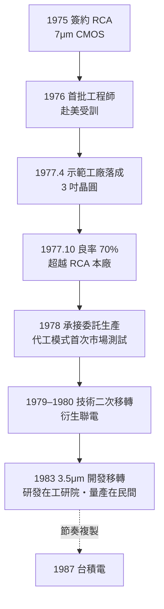

# 02.2 RCA 技術移轉與示範工廠：學徒的勝利

## 一、案情

1976 年，美國 RCA 依合約將 7μm CMOS 積體電路的設計與製造技術整體移交給工研院電子所：完整製程文件、電路圖庫、光罩佈局，外加一項合約裡寫不清楚、卻是整個案子成敗所在的條件——**約 40 名台灣工程師進駐 RCA 工廠實際上線操作**。

1977 年 4 月，工研院在新竹落成台灣第一條 3 吋晶圓示範工廠；同年 10 月，良率衝上 70%——**超過技術母廠 RCA 本廠的水準**（約 40–50%）。

偵探面前擺著兩個疑點：第一，一家百年大公司為什麼肯把吃飯本事整包教給一個潛在對手？第二，學生為什麼一年內就超越了老師？

## 二、前因：從合約到量產之間的鴻溝

1974 年的決策（見 02.1）買到了「入場券」。但入場券不等於座位：從「拿到技術」到「可以重複、可出貨的量產」，中間隔著發展經濟學所謂的「**死亡之谷**」。

RCA 當時正處於多角化失敗、現金窘迫的階段，出售技術授權（連同設備，總計約 1000 萬美元量級）是即期現金。合約分三期移轉（1976–1979），涵蓋 CMOS 製程、IC 設計方法與生產管理。台灣這邊，電子所把遴選出的年輕工程師——多半是台大、清大、交大畢業生——分批送上往新澤西的飛機。

遴選本身就是一項工程設計。受訓人選橫跨製程、設備、掩膜、測試、廠務等所有職位——不是挑精英中的精英，而是**挑出一條完整產線的編制**。這意味著：他們回國後不需要再跟任何人「解釋」學到了什麼，因為整條線的知識分布原封不動地搬回來了。事後看，這個「整線移植」的設計，是移轉成功率的最大單一變數。

## 三、線索與推理

### 線索一：RCA 為什麼肯教？——一次背叛直覺的博弈

直覺上，先進公司不該扶植潛在競爭者。把 RCA 的決策拆開看，是一場時間差博弈：

1. **即期現金**：授權費與設備銷售解燃眉之急，RCA 集團當時到處找錢。
2. **威脅時程評估**：RCA 判斷台灣至少十年內不可能構成競爭威脅——開發中國家做 IC？沒有前例。
3. **布局期待**：RCA 盼台灣日後成為其代工與組裝基地，把學生變成衛星。

第 1、3 點如願，第 2 點是二十世紀最昂貴的商業誤判之一：RCA 自己在 1986 年被奇異出售，其消費電子部門逐年萎縮；而它的學生，把台灣變成全球晶圓製造重鎮。

用簡化的博弈矩陣重述：RCA 面對「賣／不賣」兩個選項，其期望收益取決於對台灣威脅時程 $T$ 的估計——

$$
U_{RCA}(\text{賣}) = L_{授權金} + V_{衛星}(T) - R_{競爭}(T)
$$

$T$ 被估成 10 年以上時，$R_{競爭}$ 經貼現後趨近於零，「賣」成為顯性最優策略。賽局本身沒有錯，錯的是參數 $T$：實際威脅成形只用了約十年——但成形的不是「RCA 的競爭者」，而是「整個產業秩序的改寫者」。

### 線索二：移轉的到底是什麼？——顯性知識與隱性知識

這是本案的知識論核心。Polanyi 的區分在此展現得淋漓盡致：

| 知識類型 | 內容 | 載體 | 移轉方式 |
|---------|------|------|---------|
| 顯性知識 | 製程參數、電路圖、光罩資料 | 文件 | 影印機就夠 |
| **隱性知識** | 爐管該開多久、擴散爐的顏色判讀、肉眼辨識缺陷 | 人的手感 | **只能實作** |

40 名工程師在 RCA 產線跟班 6–12 個月，把「師傅的手感」內化成肌肉記憶。若只買文件不派人才，這樁交易就只是一批昂貴的影印本。**隱性知識無法快遞，只能共處。**

### 線索三：良率的指數敏感

半導體製造的核心數學是良率方程（Seed 模型的簡化形式）：

$$
Y \approx e^{-D \cdot A}
$$

其中 $D$ 是缺陷密度（defects/cm²），$A$ 是晶片面積。良率對缺陷密度**指數敏感**：當 $D \cdot A$ 從 0.5 降到 0.2，良率從 61% 跳到 82%。這說明了為什麼晶圓廠的競爭本質是「缺陷管理的競爭」，而缺陷管理的知識九成是隱性的。

### 線索四：為什麼學生一年就超越老師？

示範工廠良率 70% 對 RCA 本廠 40–50%，這個反常是破案的最後一塊拼圖：

- **人員素質落差**：示範工廠以大學畢業生擔任線上作業員與技術員；RCA 本廠人員流動率高、組織包袱重。
- **小廠的學習優勢**：3 吋小批量讓「設計→投片→測試→修改」的循環極短，同樣時間內實驗次數遠多於大廠。

$$
\text{學習速度} \propto \frac{\text{實驗次數}}{\text{每次成本}} \quad\Rightarrow\quad \text{小晶圓 + 小批量 + 高素質人力} = \text{最優學習環境}
$$

「小廠、快迭代、高素質人力」——這組合日後成為台灣晶圓廠的 DNA。

還可以從學習曲線（Wright's law）的角度補一刀。製造業的單位成本隨累積產量倍增而以固定比例下降：

$$
C_N = C_1 \cdot N^{-b}, \qquad b = -\frac{\log(\text{學習率})}{\log 2}
$$

學習率 85%（即累積產量每倍增一次、成本降到 85%）時 $b \approx 0.234$。學習率不是天上掉下來的常數，它由迭代頻率決定——**每次迭代的成本越低、頻率越高，學習率越陡**。示範工廠的真正貢獻，是把台灣 IC 產業的學習率陡度從一開始就調到最陡檔位；日後台積電「十二吋廠的學習率凌駕同業」的傳說，源頭就在這條三吋線。

### 線索五：示範工廠作為風險管理工具

為什麼不一步到位建大量產廠？比較兩條路：

| 選項 | 投資 | 單次錯誤成本 | 學習速度 |
|------|------|------------|---------|
| 直接建 5/6 吋量產廠 | 5000 萬美元以上 | 極高 | 慢 |
| **3 吋示範工廠** | 約 1000 萬美元 | 低 | **快** |

這是 02.1 實物選擇權邏輯的第二次執行：示範工廠是選擇權的「行使前查驗」階段——用小賭注驗證大賭注的前提。示範工廠同時被設計為「**學習機器**」：它存在的目的不是賺錢，是把死亡之谷用最快的速度走完。1978 年起，它開始承接美國小客戶的委託設計與生產——台灣代工模式的第一次市場測試，就在這棟「暫時性」建築裡完成。

## 四、理論：統計製程管制與趕超理論

示範工廠把良率從 40–50% 拉到 70%+，靠的不是土法煉鋼，而是當時相當先進的品管方法論——**統計製程管制（SPC）**：

$$
C_p = \frac{USL - LSL}{6\sigma}
$$

製程能力指數 $C_p$ 度量規格界限與實際變異的距離。每道工序（氧化、擴散、微影、蝕刻）建立管制圖，以實驗設計（DOE）系統性搜尋最佳參數。**核心洞察：良率不是運氣，是變異數管理。** 這個觀念日後成為台積電企業文化的核心——「客戶的良率就是我們的良心」——而它的根，就種在 1977 年的示範工廠。

良率管理的實踐，本質上是一場對變異來源的逐格圍剿。把 7μm CMOS 的良率損失拆解：

$$
1 - Y \approx \underbrace{D_{\text{微粒}}A}_{\text{污染}} + \underbrace{\sigma_{\text{熱}}^2}_{\text{爐管變異}} + \underbrace{\sigma_{\text{對準}}^2}_{\text{微影失準}} + \cdots
$$

每一項變異都需要「資料＋假說＋實驗」的完整循環才能壓制，而示範工廠的組織設計——工程師直接站在線上、每批晶圓的履歷全程可追溯——使這個循環一天可以跑好幾圈。RCA 本廠不是不懂 SPC，而是組織摩擦讓循環轉得慢；**學生贏的不是知識，是循環速度。**

從趕超（catch-up）理論看，這也是「後發優勢」的示範：後進者不必支付研發的前置成本，只需支付學習成本；而學習成本可以透過「小規模＋高強度迭代」壓到極低。技術移轉不是抄襲，是用最低成本購買一次「跳過試錯期」的機會。

## 五、後果

- 1977 年示範工廠落成並達標，政府面對立法院的第一次驗收——賭局的第一個選擇權被證明「價內」。
- 1978 年起承接國外小客戶委託生產，驗證台灣具備「接單─量產─出貨」的商業閉環能力。
- 1979–1980 年，電子所以第二次技術移轉（3.5μm）與人才整編，催生聯華電子——詳見 02.3。
- RCA 公司 1986 年被併購消散；它的製程在台灣每隔約三年躍進一個世代：7μm → 3.5 → 2 → 1.5 → 1.2μm……
- 當年赴 RCA 受訓的名單，成為台灣半導體產業的「元勳名冊」：聯電、台積電、乃至日後眾多公司的技術班底皆出自其中。
- 知識的第二次繁衍隨即展開：受訓工程師在院內帶出下一批學徒，示範工廠同時是量產驗證場與**人才養成所**——到 1980 年聯電成立時，「會做 IC 的人」在台灣已不再是一份四十人的名單，而是一個社群。

## 六、反事實

- **若只買文件、不派人**：顯性知識到貨，隱性知識缺席。示範工廠的良率將卡在 20–30% 的爬坡高原，立法院第二次質詢就會終結計畫。**本案最值錢的不是那 1000 萬美元，是那 40 張機票。**
- **若示範工廠直接建成大量產廠**：單次試誤成本放大數十倍，學習循環拉長，1977 年的驗收不可能達標；而且一開始就背負量產壓力的組織，不會有示範工廠那種「以實驗為目的」的寬容。
- **若 RCA 當年拒賣**（例如合約被 Intel 以更高價攔截）：台灣或許會轉向日本（NEC、東芝）求售，但日本廠商的移轉意願與條件都可能更苛刻，時程延誤數年，錯過 1970 年代末 CMOS 的黃金學習窗。
- **若良率停在 40%**：與 RCA 本廠「打平」聽起來不算失敗，但政治上等於失敗——「花了國家一千萬，只做到跟美國一樣」無法平息質詢。唯有「超越老師」這個超額成績，才能把計畫從「勉強過關」翻轉成「值得擴張」。**70% 不只是技術數字，是政治數字。**
- **若受訓名單只挑少數精英**：知識分布殘缺，回台後每個製程交接點都是斷點。台灣模式與其他開發中國家技術引進案的差別，就在這張名單的設計哲學：要的是一條線，不是幾顆星。

## 小結

本案的定論是：**技術移轉的價格，標定的是顯性知識；技術移轉的成敗，取決於隱性知識。** RCA 想賣的是文件與設備，台灣買到的卻是 40 顆受過訓的腦袋；RCA 想收的是權利金，真正收下的卻是「低估學徒」的代價。示範工廠那一條 3 吋產線，是國家替整個產業走過死亡之谷的橋——橋造好之後，故事就可以交給市場了。

### 冷案檔案

- 時間：1975（簽約）–1979（三期移轉完成）
- 地點：美國新澤西（RCA 本廠）、新竹（示範工廠）
- 案由：史上最成功的半導體技術移轉案；學徒一年內良率超越師傅
- 方法論：顯性知識可以買，隱性知識必須「以身試法」——整線編制的工程師駐廠實作，是唯一路徑
- 關鍵物證：1977 年 10 月的良率報告——70%，高於母廠的 40–50%
- 延伸懸案：RCA 為何誤判威脅時程？答案可能只是「沒有開發中國家成功過」的統計直覺——而統計直覺在單一歷史事件面前，從來不可靠。
