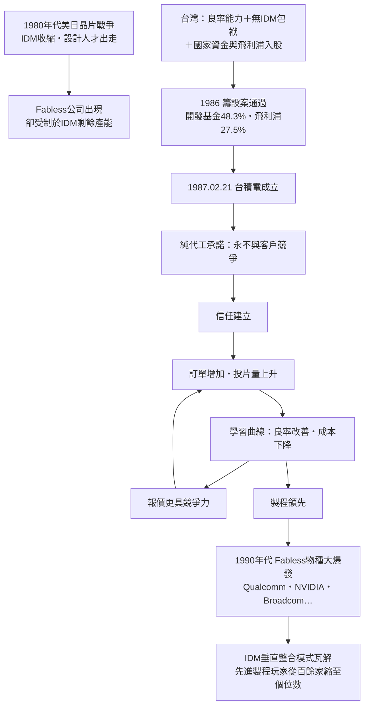

# 第三章之二：台積電——專業晶圓代工的物種大爆發

> 侦查檔案編號：03.2　案發時間：1986 年籌設、1987 年 2 月 21 日成立　案發地點：新竹科學園區

## 案情

1987 年 2 月 21 日，台灣積體電路製造股份有限公司在新竹科學園區成立。資本額 2.75 億美元，是當時台灣最大的民間投資案；出資結構為行政院開發基金 48.3%、荷蘭飛利浦 27.5%、民間股東 24.2%。張忠謀任總經理，第一批四百名員工多來自工研院電子所。

這家公司提出了一個當時全球半導體業界無人相信的商業模式：**純專業晶圓代工**——不設計產品、不賣自己品牌的晶片，只替別人製造。三十多年後，它成為全球市值最高的半導體公司，全球先進晶片的九成以上出自其手。

本案要偵辦的核心謎題有二：**為什麼 IDM 大廠都不相信代工可行？** 以及 **這個模式如何改寫整個產業的分工結構？**

## 前因

- **張忠謀的三十美國年**：1955–1985 年在美國半導體業，從希凡尼亞到德州儀器，官至集團副總裁，親歷電晶體產業的完整歷史。
- **產業現況**：1980 年代全球半導體是 IDM（整合元件製造，設計—製造—封測—銷售一體）的天下，Intel、TI、NEC、東芝皆然。
- **美日戰爭**：1980 年代美國 IDM 在 DRAM 價格戰中節節敗退給日本，被迫砍研發、砍產能。
- **台灣的籌碼**：聯電已證明台灣的良率管理能力（見第三章之一、第三章之三）；工研院有一批可用之兵。
- **邀約**：1985 年，張忠謀受李國鼎、孫運璿之邀回台出任工研院院長，隨即著手規劃新公司。

## 線索與推理

### 線索一：張忠謀的三個觀察

張忠謀的商業計畫書不是憑空發明，而是從三個產業觀察推出一個模式：

1. **觀察一**：美國 IDM 在與日本的競爭中收縮，設計人才開始流出創業——矽谷出現第一批「沒有工廠的晶片公司」（fabless 的雛形，如 1984 年成立的 Altera、Xilinx、Cypress）。
2. **觀察二**：這些新設計公司必須仰賴 IDM 的剩餘產能下單——訂單被當成填補閒置的零頭，交期與技術支援都是「二等公民」待遇；更致命的是，IDM 同時是競爭對手，客戶的設計圖等於交到敵人手裡。
3. **觀察三**：台灣的良率能力已被聯電證明，但台灣沒有全球品牌與市場——做 IDM 產品（如 DRAM）必敗於日韓；做「製造服務」則**只需要信任，不需要品牌**。

三者交會，模式浮出水面：

$$
\text{Fabless（設計公司）}+\text{Foundry（代工廠）}=\text{全新的產業結構}
$$

### 線索二：為什麼 IDM 大廠不相信？

這是本案最關鍵的證詞。IDM 高層的反對理由，逐一檢驗：

| IDM 的疑慮 | 表面理由 | 深層結構 |
|-----------|---------|---------|
| 「不會有人把設計圖交給工廠」 | 信任問題 | IDM 自己就偷看客戶設計——以己度人 |
| 「代工毛利必然低」 | 做人下手的生意 | 他們按 IDM 的成本結構算帳：代工要養通路與品牌 |
| 「市場太小，養不起一座廠」 | 需求規模 | 1987 年 fabless 公司全世界只有約二十家 |
| 「產能是我的戰略武器」 | 垂直整合信仰 | IDM 把產能視為打價格戰的籌碼，不願釋出 |

**推理**：IDM 的拒絕並非愚蠢，而是**利益位置**使然——它們是既有遊戲的贏家，任何拆解 IDM 的模式都意味著自我否定。這正是創新理論所說的「在位者困境」：模式的發明者必須是一個**不在遊戲中的人**。張忠謀恰好同時具備兩個身分：夠懂半導體（TI 三十五年）卻已離場（不在任何 IDM 的組織利益裡），而台灣恰好沒有 IDM 的包袱。

### 線索三：投資人為何買單？

- **飛利浦的算盤**：出資並移轉技術，換取穩定的晶圓供應來源與亞洲製造基地——飛利浦自身半導體部門需要產能。
- **行政院開發基金的算盤**：延續工研院衍生模式，用國家資金承擔「模式驗證」的風險；政府持股近半，是當時台灣資本市場不可能獨自承擔的賭注。
- **民間股東的算盤**：跟著政府與飛利浦下注，風險被兩大股東吸收。

### 線索四：冷啟動的破解

台積電前六年虧損，問題是經典的雞生蛋死結：

```text
沒有客戶 → 產能利用率低 → 單位成本高 → 報價不具競爭力 → 沒有客戶
```

張忠謀的三個破局動作：

1. **飛利浦保底訂單**：股東身份加技術移轉，第一年產能被包走，死結鬆開。
2. **「永不競爭」的純代工承諾**：不設計產品、不與客戶搶市場。這是與 IDM 代工部門的決定性差異——用**商業模式的純潔性**換取信任。
3. **良率紀律**：把 TI 式的製造管理——統計製程管制、設備維護制度——完整移植新竹。

### 信任的賽局分析：fabless/foundry 分離為何是均衡

客戶與代工廠之間是一個**重複賽局**。單期賽局中，代工廠「竊取設計、自製產品」的背叛收益高於合作；但在無限重複賽局中，合作可以成為子賽局完美均衡：

$$
\underbrace{\delta\cdot V_{\text{長期合作}}}_{\text{未來利益的折現值}}\;>\;V_{\text{短期背叛收益}}
\quad\Longleftrightarrow\quad
\text{信任成立}
$$

其中 $\delta$ 是折現因子（未來的相對權重）。張忠謀的策略是把 $\delta$ 與 $V_{\text{長期合作}}$ 同時拉到極大：台積電唯一的資產就是「永不背叛」的名聲，一旦背叛，數百個客戶同時離去——背叛的代價被結構性放大。相比之下，IDM 代工部門的背叛成本低（反正自有產品才是本業），永遠無法取信。

這也解釋了**為何分離是穩定均衡而非暫時現象**：fabless 客戶放心把最先進的設計交給台積電 → 台積電學習曲線加速 → 製程領先 → 更多客戶交付更先進的設計。正迴路一旦啟動，IDM 想反悔（自己做代工）已來不及累積同樣的跨客戶良率知識。



## 理論

### 拆解資源束：垂直分工的經濟學

用資源基礎理論（RBV）的語言，張忠謀拆解了 IDM 的資源束：

$$
\text{IDM}=\text{設計能力}\oplus\text{製造能力}\oplus\text{品牌通路}
\;\;\Longrightarrow\;\;
\begin{cases}
\text{Fabless 保留：設計}\oplus\text{品牌通路} & \text{（矽谷的比較優勢）}\\[4pt]
\text{Foundry 保留：製造} & \text{（台灣的比較優勢：良率・成本・紀律）}
\end{cases}
$$

垂直分工何時勝過垂直整合？依交易成本理論（Coase/Williamson），當**市場交易成本**低於**內部協調成本**時，分工占優。1980 年代末三件事同時壓低了交易成本 $TC$：

1. EDA 工具標準化——設計資料可以跨公司傳遞；
2. 製程文件標準化（PDK, Process Design Kit）——設計與製造的介面有共同語言；
3. 通訊成本下降——跨太平洋的協調變得即時。

而 IDM 內部的協調成本 $GC$ 反而在先進製程上暴增（一座廠的投資額從億級跳到十億級美元）。當 $TC<GC$ 的區域不斷擴大，垂直分工便從邊緣走向主流。

### 學習曲線：為什麼代工可以有高毛利

晶圓代工的核心競爭力是一個自我強化的動態系統：

$$
Y(t+1)=Y(t)+\alpha\cdot\text{投片量}(t)\cdot\text{技術投入}
$$

良率 $Y$ 隨累積投片量改善：良率越高 → 單位成本越低 → 報價越有競爭力 → 訂單越多 → 投片量越大 → 良率繼續改善。1990 年代台積電毛利達 50% 以上，比 IDM 還高，顛覆「代工必然低毛利」的直覺——因為：

$$
\text{代工毛利}\approx\text{良率}\times\text{規模}\times\text{客戶黏著度}
$$

三項同時到位時，代工不需要負擔設計、行銷與品牌成本，反而比 IDM 更賺。

## 後果

- **1991 年**：台積電首度獲利（前六年虧損）。
- **1993 年**：成為全球最大純晶圓代工廠；1994 年股票上市。
- **Fabless 物種大爆發**：全球 fabless 公司從 1987 年約二十家，成長到 2000 年超過一千家——Qualcomm、NVIDIA、Broadcom 等今日巨頭，全部誕生於這個新棲位。這是商業模式創新造成的「棲位開拓」，如同寒武紀大爆發：門檻（要蓋一座十億美元工廠才能做晶片）被移除，新物種大量湧現。
- **IDM 的退潮**：美國 IDM（IBM、Motorola、TI）先後關閉或出售自有晶圓廠；能留在先進製程賽道的 IDM，從 1987 年的百家以上，萎縮到二十一世紀的個位數。
- **模式的外溢**：聯電於 1995 年跟進全面轉型代工；世界先進等嘗試者眾，但「純代工＋永不競爭」的信任資產，始終以台積電最深厚。
- **歷史定位**：與 Intel 的 x86 授權模式、Apple 的 App Store 並列為半世紀以來最有價值的商業模式發明之一——**它證明了發明新遊戲勝過在舊遊戲裡贏**。

## 反事實

**如果 1986 年籌設案沒有通過——或模式被改掉——會怎樣？**

1. **若台灣做的是 IDM（例如依原案做 DRAM）**：張忠謀自己評估，台灣無品牌、無市場，與日韓打 DRAM 價格戰必敗。台灣會在 1990 年代的 DRAM 蛛網週期中（見 1989 華邦檔案）燒掉更多國家資源，重演後來力晶、茂德的劇本。
2. **若沒有開發基金 48.3% 的注資**：民間資本與創投在 1987 年的台灣無力承擔 2.75 億美元的模式驗證風險；台積電不會在那個時間窗口誕生。而 fabless 公司在 1990 年代初還很弱小，若無台積電及時供應產能，多數會死在 IDM 的產能歧視之下——垂直分工革命可能延後十年，由安靠（Amkor）等封測起家的代工路線更緩慢地演化。
3. **若台積電接受 IDM 客戶的遊戲規則（也做自己的產品）**：信任賽局崩塌，$\delta\cdot V_{\text{長期合作}}$ 歸零，fabless 客戶永遠留一手。產業會停留在「IDM 代工部門＋二等公民客戶」的低水準均衡，全球半導體的創新速度將比實際歷史慢一個世代。

**反向檢驗**：為何其他國家沒有複製出台積電？需要的條件是連乘：一個懂產業且無利益包袱的模式發明者、願意承擔風險的國家資本、既有良率人力池、以及一群即將爆發的 fabless 客戶。四者缺一不可——台灣在 1986 年恰好四項齊備，而這個機會窗口只開了幾年。

---

## 小結

台積電案的偵查結論：**產業史上最深刻的變革，往往不是技術突破，而是分工結構的重寫**。張忠謀讀出了三個別人不願正視的事實——fabless 正在誕生、IDM 無法給予信任、台灣的比較優勢在製造——然後用「永不競爭」的契約把信任制度化，用國家資本扛下模式驗證的風險。垂直分工的賽局一旦成形，正迴路便無法逆轉：下一節我們追查分工鏈的另外兩環——品牌端的宏碁與封測端的 OSAT，看整個生態系如何閉合。
