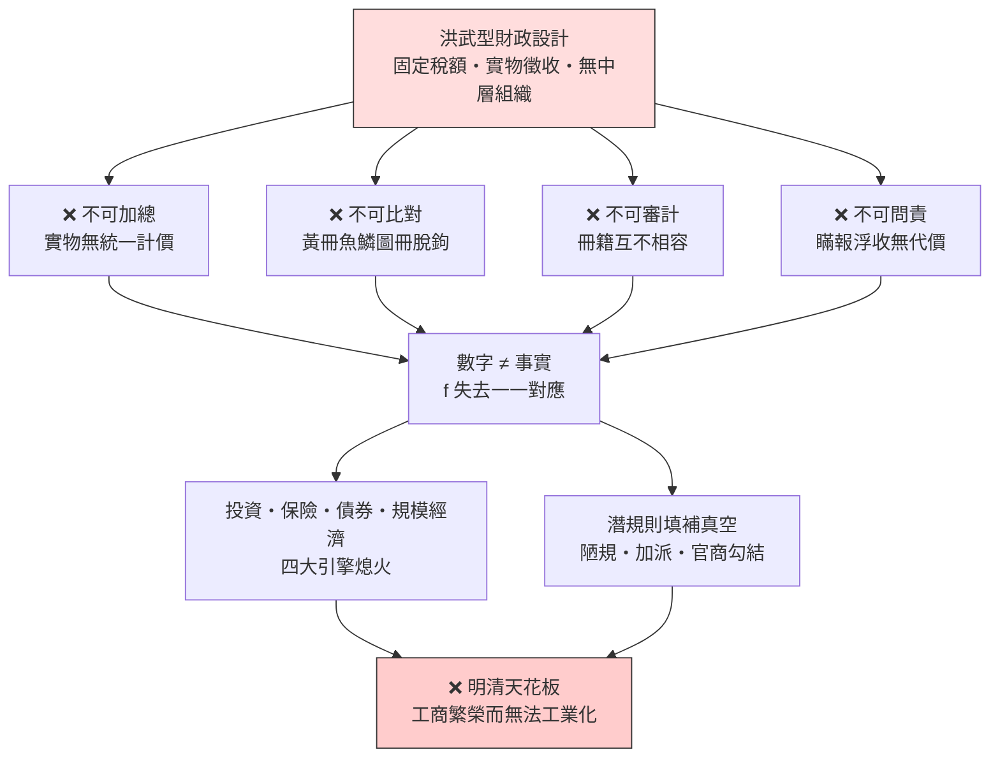

# 第一章 導論：黃仁宇的診斷——為何工業革命以數目字管理為前提

## 1.1 「數目字上管理」的意思：可加總、可比對、可審計、可問責

### 一個看似平淡的詞，一個致命的診斷

黃仁宇在《萬曆十五年》與《中國大歷史》中反覆使用一個詞：**「數目字上管理」（mathematically manageable）**。這個詞乍聽平淡，卻是他一生史學的核心診斷——中國傳統帝國之所以在明代以後被西方超越、之所以與資本主義和工業革命擦身而過，不是因為缺少發明、缺少市場、缺少勤勉的商人，而是因為**國家無法用真實、統一、可核驗的數字來掌握自己的土地、人口、財政與商業**。統治者面對的不是一張可以做算術的資產負債表，而是一團層層稀釋、層層改寫的訊息迷霧；於是治理只能退回道德文章與官僚裁量——用「教化」代替「核算」，用「忠誠」代替「對帳」。

但「數目字上管理」不等於「有數字」。黃仁宇的深意藏在四個條件裡：

- **可加總**：全國的土地、人口、稅額必須用同一把尺（統一度量衡、統一稅制、統一會計科目）度量，否則一縣一斗、一省一石，加不出總量。
- **可比對**：數字之間必須互相勾稽——戶籍對得上田畝，田畝對得上稅糧，稅糧對得上倉儲。任何一處對不上，就表示帳裡有鬼。
- **可審計**：數字必須允許第三方核驗。不只上級查下級，更要讓體系外的力量（議會、法院、獨立審計、公開帳冊）能夠查核體系內的申報。
- **可問責**：數字失真必須有人負責。若謊報無代價、實報反吃虧，則任何統計制度都會在第一時間被潛規則腐蝕。

### 下層結構：讓數字與事實一一對應

黃仁宇特別強調，數目字管理不是在頂樓加裝一個統計局就能完成的技術工程，而是一場**下層結構的改造**。國家能徵什麼稅、算什麼帳，取決於社會基層存在什麼樣的產權與契約習慣。土地必須有清楚、可分割、可轉讓的產權登記，稅基才能落實到每一筆地籍；商業必須有穩定的匯票、帳簿、合夥習慣，商稅與信用才可能被記錄；民法必須承認契約的效力並提供可預期的救濟，交易才敢留下書面痕跡。**上層的每一個數字，都必須能在下層找到對應的產權、契約或交易；反過來，下層的每一筆財產，都必須能在上層的數字中被承認與保護。**這個一一對應，正是「mathematically manageable」的字面意義：整個國家像一組可以互相代入的變數。

這也正是為什麼黃仁宇把英國經驗視為標本：十七世紀的英格蘭先經歷了圈地運動對土地產權的重整、普通法對契約的保障、以及議會對王室財政的審查，然後才有 1694 年英格蘭銀行的國債信用與十八世紀的金融市場。數目字管理不是被「發明」出來的，而是被下層結構**撐**出來的。相比之下，複式簿記這種工具本身（見 [1494-複式簿記](../../世界史/法律與制度史/1494-複式簿記.md)）早在十五世紀的義大利商業城市就已成熟，卻要等到三百年後才被放大到國家層級——中間隔著的，正是下層結構的差距。

### 一一對應的檢驗公式

用本書的語言，可以把黃仁宇的診斷寫成一個映射條件：設下層結構的事實集合為 $S$（土地、交易、契約、人口），上層的數字集合為 $N$（戶籍、地籍、稅冊、預算），數目字管理要求存在一個映射 $f: S \to N$，使得

$$
f \text{ 為一一對應，且 } \forall s_1, s_2 \in S,\ s_1 = s_2 \Leftrightarrow f(s_1) = f(s_2)
$$

帝國體制的病理，恰好是這個映射的失效：同一塊田在魚鱗圖冊上是一個數字、在實際地契上是另一個數字、在縣衙的實徵冊上又是第三個數字。**數字不是事實的像，而是事實的化妝。**一旦 $f$ 失去一一對應，加總失去意義、比對失去對象、審計失去錨點，國家便退化為一個靠道德敘事維持的龐然巨物。黃仁宇說這是「以道德代替法律，一切憑抽象的道德觀念」的統治——本書則要進一步追問：這個映射為何在帝國體制內必然失真？那是下一章吳思的證詞。

## 1.2 為何是前提：沒有數字就沒有投資、保險、債券與規模經濟

### 資本主義的計算性格

「數目字管理是因，工業革命是果」——這是黃仁宇最大膽的斷言，也是本節要辯護的命題。理由不在文化、不在精神，而在一個樸素的觀察：**現代資本主義的每一件核心工具，都是一台「數字機器」**。投資的前提是能計算報酬率；保險的前提是能統計風險機率；債券的前提是能核驗還款能力的帳目；規模經濟的前提是能用標準化的成本會計追蹤千萬件產品。這四件事沒有一件能在「糊塗帳」的環境中發生。金融經濟史（見 [金融經濟史總庫](../../世界史/金融經濟史/README.md)）讀下來，幾乎就是一部「可計算範圍不斷擴張」的歷史：從威尼斯公債到阿姆斯特丹匯兌銀行，從勞合社保險到英格蘭銀行——每一次金融創新，都是先讓某一類事實變成可靠數字，然後才有對這些數字的定價與交易。

逐項拆開來看：

- **投資**：一個商人敢把千兩白銀壓在三年後才見分曉的計畫上，前提是「三年後的損益」在某種意義上可以被預先計算——這需要歷史成本資料、需要對交易對手的帳目信任、需要利潤這個概念本身可以被簿記定義。複式簿記（[1494-複式簿記](../../世界史/法律與制度史/1494-複式簿記.md)）正是讓「利潤」第一次成為可驗證數字的技術：每一筆交易記兩次、借貸必須平衡，利潤不再是主人腦中的一種感覺，而是帳冊強制產生的一個科目。
- **保險**：勞合社的海上保險能定價，是因為倫敦累積了數十年可加總的航運損失記錄。沒有系統性的損失統計，保險費就是賭博；有了統計，風險第一次成為商品。
- **債券**：國債的本質是「未來稅收的證券化」。買家之所以願意把錢借給一個遙遠的政權，是因為議會預算審查使國家財政成為可審計的帳目——數字經過議會核可，違約等於政治自殺。1694 年英格蘭銀行的成立，用制度把「國家會準時還錢」從承諾變成帳目事實，於是政府能以低息長期舉債，資本市場隨之深化。
- **規模經濟**：工廠之所以取代作坊，不只是因為機器大，而是因為**大規模組織需要內部核算**——原料成本、工時、良率、折舊，每一項都必須數字化，管理者才能在千里之外指揮一個萬人工廠。規模經濟與管理會計是同一枚硬幣的兩面。

### 沒有數字的經濟長什麼樣

把視角反轉，看看「數字缺席」時經濟如何運作。在前現代社會，跨時空的大額交易有三條出路：靠親緣與鄉緣的關係網（晉商、徽商、猶太人網絡）、靠暴力的自我執行（武裝商隊）、或乾脆不做。這些出路都有天花板：關係網無法擴張到陌生人，武力成本高昂且不可預期。**信用被鎖死在人格網絡的半徑之內，而人格網絡的半徑遠小於工業所需的資本規模。**現代金融的本質，正是用「可審計的數字」取代「可信任的人格」，讓陌生人與陌生機構之間能產生跨越數十年的信用。這一步跨不過去，投資便只敢做短線、保險便無法定價、債券便無人問津、工廠便養不大——工業革命的四個引擎全部熄火。

用條件機率的方式說：若投資、保險、債券、規模核算各自需要「數字可信度」達到門檻 $\theta$ 才能啟動，則工業化要求

$$
P(\text{工業化}) = \mathbf{1}\{\text{可信數字} \geq \theta\} \times P(\text{其餘條件})
$$

當數字可信度不足時，指示函數為零，其餘條件再多也是零——這就是「前提」的嚴格意義。黃仁宇觀察到明代中國恰好卡在這個指示函數上：白銀大量流入、市鎮商業繁榮、手工業技術不輸歐洲，唯獨國家與商業組織之間不存在一層可審計的數字中介，於是大額資本只能以高利貸與官商勾結的形式存在，無法沉澱為長期工業投資。改革開放後的中國經濟起飛（見 [1978-改革開放](../../世界史/世界發展史/1978-改革開放.md)）從反面補充了這個論證：當統計、會計、審計與產權登記被逐步重建，被壓抑了數百年的規模經濟立即釋放——這幾乎是對黃仁宇命題的一次歷史驗證。

### 前提，不是開關

必須說清楚：數目字管理是工業革命的**必要條件**，不是充分條件。英國還需要煤、需要高工資、需要科學迴路（這是姊妹書《工業革命為何出現在歐洲》的主題）。但必要條件的政策意涵恰恰最沉重：**它一旦缺席，其他一切努力都無效**。你可以引進機器、聘請工程師、開辦學堂，但只要國家與市場之間沒有可靠數字的血管，資本就會在一輪輪帳目欺詐與貨幣失控中耗盡。十九世紀的後發國家與二十世紀的計畫經濟將反覆證明這一點。下一節，我們先回到案發現場，解剖那個「數字缺席」的極端標本——洪武型財政。

## 1.3 對照組：洪武型財政——固定稅額、實物徵收、糊塗帳帝國

### 一場以「永不改變」為目標的財政設計

要理解數目字管理為何是前提，最好的方法不是看成功案例，而是解剖一個反面標本。黃仁宇在《十六世紀明代中國之財政與稅收》中給出了這個標本：**洪武型財政**。明太祖朱元璋在洪武年間為帝國設計了一套以「簡單、固定、永不改變」為目標的財政制度：

- **固定稅額**：全國田賦總額一次核定，此後兩百多年基本不再調整。人口增加、土地開墾、物價波動，稅額巋然不動。
- **實物徵收**：稅以米麥、絹布、勞役（里甲、雜役）繳納，而非貨幣。帝國實際上是一個龐大的實物調撥系統——南方漕運米糧到北方，地方供應驛站與軍衛，大量人力耗在運輸與倉儲上。
- **缺乏中層組織**：帝國與億萬小農之間，幾乎不存在獨立的商業銀行、股份公司、律師公會、會計師行業。財政的執行壓在零散的縣衙與里甲頭上，沒有受過訓練的專業財稅官僚體系。

黃仁宇的判語是：這套制度**「不用數目字管理，而以道德與禮儀維持」**——它的目標根本不是效率，而是把帝國凍結在開國那一刻的靜態平衡裡，讓變化本身成為敵人。

### 為什麼糊塗帳是制度內建的

關鍵在於：洪武型財政的「糊塗」，不是執行不力，而是**設計使然**。逐一對照 1.1 的四個條件：

1. **不可加總**：實物稅沒有統一的計價單位。米有米的品級、布有布的寬幅、勞役有役的輕重，折算比率因地因時而異，全國「總稅收」根本是一個不存在的概念。
2. **不可比對**：魚鱗圖冊（田畝）與黃冊（戶口）在編成之初就摻入大量應付上級的虛構戶口與田畝，此後每十年重造一次，錯誤層層累積，直到與現實完全脫鉤。
3. **不可審計**：財政數據散在六部、內府、地方衙門各自的冊籍中，格式互不相容，連中央自己都無法彙總——更不必說讓任何外部力量核驗。
4. **不可問責**：官員的考核看的是「完成攤派」與「不出亂子」，不是數字真實。瞞報與浮收沒有制度性的懲罰機制，只有道德訓誡。

結果是一個弔詭：**帝國握有史上最龐大的戶籍與地籍數據庫之一，卻是史上最糊塗的帳。**有數字而無數目字管理——這正是黃仁宇診斷的精準之處。明代中後期的歷史就是這筆糊塗帳的清算史：稅額固定導致實際負擔層層轉嫁到無權無勢的小農身上，實物徵收催生無窮的折色、加派與陋規，一條鞭法企圖把一切折成白銀，卻被白銀供給波動與地方浮收再度吞噬。帝國不是沒有改革者，而是每一項改革都撞上同一堵牆：**你無法審計一張從設計上就不可審計的帳。**

### 糊塗帳不是道德問題，是迴路問題

有人會說：明朝之敗，敗於官吏貪腐。黃仁宇的回答、也是本書將反覆論證的回答是：**貪腐是症狀，不是病因**。同樣的官僚群體、同樣的儒家士大夫，在清末民初接觸現代財稅制度後，並未表現出無法勝任——說明問題不在人，而在資訊結構。當官方數字不可信時，所有參與者（官員、紳戶、商人、農民）都被迫在正式制度之外重建一套私下運算：私下議價、私下折算、私下保險。這套私下運算就是吳思所說的**潛規則**，它不是道德滑坡，而是在「不可審計的帳」之上必然生長出來的均衡（見第 2 章）。

值得注意的是，帝國史上並不缺少試圖打破糊塗帳的努力。秦制以戶籍、上計與嚴刑峻法建立了最早的中央數字體系（見 [-221-秦制與官僚帝國](../../世界史/法律與制度史/-221-秦制與官僚帝國.md)），王安石變法更企圖以青苗、免役、方田均稅把財政理性化（見 [1069-王安石變法](../../世界史/法律與制度史/1069-王安石變法.md)）——但正如本書第 2、5 章將詳細解剖的，這些努力都失敗在同一個結構上：**測量與政策、執行與問責沒有閉環**，數字在科層金字塔中上行與下行時都被私利改寫，改革者手中握著的，仍然是那張經過潛規則過濾的假帳。

洪武型財政因此不是一個孤立的明代故事，而是所有「有數字、無迴路」帝國的通用病歷。它替本書回答了「為何是前提」：工業革命需要的不只是蒸汽機，而是一個能讓投資、保險、債券與規模經濟同時啟動的可審計社會。接下來的第 2 章，我們傳喚病理學家吳思，看看這張糊塗帳的每一格數字，是如何被官僚體系的理性策略系統性地改寫的。

> **參照**：本書的因果鏈總圖與四位證人的分工見本書 README；複式簿記的技術細節見 [1494-複式簿記](../../世界史/法律與制度史/1494-複式簿記.md)；國家層級記帳的誕生見金融經濟史 [README](../../世界史/金融經濟史/README.md)；科技迴路的方法論見 [科技發展史](../../科技史/科技發展史/README.md)；現代稅制的完成形態見 [1842-所得稅與現代稅制](../../世界史/法律與制度史/1842-所得稅與現代稅制.md)。
