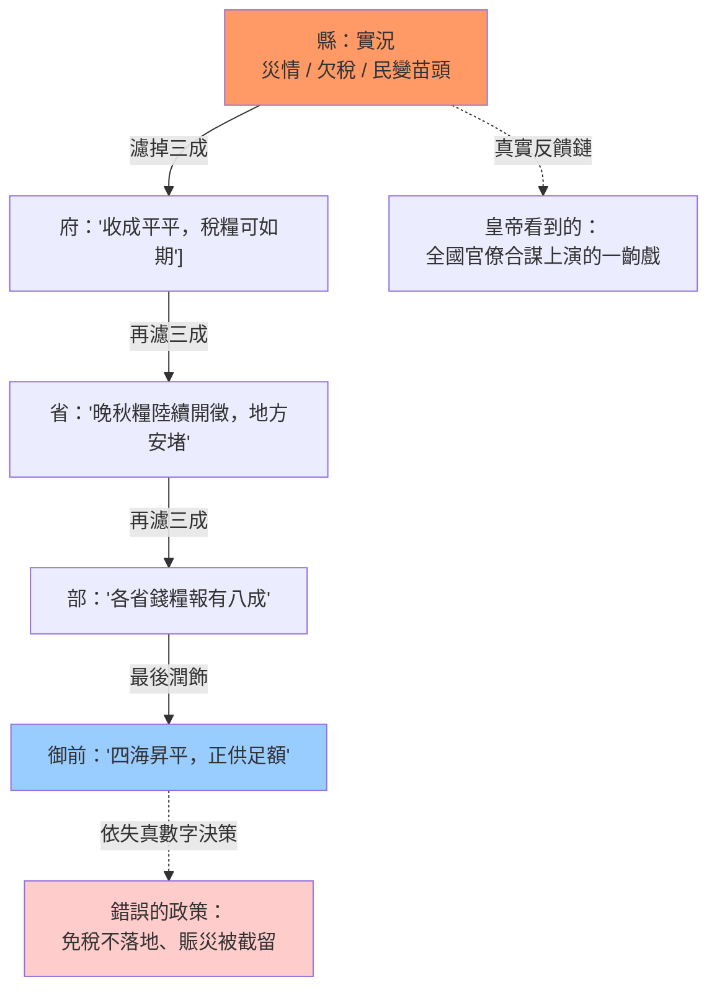
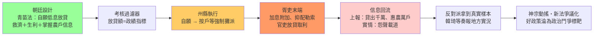

# 第二章 病理報告：吳思的潛規則——帝國為何在數目字上失能

> 吳思在《潛規則：中國歷史中的真實遊戲》中提出了一個與黃仁宇互補的診斷：明代帝國並非沒有數字——黃冊、魚鱗圖冊、考成法，測量工具一樣不缺——而是數字在層層科層的傳遞過程中被系統性地改寫。本章把吳思的「潛規則」當作一份病理報告來解讀：**潛規則不是道德敗壞的集合名詞，而是在監督成本極高、信息不對稱的科層體系中，理性人的均衡策略**。正是這個均衡，使帝國在數目字上失能。

## 2.1 潛規則的經濟學：信息不對稱下的官場均衡

### 正式制度之外的第二套規則

吳思發明「潛規則」一詞，是為了命名一個所有當事人都心知肚明、卻無人寫進公文的法律：官員之間的陋規交往、對上級的常例孝敬、對下屬的灰色分潤、徵稅時的「耗羨」加派。這套規則有三個特徵：**它是隱蔽的**（寫出來即違法）；**它是穩定的**（違反者會被同僚懲罰，而不是被朝廷獎勵）；**它是可計算的**（火耗加幾分、門包收幾兩，各地都有行情）。換言之，潛規則本身就是一套數目字管理——只不過它管理的方向與朝廷的正式帳冊相反。

### 均衡，而非墮落

把吳思的歷史敘述翻譯成經濟學語言，潛規則就是一個經典的**委託—代理博弈的均衡解**。設想一個縣官，其正式俸祿被壓得極低（明代正七品年俸約九十石米，不足養家），而他手中握有不可觀測的自由裁量權：徵稅的加派幅度、訴訟的裁判傾向、工程款的核銷。上級無法觀測他實際收了多少——信息不對稱；即使想查，巡查一個縣的成本遠高於該縣一年上繳的稅額——監督成本極高。在這個參數結構下，收陋規是占優策略：不收者反而陷入「同僚不信任、上級無孝敬、衙門無法運轉」的三重困境。吳思筆下那些「清官難存」的案例——海瑞式的官員處處碰壁——正是對這個均衡的偏離會被系統懲罰的證據。

用一個簡化的說謊（灰色收入）決策式來表示：官員選擇偏離正式制度的程度 $x$，其預期收益為

$$
\max_x \; x \cdot B - \pi(s)\cdot x \cdot P - c\cdot s,
\qquad
\pi(s)\approx \frac{1}{1+\kappa N}
$$

其中 $B$ 是每單位偏離的私利，$P$ 是被查處的損失，$\pi$ 是查處機率，它取決於監督力度 $s$ 的成本 $c$ 與被監督的官僚總數 $N$——$\kappa$ 是監察技術的效率係數。帝國的致命結構在於 $N$ 以十萬計而 $s$ 的預算有限：**當 $N$ 巨大而 $\kappa$ 微小時，$\pi$ 趨近於零，任何正的 $B$ 都會使 $x$ 趨向最大化**。這就是「無官不貪」的數學含義：不是人性突然變壞，而是參數使誠實成為被淘汰的策略。

### 馬基維利早就看穿了這一點

這個洞見並非吳思獨有。馬基維利在[1532年的《君主論》](../../世界史/法律與制度史/1532-馬基維利君主論.md)中已經給出同構的分析：君主不應指望臣僕的忠誠，而應設計使他們「不忠不划算」的結構；他提醒統治者，人人眼中的世界是人人都想看到的樣子——這正是信息不對稱下的一句格言。馬基維利與吳思的差別只在樣本：前者面對的是佛羅倫薩規模的城邦與宮廷，後者面對的是幅員千里、官員數以萬計的帝國。**規模越大，$\pi$ 越小，潛規則越穩**。中國的秦制帝國——見[-221-秦制與官僚帝國](../../世界史/法律與制度史/-221-秦制與官僚帝國.md)——早在兩千年前就完成了「編戶齊民＋文官體系」的測量工程，但同時也第一次以帝國規模安裝了這套代理人結構：郡縣制使信息必須層層上報，也就使信息層層可被改寫。

### 為何正式制度總是被架空

官場均衡的第三個推論最為致命：**正式制度會自動退化為表演**。既然真實的遊戲規則在檯面下，那麼檯面上的規則——考成法、大計、京察——就不再是治理工具，而是潛規則的定價依據：考成的等第決定孝敬的數額，京察的評語成為可以疏通的商品。黃仁宇所說的「洪武型財政」正是在這個意義上失能：固定稅額、實物徵收的正式數字體系，恰恰因為它僵硬而脫離實際，為層層加派騰出了巨大的灰色空間——正式稅額越低，地方實徵與上繳之間的差額越大，潛規則的稅基越厚。帝國並非沒有帳，而是有兩本帳：一本給皇帝看，一本維持系統運轉。

## 2.2 報喜不報憂：數字失真的傳導機制

### 科層金字塔是一個信息過濾器

上一節說明了單個官員為何說謊；本節說明說謊如何在組織中**傳導與放大**。官僚體系是一個多級串聯的塔：縣→府→道→省→部→皇帝。每一級在向上匯報時都面對同樣的激勵：報好消息得獎勵，報壞消息得懲罰（壞消息往往意味著「你的轄區出了問題」，而出了問題本身就是考成的污點）。於是每一級都是一個**信息過濾器**，濾掉不利信息、增益有利信息：

用公式表達：若每一級保留真實信息的機率為 $p$（即誠實傳遞率），$n$ 級之後，皇帝收到的信息中真實成分為

$$
P(\text{御前情報為真}) = \prod_{i=1}^{n} p_i, \quad p_i < 1
$$

這與前書分析的工業革命機率連乘是同一個數學，卻指向相反的命運：在那裡連乘使奇蹟罕見，在這裡連乘使真相絕跡。$p=0.8$、$n=5$ 時，皇帝收到的情報只有約三成反映實況；而這還假設各級只是「被動過濾」——實際上，各級還會**主動合謀**：上下級之間形成利益共同體（下級孝敬上級，上級庇護下級），使過濾器從「漏光」變成「鏡面」，只反射上级想看的東西。

### 與科學造假同構：無外部核驗，則系統性說謊

這裡出現本書最重要的同構判定。對照[科技發展史·負面案例](../../科技史/科技發展史/負面案例/README.md)中的檔案——1903年的N射線、1912年的皮爾當人、1989年的冷融合、2002年的舍恩造假、2005年的黃禹錫事件——我們會發現一個規律：**科學造假從來不是靠造假者的良心敗露而被終結的，而是靠「外部可重複性」這個核驗機制**。N射線持續傳播，直到伍德親赴實驗室拆走稜鏡、證明儀器空轉時數據照樣「出現」；舍恩的假圖持續發表，直到有人發現不相干的實驗居然給出完全相同的噪音。每一樁造假案終結的時刻，都是**獨立第三方獲得核驗手段**的時刻。

帝國的報喜不報憂是同一個現象的巨型版本：

| | 科學造假 | 帝國報喜不報憂 |
|---|---|---|
| 說謊者動機 | 發表、職位、經費 | 考成、陞遷、陋規 |
| 信息結構 | 實驗只有本人可重複 | 民情只有本官可「上報」 |
| 核驗機制 | 獨立實驗室可重複（在場） | **缺席**：監察成本高於收益 |
| 失真型態 | 數據太漂亮、噪音消失 | 災報成豐報、虧空成盈餘 |
| 終結方式 | 外部重複失敗即崩潰 | 通常不終結，直到系統崩潰 |

關鍵差異只有一處：科學共同體安裝了「同行可重複」的制度性核驗，而帝國沒有——都察院的御史是官僚體系的一部分，巡查的是下級而非體系本身，且御史自身也在同一套激勵之中。**在沒有外部核驗的系統裡，系統性說謊不是偶然事故，而是必然穩態。** 這正是吳思所謂「潛規則是真實的遊戲」的深層含義：正式規則宣稱的世界與潛規則運行的世界脫鉤，而前者完全依賴後者單向供給信息。

### 數字失真如何回頭毒害決策

失真信息的危害不止於「皇帝被蒙蔽」的道德敘事，而在於它**破壞了整個反饋迴路**。皇帝依失真的錢糧報告定稅額，於是稅額脫離實際產能；依失真的災情報告撥賑濟，於是賑銀在層層截留後所剩無幾；依失真的倉儲報告調軍糧，於是戰時才發現倉是空的。每一次基於假數字的決策，都製造出需要更多假數字來掩蓋的窟窿——嘉慶年間戶部大庫虧空案的爆發式連鎖揭發，正是假帳互相咬合、一環斷裂全鏈崩塌的典型。用金觀濤的語言說：**測量⇒政策⇒執行⇒問責的迴路在「測量」一環就已斷裂**，後面三環不論多麼勤政，都是在替幻影調參。

## 2.3 歷史實驗場：王安石變法為何敗給潛規則

### 青苗法：一個設計良好的政策輸入

1069年，王安石在宋神宗支持下推行變法，其中青苗法是設計最精巧的一項：州縣官府在青黃不接之際向農戶放貸錢糧，收成後加息二分償還。其設計意圖有三：農戶免於民間高利貸（常是倍稱之息）的盤剝；官府獲得利息收入以充國用；國家藉放貸與還貸的帳目，第一次系統性地掌握農戶的生產與信用信息——這簡直就是帝國版的農業信貸統計工程。就政策設計本身而言，青苗法是自願、低息、有救急之實的**好政策**。

### 過濾器如何把它變成強制攤派

然而政策必須經由科層體系執行，而科層體系的每一環都在2.1節描述的均衡之中。變化隨即發生：

- **考核壓力轉化為攤派**：王安石以推行新法的成敗定官員考績，於是「放貸多少」成為政績指標。各州縣為求考績優等，把自願貸款改為**按戶等強制配額**——上等戶攤得多、不必借錢的也要借。青苗法從救濟工具變成人頭稅。
- **利率在末端失控**：朝廷定的二分息經州縣「加耗」「吏手工食」層層附加，末端實際利率常達數倍，與它本要取代的民間高利貸合流。官吏放貸取利，恰好是潛規則對新政策的第一時間殖民。
- **帳面與實情全面背離**：為應付考成與稽核，州縣上報的貸出數額、惠及戶數全是按配額倒填的數字。青苗法在帳面上大獲成功——貸出錢谷歲以千萬計——在現實中怨聲載道。**數字越漂亮，實情越糟：這正是系統性說謊的標準症候。**

完整的變質鏈如下：

### 敗因不在設計，而在迴路缺環

王安石變法因此成為數目字管理史上的關鍵實驗（完整的變法檔案見[1069-王安石變法](../../世界史/法律與制度史/1069-王安石變法.md)）。它證明了三件事：

1. **好政策輸入 ≠ 好結果輸出。** 在沒有執行核驗的科層體系中，政策傳遞不是電線而是過濾器；青苗法輸入的是信貸設計，輸出的是強制攤派。系統的傳遞函數由潛規則決定，不由設計者決定。
2. **以數字考成數字，只會製造更多假數字。** 王安石的應對是把執行結果再化為考成指標——這等於在失真的測量上再加一層激勵，使說謊的收益提高而成本不變。這正是現代所謂古德哈特定律的古代版本：當指標成為目標，指標即失真。
3. **反饋只能來自體系之外。** 最終戳破帳面繁榮的，不是戶部或都察院（它們在迴路之內），而是反對派大臣韓琦等人從地方獲得的第一手實況——而這條信息通道之所以存在，只因為反對派恰好握有足夠的政治分量。換言之，帝國的自我糾錯依賴偶然的政治力學，而非制度的必然性。

對照組同樣發人深省：三百年後張居正的考成法以更嚴密的數字考核整飭官僚，短期內奏效，身後即廢——因為考核者本人仍置身於潛規則的均衡之中。王安石不缺測量、不缺政策、甚至不缺執行決心；他缺的是2.1節公式中的那個 $\kappa$——**獨立於官僚體系之外的核驗技術**。這個缺環要到第4章的議會審計與第3章的複式簿記才補得上。

## 2.4 皇帝的困境：監督成本與代理人問題

### 天子的算術

現在把鏡頭推到塔尖。皇帝面對的是代理人問題的極端形式：他擁有理論上無限的權力，卻只有有限的注意力與預算。監督一個縣的成本，前已論及；監督一個帝國呢？明代設六科給事中、十三道監察御史，清代有密摺制度，偵測網不可謂不密——但監察者仍是官僚，仍在同一均衡中，而且產生了一個新的代理人問題：**誰來監督監督者**。雍正的密摺使督撫互相偵察，確實提高了 $\pi$，但密摺內容本身又成為新的信息黑箱——皇帝得到的是一小圈親信對全國的過濾圖像，只是過濾器的層數減少了，並未拆除過濾器本身。

皇帝的根本困境可以用一句話概括：**他需要的核驗，恰恰是他的權力結構無法提供的**。要核驗官僚，需要不受官僚體系左右的第三方；而帝國的邏輯是「天下事皆決於上」，一切機構都是皇權的延伸，於是任何核驗機構都同時是利益相關者。這不是某個皇帝怠政的問題，而是結構的不動點。

### 道德說教為何救不了數字

歷代王朝對這個困境的主流回應是道德：聖旨諄諄於「愛民如子」「清慎勤」，科舉以經義取士，鄉約宣講聖諭。吳思的病理報告對此給出了最冷峻的判定：**道德說教改變不了均衡的參數**。2.1節的公式裡，道德至多影響 $B$（私利的主觀折價）的微小項，而均衡由 $\pi$ 決定——查處機率趨近於零時，再高的道德修養也只是讓少數海瑞成為系統的異常值、被同僚視為「矯激邀名」。更弔詭的是，道德話語本身也被潛規則收編：官員以道德文章自我標榜，恰使檯面更髒；考語中的「清勤」二字成為可以交易的通行證。**當正式語言全面虛假化，連道德都失去信號功能**——這是信息失真最深的一層。

英國的對照說明了出路所在：1701年的《嗣位法》（[1701-嗣位法與司法獨立](../../世界史/法律與制度史/1701-嗣位法與司法獨立.md)）把法官的任免從王權手中移出、以「行为良好即续任」保障司法獨立——這是一個結構性動作，它做的不是勸法官公正，而是**使公正的裁判者在利益上不依賴於被裁判者**。同理，議會對王室財政的審查、獨立審計對公司帳目的查核，都不是道德呼籲，而是改變 $\pi$ 與 $\kappa$ 的制度工程：讓資訊的提供者置於他無法收買的核驗者面前。皇帝辦不到這一點——因為任何「皇帝設置的獨立機構」都在邏輯上不自洽：設置者即可以被收買的頂端。

### 困境的出路：從「君心」到「結構」

本章的病理報告至此可以收攏。吳思診斷的潛規則，本質上是委託人（皇帝/國家）無法支付監督成本時，代理人（官僚）理性自利所達成的穩定秩序；其後果是信息迴路的全面失真；其例證是青苗法在科層過濾器中的變質；其傳統藥方（道德說教、嚴刑峻法、密摺監察）全部失敗，因為它們都不改變均衡參數。真正的解法必須從結構下手——**降低核驗成本（技術：複式簿記）、使核驗者獨立（制度：法治與問責）、使信息有外部對照（迴路：揭露與競爭）**。這正是本書接下來兩章的任務：第3章介紹韋伯所謂理性會計的工具革命，第4章介紹讓潛規則失去藏身之處的制度革命。

黃仁宇說帝國不能在數目字上管理；吳思補上了「為什麼」：**不是帝國不想要數字，而是帝國的制度結構使每一個數字在抵達決策者之前，都已被代理人按自身利益改寫。** 數目字管理的前提因此不是測量的意願，而是資訊迴路的可信——而可信，是一種制度技術，不是一種美德。

> **參照**：本章的代理人分析承襲吳思《潛規則》與馬基維利[《君主論》](../../世界史/法律與制度史/1532-馬基維利君主論.md)的證詞；科層結構的帝國原型見[-221-秦制與官僚帝國](../../世界史/法律與制度史/-221-秦制與官僚帝國.md)；「無外部核驗則系統性說謊」的同構判定，證據鏈見[科技發展史·負面案例](../../科技史/科技發展史/負面案例/README.md)；青苗法的完整檔案見[1069-王安石變法](../../世界史/法律與制度史/1069-王安石變法.md)；核驗者獨立性的制度原型見[1701-嗣位法與司法獨立](../../世界史/法律與制度史/1701-嗣位法與司法獨立.md)。
