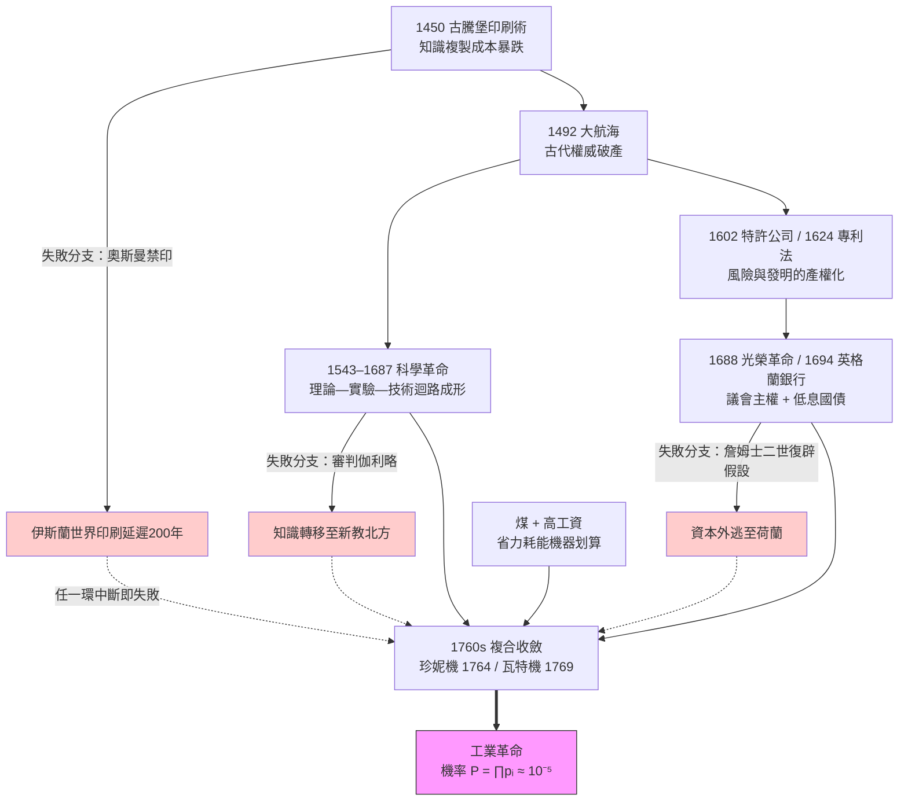

# 第一章 導論：問題的反轉與循環結構

## 1.1 金觀濤的反轉：為何「只」發生在歐洲——一連串特殊事件與體制的串聯

### 一個問題的三種問法

工業革命為什麼發生在歐洲？這個問題通常被問成：「為什麼工業革命發生在歐洲，而不是中國或印度？」但思想家金觀濤指出，這樣的問法隱藏著一個消極的預設——它把「發生工業革命」當作需要解釋的常態，把「沒有發生」當作不需要解釋的預設。我們於是不斷追問中國缺了什麼：缺科學？缺資本主義？缺殖民地？缺新教倫理？

金觀濤的反轉是：**這個預設恰恰問反了。** 縱觀人類數千年文明史，工業革命才是極端罕見的例外；「沒有發生工業革命」才是所有文明的常態。換句話說，正確的問題不是「為什麼中國沒有發生」，而是「**為什麼偏偏在十八世紀末的英格蘭，這個機率趨近於零的事件發生了**」。既然是例外，解釋的單位就不應該是任何一個文明的「長期特質」，而應該是一連串特殊事件與體制在特定時空中的**串聯**。

這個反轉與金觀濤分析科學革命的方法一脈相承。在[../../科技史/科技發展史/README.md](../../科技史/科技發展史/README.md)所整理的循環結構框架中，近代科學的誕生不是「歐洲人更聰明」的結果，而是「理論—實驗—技術」三環在特定條件下第一次扣合成自我加速迴路的結果。工業革命同理：它不是某種文明基因的必然展開，而是一條環環相扣的事件鏈碰巧全部接通的產物。

### 單因論的全面失敗

一旦把問題問對，各種流行的單因解釋就紛紛露出了破綻。

**「煤」說**：英格蘭恰好有煤，煤近地表、近河流、近市場。但中國山西的煤儲量同樣巨大，宋代已有用煤記錄；煤要變成動力革命，需要真空概念的科學知識（紐科門機的核心原理）、需要高工資讓省力機器划算、需要能為礦井籌資的金融體制。煤是必要條件，卻遠非充分條件。

**「新教倫理」說**：韋伯的命題指認了文化與經濟的關聯，但信奉新教的地區很多——蘇格蘭、荷蘭、北德、新英格蘭——工業革命卻只發生了一次。而且天主教法國同樣有重要的技術創新，儒家中國的商人也同樣勤勉逐利。宗教或許改變了對「逐利」的道德評價，但無法獨自解釋機器與蒸汽。

**「地理」說**：島國免於陸權侵擾、煤鐵位置優越——可是日本也是島國，直到十九世紀才被迫開港。地理決定論更無法解釋為何工業革命發生在 1760 年代而非此前此後的任何年代：英格蘭的地理一千年來沒有顯著變化。

**「專利」說**：1624 年英國壟斷法確實保護了發明人，但歷史學家早已指出，瓦特的專利反而延緩了蒸汽機的擴散（他自己不斷興訟阻擋競爭者）；而工業革命中大量關鍵技術——紡紗機、焦炭煉鐵——根本沒有申請專利，靠的是保密、師徒與「開辦費」式報酬。制度有關係，但不是開關。

每一個單因論者都像盲人摸象：摸到的是真實的象腿、象耳、象尾，拼出來的卻不是象。**原因很簡單：在數千年、數十個文明構成的樣本中，成功案例只有一個。對單一樣本的任何單因解釋，都無法排除它只是「必要條件之一」而非「充分條件」。**

### 一連串特殊事件與體制的串聯鏈

金觀濤式的回答是把鏡頭拉遠，把 1450 年到 1760 年間三百餘年的事件排成一條串聯鏈。這條鏈上每一環都不是「歐洲的常態」，而是低機率的偶發事件或特定博弈的產物：

- **1450 年，古騰堡活字印刷**（[../../科技史/科技發展史/1450-古騰堡印刷術.md](../../科技史/科技發展史/1450-古騰堡印刷術.md)）：知識複製成本暴跌，使異說無法被燒盡、使實驗報告可以被遠方同時代人重複檢驗——這是循環結構的點火器。
- **1492 年，哥倫布西航**：大航海暴露了古代權威（托勒密）的破產，「古人不懂的，我們懂」第一次成為可信的命題。
- **1543–1687 年，科學革命**：哥白尼、伽利略、波以耳到牛頓，「理論—實驗—技術」三環扣合運轉（[../../科技史/科技發展史/README.md](../../科技史/科技發展史/README.md)）。
- **1602 年荷蘭東印度公司、1624 年英國專利法**：把高風險遠洋貿易與高成本發明，都轉化為可計算、可投資的產權標的。
- **1688 年光榮革命、1694 年英格蘭銀行**：王權被議會馴服，國家信用第一次可以被制度化地借貸——政府能以 3–5% 的低息長期舉債，運河、礦井、保險、专利訴訟都有了廉價資本的榜樣。
- **煤 + 高工資**：英格蘭勞動力昂貴、煤炭廉價，省力而耗能的機器第一次「划算」。
- **1760 年代，複合收斂**：珍妮紡紗機（1764）、瓦特分離冷凝器（1769，[../../世界史/工業革命史/1769-瓦特蒸汽機.md](../../世界史/工業革命史/1769-瓦特蒸汽機.md)）在同時同地出現——因為上面所有環節剛好在此刻匯流。

關鍵在於理解這是一條**「與」鏈**而非「或」鏈：它是 A **且** B **且** C **且**……任一環斷裂，後面的環節就無從發生。沒有印刷術，科學革命難以形成公共的可批評場域；沒有科學革命，就沒有「真空可做功」的知識傳統；沒有光榮革命與英格蘭銀行，瓦特可以在金主的反覆破產中死去（他的第一個金主羅巴克就真的破產了，靠博爾頓的資本才活下來）；沒有高工資，省力機器是虧本買賣；沒有煤，省能的機器毫無用武之地。

用條件機率的語言說：若每一環「接通」的機率為 $p_i$，則整條鏈成立的機率是

$$
P(\text{工業革命}) = \prod_{i=1}^{n} p_i, \quad p_i \ll 1
$$

當 $n \approx 8$、$p_i \sim 0.3$ 時，$P \approx 6.6 \times 10^{-5}$。這正是「數千年數十文明只發生一次」的統計意義——不是任何文明「落後」，而是**連乘太殘酷**。任何單因論者之所以失敗，是因為他們看到 $p_i$ 中某一項接近 1，就以為 $P$ 應該接近 1。

### 競爭性國家體系：鏈條無法被單一帝國中止

這條鏈還有一個常被忽略的結構性護欄：**它不掌握在任何一個政權手中**。

歐洲是羅馬帝國崩解後形成的多國競爭體系。任何一國的中止命令，都會讓人才、資本與書籍流向鄰國——哥倫布被葡萄牙拒絕後投奔西班牙；笛卡兒從荷蘭寫信給在法國的梅森；胡格諾工匠被路易十四的廢除南特詔書趕去普魯士與英格蘭。相比之下，鄭和艦隊在 1433 年一紙詔書下終止，全世界最強的遠洋能力就此消失——因為它只存在於皇帝的意志之中。奥斯曼 1485 年起禁印阿拉伯文書籍，印刷術在伊斯蘭世界被延遲了兩百多年——但知識經義大利與荷蘭繞道回流。

用系統語言說：競爭性國家體系使 $p_i$ 的「中止事件」成為可恢復的擾動而非吸收態。單一帝國裡，一次否定性決策就是 $\prod p_i$ 歸零；多國體系裡，否定性決策只是把機率轉移到鄰國的帳上。這就是為什麼這條鏈可以在火刑（布魯諾）、審判（伽利略）、內戰（英格蘭）與專利訴訟中存活並繼續加長。

### 本書的探案方法

因此本書採取「探案」而非「定論」的寫法：把工業革命當作一樁發生過一次、動機與手法皆待重建的案件。每一章檢驗一條線索——科技、經濟、制度、文化、政治、思想、教育——但我們始終記得金觀濤的教訓：**這些線索不是互相替代的嫌疑犯，而是互相驅動的共犯結構**。印刷術（科技）改變了宗教辯論（文化），宗教改革催生了識字與義務教育（教育），識字的工匠讀得懂《哲學匯報》（思想），議會主權（政治）保障了專利與低息公債（制度），低息資本養得起長期賠錢的實驗室（經濟），實驗室又造出下一台機器（科技）——迴路閉合，革命爆發。

問題已經反轉。接下來的兩節，我們先整理兩大學術傳統——李約瑟問題與大分流辯論——的證詞，然後拆解金觀濤循環結構的九條通道，看看這台「永不停止的引擎」究竟是怎樣裝配起來的。

### 本章事件鏈與失敗分支

> **參照**：本篇的循環結構語彙承襲 [../../科技史/科技發展史/README.md](../../科技史/科技發展史/README.md)；蒸汽機案件的完整重建見 [../../世界史/工業革命史/1769-瓦特蒸汽機.md](../../世界史/工業革命史/1769-瓦特蒸汽機.md)。
