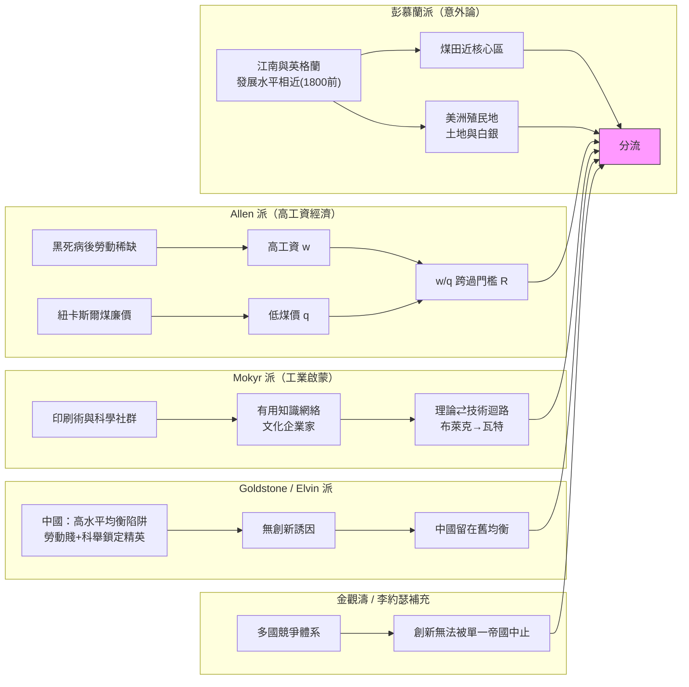

# 第一章 導論：問題的反轉與循環結構

## 1.2 李約瑟問題與大分流辯論

### 李約瑟：一個問題與它的兩種表述

李約瑟（Joseph Needham, 1900–1995）本是劍橋大學的生物化學家，因三位中國留學生的啟發轉向中國科學史，自 1954 年起陸續出版七卷本的《中國科學技術史》（*Science and Civilisation in China*）。這部巨著用無可辯駁的證據表明：在公元前的青銅冶煉、漢代的紡車與冶鐵、宋代的火藥、指南針、活字印刷與水運儀象台面前，歐洲長期是學生而非老師。以火藥為例，其定型與傳播史見 [../../科技史/科技發展史/1044-火藥.md](../../科技史/科技發展史/1044-火藥.md)；蘇頌 1090 年的水運儀象台更是集天文觀測、報時機構與機械傳動於一身的中世紀工程巔峰（[../../科技史/科技發展史/1090-水運儀象台.md](../../科技史/科技發展史/1090-水運儀象台.md)）。

正因為證據太充分，李約瑟提出的問題才如此尖銳。這個「李約瑟問題」其實有兩種表述：

1. **歷史表述**：為什麼在公元前一世紀到公元十五世紀之間，中國在把自然知識應用於人類實際需要方面遠比歐洲有效率？
2. **反轉表述**：為什麼科學革命（以及隨之而來的工業革命）沒有發生在中國，而發生在十七世紀的歐洲？

李約瑟自己的答案是制度性的：中國的「官僚封建制」把最優秀的智力吸納進科舉與行政體系，商人階層始終無法取得獨立的法權地位；而歐洲的分裂與城市自治給了「商人—工匠—學者」聯盟成長的縫隙。這個答案與金觀濤的循環結構論互補：官僚體系能動員巨大資源（鄭和艦隊），卻因**不存在多國競爭的退路**，一次否定性決策（1433 年停造寶船、明清海禁）就能終止整條技術路線。

李約瑟還留下了一個常被引用的量化觀察，可稱為「Needham 梯度」：若以某種綜合的「科學技術成就指數」$S(t)$ 比較中國與歐洲，則

$$
\frac{S_{\text{中國}}(t)}{S_{\text{歐洲}}(t)} > 1 \quad \text{當} \quad t \in [-100,\, 1450]; \qquad \frac{S_{\text{中國}}(t)}{S_{\text{歐洲}}(t)} < 1 \quad \text{當} \quad t > 1600
$$

梯度在十五至十七世紀間急速反轉。問題是：反轉的驅動力是什麼？六十年來，學界給出了兩大類答案——制度內生論與經濟意外論。後者的代表作，就是彭慕蘭的《大分流》。

### 彭慕蘭的《大分流》：煤與殖民地的「意外」

彭慕蘭（Kenneth Pomeranz）《大分流：中國、歐洲與現代世界經濟的形成》（2000）是過去四分之一世紀最具衝擊力的經濟史著作。其核心主張有三：

1. **至遲到 1800 年，長江下游（江南）與英格蘭核心區在生活水準、市場發育、勞動分工上大體相當。** 諾貝爾獎得主們估計的十八世紀中國人均 GDP 偏低是「以整個中國除以整個歐洲」的錯誤比較；拿江南比英格蘭，差距很小甚至不存在。
2. **兩邊都面臨同樣的「生態瓶頸」**：土地與森林資源瀕臨極限，再精巧的斯密型增長（分工與市場擴張）都無法突破馬爾薩斯的屋頂。
3. **分流靠兩個「意外因素」**：英格蘭恰好有煤，且煤田恰在經濟核心區附近（蘭開夏），煤取代了木材；歐洲恰好有美洲，新大陸提供了土地密集型的棉花、糖與白銀，等於為歐洲「憑空增加」了數百萬畝土地。江南既無就近的大煤田（山西煤遠水難解近火），也沒有自己的殖民地。

### 反方證詞：Allen 的高工資、Mokyr 的文化企業家、Goldstone 的效率恐慌

《大分流》引發了持續二十年的反擊。最重要的三份證詞如下。

**Robert Allen 的高工資經濟說。** Allen 以建築工人實際工資的跨國數據重建了工業革命前的國際比較，發現：倫敦工匠的實際工資在十七、十八世紀為阿姆斯特丹之後的世界第二高，遠超江南、德里與佛羅倫斯。這不是好運，而是結構性的：黑死病後英格蘭勞動力長期稀缺，加上商業帝國的資本回報，工資被持續推高。高工資 + 廉價煤炭構成了一個獨特的**要素價格結構**，使「昂貴勞動、廉價能源」的英格蘭企業家有強烈誘因去投資省力而耗能的機器——珍妮紡紗機、水力紡紗機、瓦特蒸汽機在英格蘭划算，在法國與中國則否。Allen 的模型在本節後面以公式重建。彭慕蘭的回應是英格蘭工資並未高出江南多少，但計量史家（Allen、Broadberry 等）後續以實際工資與 GDP 估計反駁：至遲 1750 年，倫敦與江南的差距已在一倍以上。

**Joel Mokyr 的文化企業家與「工業啟蒙」說。** Mokyr 指出，要素價格分析無法解釋一個關鍵事實：工業革命的關鍵人物——瓦特（儀器匠出身、與格拉斯哥大學化學家布萊克密切往來）、韋奇伍德（讀化學、當皇家學會會員）——不是在既有生產函數內做邊際調整的理性農夫，而是**知道「有用知識」存在並主動去找它的人**。十八世紀英格蘭出現了「工業啟蒙」：科學期刊、月光社式的科社、大學與工匠之間的往來網絡，使「命題性知識」（科學）與「預設性知識」（技藝）之間架起橋樑。這正是金觀濤循環結構的經濟史版本：理論—實驗—技術的迴路被制度化、被社會化了。

**Jack Goldstone 的「效率恐慌」與生態危機說。** Goldstone（以及 Mark Elvin 的「高水平均衡陷阱」）提供了更早的分岔點：明清中國並非停滯，而是陷入了**人口—資源的高水平均衡**——勞動力太便宜、人地比太緊，節省勞動的創新無利可圖；同時科舉把精英注意力鎖定在經典注疏上。歐洲在黑死病與殖民擴張之後走出這種均衡，英格蘭在十七世紀末甚至陷入「效率恐慌」：議會政體、金融革命與海外市場使精英相信「增長」是可能的、值得追求的——這種對增長的**期待本身**是心理與制度的雙重突破。

### 兩個陣營的真正分歧

表面上，辯論關於數據（江南工資到底多高？煤到底多近？）。深層的分歧是**因果觀**：彭慕蘭的框架裡，制度與文化是「通用技術」，各文明差不多，分流靠外生的資源稟賦；Allen–Mokyr 的框架裡，稟賦只是誘因，**誘因要透過制度（產權、專利、低息資本）與文化（有用知識網絡）才能轉化為創新**。用本書的語言：彭慕蘭解釋了「為何省力機器在英格蘭划算」（需求側），但無法解釋「為何恰好有人造得出這些機器」（供給側）；供給側的答案，就藏在循環結構裡。而循環結構本身，又需要第一章所說的多國競爭體系來保護它不被單一決策中止。

### Allen 模型的簡化式：節能誘因

設一項生產任務可用「勞動 + 能源」完成。傳統技術每單位產出耗勞動 $L_0$、耗能源 $E_0$；新機器使勞動需求降為 $L_1 < L_0$，但能源需求升為 $E_1 > E_0$（蒸汽機省人卻吃煤）。令工資為 $w$、能源價格為 $q$，採用新技術的單位成本節省為

$$
\Delta C = w\,(L_0 - L_1) - q\,(E_1 - E_0)
$$

企業採用新技術的條件是 $\Delta C > 0$，即

$$
\frac{w}{q} > \frac{E_1 - E_0}{L_0 - L_1} \equiv R
$$

這個臨界比 $R$ 是新技術的「要素價格門檻」。十八世紀英格蘭的 $w/q$（工資/煤價比）為世界最高——倫敦日薪約為北京的三至五倍，而紐卡斯爾煤價折算後與江南柴薪相近甚至更低。唯有英格蘭同時滿足「勞動貴」與「能源賤」，$w/q$ 跨過了瓦特機、珍妮機與軋鐵機各自的 $R$。法國與中國的 $w/q$ 低於門檻，同樣的機器「發明了也不划算」——這正是為為何專利圖紙與旅行者遊記沒能把工業革命帶走。

### 大分流辯論的因果圖

> **參照**：蒸汽機案件見 [../../世界史/世界發展史/1769-瓦特蒸汽機.md](../../世界史/世界發展史/1769-瓦特蒸汽機.md)；中英貿易的制度背景見 [../../世界史/商業貿易史/1757-廣州一口通商.md](../../世界史/商業貿易史/1757-廣州一口通商.md)；循環結構的完整表述見 [../../科技史/科技發展史/README.md](../../科技史/科技發展史/README.md)。
