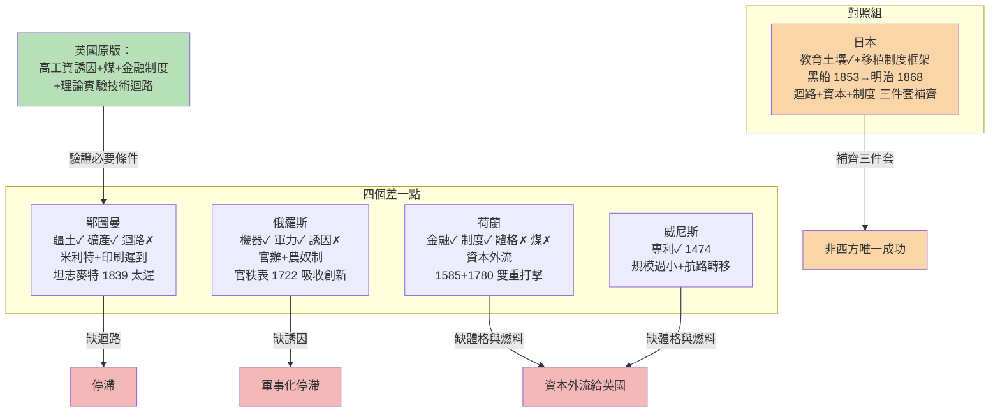

# 第二章之三 反事實檢驗：為何不是鄂圖曼、俄羅斯、荷蘭與威尼斯——四個「差一點」的故事與日本對照組

## 摘要：差一點的距離有多遠

偵探故事的結局往往藏在最接近真相的嫌疑人身上。鄂圖曼帝國統治著工業革命的出生地與原料走廊，卻親手錯過它；俄羅斯以國家暴力強制西化，卻把創新消化在官僚的胃裡；荷蘭與威尼斯發明了工業革命所需的一切金融制度，卻在自己的小體格與資本外流中功成身退。而日本——一個被炮艦轟開門的封閉群島——卻證明了這套系統是可以被自覺移植的。四個「差一點」與一個「後來居上」，共同界定了工業革命的必要條件清單。

## 一、鄂圖曼：站在礦脈上的陸權帝國

鄂圖曼帝國的地緣條件近乎作弊：它同時握有通往波斯與印度的香料絲綢孔道、巴爾幹的礦產與木材，以及歐洲最大城市的關稅收入。1453 年攻陷君士坦丁堡後，它甚至接管了東正教文明的技術遺產，見 [../../世界史/歐亞交界史/1453-君士坦丁堡陷落與陸權轉移.md]。十六世紀的鄂圖曼火炮、造船、醫學一度與歐洲並駕齊驅。

為什麼停滯？三層結構性的答案。**第一，米利特制度**：帝國以宗教社群為單位分而治之，這套制度在統治上高明，在創新上致命——它把社會切成分隔的縱向格間，知識與資本無法在格間橫向流動，跨社群的協作（歐洲城市最擅長的事）失去制度通道。**第二，陸權邏輯**：帝國的財政基礎是土地稅與擴張戰利品，統治精英的理性選擇是繼續攻城略地，而非向海洋與機器投資——沒有「技術⇒利潤⇒技術」的迴路。**第三，印刷術的遲到**：古騰堡之後近三百年，鄂圖曼當局遲遲不許用阿拉伯字母活字印刷，知識複製成本居高不下，正反饋迴路最核心的點火器始終缺席。

等到帝國意識到危機，1839 年坦志麥特改革才姍姍來遲——宣告法律面前人人平等、設立新式學校、效法法國商法，見 [../../世界史/歐亞交界史/1839-坦志麥特改革.md]。但此時英國的紡織機已轉了七十年，鐵路已鋪了十四年；在沒有產權保護、沒有工程師階層、沒有資本市場的土壤上，每一項引進都是無根的移植。坦志麥特太遲了——遲的不是幾年，是整整一個迴路週期。

## 二、俄羅斯：國家可以買到機器，買不到迴路

1722 年彼得大帝頒布官秩表，把文武官職分為十四等，貴族必須服務國家方能晉升——這是沙俄強制西化的制度核心，見 [../../世界史/歐亞交界史/1722-彼得大帝官秩表.md]。彼得親自到荷蘭造船廠做學徒，聘請數千外國工程師，建立海軍、鑄炮廠、科學院。從器物層面看，俄羅斯在十八世紀已是軍事強權。

但俄羅斯證明了反事實中最深刻的一課：**國家可以引進技術，卻無法用命令創造循環結構**。原因有三。**第一，國家是創新的唯一顧客**：礦場、兵工廠、造船廠全屬官辦，工程師對官僚負責而非對市場負責——沒有利潤訊號，就沒有改良的誘因。**第二，農奴制凍結了勞動市場**：數百萬農奴被釘在土地上，工資低到機器毫無用武之地（回看第二章之一的不等式：$w \cdot \Delta L > rK + p_e E + \delta K$，農奴制下 $w \approx 0$，永遠不成立）；而貴族的勞役義務把最可能成為企業家的階層綁進了官秩表的年資階梯。**第三，教育是軍事的延伸**：學校培養砲兵軍官與繪圖員，科學院是沙皇的珍寶櫃，不是社會的自我組織。技術孤行——與北宋同構的病症，只不過孤行者換成了沙皇。

## 三、荷蘭與威尼斯：發明了引擎，卻把引擎賣給別人

最令人扼腕的「差一點」是海上兩共和國。它們幾乎發明了工業革命所需的全套**制度**：1474 年威尼斯頒布人類第一部成文專利法——「技術⇒利潤」的誘因合同比古騰堡晚不了幾年；1602 年荷蘭東印度公司發明常設股份公司，1609 年阿姆斯特丹銀行與證券交易所發明現代金融。金觀濤循環之外的兩大支柱（產權誘因與資本組織），兩共和國都搶先拿到了。

但兩者有三個共同的死穴。**第一，體格太小**：威尼斯人口不過十餘萬，荷蘭聯省不過兩百萬，國內市場與勞動規模不足以支撐大規模機器工業的固定成本。**第二，沒有煤**：工業革命的物理燃料不存在於它們的國土——尼德蘭有泥炭但熱值太低，這是地理判下的死刑，任何制度都無法立法生產煤礦。**第三，也是最諷刺的——資本外流**：它們的金融革命太成功，以至於成為全歐洲的資金池。荷蘭的儲蓄大量借給英國（甚至資助了英國的國債與運河）、投資於英國的工廠與鐵路。**發明資本的國家，資助了別人的工業革命。**制度的果實被地緣更大、能源更廉的鄰居收割。

兩個致命的政治節點把「差一點」變成「差很多」。1585 年安特衛普陷落：西班牙軍隊攻破當時北歐最大的商業城市，數萬工匠、商人、金融家攜資本與技藝北逃阿姆斯特丹，另一部分流向倫敦——荷蘭崛起與英國補血同時發生，見 [../../世界史/大航海時代/1585-安特衛普陷落.md]。1780 年第四次英荷戰爭：英國以工業化的海軍碾碎依靠轉口貿易的荷蘭艦隊，VOC 的亞洲壟斷網絡被戰爭成本壓垮，數年後公司國有化，世界第一個股份帝國壽終正寢，見 [../../世界史/大航海時代/1780-第四次英荷戰爭與VOC之亡.md]。轉口貿易的財富邏輯（低買高賣、坐收佣金）被製造業的財富邏輯（機器量產、技術疊代）正面擊穿——荷蘭不是不夠富，是富得不在正確的產業上。

## 四、日本對照組：唯一補課成功的學生

反事實的最後一塊拼圖，是證明「這套系統可否移植」的對照組。1853 年黑船叩關，培理艦隊以蒸汽動力的展示宣告封閉已不可能，見 [../../世界史/世界發展史/1853-黑船事件.md]。十五年後的 1868 年，明治維新開始，見 [../../世界史/世界發展史/1868-明治維新.md]。日本在半個世紀內完成了別的文明五百年沒有完成的事——為什麼？

因為日本在被迫開國之前，已經**自備了三件套中的兩件半**：其一，**迴路的土壤**——蘭學兩百年的地下傳承，讓精英自十八世紀起持續閱讀解剖學、曆學、炮術的荷蘭文書籍，「以實驗與數學理解自然」的預設已被部分接受，江戶的寺子屋教育更使識字率高居世界前列。其二，**制度的空白畫布**——明治政府以國家力量系統性移植廢藩置縣、地租改正、殖產興業、專利條例、帝國大學，關鍵在於移植的是**制度框架**（產權、法人、市場、學校）而非個別機器：先建迴路，再灌技術。其三，**資本與市場**——地稅改革提供原始積累，武士公債轉化為產業資本，西方強加的不平等條約意外提供了開放的出口市場。

這正是全章的鏡像驗證：鄂圖曼不缺疆土而缺迴路，俄羅斯不缺機器而缺誘因，荷蘭不缺制度而缺體格與煤，日本起初什麼都缺——但它的統治精英把「移植整個系統」當成生存目標，且社會的教育水平足以承接。**工業革命不是一件物品，是一個可以整體安裝的迴路系統；安裝的前提，是接收端已有一張沒有被舊制度焊死的插座。**

## 五、四案對照：矩陣化的結案

## 六、結案陳詞與第三章預告

把四個「差一點」與日本並列，工業革命的必要條件清單浮現：

| 條件 | 鄂圖曼 | 俄羅斯 | 荷蘭/威尼斯 | 中國 | 日本 |
|------|--------|--------|-------------|------|------|
| 知識迴路（理論-實驗-技術） | ✗ | ✗ | 部分✓ | ✗ | 移植後✓ |
| 產權與誘因（專利、市場） | ✗ | ✗ | ✓✓ | ✗ | 移植後✓ |
| 資本組織（法人、銀行） | ✗ | ✗ | ✓✓ | ✗ | 移植後✓ |
| 要素價格（高工資+廉煤） | 部分 | ✗ | ✗ | ✗ | 部分 |
| 體格與政治屏障 | ✓✓ | ✓✓ | ✗ | ✓ | ✓ |

英國是唯一全表打勾的選手；日本是唯一在半世紀內補齊表格的學生；其餘文明各自缺格。反事實檢驗至此完成：工業革命落在英國，不是隨機的擲骰，而是多重條件在特定時空的唯一交集。

第三章，我們將轉入正面偵查：逐一拆解英國這台機器的六個零件——科技、經濟、制度、文化、政治、教育——並追溯它們之間的驅動關係如何齒輪般咬合。

---

**延伸閱讀**：[../../世界史/歐亞交界史/1453-君士坦丁堡陷落與陸權轉移.md]、[../../世界史/歐亞交界史/1839-坦志麥特改革.md]、[../../世界史/歐亞交界史/1722-彼得大帝官秩表.md]、[../../世界史/大航海時代/1585-安特衛普陷落.md]、[../../世界史/大航海時代/1780-第四次英荷戰爭與VOC之亡.md]、[../../世界史/世界發展史/1853-黑船事件.md]、[../../世界史/世界發展史/1868-明治維新.md]
