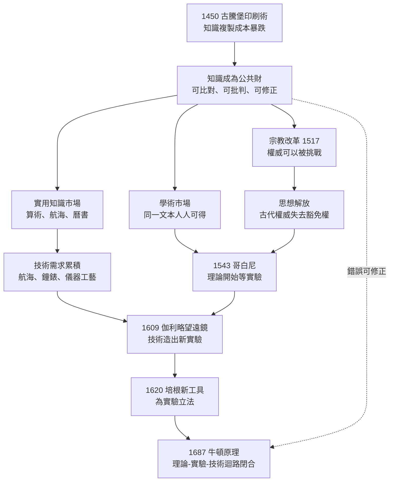

# 第三章第一節 從畢昇到古騰堡：知識複製成本暴跌與迴路的點火器

## 引子：四百年的時間差，兩種截然不同的命運

1045 年，北宋慶曆年間，布衣工匠畢昇用膠泥刻字、火燒令堅，再以鐵板排字、敷藥固版，印完即拆、字可再用——這是世界上第一次活字印刷。四百零五年後的 1450 年，美因茲金匠古騰堡以鉛、錫、銻合金鑄字，配上一台改裝的螺旋壓印機與油性墨，把活字印刷變成了一套可以規模化生產的「複製系統」。

表面上，兩項技術極為相近：都是活字、都為了降低複製成本。但結局天差地遠。畢昇的活字在宋代是曇花一現的奇技——沈括《夢溪筆談》記錄了它，然後它沉睡了幾個世紀，中國出版主流依然是雕版。而古騰堡的印刷機在五十年內印出上千萬冊書，兩百年內催生宗教改革、科學革命與近代知識公共領域。

用金觀濤的框架來說（見 [../../科技史/科技發展史/README.md]）：**印刷術是「理論—實驗—技術」迴路的點火器，但點火器要點燃，前提是那裡已經有可燃的氣氛。**中國的氣氛是科舉經典市場，歐洲的氣氛是宗教改革、大學與商人識字市場——同樣的火種，點燃了兩種完全不同的火焰。

## 技術相近：活字印刷的本質是「把資訊變成可離散編碼的對象」

從純技術角度看，活字印刷的發明門檻並不驚人。它的核心思想只有一句話：**把文本從連續整體（雕版）拆解為離散單元（字），離散單元可以標準化製造、隨意組合、重複使用。**這正是資訊編碼的雛形——四百年後的電報、打字機、電腦字元集，走的都是同一條思路。

畢昇的膠泥活字已具備思想的所有要素：**單字製造**（一字一模，火燒硬化）、**自由組合**（鐵板排字、松脂固定、印畢加熱脫板）、**重複使用**（常用字備數十枚）、**分工檢字**（「常作二鐵板，一板印刷，一板已自布字」——流水線的雛形）。

古騰堡的貢獻不是思想，而是**工程系統化**：手持鑄字模讓每枚鉛字誤差降到肉眼難辨——「互換性」思想的第一次大規模應用；油性墨在金屬字面附著均勻；螺旋壓印機讓壓力可控省力。三者合成一台「書籍的工廠」。

換句話說，畢昇證明了思想的可行性，古騰堡證明了思想的**經濟性**——而決定技術命運的往往是後者。

## 命運迥異之一：中國——科舉市場把印刷術定向到「重複印少數書」

為什麼活字在中國夭折？答案不在技術，在市場結構。

宋代以降中國最大的識字群體是科舉士子，最大的印刷品需求是儒家經典、科舉範文、佛道經藏。這個市場的特徵是：**書目極少（幾百部經典與注疏）、每種印量極大、內容數百年不變。**面對這種需求，雕版是最優解——刻一次版，可以連印幾百年，版片還可收藏、修補、傳代；而活字的優勢（換內容快、排新版快）在這個市場裡毫無用武之地。

更深的問題是：**科舉制度把知識的評價權交給了固定的經典文本。**知識的正確性由聖人與朝廷裁定，不需要可比對、可批判的流通環境。讀者要做的是記誦與註疏，不是校勘與反駁。印刷術在中國被定向成「經典的放大器」，而非「新知的載體」。

用迴路的語言說：中國有技術（印刷）、有理論（經學）、有觀測（天文曆法），但**印刷沒有長出「讓知識互相碰撞」的功能**，於是理論—實驗—技術三環依然各自孤立。參見 [../../世界史/世界發展史/1045-畢昇活字.md]。

## 命運迥異之二：歐洲——三個市場同時搶購一台機器

古騰堡的第一本書是四十二行聖經（1455），但他的合伙人福斯特與舍弗爾隨即發現，真正賺錢的是**贖罪券、文法課本與商業文件**。到 1500 年，歐洲已有二百五十多個城市設立印刷所，出書約三萬種、兩千萬冊。需求來自三個方向：

1. **宗教改革**：路德的講章、小冊子、《聖經》德譯本——廉價印刷品是宗教改革的傳播載體；
2. **大學與學者**：亞里士多德、托勒密、歐幾里得的翻印、校勘本與新注——學術市場需要「同一本書人人手上有同一版本」；
3. **商人與城市**：算術課本、複式簿記手冊、航海圖、曆書——實用知識市場（斐波那契傳統的延續，見 [../../科技史/科技發展史/1202-斐波那契算盤書.md]）。

關鍵差異在於：**歐洲的知識權威是分裂的。**教會、大學、宮廷、行會、商人城市各自宣稱真理，沒有任何一個機構能壟斷「什麼書該印、什麼說法正確」。印刷機恰好餵養了這場競爭：每一方都想印書壓倒對方，印得越多，讀者比對得越多，比對得越多，權威就越難維持。

## 迴路的點火器：知識從私人財變成公共財

印刷術對迴路的作用，不是「多印了幾本書」，而是**改變了知識的經濟與社會性質**：

- **知識成為公共財**：一個實驗結果印成小冊子，全歐洲學者同時知道——不再需要師徒口傳與手抄孤本；
- **知識成為可比對的**：同一文本的多個印本並列，版本異文、抄錄錯誤第一次可被系統性發現——「批評文本」誕生了，接下來就是批評權威；
- **錯誤可以修正**：手抄時代，錯誤每抄一次繁殖一次；印刷時代**版本可標號**——第一版錯了，第二版更正。這是科學「自我糾錯」的物質基礎；
- **知識可以積累**：當每本書都是穩定複製品，後人可以「站在同一個肩膀上」。

用九通道框架標註：印刷術本身是**技術⇒技術**（印刷機→蒸汽印刷→輪轉機→WWW，見 [../../科技史/科技發展史/1989-全球資訊網.md]），但它對迴路最大的貢獻是打通了所有通道的**傳播層**：理論⇒實驗的「該測什麼」、實驗⇒理論的「異常數據」、技術⇒理論的「工程難題」——在印刷之前，這些通道都因傳播成本太高而半癱。

## 1517：一場用印刷機打贏的戰爭

路德的九十五條綱領是印刷術力量的最佳實驗。1517 年 10 月 31 日，路德把綱領貼在維滕貝格城堡教堂門上——這在當時只是學術辯論的例行公告，此前無數次神學辯論都這樣發起、也這樣被遺忘。這次不同：有人把綱領抄下寄給印刷商。**兩週內，德意志各大城市都在討論它；兩個月內，歐洲主要城市都有了譯本**；德意志小冊子產量在 1518–1525 年間增長十倍。

請注意傳播速度的對比：同樣是神學異議，胡司（Jan Hus）在 1415 年被燒死時，他的主張花了數十年才在波希米亞之外緩慢滲透；路德的異議在兩週內成了全德意志的公共議題。差別不是路德更雄辯，而是**1450 到 1517 之間，德意志多了幾十家印刷所**。路德自己說得很清楚：「印刷術是上帝至高無上的恩典。」

這場傳播革命向歐洲知識階層演示了一件比任何神學結論都重要的事：**當知識的複製與傳播成本暴跌時，任何權威都無法再壟斷真理。**教會做不到，古代權威（亞里士多德、蓋倫、托勒密）也做不到——科學革命的心理前提就此鋪設完畢。

## 一個簡化的傳播模型：複製成本與知識的臨界規模

印刷術的歷史作用可以用一個極簡的模型刻畫。設一本書的手抄成本為 $C_m$，印刷單位成本為 $C_p$（含製版攤提），單位成本比為：

$$r = \frac{C_p}{C_m} \approx 0.01 \sim 0.001$$

十五世紀史料顯示，印刷書成本約為手抄本的百分之一到三百分之一。成本暴跌意味著，一個新知識要達到「公共討論」所需的最小讀者群，其門檻擴大了兩到三個數量級。傳播速度上，若每個持有者平均在 $t$ 天內傳給 $k$ 個新讀者（手抄需數月，印刷轉寄或翻印只需數日），則知識覆蓋人口 $N$ 的時間近似為：

$$T(N) \approx \frac{\log N / \log k}{\text{代際時間 } t}$$

印刷術同時提高了 $k$（翻印比抄寫快數十倍）並縮短了 $t$，使 $T(N)$ 從「以世紀計」壓縮到「以週月計」。**當 $T(N)$ 短於一個學術界做出反應的時間，知識就從「遺產」變成了「對話」。**九十五條綱領的兩週，就是 $T(N)$ 首次短於人類辯論節奏的歷史時刻。

## 因果鏈：從印刷機到牛頓

這條鏈上每一環都依賴前一環，而**每一環都以印刷術為傳播前提**：哥白尼的書若只抄三份，就不會有第谷去重測數據；伽利略的觀測若不印成《星際信使》，就不會有全歐洲的望遠鏡接力。

## 結語：點火器與可燃物的辯證

畢昇與古騰堡的對照，為本書的核心問題「工業革命為何出現在歐洲」給出第一條證詞：**技術本身不決定歷史，技術與社會市場的匹配才決定。**同樣的活字思想，在科舉經典市場裡是奇技淫巧，在宗教改革與商人市場裡是文明加速器。

但印刷術只是點火器，不是引擎。迴路要真正轉起來，還需要：理論敢於脫離權威去猜想（哥白尼）、實驗敢於成為裁決者（第谷、吉爾伯特、伽利略）、方法論敢於為這一切立法（培根）。這是下一節的主題。

> 延伸閱讀：[../../科技史/科技發展史/1450-古騰堡印刷術.md]、[../../世界史/世界發展史/1045-畢昇活字.md]、[../../世界史/世界發展史/1455-古騰堡印刷革命.md]、[../../科技史/科技發展史/1989-全球資訊網.md]（知識複製成本的第二次暴跌）
