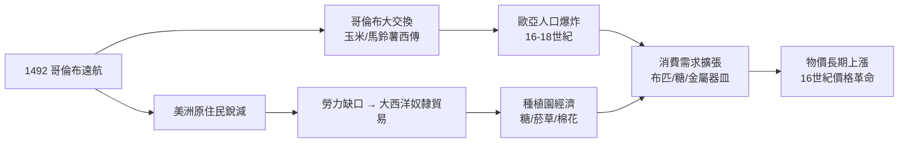

# 04.1 哥倫布大交換與波托西銀礦：需求的爆炸

## 一、1492：兩個世界的生態撞擊

工業革命的故事，通常從瓦特與紡織機講起；但真正把「需求」推向爆炸點的，是1492年那場橫跨大西洋的生態撞擊。哥倫布的航線不僅連接了兩個大陸，也連接了兩套彼此隔絕了上萬年的生物圈——作物、牲畜、病菌與人口，開始了一場史無前例的大規模遷移，後世史家克羅斯比稱之為「哥倫布大交換」。關於這段航程本身的細節，可參考 [../../世界史/大航海時代/1492-哥倫布與大交換.md]。

這場交換是極不對稱的。往西，舊大陸帶去了小麥、甘蔗、馬、牛、豬，以及致命的天花與麻疹——伊斯帕尼奧拉島上的原住民人口在數十年內幾乎滅絕，整個美洲原住民在一個多世紀內損失了九成上下，見 [../../世界史/大航海時代/1518-伊斯帕尼奧拉天花.md] 與 [../../世界史/世界發展史/1492-哥倫布大交換.md]。往東，美洲帶回了玉米、馬鈴薯、蕃薯、花生與番茄。這批作物的意義遠超「餐桌上的新品種」：它們能在貧瘠土地、丘陵坡地上生長，單位熱量產出遠高於傳統穀物。十七、十八世紀，玉米支撐了巴爾幹與義大利北部的農村人口，馬鈴薯則成為愛爾蘭、德意志東部與低地國家農民的主食。

## 二、人口爆炸：需求引擎的點火

經濟成長的第一動力，從來不是發明，而是「有人願意買」。哥倫布大交換最直接的後果，是歐洲（以及中國）人口的持續擴張。歐洲人口從1500年約八千萬，成長到1800年的近兩億；同期中國因玉米、蕃薯進入丘陵山地，人口從明中期的一億餘衝上十九世紀中的四億。關於舊大陸人口結構如何吃下這批新作物，[../../世界史/世界發展史/1492-哥倫布大交換.md] 有系統性的整理。

人口增加造成三層連鎖反應：

1. **糧食需求的結構性上移**：更多人意味著更多基本消費，而消費超過溫飽線後，對布匹、金屬器皿、糖、茶、咖啡的需求以更高比例成長——這正是恩格爾定律的前奏。
2. **土地與勞動的相對價格變動**：人口壓力使土地昂貴、勞動相對廉價，逼使歐洲西北角（荷蘭、英國）走向節約勞動的技術路線。
3. **海外市場的擴大**：殖民地的白人移民、非洲裔奴隸人口本身，就是棉布、鐵器、朗姆酒的大宗買主。

用因果鏈表示這一跨領域驅動過程：

注意圖中右半邊：美洲的人口災難催生了種植園體系，而種植園體系又回頭放大了歐洲的製造需求——需求的爆炸，一半來自舊大陸的子宮，一半來自大西洋的鞭子。

## 三、波托西1545：一座山變成銀幣的洪流

需求擴張若沒有貨幣配合，只會造成通縮瓶頸。1545年，西班牙人在上秘魯（今玻利維亞）海拔四千公尺的安第斯山區發現了波托西銀礦——這座「富饒之山」在此後兩百多年間供應了全世界約六成的白銀。搭配美洲的汞齊化煉銀技術與強制的米塔勞役制，白銀如洪流般湧入歐洲，再經由西班牙艦隊、熱那亞金融家與馬尼拉大帆船散布全世界（白銀經菲律賓流入中國的路線，見 [../../世界史/大航海時代/1571-馬尼拉大帆船.md] 與 [../../世界史/商業貿易史/1565-馬尼拉大帆船.md]）。

其直接後果是十六世紀的「價格革命」：西班牙物價在1500至1600年間上漲了約三至四倍，法國、英格蘭隨其後。這是歐洲歷史上第一次有文獻可考的長期通貨膨脹，當時的薩拉曼卡學派學者已經意識到「貨幣過多則物價昂貴」的機制。波托西的故事詳見 [../../世界史/大航海時代/1545-波托西銀礦與價格革命.md]。

## 四、貨幣數量論的粗略估算

價格革命可以用現代貨幣數量論做一個數量級檢驗。交易方程式為：

$$MV = PT$$

其中 $M$ 為貨幣存量，$V$ 為貨幣流通速度，$P$ 為物價水準，$T$ 為實質交易量。取對數差分並近似：

$$\Delta P \approx \Delta M + \Delta V - \Delta T$$

做一組粗估：白銀流入使歐洲貨幣存量在一百年間增加約三倍（$\Delta M \approx 3$，取對數約 $1.1$）；人口與貿易擴張使實質交易量約成長 $50\%$（$\Delta T$ 對數約 $0.4$）；流通速度隨商業信用發展略升（$\Delta V \approx 0.1$）。則：

$$\Delta P \approx 1.1 + 0.1 - 0.4 = 0.8 \quad\Rightarrow\quad P_{1600} \approx e^{0.8}\, P_{1500} \approx 2.2\, P_{1500}$$

與史料記載的「英格蘭物價指數百年上漲約三倍」屬同一數量級。這個估算的意義不在精確，而在說明：**美洲白銀正是十六世紀通貨膨脹的主導變數**，貨幣供給的衝擊遠大於實質產出的吸納能力。

## 五、價格革命中的贏家與輸家：工資停滯與利潤擴張

價格革命真正的歷史後果，藏在其內部結構裡。長期通膨並非全面性上漲：**物價漲、工資不漲**。英格蘭建築工人的實質工資在十六世紀下跌了近一半，地租卻隨農產品價格水漲船高。這個剪刀差意味著——

- 對農民與僱工：實質所得被侵蝕，只能壓縮消費；
- 對商人與製造業主：原料（本地羊毛等）漲價慢於終端商品與海外利潤，**利潤空間被通膨強制擴大**；
- 對地主：出售農產品獲得更高名義所得，部分轉投資於圈地與商業。

換言之，價格革命是一次歷時百年的、非自願的「強迫儲蓄」，把購買力從工資階級轉移到資本階級，為工商業累積了原始資本。這與工業革命前夜的資本形成之間的橋樑，正是本書關注的因果長鏈。

## 六、資源詛咒：西班牙的悲劇與英國的機會

同樣一場白銀洪流，對西班牙與英國卻是兩種命運。

**西班牙陷入典型的「資源詛咒」**。白銀像石油一樣湧入，王室用未來的銀船收入為抵押向熱那亞銀行家借貸，形成了「白銀→借債→軍事擴張→再借債」的依賴迴路。更致命的是，白銀讓西班牙本國商品相對昂貴（實質匯率升值），排擠了本土製造業；物價上漲而產業空心化，帝國在十七世紀淪為「白銀的漏斗」——銀子進來，向荷蘭人買布、向英國人買武器與船隻、向法國人買穀物，隨即流走。查理五世與腓力二世的多次破產，在帝國財政史中清晰可辨（該線索亦可上溯至 [../../世界史/世界發展史/1545-波托西銀礦與價格革命.md]）。

**英國則是白銀洪流的間接受益者**。西班牙的購買力就是英國與荷蘭製造業的海外訂單；倫敦作為白銀中轉與再融資節點，金融技術（匯票、海事保險、後來的英格蘭銀行，見 [../../世界史/世界發展史/1694-英格蘭銀行.md]）逐步成熟。白銀同樣沿著馬尼拉航線流入中國，刺激了中國的絲瓷出口，而這筆貿易盈餘又部分轉化為對印度棉布的需求——全球貨幣循環開始把各大洲縫合進同一張需求網絡。

## 七、小結：需求爆炸的三重驅動

回到本章的核心命題：工業革命為何需要哥倫布與波托西？

1. **生態驅動**：大交換提供新作物，支撐人口爆炸（供給側的農業革命先行）。
2. **貨幣驅動**：波托西白銀解除貨幣瓶頸，以價格革命強制完成資本轉移。
3. **結構驅動**：物價漲而工資滯後，利潤率擴大，使「投資於生產與遠洋」成為理性行為。

三者共同把「需求」推到一個前所未有的高度——而一旦需求超過手工業的供給極限，提高產量的技術誘因便成為暴利。下一步的問題是：誰來組織資本、船隊與風險，去接住這個爆炸的需求？這正是第四章第二節「特許公司」要回答的問題。
