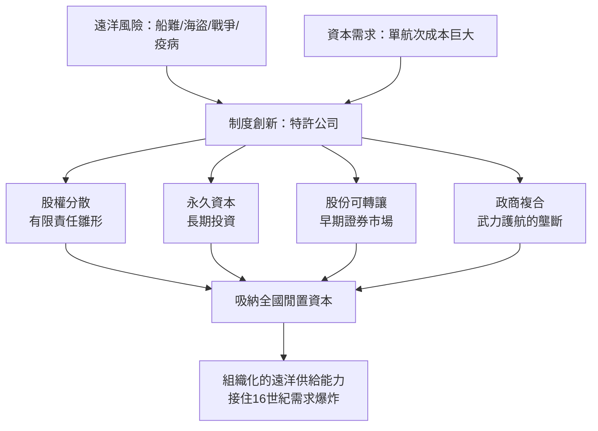
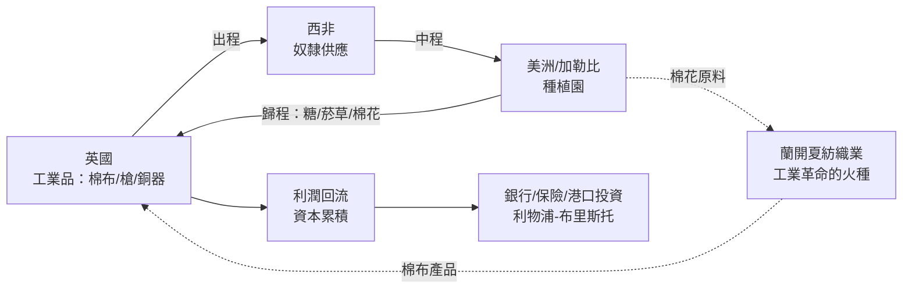

# 04.2 特許公司與三角貿易：組織遠洋資本

## 一、問題：暴利與九死一生

上一節說明了十六世紀需求爆炸的來源；但需求本身不會出海。把貨物運過三大洋，需要承擔一連串當時人類已知最昂貴的風險：船難、壞血病、海盜、戰爭沒收、港口疫病，以及——同樣致命的——**投資人的不信任**。一艘遠洋商船的單程成本動輒相當於數百戶家庭年收入，失事即血本無歸。若無制度把這些風險「打包、分攤、定價」，遠洋貿易將永遠只是小規模的投機。

歷史的答案出現在1600年與1602年：英國東印度公司與荷蘭聯合東印度公司（VOC）。這兩家公司常被敘述為殖民侵略的工具，但從制度經濟學的角度看，它們首先是**一項組織技術創新**——重要性不亞於任何一台紡織機。

## 二、1600與1602：股份制與永久資本

1600年12月31日，倫敦兩百餘名商人取得伊麗莎白一世的特許狀，成立「對東印度貿易的倫敦商人總裁與公司」，即英國東印度公司（見 [../../世界史/大航海時代/1600-英國東印度公司.md]）。1602年，荷蘭議會把分散各省的對印貿易前哨合併為VOC，並賦予它前所未有的權力：可自組軍隊、締結條約、築城宣戰（見 [../../世界史/大航海時代/1602-荷蘭東印度公司.md] 與 [../../世界史/世界發展史/1602-東印度公司.md]）。

這兩家公司的制度突破可歸納為四點：

1. **股權分散化**：一份股份可以小到商人階層中產者都能負擔，單一航次失敗不再摧毀一個家族。風險從「個人破產」變成「股東按出資比例損失」——有限責任的雛形。
2. **永久資本**：VOC規定資本「永久」投入公司，股東原則上不得抽回本金，只能轉讓股份。這解決了逐航次清算造成的資本斷裂，使公司能進行十年回收期的長期投資（船塢、倉庫、要塞、船隊）。
3. **可轉讓股份與早期資本市場**：股份可轉讓，使投資人獲得流動性；阿姆斯特丹為此發展出世界上第一個常設證券市場，公司的股票甚至在1607年就交易溢價。定價風險的工具，見 [../../科技史/金融計算/1654-PascalFermat賭金分配.md] 所代表的機率論萌芽。
4. **政商複合體**：特許狀使公司兼具主權性質，能把「商業冒險」升級為「有軍隊護航的壟斷貿易」。荷蘭省議會本身就是VOC的大股東——公司的利益與國家的利益被制度性地綁定。

## 三、三角貿易：跨大西洋的閉環系統

特許公司解決了「怎麼出海」；三角貿易則解決了「出海底後做什麼」。1663年前後，英國在皇家非洲公司（成立於1660年代，專責壟斷非洲奴隸供應，見 [../../世界史/大航海時代/1662-皇家非洲公司與中段航程.md]）與西印度種植園之間，把大西洋航線組織成一個自我強化的閉環：

- **出程**：從倫敦、布里斯托、利物浦裝載工業品——棉織品、銅器、槍枝、朗姆酒——運往西非換取奴隸；
- **中程**：奴隸橫渡大西洋運往加勒比與北美南部，投入糖、菸草、後來的棉花種植園；
- **歸程**：把糖、菸草、棉花運回英國，糖供消費，**棉花供給蓬勃的蘭開夏紡織業作原料**。

這個閉環的關鍵在於**雙重餵養**：種植園向英國紡織業提供廉價棉花原料，同時殖民地與非洲市場向英國棉布提供傾銷出路。棉織品的需求被三角貿易成倍放大，這直接為第六章的珍妮紡紗機與水力紡紗機準備了「銷得出去」的市場前提——技術史的觀察可對照 [../../科技史/機器史/](../../科技史/機器史) 中機械化系列的記錄。

## 四、風險溢價與股權分散：一個簡單的模型

為何股份制能解鎖遠洋投資？考慮一個單航次：投入資本 $C$，成功回收 $R$，機率 $p$；失事則損失殆盡。對風險中立的投資人，預期報酬為：

$$E[r] = p \cdot \frac{R - C}{C} - (1-p)$$

遠洋航次的倖存率 $p$ 估計約在 $0.6$ 至 $0.75$ 之間，故要求的預期報酬必須非常高——這就是**風險溢價**。假設投資人為風險趨避（效應函數為凹），單獨承擔整船風險所需補償更高，許多正值期望報酬的航次會因風險過大而無人問津。

若把同一航次拆成 $n$ 份股權，每份投資人承擔方差縮小為 $1/n^2$（相對於其總財富則為 $1/n^2$），由詹森不等式，風險趨避者願接受的折讓隨之下降，**原本不可行的航次變得可行**：

$$\text{分散後風險溢價} \propto \frac{1}{n} \cdot \text{原風險溢價}$$

再疊加跨航次分散（VOC同時運作數十艘船與多條航線），單一航次失事的衝擊被近乎撫平——這正是現代投資組合理論的核心直覺，其形式化要到 [../../科技史/金融計算/1952-Markowitz投資組合理論.md] 才完成，但商人們在1602年已用制度先行實作。海事保險（見 [../../世界史/大航海時代/1523-海事保險與共同海損.md]）是同一問題的另一條解法，兩者互補。

## 五、North的視角：制度創新與技術創新同構

道格拉斯・諾思（Douglass North）在《西方世界的興起》中提出：工業革命前的長期成長，關鍵不在技術而在**制度**——產權界定清楚，使個人報酬與社會報酬趨於一致，創新與投資才有人願意做。特許公司正是這一命題的最佳案例：

- **產權面**：股份是明確、可轉讓、受法院保護的財產權；
- **激励面**：利潤按股分配，冒險者與出資者的報酬都被制度化；
- **降低交易成本面**：公司把散亂的個人航次協調成一個有帳冊、有經理人、有章程的長期組織——VOC在阿姆斯特丹與巴達維亞之間維持著每週往來的書信與訂單系統；
- **國家面**：特許權以「壟斷」換「財政與海軍服務」，是國家與資本的一樁長期契約。

由此觀之，工業革命需要的技術（紡機、蒸汽機）與組織（公司、銀行、保險）是**同構的問題**：都是「如何讓不可預測的未來收益，變成今天可以投入的資本」。複式簿記（[../../世界史/世界發展史/1494-複式簿記與理性化.md]）提供了計量基礎，特許公司提供了組織載體，英格蘭銀行提供了公共信用，倫敦大火後的保險業（[../../世界史/世界發展史/1666-倫敦大火與保險.md]）提供了風險轉移——一整套制度基礎設施在1700年前後成形，工業革命只是把生產技術裝進這套容器。

## 六、陰影面：被組織的暴力

必須誠實記錄：這套制度創新同樣高效地組織了暴力。皇家非洲公司把「中段航程」標準化，VOC與英國東印度公司在東南亞以武力壟斷香料，奴隸貿易在兩百年間橫渡大西洋運送超過一千兩百萬人。組織技術是中立的：它放大資本的效率，也放大剝削的效率。三角貿易的利潤部分回流為英國的港口、銀行與工廠投資——奴隸制與工業革命之間的資本聯繫，是經濟史近二十年最重要也最沉重的修正主義課題。承認這一點，才可能完整回答「工業革命為何出現在歐洲」。

## 七、小結

特許公司與三角貿易完成了第四章前半的拼圖：需求爆炸（4.1）現在有了**資本組織**與**流通網絡**去承接。但英國還缺一樣東西——**受保護的本土製造業**。荷蘭人此時仍是歐洲的「中間商」（carrying trade 的主人），英國棉紡織業在印度棉布面前毫無競爭力。如何用國家政策把外國競爭者擋在門外、替本國產業爭取學習時間？這是下一節「航海法案與廣州體系」的主題。
