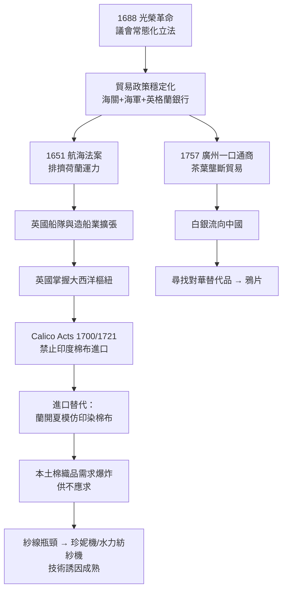

# 04.3 航海法案與廣州體系：保護主義下的棉紡織飢渴

## 一、1651航海法案：重商主義的產業政策本質

1651年10月，共和國時代的英格蘭議會通過第一部《航海法案》：凡亞洲、非洲、美洲運往英格蘭的貨物，必須由英格蘭船隻載運（船長與多數船員須為英格蘭人）；歐洲貨物則限由英格蘭船隻或貨物原產國船隻載運。1660年復辟後法案再加碼，列入「列名商品」（sugar, tobacco, cotton-wool 等）必須先運到英格蘭或其殖民地再轉口。法案的完整脈絡見 [../../世界史/大航海時代/1651-航海法案與大西洋體系.md] 與 [../../世界史/商業貿易史/1651-航海法案.md]。

表面上這是針對荷蘭的經濟戰（隨之引發1652–1674年三次英荷戰爭），實質上是一套**系統性的產業政策**：

- **扶植船隊**：強制使用英國船隻，人為創造航運需求，催生本土造船業與水手儲備；
- **殖民閉環**：列名商品制度把殖民地的糖、菸草、棉花鎖定為倫敦轉口商品，使英國成為大西洋貿易的「強制樞紐」，順帶把轉口利潤與再出口稅收留在本土；
- **打擊中間商**：荷蘭人靠「低運費、高效率」的轉口貿易為生，法案直接抽走其市場份額。

這正是重商主義的真面目——不是糊塗的金銀拜物教，而是一套「**以國家權力創造本國產業的學習空間**」的政策組合。與其同時代的法國柯爾貝主義、以及二十世紀的進口替代策略，在邏輯上同構。

## 二、光榮革命1688：保護主義的「常態化」

法案能否持續，取決於誰來執行。斯圖亞特王朝晚期，貿易特權是王室可以出賣的恩寵；1688年光榮革命後，議會成為立法的常設核心，貿易政策從「王室的臨時工具」變成「議會的穩定制度」（見 [../../世界史/大航海時代/1688-光榮革命與貿易體制.md]）。此後：

- 財政-軍事國家成形，海關官僚體系高效運轉，走私成本上升、守法收益可期；
- 1694年英格蘭銀行成立（[../../世界史/世界發展史/1694-英格蘭銀行.md]），國債信用確立，政府能以低息長期借款打仗，保護貿易路線；
- 商人階層與議會議席高度重疊，貿易立法反映製造業與航運利益。

值得強調的因果方向：**不是先有工業革命才有好的制度，而是1688年後的制度先為棉紡織業爭取了學習期**。制度變遷先於技術起飛，這是諾思命題在英國的驗證。

## 三、棉布飢渴與Calico Acts：進口替代的教科書案例

十七世紀末，印度印染棉布（calico、muslin）橫掃英國市場——它輕、軟、色彩鮮豔、可水洗，羊毛與亞麻製品毫無還手之力。英國的最初反應不是競爭而是模仿：東印度公司輸入「白棉布」，由倫敦與蘭開夏的印染廠加工上色，本土學習曲線由此啟動。印度棉布衝擊歐洲紡織業的過程，另可參照 [../../世界史/商業貿易史/1602-特許公司時代.md] 中的貿易品敘述。

競爭壓力終於引發政治反彈。1700年法案禁止進口印度、波斯與中國的印染棉布（供印染的白坯除外）；1721年法案更進一步，禁止在英格蘭**穿戴**進口印花棉布。這是赤裸裸的保護主義，但效果顯著：

1. 市場被讓給本土混合織物（棉經麻緯的fustian），蘭開夏開始積累棉紡織經驗；
2. 印染技術先行模仿成功，構成整條產業鏈的技術錨點；
3. 需求被壓抑在本土供給之下，形成持續的「**紗線短缺**」——哪裡短缺，哪裡就有發明家出沒。

1764年前後哈格里夫斯的珍妮紡紗機、1769年阿克賴特的水力紡紗機、1779年克隆普頓的走錘紡紗機，都是對這一短缺的直接回應。用經濟學語言說：**受保護的市場創造了確定的需求，確定的需求讓技術發明的預期報酬為正**。

### 學習曲線模型

保護主義的理論基礎可用「邊際成本隨累積產量下降」的學習曲線描述：

$$c(Q) = a\, Q^{-b}, \qquad b \approx 0.2\text{–}0.3$$

其中 $Q$ 為產業的累積產量，$b$ 為學習指數（累積產量倍增，單位成本下降約 $1-2^{-b}\approx 13\%$–$19\%$）。設印度棉布在英國市場的成本為 $c_I$（低且近似不變，因印度工資極低且技藝成熟），英國本土初期成本為 $c_B(0) > c_I$。在自由貿易下 $c_B > c_I$ 恆成立，本土產業永不啟動。若禁止進口，英國市場需求量 $\bar{q}$ 全由本土供給，隨 $Q(t)=\int \bar{q}\,dt$ 增長：

$$t^* : \; a\,( \bar{q} t^*)^{-b} = c_I \;\Rightarrow\; t^* = \frac{1}{\bar q}\left(\frac{a}{c_I}\right)^{1/b}$$

$t^*$ 即「學習追趕期」。帶入合理參數（$a/c_I \approx 3$、$b=0.25$、$1/b=4$），可得 $t^* \approx 3^{4}/\bar q$ 的數量級——保護期約需數十年，這與1700至1770年代英國棉業從模仿到起飛的實際時程驚人地吻合。等本土成本降到 $c_I$ 以下，保護便不再必要——這也預示了1846年廢除穀物法與自由貿易轉向的邏輯（[../../世界史/商業貿易史/1846-廢除穀物法.md]）。

## 四、1757廣州體系：白銀的單向閥

保護政策解決了「供給側學習」，但英國與亞洲的貿易還有一個結構性難題：**歐洲人愛上了中國茶**。十八世紀茶葉從奢侈品變成全民飲品，成為東印度公司利潤最大的進口品。問題是，中國對英國工業品興趣寥寥——毛呢賣不動，棉布打不過印度貨。於是貿易只能以白銀結算：歐洲人在美洲開採的白銀，經倫敦轉手，源源不斷流入廣州。這個格局是1757年乾隆皇帝限定西洋貿易於廣州一口、由公行壟斷經紀後的制度定式，詳見 [../../世界史/商業貿易史/1757-廣州一口通商.md]（清朝開海後的背景見 [../../世界史/商業貿易史/1684-清朝開海.md]）。

白銀流出對重商主義國家是原罪——金銀外流違反整個時代的財政信仰。英國的解法陰險而有效：**尋找中國人願意買的東西**。答案是在孟加拉種植的鴉片。英屬印度用鴉片換白銀、白銀再換茶葉，三角閉環一旦接通，白銀流向逆轉。1839年清廷禁煙引發鴉片戰爭（[../../世界史/商業貿易史/1839-鴉片戰爭.md]），帝國以武力為毒品貿易護航——這是第四章「市場機遇」故事最黑暗的註腳：廣州體系的貨幣失衡，最終以戰爭收場。

## 五、把圖拼起來：跨領域的驅動鏈

本章三個檔案共同描繪了工業革命的「需求—組織—保護」前奏。整理其因果鏈：

| 驅動層 | 事件 | 提供的要素 |
|---|---|---|
| 生態/人口 | 1492大交換 | 新作物 → 人口與需求爆炸 |
| 貨幣 | 1545波托西 | 白銀 → 價格革命 → 利潤擴張 |
| 組織 | 1600/1602特許公司 | 股份制 → 遠洋資本可動員 |
| 網絡 | 1663三角貿易 | 棉花原料 + 棉布市場 |
| 政策 | 1651法案/1688革命 | 保護運力與本土產業學習期 |
| 政策 | 1700/1721 Calico Acts | 進口替代 → 紗線短缺 → 發明誘因 |
| 貨幣/地緣 | 1757廣州體系 | 白銀流向中國 → 鴉片失衡 |

每一環都不是工業革命「本身」，但每一環都在把世界推離「馬爾薩斯均衡」：需求有了、資本有了、原料有了、保護有了、誘因有了。剩下的問題是供給側——如何在英國特定的地方、特定的勞動制度與特定的能源條件下，把這些引爆物湊在一起。那是第五章的主題：英國本身的「地緣與制度湊巧」。

## 六、小結：需求側的答案是「國家 + 市場」

本章易被誤讀為「自由市場的勝利」，實則相反：工業革命前的需求側準備，處處是國家的手。航海法案用海軍與海關製造航運業，Calico Acts用禁令製造紡織業，廣州體系用特許與武力維持茶葉壟斷。重商主義與工業革命不是對立面，而是**母子關係**——保護主義先養大了產業，待產業長成後，才輪到亞當・斯密們來歌頌自由貿易（[../../世界史/世界發展史/1776-國富論與獨立.md]）。理解了這一點，才不會把「市場的機遇」誤讀成「市場的奇蹟」。
