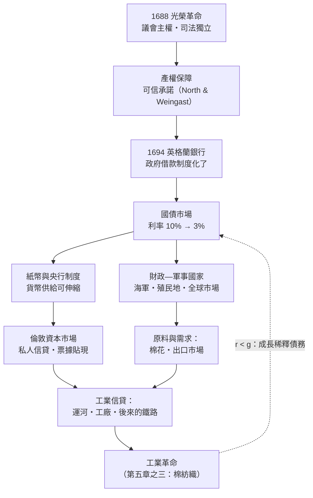

# 第五章之二：金融革命——英格蘭銀行、國債與光榮革命

## 引言：看不見的基礎設施

蒸汽機與紡紗機看得見、摸得著，但工業革命還有一項看不見的基礎設施：**一個能把社會儲蓄低風險、低成本地轉化為長期資本的金融體系**。瓦特的分離冷凝器從圖紙到商品，靠的是博爾頓的工廠與資本；博爾頓的資本從哪裡來？開鑿運河、修築鐵路、建立工廠動輒需要數萬英鎊、回收期長達數十年——沒有一個能容忍借貸、保護產權、讓長期契約可信的金融與政治制度，這些投資就不會發生。本章講述英國在 1688 到 1694 年間短短數年內完成的「金融革命」，以及它如何餵養了隨後的工業革命。

## 一、1688 光榮革命：「可信承諾」的政治學

1688 年之前，英國王權與議會的鬥爭，本質上是一場**產權危機**。斯圖亞特王朝屢屢強行借款不還（所謂「強制借款」）、壟斷特許、任意徵稅、以王室法庭干預契約。對投資人而言，國王本身就是最大的沒收風險：你今天借給王室一萬鎊，明天議會解散、法庭易主，本金就懸了。正因如此，斯圖亞特王朝借錢利率高達 10–14%，還常常借不到。

1688 年的光榮革命改寫了遊戲規則。威廉三世入主英國所換取的代價，是一套明確的憲政安排：**議會主權**（徵稅須經議會同意）、**產權保障**（王室不得未經法定程序剝奪財產）、**司法獨立**（《權利法案》保障法官任期，判決不再繫於國王喜怒）、以及王室財政須經議會審計。經濟學家諾思（Douglass North）與溫加斯特（Barry Weingast）在經典論文中稱之為**可信承諾（credible commitment）**：國王單方面毀約的能力被制度性地剝奪了——議會由債權人與地主階級把持，王室想賴帳，先要過議會這一關，而議會絕不會投票同意賴掉自己的錢。

這是一個絕妙的自我實現均衡：**因為政府不能賴帳，所以願意借錢給政府；因為錢源源而來，政府不必賴帳；於是「不能賴帳」被一次次驗證為真。** 制度信任不是宣示出來的，是被一筆筆按時還本付息的國債「養」出來的。詳見 [../../世界史/大航海時代/1688-光榮革命與貿易體制.md]。

## 二、1694 英格蘭銀行：國債、紙幣與央行的誕生

制度承諾需要一個具體的機器來兌現。1694 年，為了資助對法戰爭，蘇格蘭商人帕特森（William Paterson）提出方案：由十二百名倫敦商人組成特許公司，向政府放款一百二十萬英鎊，年息八厘，並換取銀行特許狀——**英格蘭銀行就此誕生**。

英格蘭銀行的創新遠不止於放款，它一次造出了三樣東西：

1. **國債市場**：政府借款不再是向某個金匠的一次性借據，而是標準化、可分割、可交易的政府證券。持有者可以隨時在市場賣出變現，於是「長期借給政府」與「隨時拿回現金」不再矛盾——流動性讓長期資本成為可能。
2. **紙幣與票據**：銀行存款可開支票，銀行發行以國債為準備的銀行券（paper notes），紙幣開始取代金屬貨幣流通。貨幣供給第一次可以隨商業需要而伸縮。英格蘭銀行之前的 1661 年，瑞典的斯德哥爾摩銀行曾發行歐洲最早的紙幣（見 [../../世界史/工業革命史/1661-歐洲第一張紙幣.md]），但英格蘭銀行把紙幣與國債、議會信用綁定，才使紙幣獲得了持久可信的錨。
3. **央行制度的原型**：英格蘭銀行逐步成為政府的銀行、銀行的銀行、最後貸款人——現代中央銀行制度由此發端。

效果立竿見影：光榮革命前王室借款利率 10% 以上，革命後政府長期公債（後來的「統一公債」Consols）利率在十八世紀中葉穩定降到 **3%** 上下。同樣借一百萬鎊，年息從 10% 降到 3%，意味著同樣的稅收能支撐三倍以上的債務——英國因此能同時打敗規模更大的法國：法國王權信用破產，借款利率是英國的兩倍以上，財政動員力反而弱小。「財政—軍事國家」的秘密，一半在艦隊，一半在債市。詳見 [../../世界史/工業革命史/1694-英格蘭銀行與國債.md]、[../../世界史/世界發展史/1694-英格蘭銀行.md]。

## 三、債務可持續性的數學：r < g

政府能不能持續借債而不破產？用一個簡化的動態式可以看清本質。設債務存量為 $B$，利率為 $r$，名義經濟成長率為 $g$，基本財政收支（不含利息）為平衡，則債務對收入之比 $b = B/Y$ 的演化為：

$$\Delta b = (r - g)\, b - s$$

其中 $s$ 是基本財政盈餘佔收入之比。這條式子揭示：

- 當 $r > g$，債務比 $\Delta b$ 自我膨脹，除非不斷出現財政盈餘 $s$——斯圖亞特與法國波旁王朝都困在這種「利滾利」的死亡螺旋；
- 當 $r < g$，即使政府不還本金，債務比也會自動稀釋——**成長替你還債**。

英格蘭銀行革命的本質，就是把 $r$ 從 10% 壓到 3%，而十八世紀英國的商業與工業成長使 $g$ 常年高於此值。$r<g$ 的區間一經進入，國債就從「毒藥」變成「資產」：整個地主與商人階層的財富組合裡，國債成了最安全的長期儲蓄工具，而這份財富的抵押品，正是議會制度本身。

## 四、金融革命如何餵養工業革命

國債市場看似與工廠無關，實則是工業革命的血液系統，其輸血路徑至少有四條：

**第一，國家能力。** 財政—軍事國家以國債供養海軍，海軍護航貿易、奪取殖民地與市場（印度棉花、加勒比糖、北美市場），為工業品打開全球需求。沒有廉價信貸，就沒有皇家海軍的規模；沒有海軍，就沒有棉紡織業的大西洋原料與亞洲市場。

**第二，倫敦資本市場。** 證券交易的制度、仲介、法律與慣例，從國債外溢到私人領域：十八世紀下半葉的運河熱、保險公司（如 1760 年代的勞合社體系）、以及後來的鐵路股票，全部借用同一套資本市場機器。博爾頓—瓦特公司這類需要長期資本的製造企業，其股東與債權人本身就是國債培育出的投資者階層。

**第三，私人信貸與票據貼現。** 國家信用為紙幣背書後，商業票據貼現網絡蓬勃生長：棉布商人開三個月期票、由倫敦銀行家貼現變現、再匯往利物浦買棉花——商業信用鏈條讓固定資本之外的商品流通也獲得槓桿。工業革命初期的工廠主大多是靠商業利潤與票據滾動起家，而票據體系的深度直接決定了生意能滾多大。

**第四，示範效應與心理基礎。** 國債把數十萬中產家庭變成「投資者」，使人們習慣於契約、股息、複利與長期承諾。這是一種無形的人力資本：一代人學會把錢委託給看不見的機構，下一個世紀他們才敢把錢投進看不見的鐵路與礦場。

## 五、對照組：為什麼法國沒有金融革命

同時代的法國提供了完美的對照實驗。法國的絕對王權從未接受議會對財政的約束：路易十四以後，王室屢屢「部分破產」——削減利息、強制轉換債券、出售官職攪亂稅制。約翰·勞（John Law）的密西西比泡沫（1720）崩潰後，法國公眾對紙幣與證券的信任一蹶不振，借款利率居高不下，政府只能靠包稅人與賣官籌錢。結果是：法國人口三倍於英國，戰爭財政動員力卻長期落於下風；私人資本市場浅薄，大規模長期投資缺乏載體。同樣的技術（法國不缺科學家、不缺工匠），因為缺少「可信承諾」這個制度層的收斂條件，就無法複製英國的軌跡。

## 結語：制度是技術的容器材器

金融革命的教訓可以壓縮成一句話：**蒸汽機能把水變成動力，但只有可信的制度能把信任變成資本**。光榮革命把王權關進議會的籠子，英格蘭銀行把籠子變成印鈔機與債券市場，債券市場以 3% 的利率把整個社會的遠期儲蓄調度到海軍、運河與工廠。技術（第五章之一）、制度與金融（本章）、以及即將登場的主導產業（第五章之三），三者互相咬合——這就是「英國的複合收斂」：工業革命不是單一原因的產物，而是煤與工資、科學與工匠、國債與銀行、棉花與全球市場，在同一個時間窗口收斂於一島的結果。

**延伸閱讀**：[../../世界史/大航海時代/1688-光榮革命與貿易體制.md]、[../../世界史/工業革命史/1694-英格蘭銀行與國債.md]、[../../世界史/世界發展史/1694-英格蘭銀行.md]、[../../世界史/工業革命史/1661-歐洲第一張紙幣.md]
