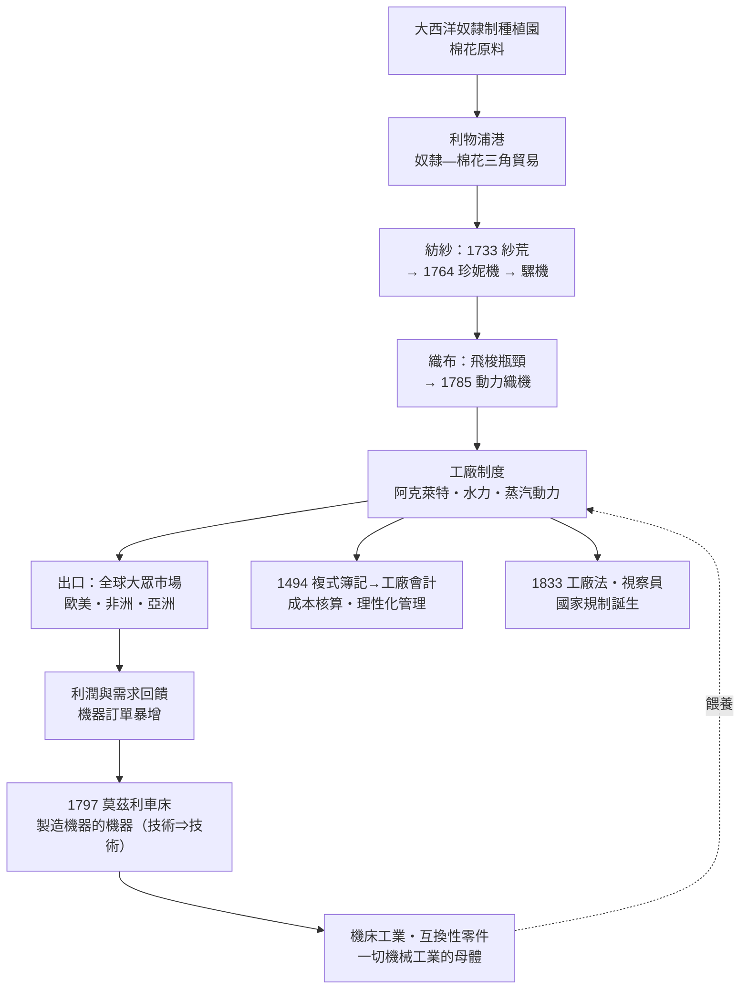

# 第五章之三：珍妮紡紗機、莫茲利車床與工廠制度——棉紡織作為主導部門

## 引言：一朵棉花如何點燃工業革命

如果說蒸汽機是工業革命的心臟，棉紡織就是它的主導部門（leading sector）：它最早實現機械化、最先集中工廠制度、吸納最多的資本與勞動、並以空前的規模把英國與全球市場縫在一起。十八世紀末，棉紡織業產值在數十年間成長十倍以上，成為英國第一個出口大宗製造業。本章沿著「技術鏈→產業邏輯→機械工業→管理與規制」四個層次，解剖棉紡織為何能成為引爆點。

## 一、紗荒：技術鏈如何被「卡住」

棉紡織的機械化不是一次到位，而是一場持續半世紀的「瓶頸接力」——每一處瓶頸解除後，瓶頸就轉移到下一道工序。

**第一棒：1733 飛梭。** 織布工序本來需要兩名學徒往返拋梭，凱伊（John Kay）發明飛梭後，織工一人一手即可讓梭子飛越寬幅布面，織布效率倍增。但這反而造成災難性的失衡：**織得快了，紗供不上**——一名織工需要五到十名紡紗工供紗。棉紗長期短缺、價格高漲，史稱「紗荒」。詳見 [../../世界史/工業革命史/1733-飛梭與紗荒.md]。

**第二棒：1764 珍妮紡紗機。** 織工哈格里夫斯（James Hargreaves）發明多軸紡紗機：一台機器同時帶動八根（後來擴到八十根）紗錠，一人可抵數十名紡紗工。紗荒似乎解除了——但珍妮機靠人力驅動、紗細而不夠堅韌，而且紡紗一旦暴增，**織布又成了瓶頸**。詳見 [../../科技史/科技發展史/1764-珍妮紡紗機.md]、[../../世界史/工業革命史/1764-珍妮紡紗機.md]。

**第三棒：水力紡紗機與騾機。** 阿克萊特（Arkwright）的水力紡紗機（1769 年專利）以水車驅動、紡出適合經線的強紗，並第一次把數百名工人集中到同一屋簷下——「工廠制度」正式誕生。克隆普頓的騾機（1779）綜合兩者，紡出又細又強的棉紗。

**第四棒：1785 動力織機。** 卡特萊特（Cartwright）的動力織機讓織布也接上動力，到 1820 年代經改良後大規模推廣，紡與織終於平衡，全流程機械化完成。

這條技術鏈的數量級可用一個簡化的倍增式表達：若一台紡機有 $N$ 個紗錠、每錠產量為單人紡車的 $k$ 倍，則每人時產量為

$$P \;=\; N \cdot k \cdot P_0$$

從珍妮機初期的 $N=8$ 到騾機的 $N>100$，再加上動力替代人力帶來的 $k$ 的躍升，五十年內棉紗人均產量提升百倍以上——這正是「紗荒」到「紗賤如土」的定量內涵，也是價格崩跌、大眾市場出現的供給面基礎。

## 二、棉為何是主導部門：原料、需求、可機械化

工業革命可以在毛紡、麻紡發生嗎？歷史給了否定的答案。棉成為主導部門，是三個條件的獨特匯合：

**（一）原料：大西洋奴隸制的棉花。** 羊毛受制於英國草場，亞麻受制於耕地；棉花則生長在美洲與印度，可以靠擴張種植園無限增產。加勒比與北美奴隸制種植園以暴力壓低成本，利物浦奴隸貿易—種植園—棉紡廠構成一個邪惡卻高效的三角循環：英國棉布運到非洲換奴隸，奴隸運到美洲產棉花，棉花運回曼徹斯特紡成更多的布。工業革命的全球原料鏈，深深烙著大西洋奴隸制的印記。

**（二）需求：全球大眾市場。** 棉布輕、軟、易洗、易染色、價格可壓到人人可負擔，它不是貴族的奢侈品而是人類第一件「大眾消費品」：歐洲下層、美洲莊園、非洲與亞洲都是市場。需求彈性極大——價格每降一分，銷量就漲一截，這給機械化提供了無限的下游空間（羊毛市場則小而穩定，撐不起百倍擴產）。

**（三）工序可機械化。** 棉纖維長度均勻、強度適中，紡與織的動作高度重複、節律固定，天然適合機器替代；而且棉布不怕機器造成的瑕疵率高——低價品市場容錯性強。相比之下，精紡毛料的手藝門檻既是護城河，也是機械化的絆腳石。需求無限、供給可擴、工序規整——三者在棉花上交會，這就是主導部門的秘密。

## 三、1797 莫茲利車床：技術⇒技術，工業學會自我複製

紡紗機、織機、蒸汽機造出來之後，一個更深層的問題浮現：**機器本身靠什麼造？** 早期機器靠木匠與鐵匠手工打造，零件無法互換、精度靠手感、壞了要匠人上門修——機器生產的天花板，被機器製造業的落後卡住了。

亨利·莫茲利（Henry Maudslay）1797 年前後在倫敦發明的螺紋車床（配滑動刀架與導螺桿），把「手持刀具憑手感切削」變成「刀具由機械導軌精確進給」，金屬加工第一次獲得工業級精度。這就是循環結構中的**技術⇒技術**通道：車床造出更精密的車床，機床工業成為「製造機器的機器」，整個工業獲得了自我複製的能力。莫茲利的工廠還培養出整整一代英國最傑出的工程師（包括造出第一台通用蒸汽機車的史蒂芬遜等人所師承的流派），互換性零件的理念經美國系統發揚，最終在 1913 年福特流水線上登峰造極。沒有莫茲利，瓦特機是一台一台的定制工藝品；有了莫茲利，蒸汽機是可批量製造的商品。詳見 [../../科技史/科技發展史/1797-莫茲利車床.md]。

## 四、從帕喬利到成本核算：理性化管理

機器與工廠需要新的「看得見的手」——管理。而管理的語言是會計。1494 年，義大利數學家帕喬利（Luca Pacioli）在《算術、幾何、比與比例概要》中系統總結了**複式簿記**：每一筆交易同時記錄借貸兩方，帳目自相平衡，企業的資產、負債、損益第一次成為可核驗的數學結構（詳見 [../../世界史/工業革命史/1494-複式簿記.md]）。

三百年後，這套文藝復興商人的工具被搬進工廠，發生質變：工廠不再只記「買與賣」，而要核算**成本**——每台機器折舊多少、每碼布攤多少棉紗與蒸汽煤、每個工段的效率如何比較。歐文在新拉納克棉廠的實驗、博爾頓—瓦特索和工廠的成本記錄，都是這種「用數字管理生產」的早期實踐。複式簿記→工廠會計→成本核算→科學管理，理性化管理的系譜從文藝復興一路貫穿到二十世紀。工廠制度不只把工人集中起來，更把生產過程變成一本可分析的帳。

## 五、1833 工廠法：國家規制的誕生

工廠制度的光明背面是殘酷：童工每日工作十二小時以上、紡織廠粉塵與事故、工人階級的貧困化。市場自身無法糾正——削減工時的工廠會在競爭中虧損。於是人類第一次以國家立法規制生產過程：**1833 年工廠法**禁止紡織廠僱用九歲以下兒童、限制九至十三歲童工工作八小時、並首創**領薪工廠視察員**制度——政府官員有權進入工廠查帳查人，違者起訴（詳見 [../../世界史/工業革命史/1833-工廠法與勞工.md]、[../../世界史/世界發展史/1833-工廠法與視察制度.md]）。

1833 工廠法是現代勞動法與規制國家的起點：它確立了「市場自由不等於工廠主自由」的原則，也證明了規制與工業化可以並行——英國棉紡業在法規之下繼續增長。從光榮革命（保護產權）到 1833 工廠法（限制產權人的權力），國家在市場經濟中的角色走完了一個辯證回合。

## 六、產業鏈全景

## 結語：主導部門的完整拼圖

棉紡織把本書前兩節的線索全部收攏：它需要蒸汽機（第五章之一）提供不靠河流的動力；需要國債與銀行體系（第五章之二）提供運河、原料與出口的周轉資本；需要海軍保護的大西洋三角貿易提供棉花；需要莫茲利車床把機器變成可複製的商品；需要複式簿記把工廠變成可計算的企業；最後需要工廠法把工業化的社會代價納入政治處理。一朵棉花串起了煤、蒸汽、金融、奴隸制、機械、會計與立法——這就是「複合收斂」最生動的縮影：工業革命不出現在發明最多處，也不只出現在科學最盛處，而出現在**所有互補要素同時就位**處。

**延伸閱讀**：[../../世界史/工業革命史/1733-飛梭與紗荒.md]、[../../科技史/科技發展史/1764-珍妮紡紗機.md]、[../../世界史/工業革命史/1764-珍妮紡紗機.md]、[../../科技史/科技發展史/1797-莫茲利車床.md]、[../../世界史/工業革命史/1494-複式簿記.md]、[../../世界史/工業革命史/1833-工廠法與勞工.md]、[../../世界史/世界發展史/1833-工廠法與視察制度.md]
