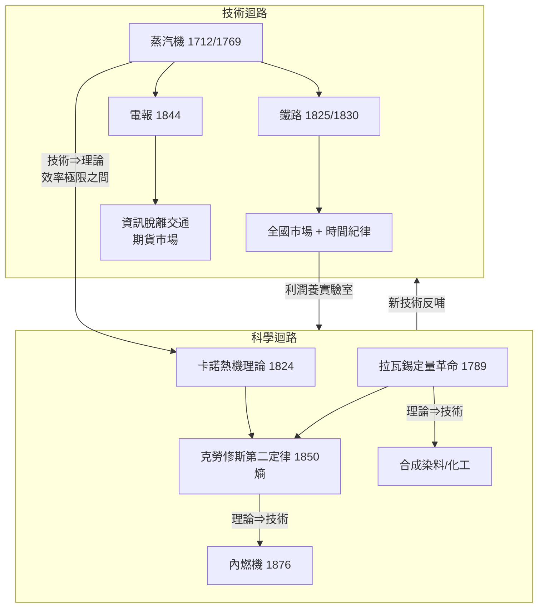

# 6.1 鐵路、電報與卡諾熱機：技術反哺理論的雙迴路大加速

## 一、1825：空間被壓縮的那一年

1825年9月27日，英格蘭東北部的斯托克頓與達靈頓之間，史蒂芬遜的「運動號」機車拉著滿載煤炭與乘客的車廂緩緩開動。這條全長約四十公里的鐵路，最初只是為了把煤從礦區運到港口的一條「更便宜的馬車道」，但當蒸汽機車證明自己比馬匹更快、更穩、更能載時，所有人都意識到：一種全新的空間秩序誕生了（見[../../世界史/工業革命史/1825-鐵路時代開啟.md]、[../../科技史/科技發展史/1825-史蒂芬遜鐵路.md]）。

真正的引爆點在1830年。利物浦—曼徹斯特鐵路通車，這是第一條完全以蒸汽牽引、載客與載貨並重、按時刻表運行的公共鐵路（見[../../世界史/工業革命史/1830-利物浦曼徹斯特鐵路.md]）。它帶來三重革命：

1. **空間壓縮**：曼徹斯特的棉花到利物浦港口的時間從數天縮到一兩小時，運費暴跌。原本按「地區」分割的市場，被熔接成一個全國市場。
2. **時間紀律**：火車不等人。時刻表的出現強迫整個社會接受「分鐘級」的時間觀念——工廠的鐘、車站的鐘、城市的鐘，從此對錶。工業資本主義的時間紀律，是先在鐵軌上立國，再進駐車間。
3. **金融動員**：鐵路需要空前規模的資本，股份公司與證券市場因此被推向大眾化，為1840年代的鐵路狂熱埋下伏筆。

英國並非唯一實驗場。1830年代起，歐陸與美國競相鋪軌，鐵路成為「現代性」的通用語言（見[../../世界史/世界發展史/1830-鐵路與電報.md]）。

## 二、1844：資訊脫離交通

1825年，蒸汽把「人與貨」的速度提升了十倍；1844年，電把「資訊」的速度提升到無限。這年5月，莫斯在華盛頓與巴爾的摩之間拍出那句著名的「上帝創造了何等的奇蹟」——電報誕生（見[../../世界史/工業革命史/1844-電報革命.md]、[../../科技史/科技發展史/1844-莫斯電報.md]）。

電報的深遠之處在於一個抽象事實：**資訊傳播第一次徹底脫離了交通**。在此之前，訊息的速度等於馬車、帆船或火車的速度；在此之後，訊息以接近光速飛行，而載著棉花或黃金的列車仍在地面上爬行。這個「資訊與物流的斷裂」重塑了市場：

- **價格趨同**：地方性的差價在幾分鐘內被套利抹平，全國乃至全球價格體系首次成形。
- **期貨市場誕生**：1848年芝加哥期貨交易所（CBOT）的遠期合約，本質上是對「訊息與貨物不同步」這一裂縫的制度回應——商人們需要在貨物抵達之前，就依電報傳來的價格完成交易與避險。電報＋鐵路＋期貨合約，構成現代金融市場的鐵三角。

用金觀濤的迴路語言說：鐵路是「技術⇒技術」（機床製造機車、機車整合市場、市場反哺機床）的勝利，而電報則開啟了「技術⇒制度」的新通道——技術不僅改變生產，還直接召喚出新的商業組織形態。

## 三、技術⇒理論：蒸汽機逼出熱力學

本章的核心命題是：**工業革命不只是「應用科學」，它反過來鞭打了科學**。最好的證據是熱力學的誕生史。

瓦特的蒸汽機在十八世紀末已是印鈔機，但沒有人真正知道「熱」是什麼，也沒有人知道蒸汽機的效率極限在哪裡。工程師們憑經驗改良機器，如同盲人騎馬。1796年，年僅二十歲的法國軍事工程師薩迪·卡諾被一個純粹的技術問題抓住：英國蒸汽機為何優於法國？其效率能否無限提高？

1824年，卡諾出版《論火的動力》，提出一個驚人的抽象結論：任何熱機的效率都存在一個理論上限，只取決於高低兩個熱源的溫度，而與工作介質無關：

$$
\eta_{\text{Carnot}} = 1 - \frac{T_c}{T_h}
$$

其中 $T_h$ 是熱源溫度、$T_c$ 是冷源溫度。這條公式意味著：再精巧的工匠，也無法造出效率超過此上限的熱機——**工匠的手藝第一次被理論畫了天花板**（見[../../科技史/科技發展史/1824-卡諾熱機理論.md]）。

卡諾早逝，但他的思想被克勞修斯與克耳文接住。1850年，克勞修斯把卡諾的洞見提升為普適的自然律——熱力學第二定律：熱不能自發地從低溫流向高溫，孤立系統的熵只增不減（見[../../科技史/科技發展史/1850-克勞修斯第二定律.md]、[../../科技史/科技發展史/1846-焦耳熱功當量.md]）。這是科學史上罕見的一幕：**一門基礎理論（熱力學）不是從仰望星空得來，而是從工廠的鍋爐房裡被逼出來的**。這就是九通道中「技術⇒理論」的教科書案例。

## 四、化學的基礎：拉瓦錫的天平

熱力學之外，化學迴路同樣在工業革命前夜完成了地基工程。1789年，拉瓦錫以天平為武器，確立質量守恆，摧毀了「燃素說」，把化學從煉金術升級為定量實驗科學（見[../../科技史/科技發展史/1789-拉瓦錫定量革命.md]）。沒有這場定量革命，就不會有後來李比希的農業化學、柏琴的合成染料、以及德國化工的整套產業——一切「分子層面的工業」，其語法都是拉瓦錫寫下的。

## 五、雙迴路大加速的全景

把本章的線索畫成一張圖：

這張圖展示了「雙迴路」的真正含義：**工業迴路（技術→利潤→市場→再投資）與科學迴路（理論→實驗→技術→新理論）互相咬合、彼此供血**。英國在第一波（紡織＋蒸汽）中佔盡先機，但英國的優勢建立在工匠經驗之上；當雙迴路加速到熱力學、電磁學的層次時，誰能把「實驗室」制度性地嵌入產業，誰就贏得下一棒——這正是德國登場的伏筆，也是第六章的主題：**霸權交替的規律，是迴路組織形態的代際優勢**。

## 延伸閱讀

- [../../世界史/世界發展史/1848-共產黨宣言.md]：鐵路時代社會震盪的思想迴響
- [../../科技史/科技發展史/1876-奧托四衝程.md]：熱力學理論落地為動力技術
- [../../科技史/科技發展史/1865-麥克斯韋方程組.md]：電磁學的迴路與熱力學並行加速
