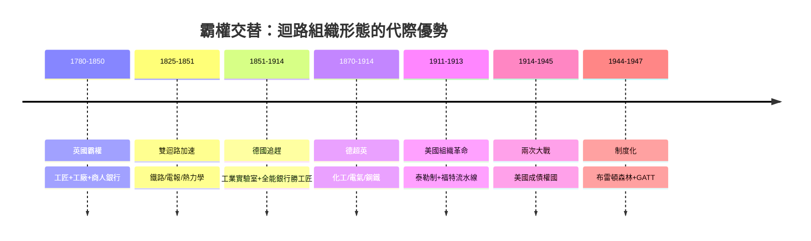

# 6.3 美國接棒：泰勒制、福特流水線與大規模生產取代英國霸權

## 一、要素稟賦決定技術風格

如果說德國的答案是「實驗室」，美國的答案則是「管理」。這個差異不是天才的偶然，而是要素稟賦的必然。

美國擁有當時世界上最大的自由市場——無關稅壁壘、無行會束縛、語言統一、購買力均勻；同時擁有世界上最稀缺的東西——**勞動力**。經濟史學家哈巴谷（H. J. Habakkuk）與羅斯托认為，正是「土地豐饒、勞工昂貴」的稟賦結構，塑造了美國獨特的技術風格：**凡能以機器替代人手者，皆有暴利**。英國工程師驚訝地發現，美國工廠用木製機床、可互換零件大規模生產步槍（所謂「美國製造體系」），寧可浪費材料也不浪費人力。資源稟賦決定技術風格，技術風格決定霸權的形態（參見[../../世界史/工業革命史/1810-機床與可互換零件.md]）。

1859年，賓州德雷克井噴出石油，美國又添一份稟賦大禮：廉價的流體能源與潤滑劑，以及日後整個內燃機文明的原料庫（見[../../世界史/工業革命史/1859-石油時代開啟.md]）。

## 二、系統化發明：愛迪生的「發明工廠」

美國的第二張牌是把「發明」本身系統化。1876年，愛迪生在門洛帕克建立史上第一座有組織的工業研發實驗室——不是德國式的大學科學，而是一支按分工編隊、以電報技師與機械工匠為主力的「發明突擊隊」。目標明確、試錯並行、直奔商業化：1879年白熾燈問世（見[../../科技史/科技發展史/1879-愛迪生白熾燈.md]），1882年紐約珍珠街電廠點亮華爾街，電力第一次成為可販賣的公共基礎設施（見[../../科技史/科技發展史/1882-珍珠街電廠.md]）。

愛迪生模式與德國模式的分野耐人尋味：德國實驗室輸入的是大學科學家，產出的是化學專利；美國實驗室輸入的是工匠與試錯文化，產出的是**系統**——燈泡、電廠、配電網一次成套。美國人賣的不是分子，是基礎設施。

## 三、泰勒制：把「管理」變成科學

1911年，弗雷德里克·泰勒出版《科學管理原理》，宣告一門新學科的誕生。其核心操作是時間動作研究：把每個工人的每個動作分解、計時、剔除浪費，再以標準作業程序與差別計件工資重新組裝。表面上這是壓榨工人的技術，深層看是一場組織革命——**管理與勞動徹底分離**：工程師在辦公室裡設計流程，工人在現場執行流程；知識從工人的手轉移到管理者的圖紙（見[../../世界史/工業革命史/1911-泰勒科學管理.md]）。

用金觀濤的迴路語言說：泰勒制是「技術⇒組織」的通道——它沒有發明任何新機器，卻讓既有機器的產出倍增。管理本身成為一種可以複製、可以教學、可以疊代的技術。

## 四、福特流水線：規模經濟的最終形態

泰勒制仍局限於單一工位；1913年，福特的海蘭帕克工廠把它推廣到整座工廠。流水線的配方是三項舊技術的合成：**可互換零件**（莫茲利以來的機床傳統）＋**徹底標準化**（Model T 只有一種規格、一種顏色）＋**移動裝配**（底盘以傳送帶匀速前進，工人原地作業）（見[../../世界史/工業革命史/1913-福特流水線.md]、[../../世界史/世界發展史/1913-福特流水線與美聯儲.md]、[../../科技史/科技發展史/1913-福特流水線.md]）。

結果是單輛裝配時間從12.5小時壓到93分鐘。單位成本隨產量急劇下降：

$$
AC(Q) = \frac{F + c \cdot Q}{Q} = \frac{F}{Q} + c
$$

其中 $F$ 是巨大的固定投入（專用機床、廠房），$c$ 是邊際成本。產量 $Q$ 越大，分攤的固定成本越薄——這正是規模經濟的數學表達。福特把 Model T 售價從850美元一路砍到260美元，車價近乎腰斬再腰斬；同時宣布日薪5美元（當時市價的兩倍以上）。這不是慈善，而是「效率工資」：高薪降低離職率、吸引最強壯耐苦的工人、並讓工人自己也買得起汽車——**大規模生產需要大規模消費，工資同時是成本與需求**。福特迴路就此閉合：標準化→降價→放量→再降價，德國實驗室精工細作的單件模式，在這台迴路機器面前失去了成本競爭力。

## 五、霸權移轉：從戰爭到制度

1914年爆發的一次大戰，替這場技術競賽蓋章。英德互毖，歐洲的黃金與訂單湧向大西洋對岸；1919年，美國從債務國變成世界最大債權國，紐約取代倫敦成為金融中心（見[../../世界史/世界發展史/1914-一次大戰與總體戰.md]）。第二次世界大戰再補一刀：1944年的布雷頓森林會議確立美元與黃金掛鉤、各國貨幣與美元掛鉤的體系，美元本位正式制度化（見[../../世界史/工業革命史/1944-布雷頓森林體系.md]、[../../世界史/世界發展史/1944-布列頓森林.md]）；1947年的關稅暨貿易總協定（GATT）則以多邊最惠國框架，把美國主導的自由貿易秩序推向全球（見[../../世界史/工業革命史/1947-GATT.md]、[../../世界史/商業貿易史/1947-GATT.md]）。

至此霸權移轉完成三層交接：**技術**（大規模生產取代精工實驗室）、**金融**（美元取代英鎊）、**制度**（布雷頓森林＋GATT 取代英帝國的帝國特惠制）。美國霸權不是戰爭紅利的僥倖，而是「科學管理＋規模經濟＋制度設計」這套迴路組織形態的必然擴張。

## 六、英→德→美霸權移轉時間軸

## 七、小結

美國接棒的祕訣，是又一次「迴路組織形態的代際躍升」：英國靠手藝、德國靠實驗室、美國靠管理。每一次交替，都不是在舊規則下跑得更快，而是換了一種組織知識與資本的方式。那麼問題來了：當管理也被複製、當所有工業化配方都被寫進教科書，後發國家還有機會嗎？答案藏在東亞——下一節，日本登場。

## 延伸閱讀

- [../../世界史/世界發展史/1913-福特流水線與美聯儲.md]：同年誕生的美聯儲與新工業秩序
- [../../世界史/工業革命史/1888-交流電大戰.md]：美國系統化發明的另一戰場
- [../../世界史/世界發展史/1879-金本位與第一次全球化.md]：美國崛起前的國際金融底座
