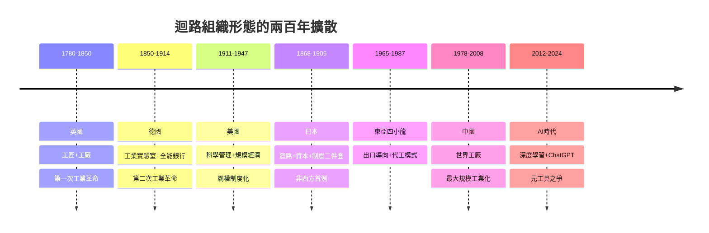

# 6.4 尾聲：兩百年後的再分流——日本追趕、中國崛起與AI時代

## 一、明治維新：唯一非西方的成功者

工業革命之後兩百年，無數國家企圖追趕，成功者寥寥。第一個、也是十九世紀唯一非西方的成功案例，是日本。1868年明治維新，一個封建幕藩體制的島國，用三十五年走完英國一百年的路（見[../../世界史/世界發展史/1868-明治維新.md]）。它為何成功？因為日本移植的不是機器，而是**迴路＋資本＋制度三件套**：

1. **迴路**：1871年學制確立國民義務教育，1886年帝國大學體系成形——這是德國洪堡模式的東方版，先造出能吸收科學的頭腦，再談工廠。
2. **資本**：明治政府先以官營模範工場（富岡製絲、八幡製鐵）示範技術，1880年代再低價轉售給三井、三菱等財閥民營化——用國家資本點火，用市場競爭接力。
3. **制度**：1871年巖倉具視使節團花費歲入的百分之二，率政府精英環遊歐美一年零十個月，把憲法、銀行、警察、教育逐一「考察—採購—本土化」。日本證明：工業化是一套可以整體搬運的組織形態，前提是政權願意自我革命。

## 二、東亞接力：出口導向、代工與世界工廠

戰後的東亞將明治模式迭代成更精細的版本。1960年代起，日本、亞洲四小龍以**出口導向工業化**取代拉美的進口替代：不築高牆保護嬰兒產業，而是強迫企業到世界市場上淬鍊，以出口實績為績效指標，政府則以定向信貸與技術授權作為獎賞（見[../../世界史/商業貿易史/1965-出口導向工業化.md]）。這是「迴路＋資本＋制度」三件套的國際貿易版。

接力棒繼續向下傳。1987年，台積電在台灣成立，發明純代工（foundry）模式：自己不設計晶片，只替全世界的設計公司製造——把半導體產業的「迴路」切開重組，設計與製造分離，讓沒有晶圓廠的創新者也能參賽（見[../../世界史/世界發展史/1987-台積電與代工模式.md]）。1980年，豐田的生產方式（TPS）則用即時供貨（JIT）與看板管理，在「小批量、多品種」的維度上打敗福特式大批量，回敬了美國霸權一記組織創新（見[../../世界史/世界發展史/1980-豐田生產方式.md]；另參[../../世界史/工業革命史/1980-豐田生產方式.md]）——霸權交替的規律仍在：**豐田以「精實管理」升級了福特的管理迴路**。

1978年，鄧小平啟動改革開放，中國以特區、鄉鎮企業與引資技術，把十億人口的勞動力接入全球供應鏈；2001年入世後，中國在二十年内成為「世界工廠」，完成史上最大規模的工業化（見[../../世界史/世界發展史/1978-改革開放.md]、[../../世界史/商業貿易史/1978-改革開放.md]、[../../世界史/商業貿易史/2001-中國入世.md]）。

## 三、再分流之問：AI是新的迴路升級嗎？

2008年金融危機後，中美人均產出差距持續收斂，「歷史終結論」讓位於「再分流」焦慮：當追趕者逼近前沿，裁判權（技術標準、晶片、金融清算）之爭浮上檯面。2022年11月，ChatGPT問世，生成式AI在兩個月內獲得億級用戶，知識工作——翻譯、程式、分析、寫作——第一次被機器大規模介入（見[../../世界史/世界發展史/2022-ChatGPT與知識工作.md]）。

用本書的框架追問：AI是否是新一輪「迴路組織形態的代際優勢」？有理由樂觀其成。深度學習本身就是「理論—實驗—技術」迴路的最新合流：算力（GPU技術）＋大數據（實驗材料）＋演算法（理論突破）在2012年的AlexNet時刻匯流（見[../../科技史/科技發展史/2012-深度學習革命.md]），此後AI反哺一切——AlphaFold 折疊蛋白質、AI 生成晶片佈局、AI 輔助數學證明。迴路的每一環都在被同一個工具加速，這是印刷術以來從未見過的「元工具」。

若AI果真是元工具，則霸權交替的規律預言：勝出者不是算力或論文最多的國家，而是**最先把AI嵌入「科學迴路＋產業迴路＋制度」的國家**——正如德國贏在實驗室制度、美國贏在管理組織。這場競賽尚未分出勝負，但規則已寫在兩百年的歷史裡。

## 四、追趕的收斂模型

後發者為何能追上？索洛模型的收斂性質給出簡化答案：離前沿越遠，資本邊際報酬越高，增長越快。

$$
g_i = g^* + \beta \left( \frac{y^* - y_i}{y^*} \right)
$$

其中 $g_i$ 是後發國的增長率，$y_i$ 是其人均產出，$y^*$ 與 $g^*$ 是前沿水準與前沿增長率，$\beta$ 是收斂速度。但模型成立有前提：後發者必須能夠**吸收**前沿技術——這正是日本、韓國、中國都先做的事：義務教育、工程師培養、開放貿易。收斂不是自動的，是制度買來的。沒有三件套的國家，$\beta \approx 0$，永遠分流。

## 五、1780→2024 工業革命擴散全景

## 六、全書總結：為何只發生一次

現在可以回答書名之問了：**工業革命為何出現在歐洲？** 答案是一個複合收斂框架：

1. **科學迴路（金觀濤條件）**：理論—實驗—技術九通道全部打通，且數學貫穿其間。這需要古騰堡印刷、望遠鏡、真空泵等工具鏈，以及皇家學會式的制度化——只有十七世紀的西歐同時備齊。
2. **資本迴路**：複式簿記、股份公司、國債市場、專利制度——荷蘭與英國把「未來收益」變成今天的投資，讓迴路有燃料。
3. **制度迴路**：產權、法治、有限政府、統一市場——讓利潤激勵與創新活動對準。

三者缺一即分流：明清中國有技術與市場卻無科學迴路，伊斯蘭世界有數學與商網卻無產權與競爭體系，印度與俄國有規模卻缺制度迴路。歐洲（先荷後英）是唯一三迴路同時閉合之地——**工業革命不是一個事件，而是一次三迴路的複合收斂，因此只發生一次，且不可逆**。

此後兩百年的全部歷史——德國的實驗室、美國的管理、日本的維新、東亞的接力、中國的崛起、AI的降臨——都是同一個主題的變奏：**誰能重新組織迴路，誰就接管世界**。兩百年前，答案是英國的工廠；兩百年後，答案仍在書寫。唯一確定的是：迴路一旦轉動，就再也不會停下。

## 延伸閱讀

- [../../世界史/世界發展史/2008-全球金融危機.md]：再分流的起點
- [../../世界史/商業貿易史/2018-美中貿易戰.md]：裁判權之爭的經濟戰場
- [../../世界史/世界發展史/2024-AI法案與治理.md]：AI時代的制度迴路
- [../../科技史/科技發展史/1947-電晶體.md]：上一次元工具誕生的先例
