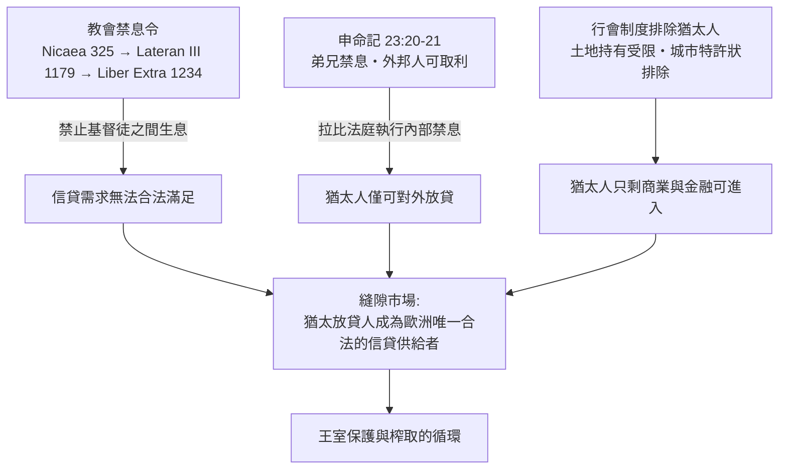

# 第三章第一節 禁息令與縫隙市場：為何是猶太人放貸

## 一、禁息令的漫長演變：從教父譴責到教法體系

要理解中世紀歐洲猶太人與金錢的捆綁，必須先理解一條不斷收緊、又不斷滲漏的制度管線：教會的禁息令。公元 325 年，尼西亞第一次大公會議（First Council of Nicaea）頒布第二十條教規，禁止神職人員以放貸取利（usura），這是禁息令最早的白紙黑字。到了 1179 年，第三次拉特朗大公會議（Third Lateran Council）將範圍擴大到平信徒：明令放貸取利者不得領受聖餐、不得葬於教會墓地，且基督徒之間不得彼此收取利息。1234 年，教宗格里高利九世頒布《 Liber Extra 》（又稱 Decretales Gregorii IX），把歷代教令匯編為教會法典，usura 一律禁止自此成為覆盖整個拉丁基督教世界的正式教法。

換言之，在十三世紀，歐洲最龐大的「金融監管機構」——羅馬教廷——以法典形式把無擔保生息借款定為罪（peccatum usurae，高利貸之罪）。神學根據來自阿奎那（Thomas Aquinas, 1225–1274）對《路加福音》6:35「借給人不指望償還」的詮釋：金錢是「可消耗物」（res fungibilis），出借金錢等於讓渡其使用權，收取利息等於「出售不存在的東西」（venditio non existentium），即出售時間——而時間屬於上帝。

## 二、縫隙的出現：damnum emergens 與 lucrum cessans

禁令再嚴，經濟現實不會消失。地中海貿易需要資本，城邦需要戰費，農民需要過冬的種子。於是教法內部出現了技術性的鬆動。第一條縫隙是 damnum emergens（已發生之損失）：貸款人若因借出而蒙受實際損害，可以要求補償。第二條縫隙是 lucrum cessans（喪失之利得）：十三世紀末，神學家開始承認，若貸款人因放棄其他投資機會而受損，可收取補償——這實質上是風險溢價與機會成本的合法化。第三條縫隙是「合夥」形式（societas maris、commenda），資本提供者分潤盈虧，不算利息。到十五世紀，Monti di Pietà（公共施惠銀行）與精巧的「三重契約」（triple contract）更把生息借貸包裝成保險與合夥的組合。

用現代語言說，教會法學家親手發明了風險溢價的理論雛形。放貸的合理報酬可以寫成一個後世商人與法學家都心照不宣的公式：

$$
R \;=\; r_f \;+\; \pi_{risk} \;+\; \underbrace{c_{\text{damnum emergens}}}_{\text{實際損失補償}} \;+\; \underbrace{c_{\text{lucrum cessans}}}_{\text{機會成本補償}}
$$

其中 $r_f$ 是名義上的「免息本金」，$\pi_{risk}$ 是違約風險溢價。當補償項目逐漸擴張，禁息令的實質約束就只剩下一個功能：**決定誰可以合法地站在這個市場裡**。

## 三、雙重標準：Deuteronomy 的兩面刃

而誰可以進場，答案早已寫在《申命記》23:20–21：「借給外邦人（nokhri）可以取利，只是借給弟兄不可取利。」這條律法的雙重標準，在中世紀被兩邊同時「履行」：猶太教拉比法庭（bet din）依《托拉》禁止猶太人向猶太弟兄收息（違者如 Moizei bi-ribit，等同被逐出教門的嚴罪），卻允許向外邦人收息；教會則禁止基督徒向基督徒收息。兩套規範疊加的結果，是基督教社會對信貸的需求與猶太社群的宗教許可，剛好互補成一個縫隙市場——市場本身無人設計，卻由兩部律法共同鑄造。

制度縫隙的形成機制可以圖示如下：

## 四、被排除者的經濟學：行會、土地與宮廷

縫隙市場之所以由猶太人獨占，還因為其他門都被關上了。中世紀城市的經濟命脈是行會（guild），而行會多以基督教宣誓為入會條件，十二、十三世紀起德意志、法蘭西、英格蘭的城市特許狀普遍將猶太人排除在手工業行會之外；土地持有則受封建效忠體系限制——猶太人不能向領主行臣服禮、不能持有需服軍役的封地。商業本可作為替代，但十字軍東征（尤其 1096 年萊茵蘭屠殺）之後，義大利商人（倫巴第人、卡奧爾人 Cahorsins）逐漸接管大宗貿易，並發展出超越禁息令的匯票技術。留給猶太人的，只剩下資本門檻低、行會管不到、但社會風險極高的行業：小型抵押放貸與典當（pawnbroking）。這不是猶太人的「天性選擇」，而是制度選擇的結果——經濟學上所謂的「中間人少數群體」（middleman minority）位置，正是在這裡被鑄造出來。

## 五、英國的案例：Aaron of Lincoln 與王室榨取循環

英格蘭提供了這個結構最完整的標本。十二世紀後半，林肯的亞倫（Aaron of Lincoln, 約卒於 1186）成為全英最有錢的放貸人，其借貸網絡遍及數百名騎士與修道院，亨利二世甚至設立專門的「亞倫金庫」（Aaron's Exchequer，Scaccarium Aaronis）來清算其遺產——因為依王室慣例，猶太人的遺產屬於國王。這一慣例正是「猶太人即王家財產」（Iudaei regis）法理的體現：王室既是保護者，也是預設的繼承人。

此後的邏輯便是一個可預測的循環：王室需要錢 → 向猶太人課以重稅（tallage，任意攤派，如 1189 年、1210 年 John 王的大規模勒索）→ 猶太人社區資本耗竭 → 債務人（包括貴族）怨恨累積 → 王室以驅逐收買民心並沒收債券。1275 年愛德華一世頒布《猶太人法》（Statute of the Jewry），禁止猶太人放貸取利，改而要求其從事商業與手工業——等於關閉了唯一的縫隙市場；1287 年威斯敏斯特（Westminster）的評估顯示英國 Jewry 已被榨得所餘無幾；1290 年 10 月，愛德華一世頒布驅逐令，約兩千至三千名猶太人被逐出英格蘭，此後近四百年（直到 1656 年）英格蘭官方再無猶太社群。

## 六、前因後果：縫隙市場的歷史辯證

值得強調的是因果的方向：不是「猶太人選了放貸」，而是「禁息令與行會制度共同把信貸留給了猶太人」。這個結構造成了三個深遠後果。第一，它把猶太人與貨幣經濟的先進部門綁定，使猶太社群普遍識字、精於算術與契約文書——這是人力資本的累積。第二，它使猶太人成為社會怨恨的絕緣導體：國王借錢，農民還債，仇恨卻落在中間人身上，威斯敏斯特與約克的 1189–1190 年屠殺（Clifford's Tower 慘案）正是此結構的血腥出口。第三，它示範了一件事：在歐洲，金融這一行業可以由一個被一切傳統職業排除的群體合法經營——當 1500 年之後禁息令全面鬆動、現代銀行興起時，這批累積了三個世紀金融技術與跨國網絡的人群，已經站在新時代的門檻上。

禁息令是磚牆，縫隙是門。門雖窄，走過去的人卻被歷史磨練出了穿門的技藝。
