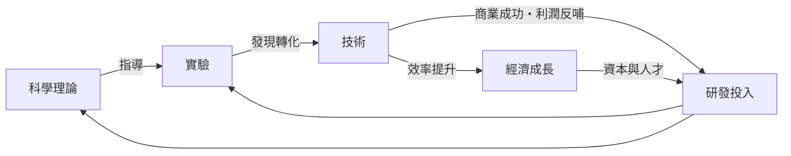

# 01 導論：問題的反轉與霸權移轉之謎

## 一、案發現場：1890 年的權力交接

打開 1890 年前後的工業統計表，偵探會看到一個安靜卻驚人的事實：美國的製造業產值悄悄越過了英國，成為世界第一。沒有宣戰，沒有條約，甚至沒有多少當時的人意識到這一刻的分量。

這不是一次普通的超車。工業革命以來，世界工廠的位置只坐過一個人——英國。英國的優勢清單長得令人生畏：最先發的蒸汽與紡織技術、全球最密的殖民地市場與原料產地、最深的金融市場（[1694-英格蘭銀行](../../世界史/金融經濟史/1694-英格蘭銀行.md) 與國債體系）、以及皇家海軍護航的全球貿易網。

而挑戰者的名單上，按「素質」排序，美國甚至排不到第一。德國有世界最強的大學與實驗室體系——[1870-全能銀行與德國追趕](../../世界史/工業革命史/1870-全能銀行與德國追趕.md) 記錄了德國如何用全能銀行把資本直接灌注進化學與電機工業；法國有深厚的科學傳統；俄國有廣袤的幅員。可是五十年後，坐在世界工廠與世界銀行位置上的，是美國。

**懸案由此成立：為何偏偏是美國接棒？**

## 二、問題的反轉：不問「為何強」，改問「為何是它」

傳統史學問的是「美國為何崛起」，這個問法有一個隱藏的陷阱：它邀請我們列舉美國的優點——地大物博、人民勤奮、市場廣大——然後把優點相加，得出「所以強」。但這種加法解釋力極差，因為：

- 俄國地更大、物更博，為何沒有崛起？
- 阿根廷在 1900 年的人均富裕程度不輸任何歐洲大國，為何掉隊？
- 德國的科學素質更高，為何兩度挑戰失敗？

本書採用**積極歸因**的反轉問法：不問「為何落後」（那是問失敗者為何失敗，答案永遠是缺點的清單），而問「**美國多了哪些缺一不可的環節**」。這像偵探不問「誰都有作案動機」，而問「誰同時具備了動機、時間、工具與不在場證明的漏洞」。

反轉之後，偵查目標從「優點清單」變成「串聯結構」。我們要找的不是一顆珍珠，而是一條完整的項鍊——每一顆珠子都重要，但真正的秘密在於穿珠子的那根線。

## 三、霸權移轉的理論現場：英→德挑戰失敗→美接棒

國際關係學者所謂「霸權移轉」，在十九世紀末到二十世紀中葉上演了一場罕見的三方劇：

**第一幕：德國的正面挑戰。** 德國是教科書級的挑戰者——工業產值超越英國、科技諾貝爾獎數量領先、陸軍與參謀體制（[1866-參謀本部與鐵路動員](../../世界史/世界發展史/1866-參謀本部與鐵路動員.md)）冠絕歐陸。它選擇以海軍競賽與兩次大戰直接奪權，兩度戰敗，國土兩度被打穿。挑戰失敗的原因不只是戰場：德國的工業體系以歐陸為腹地，當英國封鎖大洋、美國以其工業產能加入對手陣營時，德國的規模天花板立刻顯現。

**第二幕：美國的側翼接棒。** 美國幾乎從不主動挑戰。它在一戰前是世界最大的債務國，靠出口原料與農產品還債；兩次大戰它遲遲參戰，卻以軍火、物資與貸款成為所有交戰方的後方工廠；戰爭結束時，列強的黃金與債務都流向了紐約。[1944-布雷頓森林體系](../../世界史/美洲史/1944-布雷頓森林體系.md) 只是把既成事實制度化：美元取代英鎊，世界銀行與 IMF 的章程由美國起草。

**第三幕：秩序的和平轉移。** 與德國的悲劇形成對照，美國的霸權是「被讓渡」的：英國在兩次大戰中耗盡了血與金，1956 年蘇伊士運河危機時，連出兵埃及都要看華盛頓的匯率臉色。

這三幕劇留給偵探的疑點是：**同樣面對英國霸權，為何德國的挑戰引爆自我毀滅，而美國的接棒卻像水到渠成？** 差異不能只用「地理隔絕大洋」解釋——那解釋了安全，解釋不了崛起。

## 四、迴路框架回顧：金觀濤的「理論—實驗—技術」結構

本書的分析主軸，是金觀濤對工業革命起源的迴路模型：

科學理論指導實驗，實驗產出技術，技術的商業成功反哺理論與實驗——迴路閉合之處，就是工業革命發生之處。英國率先閉合（瓦特的蒸汽機 [1769-瓦特蒸汽機](../../世界史/工業革命史/1769-瓦特蒸汽機.md) 依賴布萊克的潛熱理論與格拉斯哥的儀器工匠傳統），隨後迴路沿著九條通道——科學、技術、經濟、政治、法律、教育、傳播、金融、組織——向歐陸與美洲擴散。

但迴路會擴散，正是本案最關鍵的線索。**如果迴路人人可學，那麼崛起就不是技術壟斷的結果，而是「誰能把迴路組織得更好」的競賽。** 在這場組織競賽中，三個國家交出了三份不同的答卷：

- **英國：工匠迴路。** 瓦特、莫茲利（[1797-莫茲利車床](../../科技史/科技發展史/1797-莫茲利車床.md)）一代的突破靠的是儀器工匠的雙手與經驗傳承。工匠迴路的弱點是：知識鎖在個人手藝裡，難以複製、難以規模化。
- **德國：實驗室迴路。** 德國把大學化學實驗室直接接上染料與製藥工廠，發明了「工業研究實驗室」。實驗室迴路的弱點是：高度依賴頂尖科學家與歐陸市場，體系一旦被封鎖即窒息。
- **美國：管理迴路。** 美國問了一個別人沒問的問題：**如何讓不熟練的人、在沒有大師的情況下、穩定地做出優質產品？** 答案是把知識從人手中抽出來，寫進制度——可互換零件（[1810-機床與可互換零件](../../世界史/工業革命史/1810-機床與可互換零件.md)）、泰勒的動作研究（[1911-泰勒科學管理](../../世界史/工業革命史/1911-泰勒科學管理.md)）、福特的流水線（[1913-福特流水線](../../世界史/工業革命史/1913-福特流水線.md)）。

**管理，是美國送給世界迴路結構的新變數。** 它讓技術知識第一次可以被「編排」，而不是被「擁有」。

## 五、美國的新變數：管理與國家動員

在工匠與實驗室之後，美國對迴路做了兩項代際升級：

**升級一：管理作為獨立的知識部門。** 泰勒用秒錶分解鐵鏟工的動作，福特用流水線把汽車的裝配切成八十四道工序，杜邦與史隆用事業部制（[1920-事業部制與杜邦分析](../../世界史/工業革命史/1920-事業部制與杜邦分析.md)）解決了巨型企業的指揮問題。管理知識的特點是：可複製、可教學、可跨產業移植。這使得美國企業像細胞分裂一樣繁殖，而英德企業仍像手工作坊那樣靠師徒血緣生長。

**升級二：國家作為迴路的超級催化劑。** 曼哈頓計劃（[1945-曼哈頓計劃與科學動員](../../世界史/美洲史/1945-曼哈頓計劃與科學動員.md)）證明了一件前所未有的事：國家可以把「理論—實驗—技術」迴路的每一環同時拉到極限——動員全球頂尖物理學家、建造整座城市級的實驗設施、以戰爭預算繞過一切商業計算。戰後，這套動員體制沒有解散，而是轉型為常態化的國家研發體系：聯邦科研經費、國防尖端項目、以及後來孵化出矽谷的制度設計（[1946-創投的誕生](../../世界史/工業革命史/1946-創投的誕生.md)、[1980-拜杜法](../../世界史/世界發展史/1980-拜杜法.md)）。

這兩項升級的意義可以寫成一個不等式。若以 $K$ 代表可用於生產的知識總量，工匠時代 $K$ 受限於學徒年限 $n$，實驗室時代受限於科學家人數 $s$，而管理與國家動員時代：

$$
K_{\text{美}} \propto n \times s \times \underbrace{m}_{\text{管理槓桿}} \times \underbrace{g}_{\text{國家動員}}
$$

$m$ 與 $g$ 是兩個新乘數。當對手的乘數仍為 1 時，美國的知識產出以數量級拉開差距——這就是「代際優勢」的含義：不是跑得更快，而是換了一種跑法。

## 六、全書地圖：九個章節的偵查路線

本書按因果鏈的順序展開偵查，每章回答一個環節：

1. **第 2 章〈制度地基〉**——1776 年的三重巧合：獨立宣言（[1776-美國獨立宣言](../../世界史/美洲史/1776-美國獨立宣言.md)）、國富論（[1776-國富論與獨立](../../世界史/世界發展史/1776-國富論與獨立.md)）同年問世；1787 年費城制憲（[1787-費城制憲會議](../../世界史/美洲史/1787-費城制憲會議.md)）把專利權寫進憲法本文；聯邦制作為內部自由市場的制度保障；門羅主義（[1823-門羅主義](../../世界史/美洲史/1823-門羅主義.md)）為大陸規模圈出保護罩。
2. **第 3 章〈大陸規模〉**——路易斯安那購地（[1803-路易斯安那購地](../../世界史/美洲史/1803-路易斯安那購地.md)）、西進與宅地法、橫貫大陸鐵路（[1869-橫貫大陸鐵路](../../世界史/美洲史/1869-橫貫大陸鐵路.md)）如何縫合一個世界最大的統一市場。
3. **第 4 章〈迴路轉接〉**——愛迪生的門洛帕克、石油時代（[1859-石油時代開啟](../../世界史/工業革命史/1859-石油時代開啟.md)）、電氣化（[1882-珍珠街電廠](../../科技史/科技發展史/1882-珍珠街電廠.md)）與華爾街資本如何把發明接上產業。
4. **第 5 章〈組織革命〉**——泰勒制與流水線：管理如何成為第三條迴路。
5. **第 6 章〈兩次大戰〉**——戰爭如何清空對手、讓債務國變成秩序設計者。
6. **第 7 章〈科學動員〉**——曼哈頓、矽谷（[1957-仙童半導體與矽谷起源](../../世界史/美洲史/1957-仙童半導體與矽谷起源.md)）與登月（[1969-阿波羅登月](../../科技史/科技發展史/1969-阿波羅登月.md)）：國家動員的體制化。
7. **第 8 章〈反事實檢驗〉**——逐一檢驗德國、蘇聯與日本，確認每個對手究竟缺了哪個乘數。
8. **第 9 章〈尾聲〉**——美元與資訊霸權的現狀，以及下一次接棒的候選清單。

偵查路線本身的形狀就是答案的一部分：**制度先行，規模其次，技術第三，組織第四，戰爭第五，動員第六。** 霸權不是在終點被奪走的，而是在起點就被預定了。

## 七、方法宣言：積極歸因的三條紀律

本書的探案方法立下三條紀律，供讀者監督：

1. **連乘檢驗。** 核心公式是連乘而非連加。任何一章的主張，都必須能回答「若抽掉此環節，積是否歸零」。第 8 章的反事實檢驗就是全書的驗算。
2. **不訴諸單因。** 「資源豐富論」「新教倫理論」「戰爭發財論」各自都只摸到一顆珠子。本案的嫌犯是「串聯」本身，任何單一因素若不能與其他環節扣合，即予以排除。
3. **時序證據優先。** 因果鏈必須經得起時間排序：制度（1787）先於市場統一（1869 鐵路），市場統一先於管理革命（1911–1913），管理革命先於科學動員（1942–1945）。時序錯亂的解釋一律存疑。

## 小結

本章完成了三次定位：**問題反轉**——從「美國為何強」轉為「為何偏偏是美國接棒」；**框架回顧**——金觀濤的理論—實驗—技術迴路解釋了工業革命的擴散，卻把「誰能組織迴路」的新戰場留給了十九世紀末；**變數指認**——美國的答案是管理與國家動員這兩個新乘數，疊加在大陸規模與制度地基之上。

回到核心公式：

$$
\text{美國崛起}=\text{大陸規模}\times\text{制度地基}\times\text{管理躍升}\times\text{國家動員}\times\text{秩序供給}
$$

下一章，偵探回到案發的原點——1776 年的費城與愛丁堡。那裡埋著整條因果鏈的第一個環節：一個把「鼓勵科學與實用技藝」寫進根本大法的國家，在誕生那天就決定了它要靠什麼致富。
