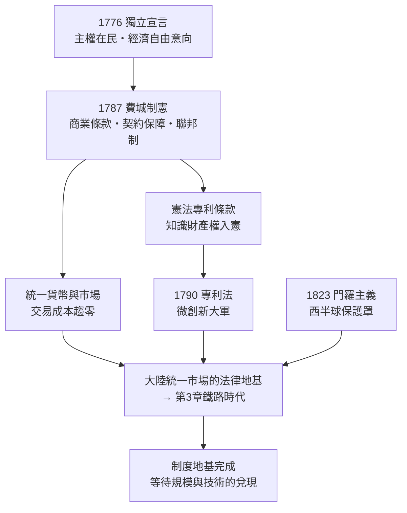

# 02 制度地基：獨立宣言、費城制憲與專利條款

## 一、1776 年的三重巧合

把地球儀轉到 1776 年，偵探會在同一年裡發現三件看似無關的事：

- 七月，費城發表《獨立宣言》，十三個殖民地宣布脫離大英帝國（[1776-美國獨立宣言](../../世界史/美洲史/1776-美國獨立宣言.md)）；
- 三月，倫敦出版亞當・斯密的《國富論》，系統論證了自由市場、分工與有限政府（[1776-國富論與獨立](../../世界史/世界發展史/1776-國富論與獨立.md)）；
- 同一年的大西洋兩岸，重商主義的帝國體系與市場經濟的理論體系，完成了歷史性的擦肩而過。

巧合的密度不止於此。宣言的執筆人傑佛遜深受蘇格蘭啟蒙影響；富蘭克林——宣言簽署人、後來的憲法會議元老——本人就是一個靠發明與印刷致富的實驗家（[1752-富蘭克林風箏](../../科技史/科技發展史/1752-富蘭克林風箏.md)）。當這批人十一年後走進費城制憲會議（[1787-費城制憲會議](../../世界史/美洲史/1787-費城制憲會議.md)）時，他們不是在抽象地設計政府，而是像工程師一樣，為一個即將擁抱市場社會的國家搭建承重結構。

**疑點：新國家成千上萬，為何唯獨這一次建國，建出了一台工業霸權的起動機？**

## 二、獨立宣言：不只是政治文件，而是一份「制度意向書」

《獨立宣言》的名句「生命、自由與追求幸福的權利」，在政治哲學史上的地位無須贅言。但偵探注意到的，是它在經濟制度史上的作用：

第一，**它把主權的來源從君主轉移到人民**，這意味著財產與契約的保障對象從特許階級擴大到全體公民。英國的專利制度（[1624-壟斷法與專利制度](../../世界史/工業革命史/1624-壟斷法與專利制度.md)）本質上是王室與工匠的交易——特權由王冠授予；而美國版的知識產權將由憲法直接授予每一個公民，無須叩任何宮門。

第二，**它宣告殖民地經濟路線的終結**。依照《航海條例》（[1651-航海條例](../../世界史/工業革命史/1651-航海條例.md)）的設計，北美殖民地本該永遠出口原料、進口製成品，做帝國分工的下游。獨立切斷了這條鎖鏈，但也提出尖銳的新問題：一個沒有母國市場、沒有海軍保護、還欠著戰爭債務的農業國，憑什麼建設自己的工業？

第三，宣言列舉的對英王控訴中，多條涉及貿易限制與司法阻撓——獨立的動機裡，經濟自由權與政治自由權本就交織在一起。**新國家從第一天起，就把「拓展商業」寫進了建國基因。**

## 三、費城制憲：一部為「大市場」設計的憲法

1787 年夏天，五十五位代表在費城閉門四個月。表面議程是修訂無力邦聯條款，實際上是在回答一個經濟學問題：**如何讓十三個互相設關卡、發紙鈔、築貿易壁壘的州，變成一個統一市場？**

憲法給出的答案，逐條都是對經濟碎片的清除：

- **商業條款**：州際與對外貿易的管理權收歸國會，各州關卡在法律上成為違憲——這是全世界最早的「共同市場」條約，比歐洲煤鋼共同體早了一百七十年；
- **統一鑄幣與破產法**：金融的地基從十三套並行體系收束為一套；
- **合同條款**：禁止州法溯及性地損害契約義務，商業預期第一次獲得最高位階的保護；
- **聯邦最高法院**：為上述一切提供最終裁判，馬歇爾法院隨後以一系列判決（如達特茅斯學院校案 [1819-達特茅斯學院校案](../../世界史/工業革命史/1819-達特茅斯學院校案.md)，確認法人特許狀為受憲法保護的契約）把憲法條文鑄成企業可以信賴的規則。

用現代經濟學的語言說：制憲者們在 1787 年就解決了「內部交易成本」問題。當其他國家還在為內地關卡、度量衡混亂（對照法國要到 [1795-公制](../../世界史/世界發展史/1795-公制.md) 才統一度量衡）與司法不確定性付出高額成本時，美國企業從建國起就只需要面對一套法律、一種貨幣、一個市場。

**聯邦制因此應當重新定義：它不只是央地分權的政治安排，更是內部自由市場的制度保障。** 各州保留了「政策實驗室」的競爭職能（誰的稅制、公司法、銀行監管更有吸引力，資本與人口就用腳投票），而聯邦壟斷了市場統一的底線。競爭在州際、統一在全國——這個結構是後來「大陸規模」（第 3 章）得以兌現的法律前提。

## 四、專利條款：知識財產權入憲的宇宙級孤例

制憲會議幾乎沒有爭議就通過了憲法第一條第八款：

> 國會有權「藉由在有限時間內保障作者與發明人對其各自作品與發現的排他權利，以促進科學與實用技藝的進步。」

這句話看似平淡，實為制度史的異數。偵探將其與三個先例並排偵查：

| 制度 | 年份 | 權利來源 | 宗旨 |
|------|------|---------|------|
| 威尼斯專利法 | [1474-威尼斯專利法](../../世界史/工業革命史/1474-威尼斯專利法.md) | 共和國元老院個案授予 | 吸引外來工匠，保護城邦產業 |
| 英國壟斷法 | [1624-壟斷法與專利制度](../../世界史/工業革命史/1624-壟斷法與專利制度.md) | 王冠授予（限制王權濫發） | 界定特權邊界，仍屬王室特許體系 |
| 美國憲法專利條款 | 1787 | **憲法本身**，權利主體為全體公民 | 「促進進步」——激勵作為目的，排他僅為手段 |

三個關鍵差異浮出水面：

1. **位階**。專利在威尼斯是法規、在英國是國會法案，在美國是憲法條文——與徵稅權、宣戰權並列。世界上沒有第二個國家把知識財產權寫進根本大法的正典部分。
2. **目的條款**。條文開宗明義寫出立法目的「促進科學與實用技藝的進步」，這使得專利在美國法理上永遠是工具而非特權——後來的最高法院判據（如 1850 年代起的「新穎性」嚴格審查，乃至 1790 年專利法 [1790-美國專利法](../../世界史/工業革命史/1790-美國專利法.md) 的三次修訂）都可以回溯到這四個字。
3. **低門檻與廣覆蓋**。1790 年首部專利法收費低廉、審查迅速（後改為登記制再回歸審查制），任何公民——包括沒有土地、沒有門第的工匠與移民——都可以申請。對照歐洲的行會門檻與貴族特許，這是知識創新的**普遍選舉權**。

成效立竿見影：1790 年頒發三張專利，1836 年專利局改制後進入爆發期，到 1860 年代美國每年頒發的專利數已超越英國。更重要的是專利制度的「結構性偏向」：英國專利多保護少數巨匠的重大發明，美國專利則淹沒在無數小改進裡——縫紉機、軋棉機（[1793-軋棉機](../../世界史/工業革命史/1793-軋棉機.md)）、割麥機。**大陸規模的市場需要的是千百萬個小發明，而不是一個大發明；專利入憲恰恰為「微創新的大軍」開了綠燈。**

## 五、聯邦制＝內部自由市場的制度保障

把第四節的專利條款放回整部憲法，可以看見制憲者的一致設計哲學：**凡促進流動的（人、貨、幣、知識），收歸聯邦；凡容許競爭的（政策、監管、稅制），留在州。**

這一設計在十九世紀兌現為四條紅利：

- **貨幣統一**：憲法禁止各州發幣，為後來的國民銀行體系（[1863-綠背鈔與國民銀行](../../世界史/工業革命史/1863-綠背鈔與國民銀行.md)）直至美聯儲（[1913-美聯儲](../../世界史/美洲史/1913-美聯儲.md)）鋪平了道路——一個大陸規模的經濟需要一個大陸規模的中央銀行；
- **契約安全**：合同條款＋聯邦法院，使跨州商業合約的執行成本趨近於零；
- **公司民主化**：各州競相放寬設立門檻（從特許制到登記制，[1855-有限責任法](../../世界史/工業革命史/1855-有限責任法.md) 的精神在州際競爭中被推向極致），創業的制度成本全球最低；
- **知識流動**：專利制度全國統一，一項發明在緬因申請、在加州變現，無州界摩擦。

用數學表述：若一個市場的交易成本為 $\tau$，市場有效規模為 $N$，則企業可達的規模經濟上限近似

$$
\text{單位成本} \approx \frac{F}{N(1-\tau)} + v
$$

其中 $F$ 為固定投入、$v$ 為變動成本。聯邦制把十三個市場的 $\tau$ 疊加結構壓成一套全國規則，$N$ 一下子放大到整個大陸——這正是第 3 章鐵路時代規模經濟爆炸的制度前置條件。**沒有 1787 年，就沒有 1869 年。**

## 六、門羅主義：為地基圈出保護罩

1823 年，門羅總統在國情咨文中宣布：歐洲列強不得再在美洲殖民或干預，美國亦不介入歐洲事務（[1823-門羅主義](../../世界史/美洲史/1823-門羅主義.md)）。

軍事上，當時的美國根本無力執行這一宣言（實際後盾是英國海軍）；但制度經濟學的意義深遠：**門羅主義為美國的大陸規模圈出了一個低外部干擾的發展溫室。** 當英法在克里米亞、普法在歐陸、列強在全球互耗時，西半球成為武裝衝突的相對真空區。美國得以把整整三代人的資本與注意力投入內部建設——西進、鐵路、工業化——而不必像德國那樣被夾在兩線軍備競賽裡燃燒。

一進一出，對照殘酷：德國的每一次工業躍升都同步推高軍費；美國的每一次工業躍升都享有相對安全紅利。霸權競賽的計分板上，這是復利級的差異：

$$
(1+r_{\text{美}})^{t_{\text{和平}}} \;\gg\; (1+r_{\text{德}}-c_{\text{軍備}})^{t_{\text{緊張}}}
$$

## 七、串聯成形：制度鏈的完整圖像

本章的證據鏈可以合併為一張制度鏈圖：

**排除的假說**：若「資源論」成立，則同時代資源更豐的俄屬美洲與拉美應率先工業化——事實是，沒有類似憲法結構的資源大國全部停留在原料出口經濟。若「移民論」成立，則大量接收移民的阿根廷不應掉隊——但阿根廷缺少的恰恰是統一市場的憲法強制與知識產權入憲。反證匯合於同一點：**制度差異是分岔的關節。**

## 小結

本章確認了全書連乘式的第一個乘數：制度地基。它的組成是一條嚴整的制度鏈——1776 年的獨立宣言確立主權在民與經濟自由的意向，1787 年的憲法把這個意向鑄成商業條款、契約保障與聯邦結構，專利條款把知識財產權推上憲法位階並向全體公民開放，門羅主義則為整個工程圈出保護罩。

回到核心公式，本章貢獻的乘數是：

$$
\underbrace{\text{制度地基}}_{\text{憲法}\cdot\text{專利}\cdot\text{聯邦制}\cdot\text{保護罩}}\times\underbrace{\text{大陸規模}}_{\text{下一章}}\times\cdots
$$

地基已就，但地基不會自己長出高樓。下一章，偵探跟隨拓荒者的馬車與鐵路公司的測量員，看這個被憲法縫合的大陸，如何在七十年間變成世界最大的統一市場——以及為何只有美國能把「地大物博」四個字兌現成規模經濟，而同樣地大物博的俄國不能。
