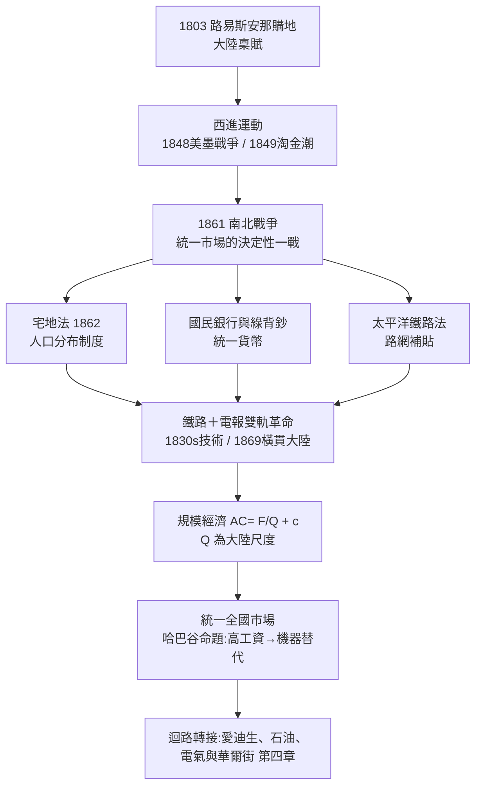

# 第三章　大陸規模：西進、鐵路與統一市場

> 探案的第一件物證，不是發明，也不是資本，而是一張地圖。1803年，美國以一千五百萬美元買下路易斯安那，領土一夜之間倍增。從那一刻起，問題就變成：這片大陸，要靠什麼縫合成一個市場？

## 一、大陸稟賦：路易斯安那購地與「天命」的地理帳本

美國崛起的起點，是一樁史上最划算的「購物」。1803年，傑佛遜政府以約一千五百萬美元從拿破崙手中購入路易斯安那，取得密西西比河流域二百餘萬平方公里的土地（見 [1803-路易斯安那購地](../../世界史/美洲史/1803-路易斯安那購地.md)）。此後半個世紀，美國透過條約、戰爭與兼併，將國土推抵太平洋：1848年美墨戰爭結束取得加州與西南部（見 [1848-美墨戰爭](../../世界史/美洲史/1848-美墨戰爭.md)），1849年加州淘金潮瞬間為西岸注入人口與資本（見 [1849-加州淘金潮](../../世界史/美洲史/1849-加州淘金潮.md)）。

我們用經濟學家的方式替這份稟賦記帳。設大陸規模市場的總需求為：

$$Q_{US} = \int_0^{L} q(x)\,dx \gg Q_{UK}$$

其中 $L$ 是大陸尺度的市場半徑。單一語言、單一關稅同盟（聯邦憲法禁止州際關稅）、單一司法體系，使這個積分不需拆帳。同時代歐洲任何強權的市場規模 $Q$ 都被國界切碎，美國卻在憲法層面預先完成了「市場統一」的法律工程——費城制憲的商業條款，是比鐵路更早的基礎設施。

但稟賦只是潛力。要把大陸變成市場，需要三樣東西：人（西進移民）、網（鐵路與電報）、秩序（統一產權與貨幣）。本章的探案，就是追查這三樣東西如何在一連串事件中接上線。

## 二、西進運動：宅地法、淘金潮與人口的重力

西進不只是浪漫敘事，而是一套精密的制度設計。1862年《宅地法》（見 [1862-宅地法](../../世界史/美洲史/1862-宅地法.md)）規定：凡連續耕作五年的移民，可免費取得160英畝土地。這是史上最大規模的「土地補貼換定居」，國家用產權作為價格，購買了人口在大陸上的均勻分布。

人口分布本身就是市場規模。設聚落 $i$ 的人口為 $n_i$，兩地貿易量近似引力模型：

$$T_{ij} = G\,\frac{n_i\, n_j}{d_{ij}^{\,\beta}}$$

當鐵路把運輸摩擦 $\beta$ 壓低、把有效距離 $d_{ij}$ 壓縮，龐大而分散的人口才真正「算數」。淘金潮提供了一場預演：短短兩年，數十萬人湧向加州，證明只要預期報酬夠高，大陸尺度的勞動力流動在美國是可行的——前提是有路可走、有法可依、有錢可匯。電報與鐵路正好補上後兩項。

## 三、哈巴谷命題：土地豐饒、勞工昂貴，於是機器降臨

經濟史家哈巴谷（H. J. Habakkuk）提出一個著名命題：美國土地豐饒、勞工昂貴，英國勞力充裕、工資低廉，因此兩國選擇了不同的技術風格——美國傾向以機器替代人手，英國傾向以人手精工。

用生產函數表達。設產出 $Y$，資本 $K$（機器），勞動 $L$：

$$Y = A\, K^{\alpha} L^{1-\alpha},\qquad w/r \big|_{US} > w/r \big|_{UK}$$

相對工資 $w$ 高、資本成本 $r$ 低，企業的最適資本密集度 $K/L$ 就被推向更高。這解釋了為什麼「美國製造體系」——可互換零件、專用機床、大量生產——誕生在新英格蘭的兵工廠而非曼徹斯特的紡織廠（見 [1810-機床與可互換零件](../../世界史/工業革命史/1810-機床與可互換零件.md)）。哈巴谷命題不是單一原因論，而是「稟賦→要素價格→技術選擇」的因果鏈：大陸規模市場使機器的固定成本 $F$ 容易攤提，高工資使省力機器的邊際收益大，兩者相乘，技術風格於是定型。

## 四、1861南北戰爭：統一市場的決定性一戰

如果說鐵路是市場的血管，南北戰爭就是决定這套血管按哪張圖紙鋪設的手術。1861年南方脫離聯邦，其經濟邏輯是「棉花出口＋低關稅＋與歐洲直接貿易」；北方的邏輯是「高關稅保護工業＋內部自由貿易＋橫貫大陸擴張」。兩套藍圖不能共存（見 [1861-南北戰爭](../../世界史/美洲史/1861-南北戰爭.md)）。

戰爭的結果確立了三件事：

1. **憲法層次的市場統一不可分裂**——聯邦主權高於州權，州際市場的法律基礎被鎖死；
2. **戰時立法的制度紅利**——戰爭期間通過的《宅地法》、《太平洋鐵路法》、國民銀行體系與綠背鈔（見 [1863-綠背鈔與國民銀行](../../世界史/工業革命史/1863-綠背鈔與國民銀行.md)），都在戰後成為統一市場的骨架；
3. **國家動員能力獲得驗證**——鐵路第一次被大規模用於軍事調度，證明了「網路即國力」。

葛底斯堡之後，美國不再需要跟自己的南方談關稅，也不再需要跟任何歐洲國家談均勢：整個密西西比以東的工業帶與以西的農業帶，被法律與鐵軌綁定成單一經濟體。這是統一市場的決定性一戰——戰場上的勝利轉換成市場邊界的勝利。

## 五、1830年代：鐵路與電報——訊息與貨物的雙軌革命

鐵路與電報幾乎同時成熟，這是關鍵的時間巧合。英國在1830年利物浦—曼徹斯特鐵路通車、莫爾斯在1830年代末發明實用電報；美國幾乎同步吸收兩項技術（見 [1830-鐵路與電報](../../世界史/世界發展史/1830-鐵路與電報.md)、[1844-莫斯電報](../../科技史/科技發展史/1844-莫斯電報.md)）。

電報對市場的意義常被低估。在電報之前，價格訊息的傳播速度等於馬車與帆船；電報之後，紐約與芝加哥的穀物價差在幾分鐘內收斂。設價差 $|p_A - p_B|$ 隨訊息速度 $v$ 衰減：

$$|p_A - p_B|(t) = \Delta_0\, e^{-\kappa v t}$$

$\kappa v$ 一項的躍升，等於把幾百個孤立的地方市場焊接成一個全國市場。鐵路搬貨物，電報搬訊息；雙軌並進，套利者讓價格趨同，規模經濟的需方才被真正連通。1848年芝加哥期貨交易所（見 [1848-芝加哥期貨市場](../../世界史/工業革命史/1848-芝加哥期貨市場.md)）正是這個「價格統一」的制度結晶：期貨合約讓農民與加工商能對沖遠期風險，大陸農業第一次可以按全國（乃至全球）價格安排生產。

## 六、1845鐵路股泡沫：資本化失敗了，金融技術卻存留下來

統一市場需要天文數字的資本，而資本的動員從來不平滑。1840年代英國爆發鐵路股狂熱與泡沫（見 [1845-鐵路股泡沫](../../世界史/金融經濟史/1845-鐵路股泡沫.md)），美國亦深受其週期牽動：資本湧入時鐵路里程暴增，資本撤走時工程停擺、銀行倒閉，1873年的恐慌更直接由鐵路過度擴張引爆（見 [1873-巴吉特最後貸款人](../../世界史/金融經濟史/1873-巴吉特最後貸款人.md)）。

但探案的要點在於：**泡沫是昂貴的預演，而不是純粹的浪費**。每一次狂熱週期，都留下鋪好的鐵軌、培養出的工程師與包銷商、以及更成熟的證券發行技術。鐵路公司為了向遠方投資人籌資，被迫發展出財務報表、審計與分期撥款制度，這些「金融基礎設施」後來成為所有美國產業融資的標準件。市場把資本配置的錯誤成本一次性付清，換來了金融中介的學習曲線。

鐵路同時是第一批「現代大企業」：跨州營運、數千員工、需要標準時間與統一會計（見 [1884-標準時間](../../世界史/世界發展史/1884-標準時間.md)、[1887-鐵路監管與會計](../../世界史/世界發展史/1887-鐵路監管與會計.md)）。管理階層制——這個美國後來輸出全世界發明——最早就是在鐵路的調度室裡排練的。

## 七、1869橫貫大陸鐵路與規模經濟的數學

1869年5月，聯合太平洋與中央太平洋兩條鐵路在猶他州普羅蒙特利峰會合，第一條橫貫大陸鐵路通車（見 [1869-橫貫大陸鐵路](../../世界史/美洲史/1869-橫貫大陸鐵路.md)）。從紐約到舊金山的旅程從數月縮短到約一週。這是「大陸規模」從地圖上的承諾變成財務報表上現金流的一天。

規模經濟的數學極為簡潔。設固定成本 $F$（鋪軌、機廠、管理總部），邊際成本 $c$（燃料、人工），產量 $Q$，則平均成本：

$$AC(Q) = \frac{F}{Q} + c$$

$F$ 越大的產業（鐵路、鋼鐵、石油、電力），平均成本越依賴 $Q$——而 $Q$ 取決於市場半徑。英國的 $Q$ 上限是不列顛加海外帝國的運輸成本折損；美國的 $Q$ 上限是一整個大陸。同樣的 $F/Q$ 曲線，在美國能滑到遠更低的右端。統一市場等於把 $Q$ 的定義域放大了一個數量級，這正是「美國為何崛起」探案中，規模經濟這條線索的全部數學內容。

到1890年，邊疆正式關閉（見 [1890-傷膝河與邊疆關閉](../../世界史/美洲史/1890-傷膝河與邊疆關閉.md)），但此時大陸市場已經建成：農業帶餵養工業帶，工業帶供給農業帶，鐵路與電報讓兩者以全國價格結算。後來的移民潮與1965年移民法案帶來的人口革命（見 [1965-移民法案與美國人口革命](../../世界史/世界發展史/1965-移民法案與美國人口革命.md)）、以及大遷徙形成的勞動力再配置（見 [1916-大遷徙與黑人北遷](../../世界史/美洲史/1916-大遷徙與黑人北遷.md)），持續為這個市場補充人力——大陸規模不是一次性事件，而是一台持續加料的反應爐。

## 小結

大陸規模不是地理的饋贈，而是三層工程的疊加：**法律工程**（憲法商業條款＋宅地法，讓人與產權鋪滿大陸）、**戰爭工程**（南北戰爭鎖死市場邊界）、**網路工程**（鐵路搬貨、電報搬訊息、期貨市場搬價格）。哈巴谷命題說明稟賦如何決定技術風格，$AC(Q)=F/Q+c$ 說明市場規模如何決定成本曲線的終點。1869年鐵軌在猶他州合攏的那一刻，美國擁有了人類歷史上第一個大陸尺度的單一市場——下一章的探案將追查：在這個市場上，發明如何被系統化、產業如何被金融化，迴路如何完成轉接。
