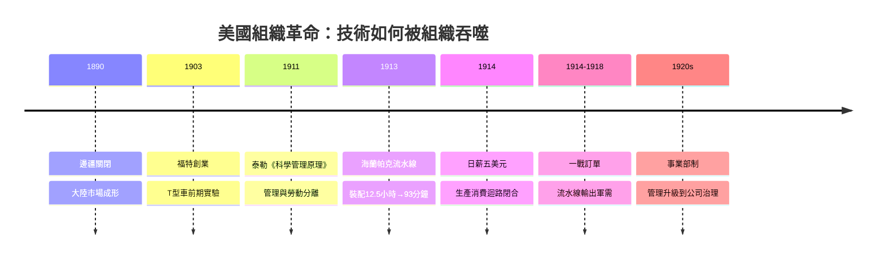

# 第五章 組織革命：泰勒制、福特流水線與大規模生產

## 一、案情提要：沒有新機器的革命

1911年至1913年之間，美國沒有發表任何劃時代的科學論文，也沒有申請到什麼石破天驚的專利。然而短短兩年，人類製造能力的組織方式被徹底改寫：1911年泰勒出版《科學管理原理》（見[../../世界史/工業革命史/1911-泰勒科學管理.md]），1913年福特在海蘭帕克工廠啟動流動裝配線（見[../../科技史/科技發展史/1913-福特流水線.md]）。

本案的謎題是：**為什麼這場「不發明任何新機器的革命」發生在美國，而不是科研更強的德國、工藝更老的英國？** 我們的偵查結論是：這不是天才的偶然，而是要素稟賦與迴路結構的必然。德國用實驗室組織「科學⇒技術」的通道，美國則用管理打通「技術⇒組織」的通道——後者才是大陸規模市場唯一能消化的組織形態。

## 二、現場勘查：土地豐饒、勞工昂貴的美國

要理解泰勒與福特，先要看清他們腳下的土壤。1890年，美國邊疆宣告關閉，一個橫貫大陸的統一市場已然成形：無內部關稅、無行會束縛、語言統一、購買力相對均勻。但這個市場有一個致命的瓶颈——**人手極度稀缺**。經濟史家哈巴谷（H. J. Habakkuk）指出，「土地豐饒、勞工昂貴」的稟賦結構，決定了美國技術的指導原則：**凡能以機器與組織替代人手者，皆有暴利**。英國工程師參觀美國兵工廠時震驚地發現，美國人寧可浪費材料也要節省人力，用可互換零件大量生產步槍（見[../../世界史/工業革命史/1810-機床與可互換零件.md]）。

英國的工匠傳統建立在「便宜的熟練勞工」之上；德國的實驗室模式建立在「便宜的大學畢業生」之上（見[../../世界史/工業革命史/1870-全能銀行與德國追趕.md]）；美國兩者都缺，唯一管夠的是土地、資源與市場規模。1859年賓州石油噴井後，美國又添一份稟賦：廉價的流體能源（見[../../世界史/工業革命史/1859-石油時代開啟.md]）。稟賦決定技術風格，技術風格決定組織形態——破案的第一條線索在此。

## 三、嫌疑人一：泰勒——把「管理」從手藝變成科學

弗雷德里克·泰勒是費城的中產工程師，不是發明家。他的《科學管理原理》賣點只有一個動作：**時間—動作研究**。把工人每個操作分解、計時、剔除多餘動作，再用標準作業程序、工具標準化與差別計件工資重新組裝。表面上是壓榨工人的計件術，深層卻是一場所有權革命：

> **管理與勞動徹底分離。** 工程師在辦公室設計流程，工人在現場執行流程；隱性知識從工人的雙手，轉移到管理者的圖紙與流程卡上。

用金觀濤的迴路語言說，泰勒制開通了「技術⇒組織」的通道：英國工業革命完成了「科學⇒技術」，德國實驗室強化了「科學⇒技術」的產業化，而組織這一環長期靠工匠的經驗傳承——泰勒第一次把「組織」本身變成可研究、可教學、可複製、可疊代的**技術**。它不添購任何新機器，卻讓既有機器的產出成倍增長。1900年前後美國掀起「效率運動」，泰勒的信徒遍布工廠；同年誕生的杜邦與通用汽車的事業部制（見[../../世界史/工業革命史/1920-事業部制與杜邦分析.md]），則把這套科學管理從車間推廣到整個公司的治理層。管理，從此成為美國的「國技」。

## 四、嫌疑人二：福特——三項舊技術的合成

泰勒制仍局限於單一工位的優化；1913年福特把它推廣到整座工廠。值得注意的是，流水線沒有一項核心技術是新的，它是三項舊技術的合成：

1. **可互換零件**——莫茲利以來的機床傳統，美國兵工廠的看家本領；
2. **徹底標準化**——T型車只有一種規格、一種配置（「任何顏色都可以，只要是黑色」），零件誤差壓到千分之一英寸級；
3. **移動裝配**——底盤以傳送帶勻速前進，工人原地作業，泰勒的時間—動作研究被固化在傳送帶的速度裡。

三項舊技術合成的結果：單輛裝配時間從12.5小時壓縮到93分鐘。而合成之所以有利可圖，靠的是規模經濟的數學結構。設固定投入為 $F$（專用機床、廠房、傳送帶），邊際成本為 $c$，產量為 $Q$，則平均成本：

$$
AC(Q)=\frac{F+c\cdot Q}{Q}=\frac{F}{Q}+c
$$

產量 $Q$ 越大，分攤的固定成本越薄。福特據此瘋狂放量：Model T 售價從1908年的850美元一路砍到1920年代的260美元；產量衝上千萬輛，全美每兩輛汽車就有一輛是福特（見[../../世界史/美洲史/1903-福特T型車與大量生產.md]）。

## 五、關鍵證物：日薪五美元的迴路閉合

1914年1月，福特宣布日薪5美元——市價兩倍以上。報紙罵他瘋狂，經濟學家後來給了它一個名字：**效率工資**。高薪降低了驚人的離職率（此前福特工廠年流動率超過300%）、吸引了最強壯耐苦的工人、並以紀律換取流水線上的穩定輸出。但本案最深的一層是：**工資同時是成本與需求**。

$$
\text{標準化} \Rightarrow \text{降價} \Rightarrow \text{放量} \Rightarrow \text{高薪} \Rightarrow \text{工人買得起汽車} \Rightarrow \text{需求擴大} \Rightarrow \text{再放量}
$$

大規模生產必須配大規模消費——只有大陸規模市場能閉合這個迴路。這正是福特迴路無法誕生於德國或英國的結構性原因：他們的國內市場不夠大，撐不起 $F/Q$ 的分母。德國實驗室模式的優勢在單件高附加價值（染料、光學、電機），遇到以管理驅動的成本曲線，便在標準化量產品類上節節敗退。1913年同月誕生的美聯儲，則為這台迴路機器補上了金融穩定器（見[../../世界史/世界發展史/1913-福特流水線與美聯儲.md]）。

## 六、三方對照：英、德、美的迴路組織形態

| 維度 | 英國（工匠） | 德國（實驗室） | 美國（管理） |
|---|---|---|---|
| 知識載體 | 熟練工匠的手 | 大學科學家與博士 | 工程師的流程卡 |
| 「科學⇒技術」 | 慢，靠個別天才 | 強，化學/電氣領先 | 中，重系統整合 |
| 「技術⇒組織」 | 弱，經驗難複製 | 中，侷限實驗室 | **強，可教學可複製** |
| 資本組織 | 商人銀行 | 全能銀行 | 證券市場＋職業經理人 |
| 優勢品類 | 紡織、機械 | 染料、光學、電機 | 汽車、標準件、量產品 |

德國模式把「理論—實驗」迴路做到極致，卻把「實驗—技術—組織」的後半段留給了美國補完。金觀濤的循環結構至此才真正閉環：科學、技術、組織三段通道全部打通者，才能吞下大陸規模的市場。

## 七、時間軸：組織革命的六年

## 小結

本案的真相是：美國接棒英國、壓過德國的關鍵，不是又一项科學突破，而是**迴路組織形態的代際躍升**——英國靠工匠、德國靠實驗室、美國靠管理。泰勒制把組織變成科學，福特流水線把組織變成機器，日薪五美元把組織變成市場。規模經濟 $AC(Q)=F/Q+c$ 之所以能兌現，是因為有一個足夠大的 $Q$ 在等着——那是泰勒與福特之外，憲法、鐵路與移民共同備好的大陸市場。

管理是可以被抄的教科書，但「管理×大陸市場×制度基礎設施」的組合無法整體移植。下一章我們將看到：1914年，歐洲用一場總體戰替這套體系做了最後的加冕——黃金、訂單與秩序設計權，如何一併渡過大西洋。

## 延伸閱讀

- [../../世界史/工業革命史/1911-泰勒科學管理.md]：時間—動作研究的原始檔案
- [../../科技史/科技發展史/1913-福特流水線.md]：流水線的技術細節
- [../../世界史/世界發展史/1913-福特流水線與美聯儲.md]：同年誕生的金融穩定器
- [../../世界史/工業革命史/1810-機床與可互換零件.md]：美國製造體系的源頭
- [../../世界史/工業革命史/1870-全能銀行與德國追趕.md]：德國實驗室模式的興起
