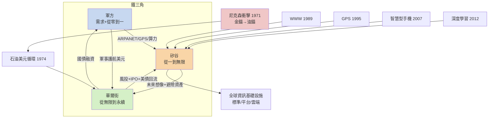

# 第九章 尾聲：美元、資訊與霸權的未來

## 摘要：霸權的第三種形態

本書的主線至此可以收束：美國接替英國，靠的是「大陸規模市場 × 制度基礎設施 × 迴路組織代際躍升 × 國家科學動員 × 秩序供給」的複合收斂。但1971年之後，霸權的形態又變了。英國霸權靠海軍與殖民地，美國早期霸權靠製造業與黃金美元；而1971年8月15日之後，美國霸權進入第三形態——**不再錨定黃金，而是錨定三樣看不見的東西：石油計價、資訊基礎設施、與全球對「未來科技」的想像**。這一章講述1971年至今的第三幕，並以一個偵探該有的誠實，把它寫成一個開放式結尾：這台迴路機器還在自我強化嗎？

## 一、1971：尼克森衝擊——霸權的裸奔與再著裝

布雷頓森林體系（1944）的設計有個內建矛盾（特里芬難題）：世界需要美元作為儲備與清算貨幣，這要求美國持續輸出美元；但美元外流終究動搖「35美元兌一盎司黃金」的承諾。到1971年，越戰開支與對外赤字使外國持有的美元已遠超美國黃金儲備，戴高樂時代的法國乾脆派軍艦運回黃金。8月15日，尼克森宣布美元停止兌換黃金，布雷頓森林的黃金之錨斷裂（見 [../../世界史/世界發展史/1971-尼克森衝擊.md]、[../../世界史/金融經濟史/1971-尼克森震撼.md]）。

表面看這是霸權衰落的證據——連金本位都守不住了。事實恰恰相反。1973年石油危機推高油價，1974年美國與沙烏地阿拉伯達成密約：石油以美元計價，沙國的石油收入循環投資於美國國債（見 [../../世界史/金融經濟史/1974-石油美元循環.md]、[../../世界史/商業貿易史/1973-石油危機與石油美元.md]）。這個「石油美元循環」完成了一次精彩的置換：

$$
\underbrace{\text{美元兌換黃金}}_{\text{1971年前：金屬之錨}} \;\Longrightarrow\; \underbrace{\text{全球買油必須先持有美元}}_{\text{1974年後：需求之錨}}
$$

黃金是死的，會被掏空；石油需求是活的，且不斷增長。全世界每加一次油，就對美元多一分需求，多一筆回流美國國債的資本。美元霸權從「承諾」升級為「必需品」——這是貨幣史上最成功的一次裸奔後再著裝：**丟掉金錨，換上油錨**。

## 二、1990—2012：資訊霸權的四次點火

比油錨更深的，是資訊之錨。第七章的三層迴路機器（國家⇒迴路⇒市場）在冷戰後進入全速期，四次點火構成了今日數位世界的地基：

1. **1989—1991，全球資訊網。** 歐洲核子研究中心的伯納斯-李發明WWW，美國的開放網路標準與NCSA瀏覽器（1993）讓它爆炸性普及（見 [../../科技史/科技發展史/1989-全球資訊網.md]）。注意誕生地：ARPANET的血統＋開放協議的文化，讓網路的「標準制定權」落在美國主導的體系內。
2. **1995，GPS全功能開放。** 軍方系統向民用免費開放精確定位（見 [../../科技史/科技發展史/1995-GPS.md]），物流、航空、金融時戳、手機地圖——全世界把關鍵基礎設施架在美國軍用衛星上。免費，是最高級的收費。
3. **2007，iPhone。** 智慧型手機把網路裝進每個人口袋（見 [../../科技史/科技發展史/2007-智慧型手機.md]），資訊迴路的終端節點從書桌擴展到八十億隻手機。蘋果的生態抽成模式，是「平台即關稅」的商業實現。
4. **2012，深度學習革命。** AlexNet在ImageNet奪冠，GPU算力＋大數據＋演算法合流（見 [../../科技史/科技發展史/2012-深度學習革命.md]），AI成為加速一切迴路的「元工具」。

## 三、鐵三角：矽谷＋華爾街＋軍方

把1971年以後的證據排開，可以看到美國霸權第三形態的骨架——一個相互餵養的鐵三角：

- **軍方**出「從零到一」的需求與資金（ARPANET、GPS、GPU的早期客戶、深度學習的影像辨識研究）；
- **矽谷**出「從一到無限」的擴散（創投、仙童裂變、平台生態），把軍方孵化的一切變成全球消費品；
- **華爾街**出「從無限到永續」的資本循環（納斯達克1971年開市、石油美元回流美債、1990年代後的風投退出機制），把矽谷的未來想像變成今天可花的錢。

三者的耦合強到什麼程度？可以用一個簡化的迴路增益式表達：

$$
G_{\text{霸權}} = \underbrace{D}_{\text{軍方需求}} \times \underbrace{V}_{\text{創投擴散}} \times \underbrace{F}_{\text{金融回收}}
$$

任一環中斷，增益歸零。而1971年後的歷史是：美元霸權給華爾街輸血（全球儲備以美債形式回流），華爾街給矽谷供彈藥（風投＋IPO），矽谷給軍方與美元提供「下一代想像」（網路、手機、AI）——三個變數互相推高，$G$ 持續大於1。冷戰後沒有任何國家同時擁有這三角：蘇聯解體了，日本有製造沒有軍事與開放金融，歐洲有科技沒有整合資本市場。

## 四、迴路還在自我強化嗎？——三個問號

偵探的職業習慣是懷疑完美的理論。1971年後的迴路增益或許仍大於1，但本書框架提醒我們：乘法裡的每個變數都可能塌陷。至少有三個問號掛在牆上。

**問號一：金融化的擠出重演？** 第八章診斷英國的死因是「金融擠出製造」。美國近三十年的路徑頗有相似之處：製造業空心化、產業金融化、矽谷也日益被華爾街的估值邏輯綁架。當鐵三角的一角（華爾街）開始虹吸其他兩角（軍方的造艦預算、矽谷的長期研發），英國病就有了復發的條件。2008年金融海嘯與之後的滞脹式復甦，是這個問號的第一次示警。

**問號二：開放體系的自我封閉。** 美國霸權的合法性建立在「開放」上——開放市場、開放網路、開放科學。但2010年代以來，出口管制、晶片禁令、科技脫鉤、學術審查，都在降低 $O$。諷刺的是，這些手段是對蘇聯式封閉的模仿。迴路的本質是流動；當流動的閘門以國安之名逐個關閉，$S \times O \times M$ 的乘積就在被在位者親手削減——這正是第八章英國走過的路。

**問號三：追趕者與元工具。** 中國以四十年完成史上最大規模的工業化，$S$（十四億人統一市場）、$M$（新型舉國體制）兩項已非小數，欠缺的是 $O$ 與秩序供給；而AI作為元工具，第一次讓「加速迴路」本身成為可競爭的對象。若AI真是印刷術級的技術，第7章的規律預言：勝出者不是算力最多的國家，而是**最先把AI嵌進「科學迴路＋產業迴路＋制度」的國家**。這場嵌合競賽的結果，沒有任何歷史案例可以保證。

## 五、下一個迴路形態在哪裡？

把全書的迴路組織形態排成一張代際表，最後一格是空白的：

| 世代 | 霸權 | 迴路組織形態 | 核心基礎設施 |
|---|---|---|---|
| 一 | 英國 | 工匠＋工廠＋商人銀行 | 運河、鐵路、電報 |
| 二 | 德國（挑戰未遂） | 工業實驗室＋全能銀行 | 大學、化學工業 |
| 三 | 美國（第一期） | 科學管理＋規模經濟 | 流水線、公路、電話 |
| 四 | 美國（第二期） | 國家⇒迴路＋軍民兩用＋創投 | 研究型大學、晶片、網路 |
| 五 | ？ | **AI嵌入的迴路？** | 算力、模型、資料、能源 |

第五格的三種可能，構成本書的開放式結尾：

1. **美國續霸**：鐵三角自我修復，AI成為第五代迴路的 cement，美元與資訊雙錨繼續互相加固——霸權像英國曾經那樣「還能再撐一百年」。
2. **雙極並立**：一個新的 $S \times O \times M$ 候選者補齊開放與秩序供給，世界進入兩套迴路、兩套標準並行的再分流時代——如同1914年前的英德，只是這次配上核武。
3. **迴路本身的躍遷**：AI不只加速既有迴路，而是把「理論—實驗—技術」循環整個自動化——機器提出假說、機器做實驗、機器寫代碼量產。若如此，優勢將不再屬於任何國家的制度，而屬於第一個建成「自動化迴路」的組織——它可能是國家，可能是跨國公司，也可能是任何還沒出現在歷史教科書裡的形態。

## 六、探案的最後一頁

本書以偵探的方式作答：美國崛起不是單因的奇蹟，也不是簡單的資源與運氣，而是「大陸規模市場 × 制度基礎設施 × 迴路組織代際躍升 × 國家科學動員 × 秩序供給」的複合收斂——五個變數同時到位，缺一即不成案。英國傳下的「理論—實驗—技術」迴路，被美國以管理、規模與國家動員升級了兩個世代，再以美元與資訊鎖進全球基礎設施。

但探案的讀者都知道：**沒有結案就沒有下一件案子**。1971年的裸奔者後來再著裝成功；2020年代的在位者正面對三個問號與一個空白世代的考卷。金觀濤的循環結構告訴我們，迴路可以自我強化，也可以自我封閉——英國與蘇聯都曾以為自己的迴路永動。美國是否會成為第一個在位時主動避免封閉的霸權？或者，第五格會被一個我們尚未命名的形態填上？

證據還在累積。偵探合上卷宗，但不熄燈。

---

## 延伸閱讀（探案庫連結）

- [../../世界史/世界發展史/1971-尼克森衝擊.md](../../世界史/世界發展史/1971-尼克森衝擊.md)
- [../../世界史/金融經濟史/1971-尼克森震撼.md](../../世界史/金融經濟史/1971-尼克森震撼.md)
- [../../世界史/金融經濟史/1974-石油美元循環.md](../../世界史/金融經濟史/1974-石油美元循環.md)
- [../../世界史/商業貿易史/1973-石油危機與石油美元.md](../../世界史/商業貿易史/1973-石油危機與石油美元.md)
- [../../科技史/科技發展史/1989-全球資訊網.md](../../科技史/科技發展史/1989-全球資訊網.md)
- [../../科技史/科技發展史/1995-GPS.md](../../科技史/科技發展史/1995-GPS.md)
- [../../科技史/科技發展史/2007-智慧型手機.md](../../科技史/科技發展史/2007-智慧型手機.md)
- [../../科技史/科技發展史/2012-深度學習革命.md](../../科技史/科技發展史/2012-深度學習革命.md)
